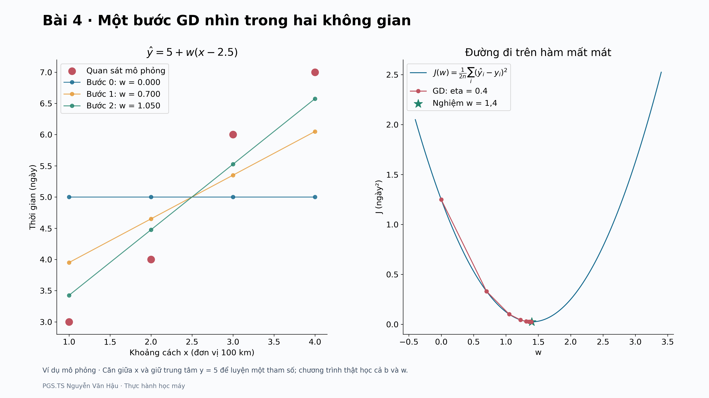

# Khóa học Học máy

**PGS.TS. Nguyễn Văn Hậu**

Khoa Công nghệ Thông tin, Trường Đại học Công nghệ Kỹ thuật Hưng Yên

Khóa học gồm **10 tài liệu đọc trước và 10 bài thực hành Python hoàn chỉnh**. Mỗi bài dẫn từ dữ liệu và ví dụ tính tay đến thuật toán, chương trình chạy được, hình minh họa và kết quả kiểm chứng. Tài liệu đọc trước đã cập nhật **v3**, đối chiếu slide v3 của Bài 1–6 và 8–10; riêng Bài 7 đối chiếu slide v2 hiện có. Python thực hành đã được đồng bộ ví dụ, ký hiệu, hình và hướng dẫn theo cùng phiên bản; các thuật toán đã kiểm chứng được giữ nguyên. Xem [đối chiếu phiên bản](docs/DOI_CHIEU_HOC_LIEU.md) và [nhật ký cập nhật](docs/CAP_NHAT_DOC_TRUOC_V3.md).

Repository: [ml4vn/MachineLearning](https://github.com/ml4vn/MachineLearning).

## Đọc trước rồi thực hành

Mở **Đọc trực tiếp** để học ngay trên GitHub với bảng, hình và công thức. Chọn **PDF** để đọc/in theo bố cục 14 trang mỗi bài, riêng Bài 6 có 15 trang (tổng 141 trang), **Word** để tải bản có thể chỉnh sửa. Khi đã hiểu ví dụ, chuyển sang **Python** của cùng bài. Tài liệu đọc trước không yêu cầu đã biết lập trình.

| Bài | Nội dung | Đọc trực tiếp | PDF | Word | Python |
|---|---|---|---|---|---|
| 01 | Vector và cosine | [Đọc](readings/bai01/README.md) | [PDF](readings/bai01/Bai01_Kien_thuc_nen_tang_va_doc_truoc.pdf) | [Word](readings/bai01/Bai01_Kien_thuc_nen_tang_va_doc_truoc.docx) | [Thực hành](lessons/bai01/README.md) |
| 02 | kNN và chuẩn hóa | [Đọc](readings/bai02/README.md) | [PDF](readings/bai02/Bai02_Kien_thuc_nen_tang_va_doc_truoc.pdf) | [Word](readings/bai02/Bai02_Kien_thuc_nen_tang_va_doc_truoc.docx) | [Thực hành](lessons/bai02/README.md) |
| 03 | Đánh giá phân loại và ngưỡng | [Đọc](readings/bai03/README.md) | [PDF](readings/bai03/Bai03_Kien_thuc_nen_tang_va_doc_truoc.pdf) | [Word](readings/bai03/Bai03_Kien_thuc_nen_tang_va_doc_truoc.docx) | [Thực hành](lessons/bai03/README.md) |
| 04 | Hồi quy tuyến tính và GD | [Đọc](readings/bai04/README.md) | [PDF](readings/bai04/Bai04_Kien_thuc_nen_tang_va_doc_truoc.pdf) | [Word](readings/bai04/Bai04_Kien_thuc_nen_tang_va_doc_truoc.docx) | [Thực hành](lessons/bai04/README.md) |
| 05 | Hồi quy Logistic | [Đọc](readings/bai05/README.md) | [PDF](readings/bai05/Bai05_Kien_thuc_nen_tang_va_doc_truoc.pdf) | [Word](readings/bai05/Bai05_Kien_thuc_nen_tang_va_doc_truoc.docx) | [Thực hành](lessons/bai05/README.md) |
| 06 | Cây quyết định | [Đọc](readings/bai06/README.md) | [PDF](readings/bai06/Bai06_Kien_thuc_nen_tang_va_doc_truoc.pdf) | [Word](readings/bai06/Bai06_Kien_thuc_nen_tang_va_doc_truoc.docx) | [Thực hành](lessons/bai06/README.md) |
| 07 | Chia dữ liệu và đánh giá đáng tin cậy | [Đọc](readings/bai07/README.md) | [PDF](readings/bai07/Bai07_Kien_thuc_nen_tang_va_doc_truoc.pdf) | [Word](readings/bai07/Bai07_Kien_thuc_nen_tang_va_doc_truoc.docx) | [Thực hành](lessons/bai07/README.md) |
| 08 | RFM và K-means | [Đọc](readings/bai08/README.md) | [PDF](readings/bai08/Bai08_Kien_thuc_nen_tang_va_doc_truoc.pdf) | [Word](readings/bai08/Bai08_Kien_thuc_nen_tang_va_doc_truoc.docx) | [Thực hành](lessons/bai08/README.md) |
| 09 | PCA | [Đọc](readings/bai09/README.md) | [PDF](readings/bai09/Bai09_Kien_thuc_nen_tang_va_doc_truoc.pdf) | [Word](readings/bai09/Bai09_Kien_thuc_nen_tang_va_doc_truoc.docx) | [Thực hành](lessons/bai09/README.md) |
| 10 | Mạng neural | [Đọc](readings/bai10/README.md) | [PDF](readings/bai10/Bai10_Kien_thuc_nen_tang_va_doc_truoc.pdf) | [Word](readings/bai10/Bai10_Kien_thuc_nen_tang_va_doc_truoc.docx) | [Thực hành](lessons/bai10/README.md) |

Mỗi tài liệu giữ cùng 10 mục: vấn đề → tiên quyết → dữ liệu → ý tưởng → khái niệm/công thức → quy trình → ví dụ → đọc kết quả → tự kiểm → ghi nhớ. Có phụ lục đáp án giải thích và kiến thức mở rộng. Thời gian đọc dự kiến được ghi trong từng bài; điều chỉnh theo tốc độ của người học. Bản v3 bổ sung các phần kết nối với slide và tổng kết trực quan.



## Bắt đầu trong ba bước

1. Chọn **Code → Download ZIP** trên repository và giải nén, hoặc dùng `git clone https://github.com/ml4vn/MachineLearning.git`. Cài **Python 3.12, 64-bit**, mở terminal tại thư mục có `requirements.txt`.
2. Tạo môi trường riêng và cài các thư viện bên dưới.
3. Chạy ví dụ nhỏ của Bài 01; đọc README của bài trước khi chạy case thật.

**Windows PowerShell** — dùng đường dẫn Python của venv nên không cần đổi execution policy:

```powershell
py -3.12 -m venv .venv
.\.venv\Scripts\python.exe -m pip install -r requirements.txt
.\.venv\Scripts\python.exe -m lessons.bai01.main --mode toy
```

**macOS/Linux**:

```bash
python3.12 -m venv .venv
source .venv/bin/activate
python -m pip install -r requirements.txt
python -m lessons.bai01.main --mode toy
```

Các lệnh `python` bên dưới phải dùng Python của môi trường vừa tạo. Trên Windows có thể thay `python` bằng `.\.venv\Scripts\python.exe`. Không cần GPU, tài khoản dịch vụ ML hay PowerPoint để chạy. Công thức trên hình dùng Matplotlib mathtext; không cần cài LaTeX hệ thống.

## Mười bài tạo thành một lộ trình

| Bài | Kiến thức chính | Case thật | Minh họa và kiểm chứng |
|---|---|---|---|
| [01](lessons/bai01/README.md) | Vector, dot product, cosine | MovieLens: phim gần The Matrix theo thể loại | Vector, chuẩn, đồng hạng và metadata thiếu |
| [02](lessons/bai02/README.md) | kNN, khoảng cách, chuẩn hóa | Tin nhắn SMS ham/spam | Nội dung tin thật → hai đặc trưng → láng giềng |
| [03](lessons/bai03/README.md) | Confusion, precision/recall/F1, ROC/PR, ngưỡng | Cùng dữ liệu SMS | Đổi chi phí sai và chọn ngưỡng trên validation |
| [04](lessons/bai04/README.md) | Hồi quy tuyến tính, MSE, gradient descent | Olist: thời gian giao hàng | Các bước GD, learning rate, đối chiếu OLS |
| [05](lessons/bai05/README.md) | Logistic, sigmoid, BCE, gradient | Olist: nguy cơ giao trễ | Từng đóng góp logit, xác suất và chi phí quyết định |
| [06](lessons/bai06/README.md) | Cây quyết định, Gini, pruning, importance | Cùng bài toán Olist | Từng phép tách và đường đi của một đơn hàng |
| [07](lessons/bai07/README.md) | Chia tập, leakage, pipeline, CV | Olist theo thời gian | Nhãn có lúc nào, nhóm khách lặp, nested/rolling CV |
| [08](lessons/bai08/README.md) | RFM, K-means, silhouette, ổn định | UCI Online Retail | Hóa đơn → khách; từng nửa bước Lloyd; cụm khó diễn giải |
| [09](lessons/bai09/README.md) | PCA, phép chiếu, EVR và tái tạo | Fashion-MNIST | Pixel thật, ảnh cùng nguồn với nhiều số chiều |
| [10](lessons/bai10/README.md) | MLP, ReLU, backprop, Adam, checkpoint | Cùng ảnh Fashion-MNIST | XOR, chín gradient, ba seed, ảnh lỗi và suy luận |

Học theo thứ tự 01→10 để hiểu các mối nối. **Về kỹ thuật, mỗi bài tự chạy được** sau khi cài thư viện và có dữ liệu gốc; không yêu cầu đã sinh output của bài trước. Mã dùng chung nằm trong `mlcourse/` để tránh lặp định nghĩa dữ liệu và quy tắc đánh giá.

## Ba chế độ thống nhất

```bash
python -m lessons.bai04.main --mode toy
python -m mlcourse.data fetch --dataset olist
python -m lessons.bai04.main --mode all
```

- `toy`: ví dụ nhỏ hoặc dữ liệu mô phỏng được ghi rõ, chạy ngoại tuyến.
- `real`: đọc dữ liệu thật, fit lại mô hình/thí nghiệm và xuất kết quả.
- `all`: cả hai, đây là chế độ mặc định của mỗi bài.

Mỗi bài hỗ trợ `--seed`, `--data-dir`, `--output-dir`, `--dpi`; chạy `--help` để thấy tùy chọn riêng. Có thể chạy trực tiếp `python lessons/bai04/main.py`. Hình mặc định **3840×2160**, màu và nhãn rõ, có công thức cần thiết, chú thích và tên giảng viên. Không dùng `bbox_inches='tight'` để giữ đúng kích thước.

Kết quả mặc định nằm trong `outputs/baiNN/`: PNG, CSV UTF-8 có BOM để mở với Excel, JSON chứa số liệu/cấu hình/phiên bản; các bài phù hợp còn có tham số mô hình dạng số. Chạy lại cùng thư mục sẽ cập nhật các tệp kết quả đó. Khi đổi cấu hình, nên dùng một `--output-dir` khác để giữ lần chạy trước.

## Tải dữ liệu một lần

| Tùy chọn dataset | Bài dùng | Tệp được tải |
|---|---|---|
| `movielens` | 01 | movielens.zip |
| `sms` | 02–03 | sms.zip |
| `olist` | 04–07 | olist.zip |
| `retail` | 08 | online_retail.zip |
| `fashion` | 09–10 | Bốn tệp IDX gzip |

```bash
python -m mlcourse.data fetch --dataset all
```

Tệp được kiểm **SHA256** theo [registry](mlcourse/datasets.json). Không tải dữ liệu khi import module hoặc chạy toy. Có sẵn đúng tệp snapshot:

```bash
python -m mlcourse.data fetch --dataset all --source-dir "THU_MUC_CHUA_TEP_GOC"
```

Nếu endpoint yêu cầu đăng nhập, trả HTML hoặc thay archive, chương trình báo lỗi thay vì dùng dữ liệu khác âm thầm. Đọc [nguồn và điều kiện sử dụng](docs/DU_LIEU_VA_NGUON.md) để tải thủ công đúng tệp, đặt tên theo registry rồi nhập bằng `--source-dir`. Nếu checksum vẫn khác, cần đối chiếu bản dữ liệu trước khi cập nhật registry. Không xóa kiểm tra checksum để làm kết quả “khớp”.

## Chạy lần lượt toàn bộ và tự kiểm tra

```bash
python run_tests.py
python run_all.py --mode toy
python run_all.py --mode all
```

`run_all.py` chạy tuần tự; chỉ sang bài kế tiếp khi bài trước trả mã thành công, dừng rõ ràng khi lỗi. Có thể chọn `--start 6 --end 10`. Mỗi bài có `run.log`; `outputs/run_summary.json` ghi thời gian và mã thoát. Chạy toàn bộ case thật cần tải đủ dữ liệu trước, vài GB RAM và thời gian cho XLSX, PCA, huấn luyện mạng; thời gian tùy máy. Bài 10 mặc định thực sự chạy 150 epoch cộng dồn qua ba seed.

Khi dùng `run_all.py --seed N`, chương trình truyền N cho cả split Fashion của Bài 09 và `--split-seed` của Bài 10 để giữ cùng tập ảnh. Sau lượt `--mode all` mặc định, có thể chạy `python validate_outputs.py` để kiểm 107 điều kiện về số liệu tham chiếu và 71 ảnh 3840×2160. Bộ kiểm này dành cho cấu hình mặc định; không dùng để bác bỏ các thí nghiệm đã chủ động đổi seed hoặc tham số.

`run_tests.py` chạy **60 kiểm thử** toán học, đối chiếu thư viện và các trường hợp biên, không cần tải dataset. [Workflow CI](.github/workflows/tests.yml) cài thư viện rồi chạy các kiểm thử và toàn bộ ví dụ nhỏ. CI không tự tải bộ dữ liệu thật. Kết quả chạy thật và giới hạn tái lập được lưu trong [báo cáo kiểm tra](docs/KIEM_TRA_TONG_THE.md).

## Cách dùng tài liệu của mỗi bài

Mở `lessons/baiNN/README.md`, lần lượt đọc mục tiêu, dữ liệu, phép tính, hướng dẫn chạy, hình/kết quả và câu hỏi tự kiểm tra. Mỗi bài có:

```text
PLAN.md          Kế hoạch, phạm vi và phép kiểm
algorithms.py    Phép tính/thuật toán minh bạch
main.py          Chạy bài, tạo dữ liệu trung gian và kết quả
tests.py         Kiểm thử cần thiết
README.md        Hướng dẫn sinh viên, bài tập và đáp án giải thích
VALIDATION.md    Biên bản chạy và đối chiếu của bài
```

Bài 10 còn có `visuals.py` và `predict.py`. Xem [10 hình chọn lọc](docs/HINH_MINH_HOA.md) trước khi chạy; toàn bộ hình được sinh lại bằng mã, không phải ảnh được chụp thủ công từ slide.

## Nguyên tắc khoa học được giữ trong mã

Các phép biến đổi học tham số được fit trên train trong bài toán có đánh giá ngoài mẫu; ngưỡng/checkpoint chọn trên validation. Olist dùng mốc thời gian và thời điểm có nhãn; giả định về khả năng biết đặc trưng được ghi rõ. RFM là phân tích mô tả ảnh chụp lịch sử. Các thí nghiệm mô phỏng và dữ liệu thật có tên riêng. Không diễn giải tương quan thành nhân quả, importance thành nguyên nhân, EVR thành accuracy hoặc softmax thành bảo đảm đúng.

Số liệu trên các tập test công khai đã có trong bộ bài giảng. Việc chạy lại là tái lập và học phương pháp, không làm chúng trở thành những test mới chưa từng được xem. Khi làm dự án mới, cần thiết kế quy trình đánh giá phù hợp với thời gian, nhóm đối tượng và mục đích sử dụng.

## Đưa lên GitHub

Repository gồm mã, 10 tài liệu đọc trước, hình, bảng tham chiếu, hướng dẫn và cấu hình kiểm tra. `.gitignore` loại các archive dữ liệu tải mới, output của chương trình và venv. [Hướng dẫn GitHub](docs/GITHUB.md) dành cho giảng viên đăng bộ này lên `ml4vn/MachineLearning`; sinh viên dùng mục cài đặt và bảng bài học ở trên.

[Ghi chú đối chiếu học liệu](docs/DOI_CHIEU_HOC_LIEU.md) giải thích các mức độ đơn giản hóa và khác biệt số học nhỏ giữa tài liệu với mã. PDF và Word được giữ nguyên theo bản đã kiểm tra, đối chiếu SHA256 trong [manifest tài liệu](docs/reading_manifest.json). Chưa tự áp một giấy phép mở cho toàn bộ giáo trình; điều kiện của dữ liệu bên thứ ba được ghi riêng và không thay đổi theo giấy phép mã nguồn sau này.

## Lộ trình thực hành cập nhật

Mỗi bài có hướng dẫn **dự đoán → chạy → đối chiếu → giải thích**, bảng nối với slide và hình `summary_v3.png`. Xem [phạm vi cập nhật Python v3](docs/PYTHON_V3.md) và [kết quả kiểm tra](docs/KIEM_TRA_PYTHON_V3.md).
