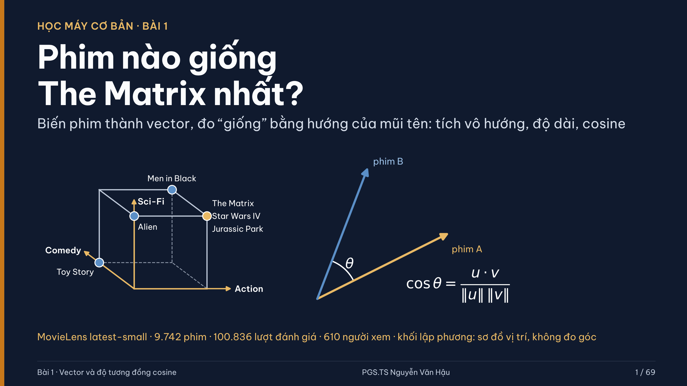

# Học máy cơ bản

Kho học liệu dành cho sinh viên, gồm **10 bài học**, tài liệu đọc trước, notebook thực hành và dự án khởi đầu.

> Kho này không chứa PowerPoint, quiz, đáp án, notebook lời giải, rubric hay tài liệu dành riêng cho giảng viên.

## Bắt đầu nhanh

1. Cài Python 3.11 trở lên.
2. Tạo môi trường ảo và cài thư viện:

   ```bash
   python -m venv .venv
   # Windows
   .venv\Scripts\activate
   # macOS/Linux
   source .venv/bin/activate
   pip install -r requirements.txt
   ```

3. Chọn một bài trong bảng dưới đây, đọc `DOC_TRUOC.md`, rồi mở `THUC_HANH.ipynb` bằng JupyterLab.

   ```bash
   jupyter lab
   ```

## Lộ trình 10 bài

| Bài | Chủ đề | Học liệu |
|---:|---|---|
| 01 | Vector và độ tương đồng cosine | [Mở bài 01](bai-01/README.md) |
| 02 | kNN và chuẩn hóa đặc trưng | [Mở bài 02](bai-02/README.md) |
| 03 | Đánh giá mô hình phân loại | [Mở bài 03](bai-03/README.md) |
| 04 | Hồi quy tuyến tính và Gradient Descent | [Mở bài 04](bai-04/README.md) |
| 05 | Hồi quy logistic | [Mở bài 05](bai-05/README.md) |
| 06 | Cây quyết định | [Mở bài 06](bai-06/README.md) |
| 07 | Đánh giá mô hình đáng tin cậy | [Mở bài 07](bai-07/README.md) |
| 08 | K-means và phân nhóm khách hàng RFM | [Mở bài 08](bai-08/README.md) |
| 09 | PCA và ảnh thời trang | [Mở bài 09](bai-09/README.md) |
| 10 | Mạng nơ-ron và ảnh thời trang | [Mở bài 10](bai-10/README.md) |

## Cấu trúc mỗi bài

```text
bai-XX/
├── README.md              # Điểm bắt đầu và hướng dẫn
├── DOC_TRUOC.md           # Nội dung cần đọc trước buổi học
├── assets/                # Hình minh họa cho tài liệu đọc trước
├── THUC_HANH.ipynb        # Bài thực hành trên lớp
├── DU_AN.md               # Đề bài dự án độc lập
├── DU_AN_KHOI_DAU.ipynb   # Notebook khởi đầu, không có lời giải
└── data/                   # Dữ liệu cần thiết cho notebook
```

## Cách học đề xuất

1. Đọc tài liệu trước và tự làm các câu hỏi/hoạt động trong tài liệu.
2. Chạy notebook thực hành từ đầu đến cuối, hoàn thành các ô yêu cầu.
3. Làm dự án từ notebook khởi đầu; không thay đổi tập kiểm tra cuối trước khi chốt mô hình.
4. Ghi lại kết quả, giới hạn của mô hình và điều bạn rút ra.

Giảng viên phụ trách: **PGS.TS Nguyễn Văn Hậu**.
