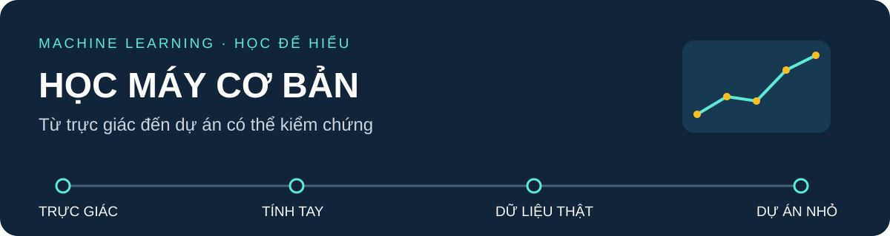

# Học máy cơ bản

**PGS.TS. Nguyễn Văn Hậu** · Khoa Công nghệ Thông tin, Trường Đại học Công nghệ Kỹ thuật Hưng Yên

**10 bài học · 150 phút/bài · 5 dự án nhỏ · Dữ liệu thật**

Từ một phép tính tay đến một mô hình có thể kiểm chứng. Dành cho sinh viên mới học ML, có nền toán trung bình: quan sát trước, hiểu công thức, tự tính, rồi mới dùng thư viện.

[Bắt đầu trong 10 phút](docs/START_HERE.md) · [Chọn bài học](#lộ-trình-10-bài) · [Làm dự án](projects/README.md) · [Nguồn dữ liệu](course/DATA_SOURCES.md)

## Bạn sẽ làm được gì?

| Biểu diễn và tìm kiếm | Dự đoán và kiểm chứng | Khám phá và học biểu diễn |
|---|---|---|
| Gợi ý phim theo thể loại; nhận diện SMS spam | Dự đoán giao hàng; chọn ngưỡng và kiểm tra rò rỉ | Phân nhóm khách hàng; nén và phân loại ảnh |
| Vector → cosine → kNN | Loss → học tham số → đánh giá | K-means → PCA → mạng neural |

## Lộ trình 10 bài

| Bài | Câu chuyện dẫn dắt | Kiến thức chính | Học liệu |
|---|---|---|---|
| 01 | Tìm bộ phim có “gu” tương tự | Vector, chuẩn, tích vô hướng, cosine | [Đọc](course/bai01/READING.md) · [Thực hành](course/bai01/README.md) |
| 02 | Tin nhắn này giống spam nào? | kNN, khoảng cách, chuẩn hóa | [Đọc](course/bai02/READING.md) · [Thực hành](course/bai02/README.md) |
| 03 | Chặn nhầm hay bỏ sót? | Precision, recall, mất cân bằng, threshold | [Đọc](course/bai03/READING.md) · [Thực hành](course/bai03/README.md) |
| 04 | Đơn hàng mất bao nhiêu ngày? | Hồi quy tuyến tính, loss, gradient descent | [Đọc](course/bai04/READING.md) · [Thực hành](course/bai04/README.md) |
| 05 | Đơn hàng có nguy cơ trễ? | Logistic, BCE, xác suất và quyết định | [Đọc](course/bai05/READING.md) · [Thực hành](course/bai05/README.md) |
| 06 | Giải thích một dự đoán | Cây quyết định, Gini, pruning | [Đọc](course/bai06/READING.md) · [Thực hành](course/bai06/README.md) |
| 07 | Điểm số có đáng tin? | Chia dữ liệu, leakage, overfitting | [Đọc](readings/bai07/README.md) · [Thực hành](examples/bai07/README.md) |
| 08 | Khách hàng có những nhóm nào? | RFM, K-means, diễn giải cụm | [Đọc](course/bai08/READING.md) · [Thực hành](course/bai08/README.md) |
| 09 | Giữ ít số hơn, còn thấy chiếc áo? | PCA, phương sai, chiếu và tái dựng | [Đọc](course/bai09/READING.md) · [Thực hành](course/bai09/README.md) |
| 10 | Máy học cách nhận ra trang phục | MLP, backpropagation, học biểu diễn | [Đọc](course/bai10/READING.md) · [Thực hành](course/bai10/README.md) |

## Từ bài tập đến sản phẩm nhỏ

Mỗi notebook dự án đan xen **mã mẫu → TODO → gợi ý → kiểm thử → diễn giải**. Bạn hoàn thiện phần cốt lõi, chạy trên dữ liệu thật và đóng gói kết quả.

| Dự án | Sau bài | Sản phẩm |
|---|---|---|
| [Gợi ý phim](projects/01_movie_recommender/README.md) | 01 | Hàm tìm phim tương tự, bảng top-k và giải thích |
| [Bộ lọc SMS](projects/02_sms_filter/README.md) | 03 | Bộ lọc, ngưỡng theo chi phí, báo cáo lỗi |
| [Dự báo giao hàng](projects/03_delivery_estimator/README.md) | 07 | Pipeline hồi quy, baseline, đánh giá theo thời gian |
| [Chân dung khách hàng](projects/04_customer_segments/README.md) | 08 | Bảng RFM, phân cụm, hồ sơ nhóm |
| [Phòng thử ảnh thời trang](projects/05_fashion_lab/README.md) | 10 | PCA + MLP, ảnh tái dựng và model card |

## Một môi trường, ba cách học

```bash
python -m pip install -r requirements.txt
python -m jupyterlab
```

Cần Python 3.12 và môi trường ảo; xem [hướng dẫn cài đặt](docs/START_HERE.md). Mở `course/` để theo bài, `projects/` để tự xây sản phẩm, hoặc chạy ví dụ nhỏ trong `examples/`. Dữ liệu đã kèm; không cần tài khoản Kaggle hay GPU. Cài thư viện cần Internet.

- [Hướng dẫn chạy bài học](course/README.md).
- [Lộ trình dự án, cách nộp và rubric](projects/README.md).
- Ví dụ thuật toán: `python -m examples.bai01.main --mode toy`.
- [Kiểm tra chất lượng học liệu](docs/MAINTAINING.md).
- [Kết quả kiểm chứng](docs/QUALITY_CHECKS.md) · [Thư viện hình minh họa](docs/HINH_MINH_HOA.md).

Kho công khai **không phân phối file PowerPoint**. Dữ liệu có điều kiện sử dụng riêng; xem [nguồn và giấy phép](course/DATA_SOURCES.md). Test công khai phục vụ tái lập học liệu, không chứng minh hiệu quả triển khai thực tế.
