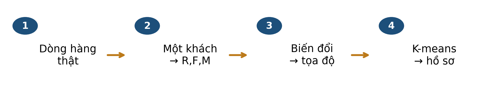
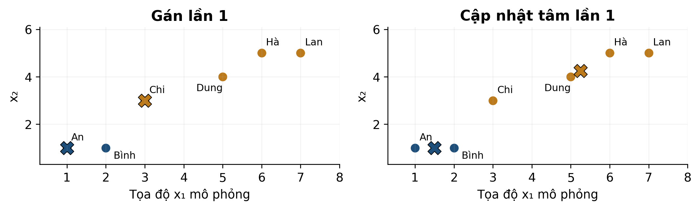
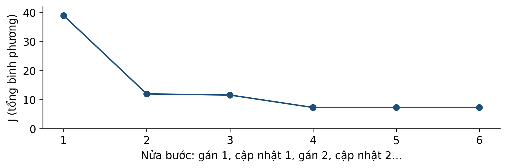
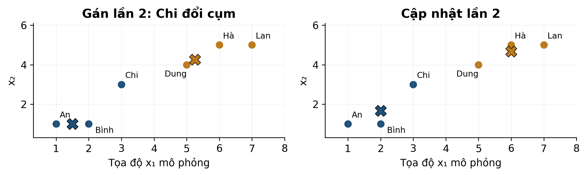
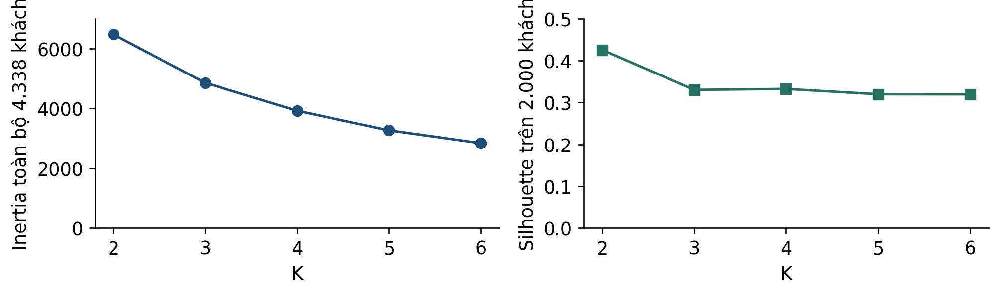
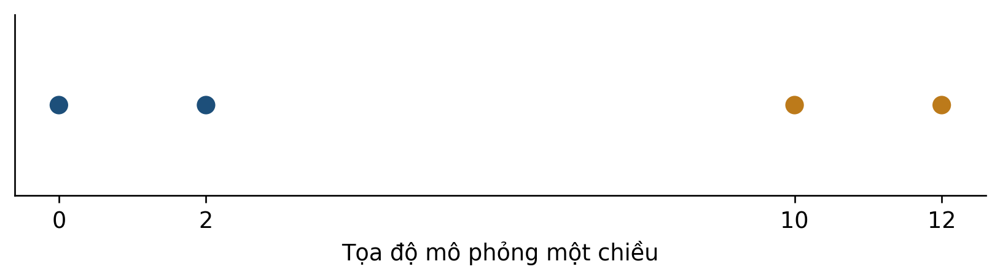

# Bài 8 — RFM và K-means để khám phá nhóm khách hàng
Kiến thức nền tảng và tài liệu đọc trước — bản cập nhật 

## 1 Bài học này giải quyết vấn đề gì

Một khách mua nhiều lần với số tiền nhỏ; một khách chỉ mua một lần nhưng rất nhiều tiền. Có nên chăm sóc hai khách giống nhau? Bài 8 dùng **RFM và K-means** để tìm nhóm theo một cách đo đã chọn, sau đó đọc hồ sơ và đề xuất giả thuyết hành động.

### Sau khi đọc bạn có thể

- Tạo R,F,M từ một bảng giao dịch thật, đúng mốc chốt.
- Tính khoảng cách, gán cụm và cập nhật tâm trên sáu điểm.
- Giải thích vai trò của biến đổi thang, khởi tạo và K.
- Đọc inertia, silhouette, quy mô và hồ sơ cụm cùng nhau.

Dự kiến 40–50 phút; ôn vector/khoảng cách và chuẩn hóa. Không cần lập trình. Bài này dùng Online Retail của một cửa hàng khác Olist. Không có nhãn “phân khúc đúng” để chấm accuracy trong case.

## Lộ trình đọc và đối chiếu với bài giảng

Bản tài liệu cập nhật  • Đối chiếu Bài 8, slide . Nội dung và các mốc tổng kết dưới đây theo bản slide .

### Đọc để chuẩn bị điều gì

- Một khách hàng thành một điểm RFM
- Biến đổi log và chuẩn hóa
- Lặp gán cụm rồi cập nhật tâm
- Silhouette và ý nghĩa kinh doanh

Dành khoảng 40–50 phút cho phần chính, ví dụ và tự kiểm. Phụ lục A dùng để kiểm tra lập luận sau khi tự làm; phụ lục B là phần mở rộng, có thể đọc sau giờ học.

| Slide | Mốc ôn tập trong bài giảng |
| --- | --- |
| 12 | Một khách hàng, ba góc nhìn |
| 20 | Biểu diễn quyết định cách đo gần |
| 35 | K-means: khởi tạo và hai bước lặp |
| 55 | Đánh giá và lựa chọn số cụm |
| 63 | Bài 8 · Phân nhóm khách hàng có căn cứ |

Tài liệu đọc trước tạo nền và đặt câu hỏi; các slide trên giúp nối lại kiến thức trong giờ học. Không cần học thuộc mọi kết quả số trước khi đến lớp.

## 2 Bạn cần biết gì trước khi bắt đầu

| Nền tảng | Cách làm |
| --- | --- |
| Vector | Một khách → ba tọa độ R,F,M; mã khách là định danh, không là đại lượng khoảng cách. |
| Khoảng cách Euclid | Lấy hiệu từng tọa độ, bình phương, cộng, rồi căn. |
| Bình phương khoảng cách | Bỏ bước căn khi chỉ cần tìm tâm gần nhất; thứ tự giữ nguyên. |
| Trung bình vector | Lấy trung bình riêng từng tọa độ. |
| log1p(u) | ln(1+u), giúp nén chênh lệch lớn theo lựa chọn biểu diễn. |
| Chuẩn hóa | Trừ trung bình và chia độ lệch chuẩn trên tập fit phù hợp. |

$$
\|(3,3)-(1,1)\|^2=(3-1)^2+(3-1)^2=8
$$

Bình phương khoảng cách là 8, khoảng cách là √8. Không cộng các giá trị tọa độ thay cho hiệu tọa độ.

Nếu một trục dùng số tiền hàng nghìn còn một trục dùng số lần nhỏ, trục tiền có thể chi phối khoảng cách. Biến đổi biểu diễn làm thay đổi ý nghĩa “gần”, không chỉ thay đổi vẻ ngoài biểu đồ.

log1p không bảo đảm phân phối chuẩn. Chuẩn hóa phương sai bằng 1 không chứng minh các đặc trưng quan trọng ngang nhau về nghiệp vụ.

**K1:** trung bình hai điểm (1,1),(2,1) là gì? **K2:** một hóa đơn gồm ba dòng hàng có làm F tăng thêm ba không?

## 3 Dữ liệu của bài học trông như thế nào

Online Retail [1,2] gồm giao dịch của một nhà bán lẻ tại Anh giai đoạn 12/2010–12/2011. Tệp có 541.909 dòng; 135.080 dòng thiếu CustomerID. Giữ mã khách có sẵn, Quantity>0, UnitPrice>0, mã hóa đơn không bắt đầu C: còn 397.884 dòng và 4.338 khách.

### Bốn dòng mua dương của khách thật 12755

| Hóa đơn | Ngày | Mã hàng | SL | Giá GBP | Tiền GBP |
| --- | --- | --- | --- | --- | --- |
| 537899 | 2010-12-09 | 22328 | 1488 | 2.55 | 3794.40 |
| 545645 | 2011-03-04 | 22652 | 1 | 1.65 | 1.65 |
| 545645 | 2011-03-04 | 22654 | 1 | 5.95 | 5.95 |
| 545645 | 2011-03-04 | 22968 | 1 | 9.95 | 9.95 |

| RFM tại 10/12/2011 | Tính từ bảng |
| --- | --- |
| R = 281 ngày | 10/12/2011 − ngày mua cuối 04/03/2011, theo ngày lịch. |
| F = 2 hóa đơn | Hai mã phân biệt: 537899 và 545645, dù có bốn dòng. |
| M = 3.811,95 GBP | 3794,40 + 1,65 + 5,95 + 9,95. |

Bảng chỉ là lịch sử giữ lại trong cửa sổ dữ liệu. M không phải lợi nhuận, doanh thu ròng sau trả hàng hay giá trị trọn đời. R thấp nghĩa là mua gần đây, chưa chứng minh khách mới.

Giữ dòng trùng nguyên vẹn theo quy trình slide và công bố độ nhạy; chưa đủ bằng chứng để coi mọi dòng trùng là lỗi nghiệp vụ. Các điều kiện lọc chồng lấn không được cộng số loại một cách tùy ý.

## 4 Ý tưởng chính của phương pháp là gì

K-means nhận số cụm K và tìm các tâm để điểm trong cùng cụm gần tâm của mình theo bình phương khoảng cách. Thuật toán Lloyd luân phiên **gán điểm** rồi **cập nhật tâm** [3].

| Nửa bước | Giữ nguyên | Thay đổi |
| --- | --- | --- |
| Gán cụm | Các tâm hiện tại. | Mỗi điểm chọn tâm gần nhất. |
| Cập nhật tâm | Thành viên từng cụm. | Tâm thành trung bình các điểm của cụm. |

Các tên An, Bình, Chi, Dung, Hà, Lan là nhãn của sáu điểm thiết kế, không phải khách thật. Hai trục là tọa độ mô phỏng không có đơn vị RFM. Dùng bảng mục 7 để kiểm màu bằng phép tính.

Sau cập nhật lần 1, tâm 0=(1,5;1), tâm 1=(5,25;4,25). Trước khi tính, dự đoán Chi=(3,3) có đổi cụm không?

## 5 Những khái niệm và công thức nào cần nắm

$$
R=t_0-date(t_{cuoi}),\quad F=|\{InvoiceNo\}|,\quad M=\sum_{dong\ mua}Quantity\times UnitPrice
$$

R dùng số ngày lịch đến mốc t₀; tập InvoiceNo gồm mã hóa đơn phân biệt của khách sau lọc. M cộng các dòng mua đủ điều kiện, giữ độ chính xác gốc rồi mới làm tròn trình bày.

$$
u_{ij}=\ln(1+r_{ij}),\qquad x_{ij}=\frac{u_{ij}-\bar u_j}{s_j}
$$

Ở case thật, r=(R,F,M); log1p rồi StandardScaler trên 4.338 khách cho phân tích khám phá tại mốc chốt. ūj,sj là trung bình/độ lệch chuẩn cột log, sⱼ>0.

$$
J=\sum_{i=1}^{n}\|x_i-\mu_{c_i}\|^2
$$

Trong công thức K-means, μk ký hiệu tâm cụm k; ūj ở công thức trước là trung bình của cột log. cᵢ là mã cụm của điểm i. J còn gọi inertia, là tổng bình phương khoảng cách tới tâm được gán.

$$
c_i=\arg\min_k\|x_i-\mu_k\|^2,\qquad\mu_k=\frac{1}{|C_k|}\sum_{i\in C_k}x_i
$$

Cₖ là tập chỉ số điểm thuộc cụm k. Gán khi giữ tâm; lấy trung bình khi giữ cụm không rỗng. Nếu hòa khoảng cách cần quy tắc; ví dụ này chọn mã nhỏ hơn.

Không so trực tiếp J trên RFM thô với J trên log/chuẩn hóa: đơn vị và hình học đã đổi. Trong mục 7, thay x bằng tọa độ mô phỏng đã cho.

## 6 Phương pháp được thực hiện như thế nào

### Một lần chạy Lloyd

- Chọn K và khởi tạo K tâm. Trong ví dụ: K=2, tâm tại An và Chi.
- Gán mọi điểm về tâm gần nhất bằng bình phương khoảng cách.
- Tính trung bình từng cụm không rỗng để cập nhật tâm.
- Gán lại, cập nhật lại; kiểm điều kiện dừng và giới hạn số vòng.

Với tâm cố định, gán gần nhất không tăng J. Với nhóm cố định không rỗng, trung bình tối thiểu hóa tổng bình phương. J có thể bằng nhau, không cần giảm nghiêm ngặt. Dãy J không tăng là phép kiểm hữu ích nhưng chưa chứng minh mọi phép tính đều đúng.

### Những trường hợp cần xử lý rõ

- Cụm rỗng: không chia cho số mẫu 0; phải có quy tắc khởi tạo lại hoặc xử lý khác.
- Giới hạn max_iter: dừng vì hết vòng không chứng minh đã hội tụ.
- Nhiều khởi tạo: giữ nghiệm J thấp nhất trong các lần đã thử, chưa bảo đảm tối ưu toàn cục.
- Mã cụm: chỉ là tên; đổi 0↔1 không thay các nhóm điểm.

Hội tụ nghĩa gì trong ví dụ? Gán thêm một lần không đổi nhóm và cập nhật không đổi tâm; không có nghĩa đã kiểm mọi phân hoạch có thể.

## 7 Cùng làm một ví dụ từ đầu đến cuối

**Bảng mô phỏng đầy đủ, lần gán đầu:** tâm 0=(1,1), tâm 1=(3,3). Chọn bình phương khoảng cách nhỏ hơn.

| Điểm | (x₁,x₂) | d² tâm 0 | d² tâm 1 | Cụm |
| --- | --- | --- | --- | --- |
| An | (1, 1) | 0 | 8 | 0 |
| Bình | (2, 1) | 1 | 5 | 0 |
| Chi | (3, 3) | 8 | 0 | 1 |
| Dung | (5, 4) | 25 | 5 | 1 |
| Hà | (6, 5) | 41 | 13 | 1 |
| Lan | (7, 5) | 52 | 20 | 1 |

Cụm 0 có An,Bình → tâm (1,5;1). Cụm 1 có Chi,Dung,Hà,Lan → tâm (5,25;4,25). Ví dụ tọa độ x₁ của tâm 1 là (3+5+6+7)/4=5,25.

$$
d^2(Chi,\mu_0)=6.25,\quad d^2(Chi,\mu_1)=6.625
$$

Ở lần gán 2, Chi chuyển từ cụm 1 sang 0 vì 6,25<6,625. Chênh 0,375 là bình phương khoảng cách, không phải xác suất thuộc cụm.

Cộng bình phương khoảng cách đến tâm mới được J=22/3≈7,3333. Gán thêm một vòng giữ nhóm và tâm. Số điểm trong ví dụ vẫn là sáu, không thay đổi theo vòng lặp.

## Silhouette giải thích một điểm có hợp cụm không

Inertia tối ưu không tăng khi tăng K, nên không thể chỉ chọn K có inertia nhỏ nhất. Silhouette so sánh độ gần trong cụm với khoảng cách sang cụm khác.

$$
s(i)=\frac{b(i)-a(i)}{\max\{a(i),b(i)\}}
$$

a(i) là khoảng cách trung bình từ i tới các điểm khác trong cùng cụm. b(i) là nhỏ nhất trong các khoảng cách trung bình từ i tới từng cụm khác. Đây không phải khoảng cách tới tâm cụm.

| Hai cụm trên trục số | Với điểm i = 2 |
| --- | --- |
| Cụm A = {0, 2} | a(2) = \|2 − 0\| = 2 |
| Cụm B = {10, 12} | b(2) = (8 + 10)/2 = 9 |
| Kết quả | s(2) = (9 − 2)/9 = 7/9 ≈ 0,778 |

- Gần 1: điểm gần cụm của mình hơn các cụm khác.
- Gần 0: nằm gần ranh giới theo thước đo này.
- Âm: có thể được gán chưa phù hợp.

Silhouette cần 2 ≤ K ≤ n − 1. Cụm chỉ có một điểm được quy ước điểm silhouette bằng 0 trong cách tính dùng ở bài. Điểm số tốt chưa chứng minh phân khúc có ích cho kinh doanh.

Tự kiểm: vì sao K = 4 vẫn được phân tích trong case khi K = 2 có silhouette cao hơn? Vì K = 4 cho mô tả phân khúc chi tiết để cân nhắc hành động; cần trình bày rõ đánh đổi.

## 8 Đọc kết quả và tránh hiểu nhầm

Trở lại 4.338 khách thật: log1p rồi chuẩn hóa RFM, K-means n_init=20, seed=42. Quét K=2…6 trên cùng biểu diễn; silhouette dùng cùng mẫu 2.000 khách, không phải toàn bộ tập.

| Cụm K4 | Số khách | R trung vị | F trung vị | M trung vị GBP |
| --- | --- | --- | --- | --- |
| 0 | 877 | 19 | 2 | 450.84 |
| 1 | 1579 | 183 | 1 | 300.42 |
| 2 | 720 | 9 | 10 | 3726.08 |
| 3 | 1162 | 54 | 4 | 1353.74 |

Ví dụ cụm 2 có R trung vị 9 ngày, F=10, M≈3.726,08 GBP: nhóm mua gần đây, nhiều hóa đơn và số tiền cao trong mẫu. Đây là trung vị từng cột của nhóm, không phải tâm biến đổi ngược hay một khách cụ thể.

K4 giúp thảo luận bốn hồ sơ; chưa chứng minh có đúng bốn phân khúc tự nhiên hoặc chiến dịch sẽ hiệu quả. So K còn cần quy mô cụm, độ ổn định và khả năng sử dụng. Trên thang RFM thô, K2 từng tách 4.330 và 8 khách với silhouette mẫu≈0,988: phải đọc cả cấu trúc nhóm và mục tiêu.

## 9 Tự kiểm tra trước khi đến lớp

**Câu 1.** Khách 12755 có bốn dòng và hai mã InvoiceNo phân biệt. F là gì?
A. 4 vì mỗi dòng là một lần mua.
B. 2 theo số hóa đơn phân biệt.
C. 1 vì chỉ có một CustomerID.

**Câu 2.** Với Chi=(3,3) và tâm (1,5;1), tính bình phương khoảng cách. Không lấy căn ở bước này.

**Câu 3.** Nhóm An=(1,1), Bình=(2,1), Chi=(3,3) có tâm trung bình nào?
A. (2;5/3).
B. (6;5).
C. (2;2).

**Câu 4.** Vì sao J tối ưu không tăng khi được phép thêm tâm? Nếu K bằng số điểm và mỗi điểm có một tâm thì J bằng bao nhiêu?

**Câu 5.** Một điểm có silhouette âm. Kết luận nào phù hợp?
A. Chắc chắn nhãn phân khúc của khách bị ghi sai.
B. Trung bình điểm đó gần một cụm khác hơn cụm hiện tại theo khoảng cách đã chọn; cần xem thêm.
C. Tâm cụm có giá trị âm.

**Câu 6.** K2 có silhouette mẫu cao nhất, nhưng giảng viên minh họa hồ sơ K4. Có thể khẳng định K4 tốt nhất cho marketing không? Nêu hai việc cần kiểm thêm.

Câu 1 kiểm đơn vị quan sát; câu 2–3 kiểm thuật toán; câu 4 kiểm mục tiêu; câu 5–6 kiểm diễn giải.

## 10 Những điều cần nhớ

### Trước khi báo cáo một kết quả phân cụm

- Chỉ rõ một dòng là khách hay giao dịch, mốc chốt và bộ lọc.
- Giải thích R,F,M, đơn vị và điều chúng chưa đo được.
- Ghi biểu diễn, khoảng cách, K, khởi tạo và điều kiện dừng.
- Báo J trên cùng thang, silhouette đúng phạm vi mẫu, kích thước và hồ sơ cụm.
- Phân biệt nhóm hình học với giả thuyết hành động; hiệu quả cần được thử riêng.

| Thuật ngữ | Ý nghĩa |
| --- | --- |
| Centroid | Tâm trung bình của cụm trong không gian đang phân cụm. |
| Inertia | Tổng bình phương khoảng cách tới tâm được gán. |
| Lloyd | Luân phiên gán và cập nhật tâm. |
| Silhouette | So khoảng cách trung bình trong cụm và tới cụm khác gần nhất. |
| Stability | Mức nhất quán dưới thay đổi đã nêu: seed, lấy mẫu hay thời gian. |

### Nguồn và hiện vật

Đối chiếu Bài 8 ; các mốc tổng kết được ghi ở bảng lộ trình đầu tài liệu. Dữ liệu được xử lý lại từ tệp gốc; kèm giao dịch khách 12755, bảng RFM, hồ sơ cụm, lịch sử tính tay và mã quét K. Dữ liệu phái sinh từ Chen (2015), CC BY 4.0; các bộ lọc và biến đổi nêu ở mục 3,5.

[[1] Chen (2015), Online Retail, UCI — CC BY 4.0](https://archive.ics.uci.edu/dataset/352/online+retail)

[[2] Bản dữ liệu Online Retail trên Kaggle](https://www.kaggle.com/datasets/carrie1/ecommerce-data)

[[3] scikit-learn 1.6 — K-means](https://scikit-learn.org/1.6/modules/clustering.html#k-means)

[[4] scikit-learn 1.6 — Silhouette](https://scikit-learn.org/1.6/modules/generated/sklearn.metrics.silhouette_score.html)

Nối bài 9: khi một đối tượng là ảnh với 784 tọa độ, ta cần hiểu giảm chiều giữ lại và bỏ đi thông tin gì.

## Phụ lục A Đáp án có giải thích

**K1:** (1,5;1), lấy trung bình riêng mỗi tọa độ. **K2:** không, ba dòng cùng một mã hóa đơn chỉ đóng góp một vào F.

### Câu 1

B. F đếm InvoiceNo phân biệt sau lọc. A nhầm số dòng mặt hàng với số hóa đơn; C nhầm số khách với tần suất mua của khách.

### Câu 2

$$
(3-1.5)^2+(3-1)^2=2.25+4=6.25
$$

Đây là d²; nếu cần d mới lấy căn được 2,5. So d² của Chi tới hai tâm: 6,25 và 6,625 nên chọn tâm 0.

### Câu 3

$$
\mu=\left(\frac{1+2+3}{3},\frac{1+1+3}{3}\right)=\left(2,\frac{5}{3}\right)
$$

A. B mới tính tổng chưa chia ba; C không phải trung bình tọa độ thứ hai. Tâm không bắt buộc trùng một điểm dữ liệu.

### Câu 4

Có thể giữ các tâm cũ và thêm tâm mà không làm khoảng cách gần nhất tăng; vì vậy giá trị tối ưu khi cho thêm tâm không lớn hơn trước. Với K=n, đặt một tâm ở mỗi điểm cho J=0. Điều này không chứng minh K=n hữu ích cho việc tóm tắt nhóm.

### Câu 5

B. Silhouette âm nghĩa là a>b theo định nghĩa ở phụ lục B. A cần nhãn phân khúc thật mà case không có; C nhầm dấu của chỉ số với tọa độ tâm. Độ chồng lấn hay biểu diễn chưa phù hợp đều cần xem xét.

### Câu 6

Chưa thể. Cần kiểm quy mô/hồ sơ có phục vụ hành động cụ thể, độ ổn định theo dữ liệu hoặc thời điểm và thử hiệu quả hành động. K2 thắng một chỉ số mẫu trong một biểu diễn; K4 là lựa chọn minh họa có điều kiện, không là chân lý phân khúc.

Ôn câu 1 ở mục 3; câu 2–3 ở mục 4–7; câu 4 ở mục 6; câu 5–6 ở mục 8 và phụ lục B.

## Phụ lục B Kiến thức mở rộng tùy chọn

$$
s(i)=\frac{b(i)-a(i)}{\max(a(i),b(i))}
$$

a(i): khoảng cách trung bình từ i đến các điểm khác cùng cụm. b(i): nhỏ nhất trong các khoảng cách trung bình từ i đến từng cụm khác. Dùng khoảng cách tới điểm, không tới tâm [4].

$$
a(2)=2,\quad b(2)=\frac{8+10}{2}=9,\quad s(2)=\frac{9-2}{9}=\frac{7}{9}
$$

s gần 1: điểm tương đối gần nhóm mình và xa nhóm khác; s âm: a>b. Cụm đơn một điểm dùng quy ước s=0; số cụm để tính hợp lệ từ 2 đến n−1.

### Hội tụ và tối ưu toàn cục

Vét cạn mọi phân hoạch của sáu điểm xác nhận tối ưu K2 là 22/3, K3 là 19/6. Chỉ thử 20 bộ tâm khởi tạo từ điểm dữ liệu không thay thế được vét cạn phân hoạch. Ở dữ liệu thật, gọi kết quả là tốt nhất trong các lần đã chạy.

### Đổi tên và độ ổn định

Nhãn [0,0,1,1] và [7,7,2,2] là cùng một phân hoạch. ARI của chúng bằng 1; ARI không phải phần trăm khách giữ nguyên mã. Ổn định theo seed khác ổn định theo thời gian; cả hai chưa chứng minh ích lợi kinh doanh.

Các vùng Voronoi có biên phẳng từng cặp tâm trong không gian Euclid đang dùng. Biến đổi log trước đó có thể làm biên biểu diễn trên thang gốc thành cong.
