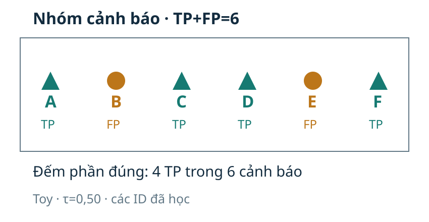
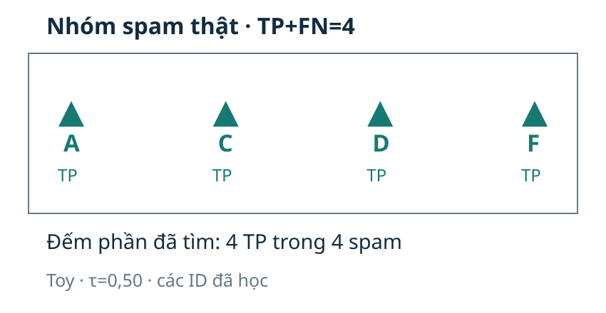
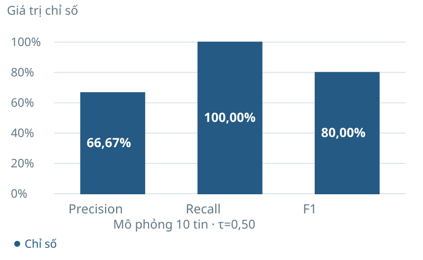
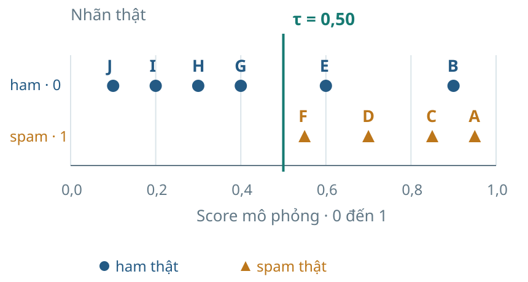
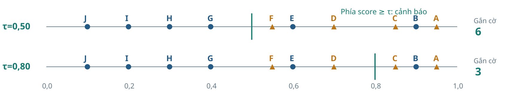
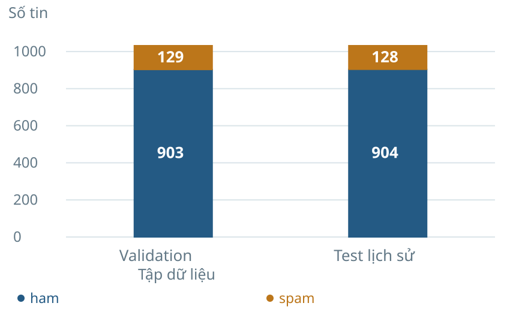

> Bản đọc trực tiếp trên GitHub, chuyển từ đầy đủ tài liệu HTML . [Tải bản HTML có bố cục và công thức LaTeX](Tai_lieu_doc_truoc/Bai03_Kien_thuc_nen_tang_va_doc_truoc.html); mở bản HTML sau khi tải và giải nén toàn bộ repository. [Hướng dẫn bài thực hành và slide](README.md).

# Đọc trước Bài 3 <br>Đánh giá phân loại

Chuẩn bị khoảng 35–45 phút: đọc ví dụ, tự đếm, giải thích nhóm mẫu số rồi thử code. Bài tiếp nối đúng case SMS của Bài 2 .

<a id="muc-1"></a>

## 1. Mục tiêu và sản phẩm cần tạo

| Cuối bài tự làm được | Bằng chứng đạt |
| --- | --- |
| Lập bốn ô và kiểm tổng | Đúng TP/FP/FN/TN, tổng N và tổng lớp |
| Tính và giải thích chỉ số | Đúng nhóm mẫu số, điều kiện và ý nghĩa |
| So ngưỡng theo mục tiêu | Theo dõi ID đổi ô, tính chi phí |
| Chọn và báo cáo chính sách | Chọn trên validation; nêu lịch sử test |
| Kiểm lại bằng Python | CSV, phép tính và kết luận khớp nhau |

Phiếu cuối buổi kiểm phép tính, cách đọc lỗi, quy trình và giới hạn.

Trước giờ học, cố gắng tự lập bốn ô cho mười tin và viết một câu giải thích precision khác recall ở đâu. Sau giờ học, chạy được notebook và nêu một đánh đổi của chính sách.

<a id="muc-2"></a>

## 2. Bối cảnh và dữ liệu thật

UCI SMS Spam Collection gồm văn bản tiếng Anh với nhãn ham/spam. Tệp trong case có 5.574 dòng; quy tắc nhận diện văn bản trùng bỏ 415 dòng, còn 5.159 tin. Giữ nguyên văn bản của bản ghi đầu để trích số ký tự và tỷ lệ chữ số. Nhãn spam chưa xác minh gian lận; dữ liệu này không mặc nhiên đại diện SMS tiếng Việt hiện nay.

| Hiện vật từ Bài 2 | Giá trị / vai trò |
| --- | --- |
| Dữ liệu sau bỏ trùng | 5.159 SMS tiếng Anh |
| Train / validation / test | 3.095 / 1.032 / 1.032 |
| Hai đặc trưng | Số ký tự; tỷ lệ chữ số |
| Mô hình khóa | Scaler fit train; kNN k=11; phiếu đều |

| Một dòng test · ID 1056 | Giá trị |
| --- | --- |
| Nhãn nguồn y | 0 · ham |
| Phiếu spam v | 6 trong 11 láng giềng |
| Score s | 6/11 ≈ 0,5455 |
| Dự đoán mặc định | 1 · spam |

Nhãn thật dùng để chấm. Đây là test lịch sử đã công bố; tái lập, không tinh chỉnh theo test.

SMS thật · bản ghi 1056 · nhãn nguồn ham

HIYA COMIN 2 BRISTOL 1 ST WEEK IN APRIL. LES GOT OFF + RUDI ON NEW YRS EVE BUT I WAS SNORING.THEY WERE DRUNK! U BAK AT COLLEGE YET? MY WORK SENDS INK 2 BATH.

Diễn nghĩa: nhắn về bạn bè, chuyến đi và công việc.

| Bản ghi 1056 | Kết quả |
| --- | --- |
| Nhãn thật | ham · y=0 |
| Đặc trưng | 157 ký tự; 3/157 chữ số |
| Phiếu / dự đoán | 6/11 → spam |
| Loại kết quả | FP · gắn cờ nhầm ham |

```math
\underbrace{y=0}_{\text{ham thật}}\quad\underbrace{\hat y=1}_{\text{dự đoán spam}}
```

Một cảnh báo sai có thể làm người dùng bỏ qua tin nhắn cần đọc.

<a id="muc-3"></a>

## 3. Kiến thức nền cần ôn

| Cần biết | Ví dụ tự làm |
| --- | --- |
| Tỷ lệ và phần trăm | 4/6≈0,6667≈66,67% |
| Đếm theo điều kiện | Lọc y=1; lọc ŷ=1; lấy phần giao |
| So sánh và phép cộng có trọng số | 5×FP+FN |
| Python cơ bản | Đọc CSV, điều kiện >=, mảng nhãn |

Không cần đạo hàm hoặc chứng minh xác suất để học tuyến chính. Hãy ôn phân số trước khi cố nhớ tên chỉ số.

<a id="muc-4"></a>

## 4. Ký hiệu và quy ước

| Ký hiệu | Ý nghĩa |
| --- | --- |
| y | Nhãn thật; spam=1, ham=0 |
| s | Score từ mô hình; kNN phiếu đều là v/11 |
| ŷ | Nhãn dự đoán sau quy tắc quyết định |
| τ / m | Ngưỡng score / số phiếu tối thiểu |
| TP/FP/FN/TN | Bốn loại kết quả theo cặp y và ŷ |
| N | Tổng số tin của đúng tập đang báo |

| Tên | y thật | ŷ | ID thật |
| --- | --- | --- | --- |
| TN | 0 | 0 | 4 |
| FP | 0 | 1 | 1056 |
| FN | 1 | 0 | 1501 |
| TP | 1 | 1 | 9 |

**01**Chốt lớp dương: spam=1; lớp âm: ham=0.

**02**Positive / negative nói về dự đoán 1 / 0.

**03**True / false nói dự đoán khớp / không khớp nhãn thật.

Trong toàn bài: hàng là nhãn thật, cột là dự đoán; mỗi tin chỉ thuộc một ô.

<a id="muc-5"></a>

## 5. Cơ chế đếm và các chỉ số

| Thật ↓ / dự đoán → | ham · 0 | spam · 1 |
| --- | --- | --- |
| ham · 0 | TN = 4<br>G, H, I, J | FP = 2<br>B, E |
| spam · 1 | FN = 0<br>∅ | TP = 4<br>A, C, D, F |

| Ô | ID được đếm |
| --- | --- |
| TN · ham giữ đúng | G,H,I,J |
| FP · cảnh báo nhầm | B,E |
| FN · spam bỏ lọt | Không có |
| TP · spam tìm được | A,C,D,F |

```math
N=TN+FP+FN+TP=4+2+0+4=10
```

Đặt mỗi ID vào một ô dựa trên cặp (y, ŷ); không đếm một tin hai lần.



*Nhóm cảnh báo làm mẫu số precision.*

```math
P=\frac{TP}{TP+FP}=\frac{4}{4+2}=\frac{4}{6}\approx66{,}67\%
```

**Trong các cảnh báo, bao nhiêu là spam thật?**

Mẫu số là A,B,C,D,E,F.<br>Điều kiện: TP+FP>0.

Precision nhìn từ phía cảnh báo được tạo ra.



*Nhóm spam thật làm mẫu số recall.*

```math
R=\frac{TP}{TP+FN}=\frac{4}{4+0}=1=100\%
```

**Trong spam thật, tìm được bao nhiêu?**

Mẫu số là A,C,D,F.<br>Điều kiện: TP+FN>0.

Recall nhìn từ phía những tin thực sự mang nhãn spam.



*Cùng 10 tin: P=2/3, R=1 và F1=0,80.*

Từ P và R · khi P,R xác định và P+R>0

```math
F_1=\frac{2PR}{P+R}=\frac{2\cdot(2/3)\cdot1}{2/3+1}=0{,}80
```

Từ số đếm · khi 2TP+FP+FN>0

```math
F_1=\frac{2TP}{2TP+FP+FN}=\frac{8}{8+2+0}=0{,}80
```

F1 là trung bình điều hòa. Cùng ví dụ có trung bình cộng (2/3+1)/2≈0,8333.

| Thật ↓ / dự đoán → | ham · 0 | spam · 1 |
| --- | --- | --- |
| ham · 0 | TN = 904 | FP = 0 |
| spam · 1 | FN = 128 | TP = 0 |

```math
P=\frac{0}{0}\quad\text{chưa xác định}
```

| Trường hợp | Điều kiện toán học |
| --- | --- |
| Không có cảnh báo | TP+FP=0 → P chưa xác định |
| Không có dương thật | TP+FN=0 → R chưa xác định |
| Chỉ có TN | 2TP+FP+FN=0 → dạng đếm F1 chưa xác định |

Mã trong bài chọn **zero_division=0**: giá trị báo cáo là 0, kèm cờ cho biết mẫu số không có.

Ở mốc luôn ham: recall=0/128=0 có nghĩa; precision 0/0 cần công bố quy ước.

<a id="muc-6"></a>

## 6. Ví dụ tính tay xuyên suốt

| ID | Score | Nhãn thật |
| --- | --- | --- |
| A | 0,95 | 1 |
| B | 0,9 | 0 |
| C | 0,85 | 1 |
| D | 0,7 | 1 |
| E | 0,6 | 0 |
| F | 0,55 | 1 |
| G | 0,4 | 0 |
| H | 0,3 | 0 |
| I | 0,2 | 0 |
| J | 0,1 | 0 |



*Mô phỏng A–J; tại score≥0,50 gắn cờ A–F.*

Tự ghi danh sách ID của từng ô, rồi kiểm tổng hàng/cột. Sau đó tính accuracy,precision,recall,F1. Đáp án: TN4,FP2,FN0,TP4; Acc0,80; P2/3; R1; F1=0,80.

<a id="muc-7"></a>

## 7. Ngưỡng và mục tiêu quyết định



*Cùng các score, đổi ngưỡng làm đổi tập cảnh báo.*

Toy · τ=0,50

| Thật ↓ / dự đoán → | ham · 0 | spam · 1 |
| --- | --- | --- |
| ham · 0 | TN = 4 | FP = 2 |
| spam · 1 | FN = 0 | TP = 4 |

```math
P=4/6\quad R=4/4\quad F_1=8/10
```

Toy · τ=0,80

| Thật ↓ / dự đoán → | ham · 0 | spam · 1 |
| --- | --- | --- |
| ham · 0 | TN = 5 | FP = 1 |
| spam · 1 | FN = 2 | TP = 2 |

```math
P=2/3\quad R=2/4\quad F_1=4/7
```

D,F: TP → FN

→

E: FP → TN

→

N=10; spam thật=4

Ít cảnh báo hơn: bớt một FP nhưng thêm hai FN. Tổng mỗi lớp thật không đổi.

| Hướng lỗi | Hậu quả minh họa | Trọng số |
| --- | --- | --- |
| FP | Gắn cờ nhầm tin cần đọc | c_FP |
| FN | Bỏ lọt tin spam | c_FN |

```math
C=c_{FP}FP+c_{FN}FN
```

Chọn hệ số theo mục tiêu **trước** khi so ngưỡng.

| Hai giả định giảng dạy | Chi phí |
| --- | --- |
| Ưu tiên tránh gắn cờ nhầm | 5FP+FN |
| Ưu tiên tránh bỏ lọt | FP+5FN |

Hệ số 5:1 và đơn vị chi phí là giả định minh họa; chưa phải tiền hay hậu quả đã đo thực tế.

| Toy · hai ngưỡng đang so | FP | FN | 5FP+FN | FP+5FN |
| --- | --- | --- | --- | --- |
| τ=0,50 | 2 | 0 | 10 | 2 |
| τ=0,80 | 1 | 2 | 7 | 11 |

```math
5\cdot2+0=10\quad\text{so với}\quad5\cdot1+2=7
```

```math
2+5\cdot0=2\quad\text{so với}\quad1+5\cdot2=11
```

Trong hai ngưỡng này: mục tiêu tránh FP chọn 0,80; mục tiêu tránh FN chọn 0,50. Chưa xét mọi ngưỡng.

Train: scaler + kNN

→

Validation: chọn m

→

Khóa tiêu chí / quy tắc

→

Test: báo kết quả

| Thao tác | Dữ liệu / quy tắc |
| --- | --- |
| Giữ mô hình | Scaler và kNN từ train của Bài 2 |
| Chọn ngưỡng | Validation; trọng số và ứng viên định trước |
| Xử lý hòa | Chi phí nhỏ nhất → ít cảnh báo hơn → m lớn hơn |
| Công bố phạm vi | Validation đã chọn k; test lịch sử đã công bố |

Không dùng bảng test để chọn lại k hoặc m. Một phép đánh giá độc lập mới cần dữ liệu chưa dùng để lựa chọn.

Hãy phân biệt phép so hai ngưỡng toy với quét đầy đủ chính sách m=0…12 trên validation thật. Precision có thể giảm khi tăng ngưỡng; ví dụ A,B,C→A,B cho 2/3→1/2.

<a id="muc-8"></a>

## 8. Case SMS thật và cách đọc báo cáo



*Phân bố lớp validation và test.*

| Tập | ham | spam | Vai trò |
| --- | --- | --- | --- |
| Validation | 903 | 129 | Chọn m |
| Test lịch sử | 904 | 128 | Báo kết quả |

Cả hai tập có 1.032 tin.<br>Số spam thật khác nhau: 129 và 128.

Tên tập đi cùng từng bảng và đồ thị; không thay mẫu số validation bằng mẫu số test.

Mục tiêu 5FP+FN · chọn m=8

| Thật ↓ / dự đoán → | ham · 0 | spam · 1 |
| --- | --- | --- |
| ham · 0 | TN = 899 | FP = 4 |
| spam · 1 | FN = 19 | TP = 110 |

```math
C=5\cdot4+19=39
```

Mục tiêu FP+5FN · chọn m=4

| Thật ↓ / dự đoán → | ham · 0 | spam · 1 |
| --- | --- | --- |
| ham · 0 | TN = 886 | FP = 17 |
| spam · 1 | FN = 12 | TP = 117 |

```math
C=17+5\cdot12=77
```

Hai ma trận validation, cùng 129 spam thật. Cực tiểu trên 13 chính sách đã công bố và theo quy tắc hòa đã định.

| Test lịch sử | Cảnh báo | FP / FN | Precision | Recall | F1 |
| --- | --- | --- | --- | --- | --- |
| m=6 | 123 | 12 / 17 | 90,24% | 86,72% | 88,45% |
| m=8 | 114 | 7 / 21 | 93,86% | 83,59% | 88,43% |
| m=4 | 137 | 23 / 14 | 83,21% | 89,06% | 86,04% |

| Chi phí theo mục tiêu | m=6 | m=8 | m=4 |
| --- | --- | --- | --- |
| 5FP+FN | 77 | 56 | 129 |
| FP+5FN | 97 | 112 | 93 |

m8: precision cao hơn, recall thấp hơn; F1 gần như không đổi. Kết luận phải gắn với mục tiêu đã chọn.

ROC/PR đọc nhiều ngưỡng từ y và score. AUC/AP tóm tắt xếp hạng, không tự chọn mục tiêu chi phí và không chứng minh score đã được hiệu chỉnh xác suất. Công thức sâu hơn nằm trong tài liệu mở rộng.

<a id="muc-9"></a>

## 9. Tự kiểm trước giờ học

Làm các câu 1–3 để kiểm bốn ô và mẫu số. Các câu ngưỡng/quy trình có thể thử trước rồi quay lại sau giờ học.

**Spam là lớp dương. Một tin có y=0 và ŷ=1 thuộc ô nào?**

| Lựa chọn | Nội dung |
| --- | --- |
| A | TP |
| B | FP |
| C | FN |
| D | TN |

Đáp án B

A sai: TP cần y=1 và ŷ=1. B đúng: mô hình dự đoán dương nhưng nhãn thật âm, nên đây là FP. C sai: FN cần y=1 và ŷ=0, tức bỏ lọt spam. D sai: TN cần cả nhãn thật và dự đoán bằng 0.

**TP=15, FP=5, FN=15. Cặp precision và recall nào đúng?**

| Lựa chọn | Nội dung |
| --- | --- |
| A | P=0,50; R=0,75 |
| B | P=0,75; R=0,75 |
| C | P=0,75; R=0,50 |
| D | P=0,50; R=0,50 |

Đáp án C

A sai: đã đổi chỗ nhóm cảnh báo và nhóm dương thật. B sai: recall phải chia cho TP+FN=30, không chia cho 20. C đúng: P=15/20=0,75 và R=15/30=0,50. D sai: precision phải chia cho TP+FP=20, không chia cho 30.

**Cùng 100 tin, có 20 spam: A có FP=10,FN=2; B có FP=2,FN=10. Nếu ưu tiên giảm bỏ lọt, kết luận nào có căn cứ?**

| Lựa chọn | Nội dung |
| --- | --- |
| A | B có recall cao hơn vì ít FP hơn |
| B | A có recall cao hơn: 18/20 so với 10/20 |
| C | Hai mô hình có cùng accuracy nên recall bằng nhau |
| D | Không thể tính recall khi thiếu số cảnh báo |

Đáp án B

A sai: FP thuộc nhóm cảnh báo, không quyết định mẫu số recall. B đúng: A tìm 18 trong 20 spam, B tìm 10 trong 20 spam; đây là kết luận theo mục tiêu giảm bỏ lọt. C sai: cả hai có 88 dự đoán đúng nhưng khác FN và recall. D sai: biết tổng spam và FN thì suy ra TP và tính được recall.

**Giữ nguyên score và nhãn thật. Khi tăng ngưỡng, phát biểu nào đúng?**

| Lựa chọn | Nội dung |
| --- | --- |
| A | Precision luôn tăng |
| B | FP có thể tăng vì ít cảnh báo hơn |
| C | TP luôn giữ nguyên vì mô hình không đổi |
| D | Precision có thể giảm: A,B,C → A,B cho 2/3 → 1/2 |

Đáp án D

A sai: precision không có bảo đảm đơn điệu; ví dụ A,B,C là một phản ví dụ. B sai: tập cảnh báo thu hẹp nên FP không tăng khi score và nhãn thật giữ nguyên. C sai: mô hình không đổi nhưng quyết định đổi, nên TP có thể giảm. D đúng: loại một TP là C khiến phần spam đúng trong cảnh báo giảm từ 2/3 xuống 1/2.

**Trong case này, quy trình nào đúng khi chọn và báo một chính sách ngưỡng?**

| Lựa chọn | Nội dung |
| --- | --- |
| A | Chọn m bằng chi phí validation đã định; khóa m; báo test kèm lịch sử sử dụng |
| B | Thử mọi m trên test rồi lấy m có chi phí test thấp nhất |
| C | Dùng test chọn m nhưng gọi kết quả đó là đánh giá độc lập |
| D | Coi validation đã chọn k và m là tập đánh giá độc lập |

Đáp án A

A đúng: validation phục vụ lựa chọn, chính sách khóa trước khi báo test và lịch sử test được công bố. B sai: dùng test để chọn phá vai trò của tập báo cáo. C sai: kết quả trên dữ liệu tham gia lựa chọn không phải đánh giá độc lập mới. D sai: validation đã tham gia chọn k và m nên điểm ở đó có thể lạc quan.

**Giữ y thật và score, chỉ đổi ngưỡng. Kết luận nào đúng?**

| Lựa chọn | Nội dung |
| --- | --- |
| A | Precision và recall luôn giữ nguyên |
| B | ROC-AUC phải thay đổi vì số cảnh báo đổi |
| C | ROC-AUC/AP từ score giữ nguyên; ma trận và chỉ số quyết định có thể đổi |
| D | Score tự trở thành xác suất đã hiệu chỉnh |

Đáp án C

A sai: ngưỡng có thể đổi tập cảnh báo và các phép đếm, nên precision hoặc recall có thể đổi. B sai: ROC-AUC(score) dùng y thật và score, hai đầu vào vẫn giữ nguyên. C đúng: chất lượng xếp hạng từ cùng score giữ nguyên, còn quyết định tại ngưỡng có thể đổi. D sai: đổi quy tắc quyết định không thực hiện hiệu chỉnh xác suất.

**Một SMS có score=1, tức 11/11 láng giềng là spam. Kết luận nào có căn cứ?**

| Lựa chọn | Nội dung |
| --- | --- |
| A | Tin chắc chắn là spam vì tất cả láng giềng đồng ý |
| B | Score thể hiện tỷ lệ phiếu; độ đúng và calibration vẫn cần kiểm tra |
| C | Đã có xác suất đúng 100% được hiệu chỉnh |
| D | Mô hình đã hiểu nghĩa tiếng Việt của SMS |

Đáp án B

A sai: đồng thuận láng giềng không bảo đảm khớp nhãn thật. B đúng: 11/11 mô tả phiếu của mô hình; độ đúng và hiệu chỉnh xác suất cần bằng chứng riêng. C sai: tỷ lệ phiếu một không chứng minh xác suất đúng đã hiệu chỉnh. D sai: hai đặc trưng hình thức và corpus tiếng Anh không chứng minh hiểu nghĩa tiếng Việt.

<a id="muc-10"></a>

## 10. Thực hành, thuật ngữ và tài liệu

```text
votes = np.rint(score * 11).astype(int)
y_hat = (votes >= min_votes).astype(int)
tn, fp, fn, tp = confusion_matrix(
    y_true, y_hat, labels=[0, 1]).ravel()
precision_score(y_true, y_hat, zero_division=0)
roc_auc_score(y_true, score)
```

CSV: y + score

→

Ngưỡng → ŷ

→

Ma trận → P/R/F1

→

Score → AUC/AP

Score đã kiểm khớp số phiếu nguyên. Mã đầy đủ: source/metrics_lab.py; không dùng ŷ thay cho score khi tính AUC/AP.

| Tin thật | y | v | m=4 | m=6 | m=8 |
| --- | --- | --- | --- | --- | --- |
| 1056 | 0 | 6 | FP | FP | TN |
| 1501 | 1 | 4 | TP | FN | FN |

**01**Đọc nguyên văn và tìm hai ID trong CSV.

**02**Tự tính ŷ bằng điều kiện v≥m.

**03**Gọi tên ô bằng cặp (y, ŷ).

**04**Chạy code, đối chiếu và giải thích đánh đổi.

Hai tin minh họa không đại diện cho toàn tập; kết luận chính sách phải đọc cùng toàn bộ ma trận.

| Thuật ngữ | Cách hiểu ngắn |
| --- | --- |
| Confusion matrix | Ma trận đếm nhãn thật và dự đoán |
| Precision | Phần đúng trong cảnh báo |
| Recall | Phần tìm được trong dương thật |
| Threshold | Ngưỡng quyết định |
| Calibration | Kiểm mức score có phù hợp tần suất nhãn thật |
| Validation / test | Chọn chính sách / báo kết quả với lịch sử công bố |

[Notebook](Bai03_Thuc_hanh.ipynb) · [Python](source/metrics_lab.py) · [Tự học mở rộng và notes](Tai_lieu/Huong_dan_va_mo_rong.html)

Nguồn: [UCI SMS](https://archive.ics.uci.edu/dataset/228/sms+spam+collection); [scikit-learn Metrics](https://scikit-learn.org/1.6/modules/model_evaluation.html); [Average Precision](https://scikit-learn.org/1.6/modules/generated/sklearn.metrics.average_precision_score.html).

Bài 3 · Đánh giá phân loại · PGS.TS. Nguyễn Văn Hậu
