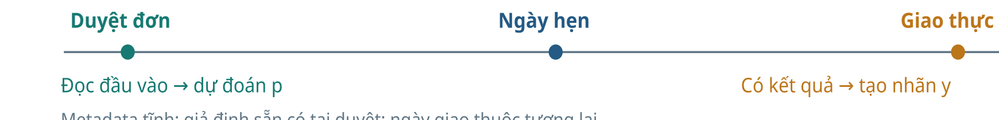
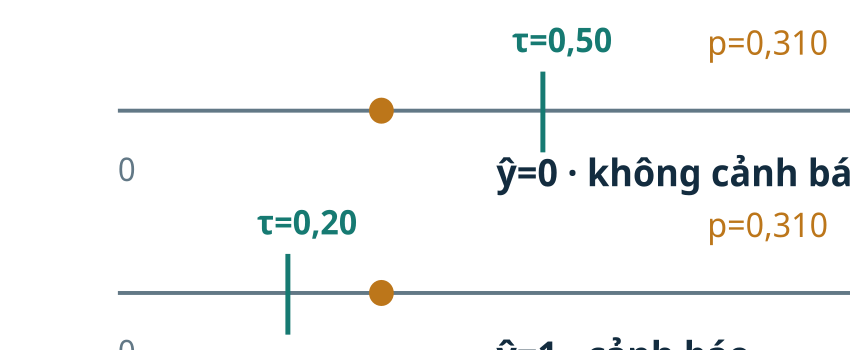
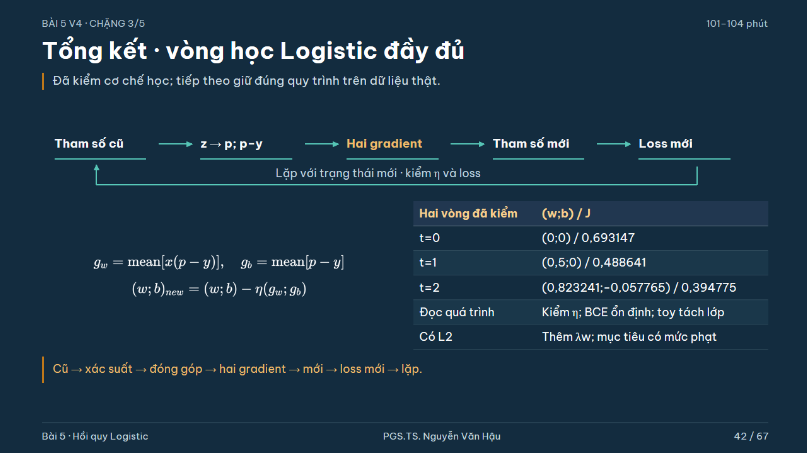
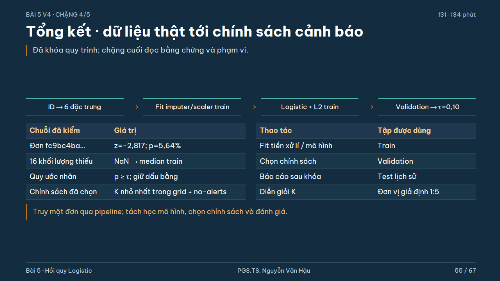
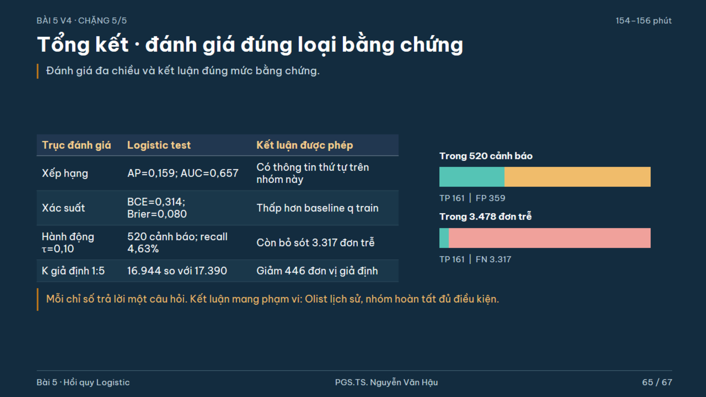

> Bản đọc trực tiếp trên GitHub, chuyển từ đầy đủ tài liệu HTML . [Tải bản HTML có bố cục và công thức LaTeX](Tai_lieu_doc_truoc/Bai05_Kien_thuc_nen_tang_va_doc_truoc.html); mở bản HTML sau khi tải và giải nén toàn bộ repository. [Hướng dẫn bài thực hành và slide](README.md).

# Bài 5 · Kiến thức nền tảng và đọc trước

**PGS.TS. Nguyễn Văn Hậu** · Khoa Công nghệ Thông tin · Trường Đại học Công nghệ Kỹ thuật Hưng Yên.

Đọc trước 30–40 phút. Mỗi mục trả lời một câu hỏi để bạn nhận diện dữ kiện, tính một bước và giải thích kết quả. Tuyến chính không đòi hỏi đại số ma trận; phần chứng minh đọc sau giờ học.

## 1. Mục tiêu và câu hỏi thực tế

Tại lúc đơn hàng được phê duyệt, có nên cảnh báo nguy cơ giao trễ ngày hẹn? Mô hình tạo xác suất; một chính sách dùng xác suất để quyết định cảnh báo. Bạn cần phân biệt hai công việc đó.

| Bạn cần làm được | Sản phẩm tự kiểm |
| --- | --- |
| Dữ liệu và nhãn | Một ID thật, mốc dự đoán, sáu đầu vào và nhãn ngày lịch |
| Mô hình | Tính z → sigmoid → p; phân biệt p, odds và ngưỡng |
| Thuật toán | Tính đủ hai vòng BCE → gradient → cập nhật → BCE mới |
| Vận dụng | Fit tiền xử lý bằng train; chọn chính sách trên validation |
| Đánh giá | Đọc precision/recall, AP/AUC và giới hạn của kết quả |

## 2. Dữ liệu thật và thời điểm dự đoán

Nguồn: [Olist / Kaggle](https://www.kaggle.com/datasets/olistbr/brazilian-ecommerce). ZIP có bảng đơn hàng, mặt hàng, sản phẩm, người mua, người bán và tọa độ vùng mã bưu chính. Một dòng học là một đơn đã tổng hợp; không là một mặt hàng. Chỉ xét nhóm đơn đã giao đủ dữ kiện và thời lượng không âm.



```math
y=\mathbb{1}\{\operatorname{date}(t_{delivered})>\operatorname{date}(t_{estimated})\}
```

Giao bất kỳ giờ nào trong cùng ngày hẹn được coi đúng hạn. Nhãn này khác so sánh timestamp trực tiếp với 00:00 ngày hẹn. Ngày giao thuộc tương lai, chỉ dùng tạo y; không dùng làm đặc trưng. Metadata sản phẩm và địa lý là snapshot tĩnh: sẵn có tại lúc duyệt là giả định chưa xác minh bằng lịch sử cập nhật.

| Tập | Approval | Số đơn | Số trễ / tỉ lệ |
| --- | --- | --- | --- |
| train | 01–10/2017; nhãn trước 01/11 | 29031 | 941 / 3,24% |
| validation | 11–12/2017; nhãn trước 01/01/2018 | 10389 | 634 / 6,10% |
| test | 01–06/2018; nhóm cuối đã hoàn tất | 40266 | 3478 / 8,64% |

Bốn ví dụ trong CSV four_real_orders.csv gồm hai đơn mỗi lớp được chọn minh họa, không đại diện tỉ lệ trễ của quần thể. Xem mã đầy đủ để truy lại ZIP gốc; cùng ID fc9bc4bac939adaa600ad59dee9a106f được dùng ở Bài 4 và Bài 5.

## 3. Kiến thức nền cần ôn

| Kiến thức | Ví dụ nhỏ |
| --- | --- |
| Trung bình và dấu | mean([0,5;0,5;−0,5;−0,5])=0 |
| Hàm mũ và logarithm | e^(ln 2)=2; ln(0,8)<0 |
| Đạo hàm | Đo biến thiên tại tham số hiện tại |
| Cập nhật đồng thời | Tính cả hai gradient từ cùng p cũ, rồi gán tham số mới |
| Tỉ lệ và mẫu số | Precision đọc trong cảnh báo; recall đọc trong đơn thật sự trễ |

Nếu chưa vững logarithm, dùng bảng BCE và máy tính trước, rồi quay lại công thức. Mọi ln trong bài là logarithm tự nhiên.

## 4. Ký hiệu, đơn vị và sáu đặc trưng

| Ký hiệu | Nghĩa |
| --- | --- |
| x, u | Đặc trưng gốc; đặc trưng đã điền và chuẩn hóa |
| y, ŷ | Nhãn thật 0/1; nhãn dự đoán theo ngưỡng |
| w, b, z | Hệ số, intercept, điểm tuyến tính (logit) |
| p, τ | Ước lượng xác suất lớp 1; ngưỡng chính sách |
| ℓ, J, n | Loss một mẫu; mean loss train; số mẫu train |
| g, η, λ | Gradient; learning rate; mức phạt L2 |

| Đầu vào | Cách tính / đơn vị |
| --- | --- |
| distance_km | Haversine giữa tọa độ trung vị vùng; trung bình theo dòng mặt hàng, km. Không là đường vận chuyển. |
| promised_days | (ngày hẹn − approval) theo giây / 86.400; ngày thập phân |
| price | Tổng giá mặt hàng theo đơn; BRL |
| freight_value | Tổng cước theo các dòng mặt hàng; BRL |
| n_items | Số dòng mặt hàng theo đơn |
| weight_g | Tổng gram; nếu bất kỳ thành phần thiếu thì tổng chưa biết |

Phiên bản sửa 16 đơn train: khối lượng chưa biết giữ NaN, không thay bằng 0. Sau đó imputer học median train để điền. Không gán “không có khối lượng” cho “chưa có thông tin”.

## 5. Mô hình: từ điểm số tới xác suất và hành động

```math
z=b+wx,\quad p=\sigma(z)=\frac1{1+e^{-z}},\quad \hat y=\mathbb{1}\{p\ge\tau\}
```

Ví dụ b=−2, w=0,4, x=3 cho z=−0,8 và p≈0,3100255. Ngưỡng 0,5 cho ŷ=0; ngưỡng 0,2 cho ŷ=1. Đổi ngưỡng không đổi w,b hoặc p. Giá trị p được ước lượng theo mô hình, chưa bảo đảm đã hiệu chỉnh đúng tần suất thực.

```math
\mathrm{odds}=\frac p{1-p}=e^z,\quad \log\frac p{1-p}=b+wx
```

Khi x tăng một đơn vị và giữ các đặc trưng khác, odds được nhân e^w. Nếu p=0,2, odds=0,25; nhân odds 2 lần cho odds=0,5 và p=1/3. Không nhân thẳng xác suất 2 lần. Đơn vị của x và việc chuẩn hóa quyết định “một đơn vị”; hệ số chưa là hiệu ứng nhân quả.



## 6. BCE: học xác suất có trả giá cho sự tự tin sai

```math
\ell(y,p)=-[y\ln p+(1-y)\ln(1-p)],\qquad J=\frac1n\sum_i\ell_i
```

| y thật | p | BCE |
| --- | --- | --- |
| 1 | 0,8 | −ln(0,8)≈0,223144 |
| 1 | 0,01 | −ln(0,01)≈4,605170 |
| 0 | 0,2 | −ln(0,8)≈0,223144 |

Cùng sai nhãn ở ngưỡng 0,5 nhưng xác suất tự tin sai bị phạt mạnh hơn. Không đưa ŷ vào BCE. Với logit hữu hạn, sigmoid nằm trong (0,1); khi lập trình dùng biểu thức ổn định để tránh tràn số và ln(0).

```math
\ell(y,z)=\log(1+e^z)-yz
```

Mã dùng np.logaddexp(0,z)−y*z và scipy.special.expit. Nếu p làm tròn thành 0 hoặc 1 trên slide, không dùng số đã làm tròn để tính loss.

## 7. Thuật toán: kiểm trọn hai vòng Gradient Descent

Bốn mẫu THIẾT KẾ để tính tay: x=[−1,0,1,2], y=[0,0,1,1]. x là thước đo toy, không là khoảng cách km âm và không được gọi là dữ liệu đã chuẩn hóa về trung bình 0. Khởi tạo (w,b)=(0,0), η=1, chưa L2.

```math
g_w=\frac1n\sum_i x_i(p_i-y_i),\quad g_b=\frac1n\sum_i(p_i-y_i)
```

```math
w_{new}=w-\eta g_w,\quad b_{new}=b-\eta g_b
```

| Trạng thái | w | b | g_w | g_b | J |
| --- | --- | --- | --- | --- | --- |
| 0 | 0,000000 | 0,000000 | -0,500000 | 0,000000 | 0,693147 |
| 1 | 0,500000 | 0,000000 | -0,323241 | 0,057765 | 0,488641 |
| 2 | 0,823241 | -0,057765 | -0,237389 | 0,072877 | 0,394775 |

Tại t=0: p=[0,5;0,5;0,5;0,5], p−y=[0,5;0,5;−0,5;−0,5], x(p−y)=[−0,5;0;−0,5;−1]. Do đó g_w=−0,5 nhưng g_b=0; cần tiếp tục cập nhật w. Sau cập nhật đầu, p≈[0,377541;0,5;0,622459;0,731059] và J≈0,488641. Vòng hai tính lại gradient tại (0,5;0) rồi cập nhật cả hai tham số.



```math
J_\lambda=J+\frac\lambda2\sum_jw_j^2,\quad g_{w_j}^{\lambda}=g_{w_j}+\lambda w_j
```

Toy tách lớp hoàn toàn: không L2 có thể cho BCE tiến về 0 mà hệ số tăng không giới hạn. L2 thay mục tiêu học; λ=0,1, không phạt b, và toy có cả hai lớp cho nghiệm hữu hạn. Learning rate và λ có vai trò khác nhau. Case thật dùng solver newton-cg của sklearn; không gán nhãn “GD” cho solver đó.

## 8. Pipeline Olist và chọn chính sách

```math
u_j=\frac{x_j^{filled}-\mu_j^{train}}{s_j^{train}},\quad z=b+\sum_jw_ju_j
```

Median, mean, std (ddof=0) chỉ học bằng train. Validation/test dùng lại các đại lượng đó. LogisticRegression(solver="newton-cg", C=1, penalty="l2", tol=1e-6) fit train; không class_weight hay sample_weight. Với quy ước mean BCE + λ||w||²/2 của bài và sklearn 1.6.1, λ=1/(nC). Không phạt b.

| Cùng ID fc9bc4bac939adaa600ad59dee9a106f | Giá trị |
| --- | --- |
| Intercept | -3,486822 |
| z | -2,817384 |
| p | 0,056392 |
| y thật | 0 |
| Cảnh báo τ=0,10 | Không |

Bảng sáu biến đổi và sáu đóng góp ở slide 46–47 là dữ kiện của chính ID này, không là bảng dựng minh họa. Giữ toàn bộ độ chính xác trong mã; slide chỉ làm tròn để đọc.

Quét τ∈{0,02;0,03;0,05;0,10;0,15;0,20;0,30;0,50;0,80} và chính sách không cảnh báo. Dùng validation để chọn K=FP+5FN nhỏ nhất; nếu hòa, chọn ít cảnh báo hơn rồi ngưỡng lớn hơn. K là giả định học tập, không là tiền. Chọn τ=0,10 và giữ model, pipeline, policy khi đánh giá test.



## 9. Đánh giá và giới hạn: ba câu hỏi khác nhau

| Trục | Logistic test | Cách đọc |
| --- | --- | --- |
| Hành động | TP=161, FP=359, FN=3.317, TN=36.429 | 520 cảnh báo; precision≈30,96%; recall≈4,63% |
| Xếp hạng | AP=0,159237; AUC=0,656655 | Có thông tin thứ tự, chưa suy ra recall cao tại τ |
| Xác suất | BCE=0,313599; Brier=0,080450 | So cùng test với baseline p=qtrain |
| K giả định | 16.944 so với không cảnh báo 17.390 | Giảm 446 đơn vị giả định, chưa là tiết kiệm tiền |

```math
\mathrm{precision}=\frac{TP}{TP+FP},\quad \mathrm{recall}=\frac{TP}{TP+FN}
```

Nếu không cảnh báo, precision có mẫu số 0 nên không xác định; mã báo 0 theo quy ước. AP là tổng precision có trọng số theo mức tăng recall, không bằng diện tích PR tính hình thang nói chung. ROC-AUC đọc xác suất thứ tự dương–âm, có nửa điểm cho hòa. BCE và Brier là scoring rules tổng hợp, không thuần đo calibration. Reliability diagram so tần suất trễ với xác suất trung bình trong từng bin; cần đọc cả số mẫu.

Test đã xuất hiện ở phiên bản trước: đây là tái lập lịch sử, không là test mù mới. Tỉ lệ trễ đổi từ 3,24% train tới 8,64% test; khác quần thể hoàn tất, snapshot metadata và chi phí chưa xác minh giới hạn kết luận. Recall thấp không phủ định công thức Logistic; nó cho thấy pipeline/chính sách hiện tại chưa đủ để phát hiện phần lớn đơn trễ.



## 10. Tự kiểm, thực hành và tài liệu

| Tự làm | Đầu ra |
| --- | --- |
| z=ln3, y=1, τ=0,8 | p, odds, BCE, ŷ, loại lỗi, đạo hàm theo z |
| Hai vòng toy | Trạng thái cũ, p, gradient, tham số mới, J mới |
| Từ test Olist | Hai câu kết luận: một kết quả và một giới hạn |

**Đối chiếu câu tính nhanh**

p=3/4; odds=3; BCE=−ln(3/4)≈0,287682; ŷ=0 nên FN; ∂ℓ/∂z=p−y=−1/4.

[Toàn bộ học liệu](Bat_dau_Bai05.html) · [Notebook](Bai05_Thuc_hanh.ipynb) · [Lab Python](source/logistic_lab.py) · [Quiz](Tai_lieu/Bai05_Quiz.html).

Nguồn đọc tiếp: [Cornell CS4780 · Logistic](https://www.cs.cornell.edu/courses/cs4780/2024sp/lectures/lecturenote06.html); [sklearn 1.6 · Logistic](https://scikit-learn.org/1.6/modules/linear_model.html#logistic-regression); [sklearn · calibration và scoring rules](https://scikit-learn.org/1.6/modules/calibration.html).
