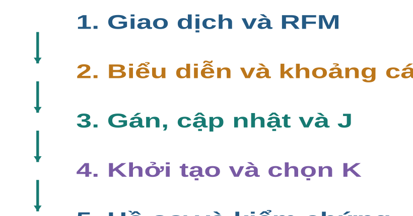
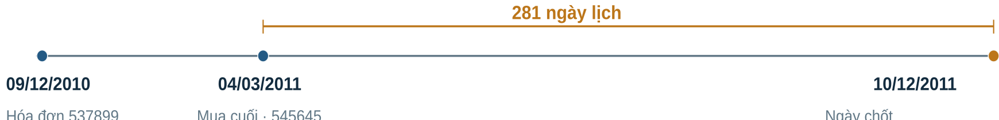
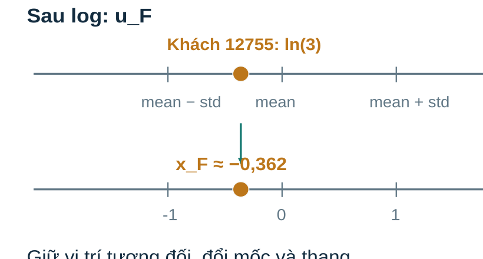
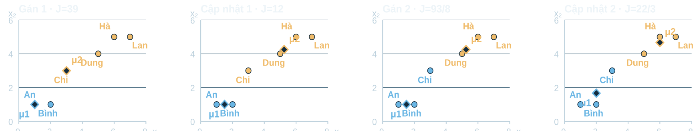

> Bản đọc trực tiếp trên GitHub, chuyển từ đầy đủ tài liệu HTML . [Tải bản HTML có bố cục và công thức LaTeX](Tai_lieu_doc_truoc/Bai08_Doc_truoc.html); mở bản HTML sau khi tải và giải nén toàn bộ repository. [Hướng dẫn bài thực hành và slide](README.md).

# Bài 8 · Kiến thức nền và đọc trước

**PGS.TS. Nguyễn Văn Hậu** · Khoa Công nghệ Thông tin · Trường Đại học Công nghệ Kỹ thuật Hưng Yên.

🧭 **Mạch học:** giao dịch → RFM → biểu diễn → khoảng cách → gán/cập nhật → chọn K → hồ sơ và kiểm chứng. Đọc khoảng 35–45 phút trước buổi học. Chuẩn bị phép cộng, trung bình, bình phương và cách đọc trục tọa độ.

## 1. 🎯 Bài toán và điều cần làm được

Ta muốn tổ chức khách hàng theo hành vi mua khi chưa có nhãn nhóm. Đầu ra gồm nhóm, tâm và hồ sơ của nhóm. Sau bài học, tự tính được RFM một khách, làm một vòng K-means, đọc bằng chứng lựa chọn K và nêu giới hạn của đề xuất sử dụng.

| Năng lực | Sản phẩm kiểm được |
| --- | --- |
| Dữ liệu | RFM có ID, đơn vị, ngày chốt và recipe |
| Thuật toán | Khoảng cách, nhãn, tâm và J khớp nhau |
| Đánh giá | So K trên cùng biểu diễn và ngân sách |
| Diễn giải | Hai bằng chứng, một giới hạn và phép kiểm tiếp |



## 2. 🧩 Kiến thức nền cần nhớ

Một vector là một bộ tọa độ mô tả đối tượng. Trung bình cộng lấy tổng chia số phần tử. Khoảng cách Euclid trên hai tọa độ xuất phát từ tổng bình phương chênh lệch; so bình phương khoảng cách vẫn giữ thứ tự gần–xa. Chuẩn hóa dùng trung bình và độ lệch chuẩn của từng cột.

```math
d^2(\mathbf x,\mathbf m)=(x_1-m_1)^2+(x_2-m_2)^2
```

Ví dụ Dung=(5;4), tâm=(3;3): d²=(5−3)²+(4−3)²=5. Khoảng cách d=√5. Không cần đạo hàm để thực hiện các vòng lặp trong bài.

## 3. 📖 Thuật ngữ và ký hiệu

| Tên / ký hiệu | Ý nghĩa |
| --- | --- |
| R / F / M | Số ngày từ lần mua cuối / số hóa đơn riêng biệt / tổng tiền mua dương |
| r / u / x | RFM gốc / sau log / sau chuẩn hóa |
| K / d / n | Số cụm / số tọa độ / số khách hoặc điểm |
| μⱼ | Tâm nhóm j trong không gian x |
| cᵢ / Cⱼ | Chỉ số nhóm của điểm i / tập thành viên nhóm j |
| J / inertia | Tổng khoảng cách bình phương đến tâm được gán |
| Lloyd | Vòng lặp gán về tâm gần nhất và cập nhật trung bình |
| Silhouette / ARI | Độ phân tách nội bộ / độ tương đồng giữa hai phân hoạch |

Ví dụ tính tay đánh số nhóm 1,2; sklearn dùng 0,1,…,K−1. Đổi tên nhóm giữ nguyên phân hoạch nếu các cặp cùng nhóm không đổi.

## 4. 🗂️ Dữ liệu thật và ví dụ mô phỏng

Online Retail là giao dịch của doanh nghiệp bán hàng trực tuyến ở Anh, cửa sổ 01/12/2010–09/12/2011, gồm khách ở nhiều quốc gia và cả khách bán buôn. Tệp thực có 541.909 dòng và 135.080 dòng thiếu CustomerID. Giữ CustomerID có giá trị, Quantity>0, UnitPrice>0 và InvoiceNo không bắt đầu C, thu được 397.884 dòng của 4.338 khách.

| InvoiceNo | Ngày | Mã hàng | Quantity | UnitPrice GBP | Tiền dòng GBP |
| --- | --- | --- | --- | --- | --- |
| 537899 | 2010-12-09 | 22328 | 1488 | 2,55 | 3794,40 |
| 545645 | 2011-03-04 | 22652 | 1 | 1,65 | 1,65 |
| 545645 | 2011-03-04 | 22654 | 1 | 5,95 | 5,95 |
| 545645 | 2011-03-04 | 22968 | 1 | 9,95 | 9,95 |

Khách 12755 có bốn dòng thuộc hai hóa đơn. Ngày chốt 10/12/2011 và mua cuối 04/03/2011 tạo R=281 ngày lịch. F=2 và M=3811,95 GBP. M không là lợi nhuận hoặc tiền mua ròng vì recipe loại trả/hủy. Giữ dòng trùng trong recipe chính và kiểm độ nhạy bằng một recipe bỏ trùng riêng.



| Điểm mô phỏng | x₁ | x₂ |
| --- | --- | --- |
| An | 1 | 1 |
| Bình | 2 | 1 |
| Chi | 3 | 3 |
| Dung | 5 | 4 |
| Hà | 6 | 5 |
| Lan | 7 | 5 |

Sáu điểm là mô phỏng hai chiều để tính tay. Case khách hàng sử dụng ba tọa độ RFM; không đồng nhất hai tập dữ liệu.

## 5. 👀 Trực giác về biểu diễn và khoảng cách

Các cột RFM có đơn vị và mức biến thiên khác nhau. Cộng chênh lệch bình phương trực tiếp có thể làm tiền chi phối cách đo gần nhau. Case dùng log tự nhiên rồi chuẩn hóa từng cột. Đây là lựa chọn hình học cần giải thích theo mục đích, không là bảo đảm tìm nhóm đúng.

```math
u_{ij}=\ln(1+r_{ij}),\quad x_{ij}=\frac{u_{ij}-\bar u_j}{s_j}
```

```math
s_j^2=\frac1n\sum_i(u_{ij}-\bar u_j)^2
```

| 12755 | r | u | mean u | std u | x |
| --- | --- | --- | --- | --- | --- |
| R | 281,00 | 5,642 | 3,857 | 1,307 | 1,366 |
| F | 2,00 | 1,099 | 1,346 | 0,683 | -0,362 |
| M | 3811,95 | 8,246 | 6,594 | 1,257 | 1,314 |

x_F≈−0,362 nghĩa là ln(F+1) thấp hơn trung bình cột sau log; F gốc vẫn bằng hai. StandardScaler dùng ddof=0, được fit trên toàn cohort khám phá lịch sử. Hình hai chiều bỏ một tọa độ nên không thay khoảng cách ba chiều của mô hình.



## 6. 🧮 Một vòng tính tay đầy đủ

Đặt K=2, tâm đầu ở An=(1;1) và Chi=(3;3). Tính khoảng cách bình phương từ mọi điểm đến cả hai tâm và chọn nhỏ nhất. An, Bình thuộc nhóm một; Chi, Dung, Hà, Lan thuộc nhóm hai. J đầu bằng 39.

```math
J=\sum_i\|\mathbf x_i-\boldsymbol\mu_{c_i}\|^2
```

Giữ nhóm rồi lấy trung bình từng tọa độ: μ₁=(1,5;1), μ₂=(5,25;4,25), J=12. Gán lại: Chi có d₁²=6,25 và d₂²=6,625 nên chuyển nhóm. J=93/8. Cập nhật tiếp: μ₁=(2;5/3), μ₂=(6;14/3), J=22/3. Vòng tiếp không đổi nhãn hoặc tâm.



```math
39\geq12\geq93/8\geq22/3
```

Trong bước gán giữ tâm; trong bước cập nhật giữ nhãn. Các điểm dữ liệu đứng yên. Tâm là trung bình nên không nhất thiết là một điểm đã có.

## 7. ⚙️ Thuật toán, khởi tạo và điều kiện dừng

Một lần chạy nhận X, K và tâm đầu. Luân phiên gán gần nhất và cập nhật trung bình cho tới điều kiện dừng. Ví dụ dùng tâm không đổi; thư viện còn có tolerance và max_iter. Hòa khoảng cách chọn chỉ số nhỏ hơn trong mã học tập; cụm rỗng cần quy tắc, không lấy trung bình của tập rỗng.

```math
c_i\in\arg\min_j\|\mathbf x_i-\boldsymbol\mu_j\|^2,\qquad\boldsymbol\mu_j=\frac1{|C_j|}\sum_{i\in C_j}\mathbf x_i
```

| Cùng toy, K=3 | Kết quả |
| --- | --- |
| Khởi tạo An, Bình, Chi | Điểm cố định J=19/6 |
| Khởi tạo An, Hà, Lan | Điểm cố định J=17/3 |

Dừng chưa chứng minh tối ưu toàn cục. Vét cạn 203 phân hoạch chỉ xác nhận nghiệm tốt nhất cho toy nhỏ. K-means++ hỗ trợ chọn tâm đầu; n_init=20 thử hai mươi lần và giữ J nhỏ nhất trong các lần đó. max_iter là ngân sách vòng của từng lần, không phải n_init.

## 8. 📊 Bằng chứng chọn K và diễn giải

Inertia và silhouette đo hai tính chất khác nhau. J dùng bình phương khoảng cách điểm–tâm. Silhouette dùng khoảng cách điểm–điểm: a là trung bình tới các điểm khác cùng nhóm, b là nhỏ nhất của các trung bình tới từng nhóm khác.

```math
s_i=(b_i-a_i)/\max(a_i,b_i)
```

Với điểm 2 cùng nhóm với 0, nhóm khác là 10,12: a=2, b=(8+10)/2=9, s=7/9. Âm nghĩa là trung bình gần nhóm khác hơn, chưa chứng minh sai nhãn thật. Nhóm một điểm được sklearn cho s=0; cần 2 đến n−1 nhóm.

| K | J toàn cohort | S trong mẫu 2.000 | S toàn cohort |
| --- | --- | --- | --- |
| 2 | 6474,15 | 0,425 | 0,433 |
| 3 | 4856,48 | 0,330 | Không tính trong thí nghiệm |
| 4 | 3924,46 | 0,332 | 0,336 |
| 5 | 3268,21 | 0,320 | Không tính trong thí nghiệm |
| 6 | 2840,15 | 0,319 | Không tính trong thí nghiệm |

K=2 có S cao nhất trong các K đã thử trên biểu diễn này; K=4 là ứng viên để mô tả chi tiết hơn. Silhouette mẫu được tính trong tập con, không phải lấy trung bình một số silhouette tính trên toàn cohort. Thử mẫu seed 43/44 vẫn hỗ trợ thứ tự K2>K4. So khởi tạo dùng cùng n_init=20; bỏ trùng refit cả pipeline cho ARI=0,9576.

| Nhóm | n | Trung vị R | Trung vị F | Trung vị M GBP |
| --- | --- | --- | --- | --- |
| 0 | 877 | 19 | 2,0 | 450,84 |
| 1 | 1579 | 183 | 1,0 | 300,42 |
| 2 | 720 | 9 | 10,0 | 3726,08 |
| 3 | 1162 | 54 | 4,0 | 1353,74 |

Hồ sơ trung vị gốc khác tâm đổi ngược về đơn vị gốc. R thấp chưa chứng minh khách mới hay trung thành. Hình dạng cong và điểm xa có thể làm K-means khó phù hợp. Một nhóm chỉ tạo giả thuyết hành động; chưa có dữ liệu chứng minh lợi nhuận hoặc hiệu quả chiến dịch.

## 9. ❓ Tự kiểm bằng quiz

**Một khách có 5 dòng mua thuộc 2 InvoiceNo khác nhau. F bằng bao nhiêu?**

| Lựa chọn |
| --- |
| A. 2 |
| B. 5 |
| C. Tổng Quantity |
| D. Tổng Quantity × UnitPrice |

**Đáp án A**<br>A. đếm hai mã hóa đơn phân biệt.<br>B. nhầm dòng hàng với hóa đơn.<br>C. là lượng mua.<br>D. là tiền mua của các dòng.

**F gốc của khách 12755 là 2; tọa độ F sau log và chuẩn hóa khoảng −0,362. Số âm cho biết điều gì?**

| Lựa chọn |
| --- |
| A. Số hóa đơn của khách âm |
| B. Phép chuẩn hóa chắc chắn sai |
| C. log(F+1) thấp hơn trung bình cột |
| D. Khách không có hóa đơn |

**Đáp án C**<br>A. đổi nghĩa tọa độ biến đổi thành số hóa đơn.<br>B. số âm là kết quả bình thường.<br>C. là cách đọc dấu trong công thức z.<br>D. F gốc vẫn bằng 2.

**Sau bước gán, thuật toán cập nhật tâm bằng cách nào?**

| Lựa chọn |
| --- |
| A. Giữ tâm rồi đổi nhãn nhóm |
| B. Giảm K đi một |
| C. Thay tọa độ điểm dữ liệu |
| D. Giữ nhóm vừa gán, lấy trung bình từng tọa độ |

**Đáp án D**<br>A. là bước gán.<br>B. K cố định trong lần chạy.<br>C. dữ liệu đứng yên trong vòng lặp.<br>D. đúng với tối ưu tâm khi nhóm cố định.

**Một lần chạy đã ổn định các tâm. Kết luận nào đúng?**

| Lựa chọn |
| --- |
| A. Đã thỏa điều kiện dừng, có thể còn nghiệm J thấp hơn |
| B. Đã chứng minh tối ưu toàn cục |
| C. Thuật toán tự tìm được K tối ưu |
| D. n_init chính là số vòng lặp đã chạy |

**Đáp án A**<br>A. phân biệt đúng điều kiện dừng và chất lượng nghiệm.<br>B. hai nghiệm K=3 phản bác suy luận này.<br>C. K được đặt trước.<br>D. n_init đếm lần khởi tạo/chạy lại.

**Một điểm có a=2 và b=1. Silhouette của điểm bằng bao nhiêu?**

| Lựa chọn |
| --- |
| A. 0,5 |
| B. −0,5 |
| C. 0 |
| D. −1 |

**Đáp án B**<br>A. đảo dấu b−a.<br>B. (1−2)/max(2,1)=−0,5.<br>C. chỉ đúng khi a=b theo trường hợp không suy biến.<br>D. sai mẫu số; trung bình tới cụm khác gần nhất thấp hơn tới cùng cụm.

**Kết luận nào được thí nghiệm K=2..6 trong bài hỗ trợ?**

| Lựa chọn |
| --- |
| A. K=4 chắc chắn tối đa doanh thu |
| B. R thấp chứng minh là khách mới |
| C. K=2 có silhouette mẫu cao nhất trong K đã thử trên biểu diễn này |
| D. Tâm luôn là một khách thật |

**Đáp án C**<br>A. chưa đo kết quả sau hành động.<br>B. thiếu thông tin bắt đầu quan hệ.<br>C. đúng theo phạm vi thí nghiệm và biểu diễn đã nêu.<br>D. tâm là trung bình vector, không nhất thiết trùng một quan sát.

## 10. ✅ Chuẩn bị và thực hành

Trước buổi: tự tính RFM 12755, khoảng cách của Dung và tâm sau cập nhật một. Trong buổi: trả lời quiz, theo dõi Chi và hoàn thành hoạt động slide 63. Sau buổi: chạy notebook từ đầu, thay một yếu tố mỗi lần, đọc J, silhouette và hồ sơ cùng phạm vi.

| Tự kiểm | Đã làm được? |
| --- | --- |
| Phân biệt dòng hàng với hóa đơn | □ |
| Đọc số âm sau chuẩn hóa đúng nghĩa | □ |
| Giữ đúng biến trong từng nửa bước | □ |
| Phân biệt dừng và tối ưu toàn cục | □ |
| Bảo vệ K bằng hai bằng chứng và một giới hạn | □ |

[Notebook](Bai08_Thuc_hanh.ipynb) · [Python đầy đủ](source/kmeans_lab.py) · [Bắt đầu](Bat_dau_Bai08.html)
