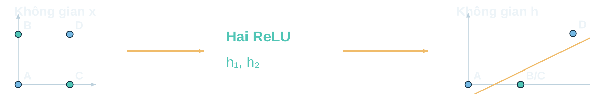
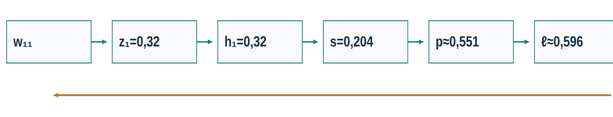

> Bản đọc trực tiếp trên GitHub, chuyển từ đầy đủ tài liệu HTML . [Tải bản HTML có bố cục và công thức LaTeX](Tai_lieu_doc_truoc/Bai10_Doc_truoc.html); mở bản HTML sau khi tải và giải nén toàn bộ repository. [Hướng dẫn bài thực hành và slide](README.md).

# Bài 10 · Kiến thức nền và đọc trước

**PGS.TS. Nguyễn Văn Hậu** · Khoa Công nghệ Thông tin · Trường Đại học Công nghệ Kỹ thuật Hưng Yên.

## 1. 🎯 Bài học giải quyết điều gì?

MLP học biểu diễn phi tuyến phục vụ dự đoán có nhãn. Em sẽ theo một dự đoán từ đầu vào tới loss, rồi đi từ loss về từng trọng số và cập nhật.

| Đích đến | Tự kiểm |
| --- | --- |
| Biểu diễn | Giải thích XOR trong hai không gian |
| Phép tính | Tính forward và một gradient lớp ẩn |
| Bằng chứng | Đọc checkpoint và một kết luận có giới hạn |

## 2. 🖼️ Dữ liệu thật và cách biểu diễn

Fashion-MNIST có ảnh sản phẩm xám 28×28 và mười lớp. Một ảnh là 784 giá trị byte. Trong case, chia 255 để đưa đầu vào về [0,1].

| Tập | Số ảnh | Vai trò |
| --- | --- | --- |
| Train | 12000 | Học tham số |
| Validation | 3000 | Chọn checkpoint, phân tích lỗi |
| Nguồn train chưa dùng | 45000 | Không tham gia case chính |
| Test | 10000 | Báo cáo sau chốt quyết định; đã có lịch sử |


ID train:24814 gọi hàng trong nguồn train chính thức, còn vai trò thí nghiệm là validation. Pixel hàng 12/cột 12 có byte 203. Chỉ số bắt đầu từ 0.

## 3. 🧮 Kiến thức cần nhớ

| Khái niệm | Ý nghĩa |
| --- | --- |
| Tổng có trọng số | Cộng các tích trọng số và đầu vào, thêm bias |
| Xác suất | Giá trị trong [0,1], phân biệt với score và nhãn |
| Trung bình | Tổng chia số mẫu thật |
| Đạo hàm | Độ nhạy cục bộ với một thay đổi nhỏ |

Quy tắc dây chuyền được dẫn lại bằng đồ thị có ba phép toán. Em chưa cần biết đạo hàm ma trận nhiều lớp để theo phần cốt lõi.

## 4. 📘 Từ vựng và ký hiệu

| Ký hiệu | Cách đọc |
| --- | --- |
| x | Đầu vào |
| z | Tổng trước kích hoạt |
| h | Giá trị sau kích hoạt |
| s | Score/logit |
| p | Xác suất |
| y / eᵧ | Nhãn lớp / vector one-hot |
| ℓ / L | Loss một mẫu / loss trung bình |
| θ / g / η | Tham số / gradient / learning rate |

## 5. 🔍 Vì sao cần phi tuyến?



```math
h_1=\mathrm{ReLU}(x_1+x_2),\quad h_2=\mathrm{ReLU}(x_1+x_2-1)
```

XOR dùng trọng số cho trước để chứng minh khả năng biểu diễn. Ghép nhiều affine vẫn là affine. Mạng có khả năng biểu diễn một lời giải chưa bảo đảm mọi lần huấn luyện đều tìm được lời giải ấy.

## 6. ➡️ Forward và loss

| Mạng nhỏ cố định | Dữ kiện |
| --- | --- |
| Đầu vào / nhãn | x=(0,6;0,2), y=1 |
| W₁ | [[0,5; −0,4], [0,3; 0,8]] |
| b₁ / v / b | (0,1;0,1) / (0,7;−0,5) / 0,2 |
| Kết quả | h=(0,32;0,44), s=0,204, p≈0,550824, ℓ≈0,596340 |

```math
\ell_{BCE}=-y\ln p-(1-y)\ln(1-p)
```

```math
\ell_{CE}=-\ln p_y,\qquad L=\frac1n\sum_i\ell_i
```

Nhị phân dùng sigmoid cùng BCE. Mười lớp loại trừ dùng softmax cùng cross-entropy. Loss và accuracy trả lời các câu hỏi khác nhau.

## 7. ↩️ Backprop và một bước học



```math
\frac{\partial\ell}{\partial w_{jk}}=(p-y)v_j\mathrm{ReLU}^{\prime}(z_j)x_k
```

```math
\theta_{new}=\theta_{old}-\eta g_{old}
```

Công thức gradient trên thuộc mạng nhỏ một lớp ẩn, sigmoid+BCE một mẫu. Tính đủ gradient từ trạng thái cũ rồi cập nhật. Với η=0,1, cập nhật cả chín tham số làm loss mẫu chính giảm xuống khoảng 0,550637. ReLU không có đạo hàm thông thường tại 0; mã chọn quy ước 0.

## 8. 🔁 Vòng học và cách đọc bằng chứng


| Cần phân biệt | Cách đọc |
| --- | --- |
| Batch / epoch | 47 cập nhật tạo một epoch trên 12.000 train |
| Backprop / Adam | Tính gradient / dùng gradient và trạng thái moment để cập nhật |
| Train CE / mục tiêu học | CE được tính riêng, L2 còn tham gia mục tiêu |
| Checkpoint / epoch cuối | Chọn CE validation nhỏ nhất, hòa chính xác chọn sớm hơn |
| Accuracy / recall | Tổng số đúng / số đúng của một lớp trên tổng hàng |

Seed 42 là lần chạy chính, không chọn seed thắng theo test. Lỗi mới, ảnh 28×28 và lịch sử dùng test là những giới hạn cần giữ khi kết luận.

## 9. ❓ Tự kiểm trước buổi học

**Nếu bỏ mọi hàm kích hoạt giữa các lớp affine, điều gì xảy ra?**

Nếu bỏ mọi hàm kích hoạt giữa các lớp affine, điều gì xảy ra?

| Phương án | Nội dung |
| --- | --- |
| A | Mạng trở thành một phép affine và vẫn có giới hạn phân tách XOR. |
| B | Có đủ lớp thì luôn phân tách được XOR. |
| C | Mọi đầu vào đều cho cùng một kết quả. |
| D | Các trọng số không thể được cập nhật. |

**Đáp án và giải thích**

**A**<br>A đúng vì ghép các phép affine vẫn là một phép affine.<br>B sai vì tăng số lớp affine không tạo phép biến đổi phi tuyến.<br>C sai vì đầu ra vẫn có thể phụ thuộc đầu vào.<br>D sai vì tham số vẫn có thể học, nhưng họ mô hình có giới hạn biểu diễn.

**Với y=1, hai dự đoán p=0,6 và p=0,9 cùng dùng ngưỡng 0,5. Kết luận nào đúng?**

Với y=1, hai dự đoán p=0,6 và p=0,9 cùng dùng ngưỡng 0,5. Kết luận nào đúng?

| Phương án | Nội dung |
| --- | --- |
| A | Cả hai có cùng loss vì cùng dự đoán đúng. |
| B | Dự đoán p=0,9 có accuracy trên mẫu này thấp hơn. |
| C | Cả hai đúng, nhưng p=0,9 có BCE nhỏ hơn. |
| D | Score s của cả hai phải bằng nhau. |

**Đáp án và giải thích**

**C**<br>A sai vì BCE còn phụ thuộc xác suất của lớp đúng.<br>B sai vì cả hai đều dự đoán nhãn 1 trên mẫu đang xét.<br>C đúng vì −ln(0,9) nhỏ hơn −ln(0,6).<br>D sai vì sigmoid tăng nghiêm ngặt nên hai xác suất khác nhau có score khác nhau.

**Với G(t)=(2t+3)²+3t, tại t=1 đạo hàm được ghép thế nào?**

Với G(t)=(2t+3)²+3t, tại t=1 đạo hàm được ghép thế nào?

| Phương án | Nội dung |
| --- | --- |
| A | Nhân tất cả đạo hàm của hai nhánh với nhau. |
| B | Đạo hàm nhánh bình phương là 20, rồi cộng đạo hàm nhánh 3t là 3. |
| C | Chỉ lấy đạo hàm của phép toán cuối mỗi nhánh. |
| D | Đạo hàm bằng giá trị đầu ra 28. |

**Đáp án và giải thích**

**B**<br>A sai vì hai đường ảnh hưởng phải được cộng.<br>B đúng vì nhân dọc mỗi đường rồi cộng giữa hai đường, được 23.<br>C sai vì ảnh hưởng đi qua cả các phép toán trước đó.<br>D sai vì giá trị hàm và đạo hàm là hai đại lượng khác nhau.

**Với mạng nhỏ đã học, gradient theo trọng số đầu ra v₁ là biểu thức nào?**

Với mạng nhỏ đã học, gradient theo trọng số đầu ra v₁ là biểu thức nào?

| Phương án | Nội dung |
| --- | --- |
| A | $(p-y)x_1$ |
| B | $(p-y)/h_1$ |
| C | $p-y$ |
| D | $(p-y)h_1$ |

**Đáp án và giải thích**

**D**<br>A sai vì cạnh v₁ nhận hoạt hóa h₁, không trực tiếp nhận x₁.<br>B sai vì score phụ thuộc v₁ bằng phép nhân v₁h₁.<br>C sai vì biểu thức này là gradient theo bias đầu ra.<br>D đúng vì đạo hàm score theo v₁ bằng h₁.

**Với w₁₂ nối x₂ vào nơ-ron ẩn 1, gradient đúng là gì?**

Với w₁₂ nối x₂ vào nơ-ron ẩn 1, gradient đúng là gì?

| Phương án | Nội dung |
| --- | --- |
| A | $(p-y)v_1\mathrm{ReLU}^{\prime}(z_1)x_2$ |
| B | $(p-y)h_1$ |
| C | $(p-y)v_2\mathrm{ReLU}^{\prime}(z_2)x_2$ |
| D | $(p-y)v_1\mathrm{ReLU}^{\prime}(z_1)x_1$ |

**Đáp án và giải thích**

**A**<br>A đúng vì bốn thừa số theo đúng đường qua nơ-ron ẩn 1 và đầu vào x₂.<br>B sai vì đây là gradient của trọng số đầu ra v₁.<br>C sai vì đi qua nơ-ron ẩn 2.<br>D sai vì đây là đường của w₁₁ nối từ x₁.

**Một lượt backprop đã dùng trạng thái θ cũ. Khi cập nhật, thao tác nào đúng?**

Một lượt backprop đã dùng trạng thái θ cũ. Khi cập nhật, thao tác nào đúng?

| Phương án | Nội dung |
| --- | --- |
| A | Cập nhật v rồi dùng v mới để tính gradient W₁ trong lượt ấy. |
| B | Cập nhật từng tham số theo nhãn dự đoán, bỏ loss. |
| C | Tính đủ gradient bằng θ cũ rồi cập nhật toàn bộ tham số. |
| D | Dùng validation để tính gradient cho train. |

**Đáp án và giải thích**

**C**<br>A sai vì trộn hai trạng thái trong một gradient.<br>B sai vì cập nhật cần đạo hàm của mục tiêu đã chọn.<br>C đúng vì mọi gradient thuộc cùng một điểm tham số trước cập nhật.<br>D sai vì validation dùng đánh giá và chọn checkpoint trong giao thức này.

**Giao thức chọn checkpoint theo validation CE nhỏ nhất. Cách chọn nào phù hợp?**

Giao thức chọn checkpoint theo validation CE nhỏ nhất. Cách chọn nào phù hợp?

| Phương án | Nội dung |
| --- | --- |
| A | Chọn epoch cuối dù CE validation đã tăng. |
| B | Chọn epoch có CE validation nhỏ nhất, hòa chính xác thì chọn epoch sớm hơn. |
| C | Chọn seed/epoch có accuracy test lớn nhất. |
| D | Chọn epoch có CE train nhỏ nhất. |

**Đáp án và giải thích**

**B**<br>A sai vì epoch cuối không nhất thiết đạt tiêu chí đã chốt.<br>B đúng vì thực hiện đúng tiêu chí và quy tắc xử lý hòa.<br>C sai vì dùng test để lựa chọn và đổi vai trò của test.<br>D sai vì train CE chưa thay thế được bằng chứng validation.

**MLP tăng số ảnh đúng trên validation, đồng thời tạo một số lỗi mới. Kết luận nào phù hợp?**

MLP tăng số ảnh đúng trên validation, đồng thời tạo một số lỗi mới. Kết luận nào phù hợp?

| Phương án | Nội dung |
| --- | --- |
| A | MLP tốt hơn với mọi ảnh và mọi lớp. |
| B | MLP có thể triển khai ngay với mọi ảnh cửa hàng. |
| C | Ba seed đã chứng minh mức tăng có ý nghĩa thống kê. |
| D | Trong giao thức này MLP cải thiện tổng số đúng, nhưng cần xem lớp, lỗi mới và phạm vi dữ liệu. |

**Đáp án và giải thích**

**D**<br>A sai vì bảng cặp lỗi có ảnh baseline đúng nhưng MLP sai.<br>B sai vì benchmark ảnh xám 28×28 khác ảnh cửa hàng tự do.<br>C sai vì ba seed chỉ mô tả dao động, chưa phải kiểm định hay khoảng tin cậy.<br>D đúng vì kết luận gắn với dữ liệu, giao thức và cả hai chiều thay đổi lỗi.

## 10. ✅ Chuẩn bị và thực hành

| Trước / trong / sau buổi | Sản phẩm |
| --- | --- |
| Trước | Đọc ký hiệu và tính hai nơ-ron ẩn |
| Trong | Một đường gradient và một kết luận từ bảng lỗi |
| Sau | Chạy notebook từ đầu, mở ảnh có ID và so với log |

[Notebook](Bai10_Thuc_hanh.ipynb) · [Dữ liệu thật](Bai10_Du_lieu_that.html) · [Mạng nhỏ tương tác](Bai10_Mang_nho_tuong_tac.html)
