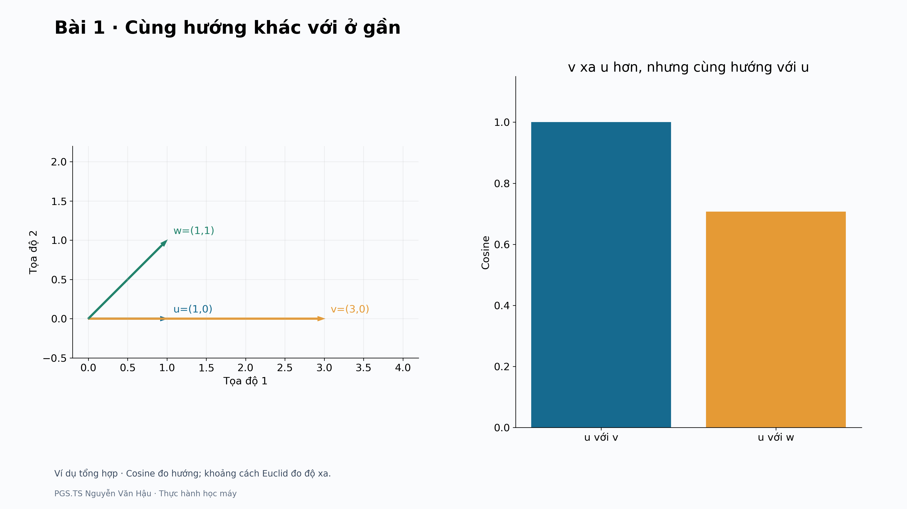
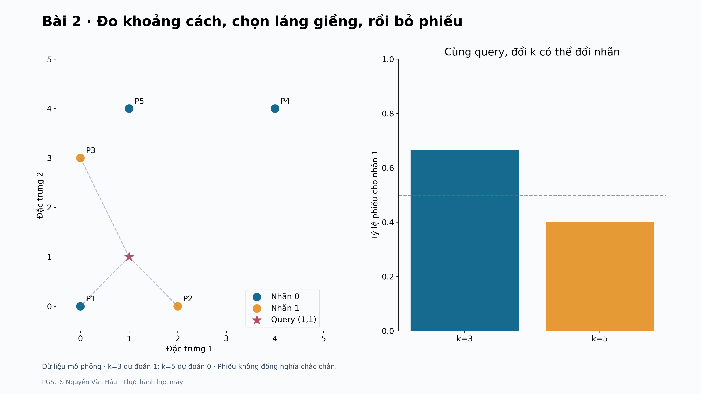
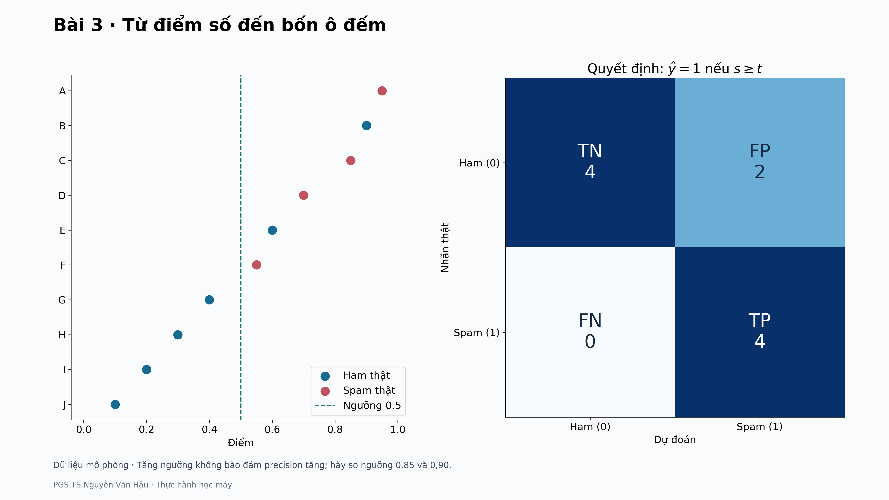
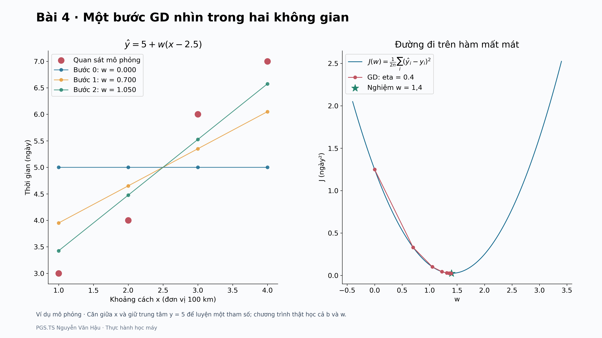
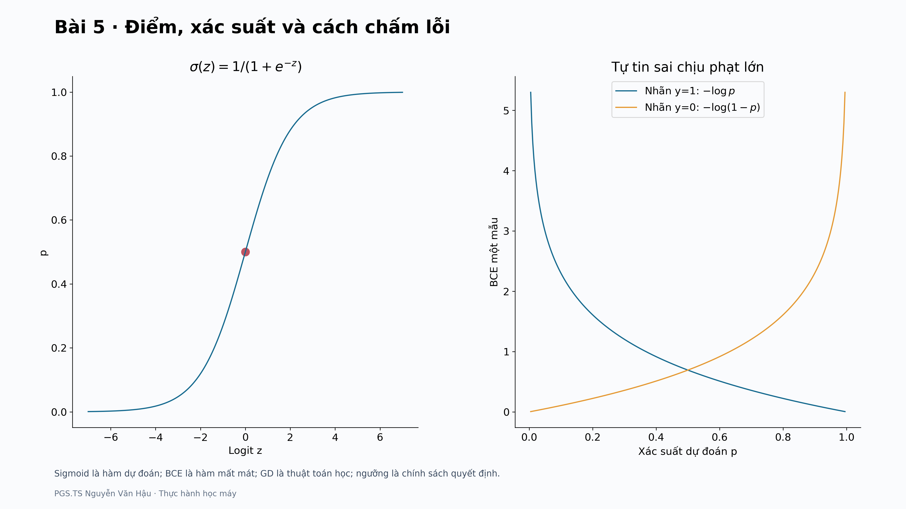
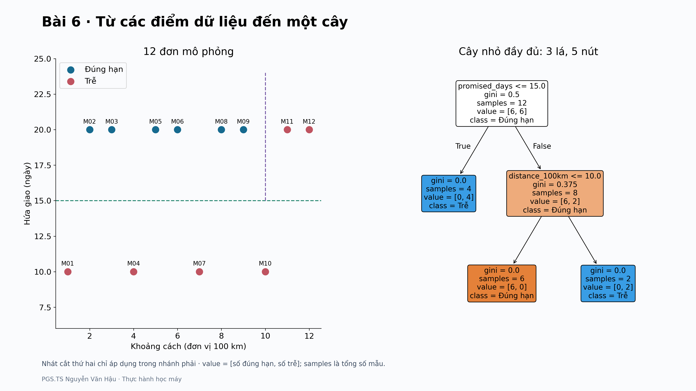
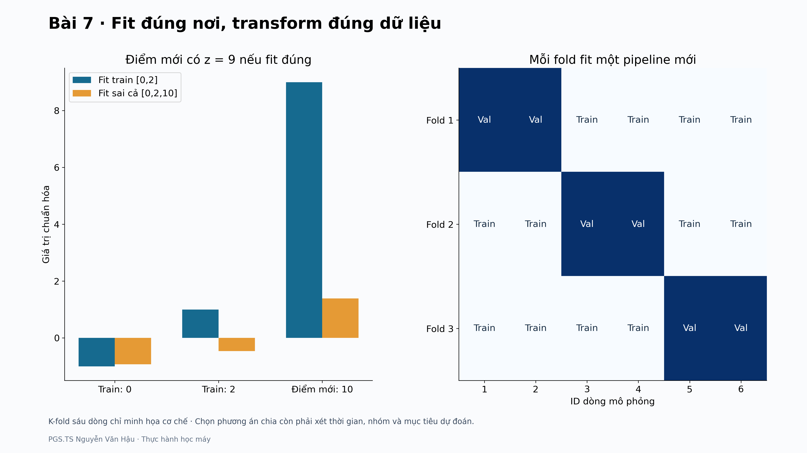
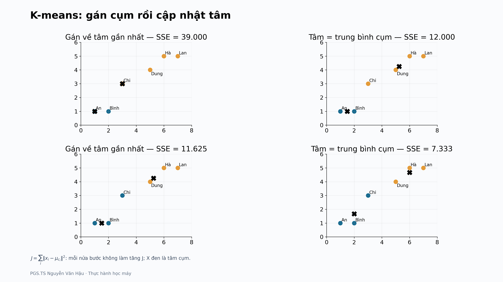
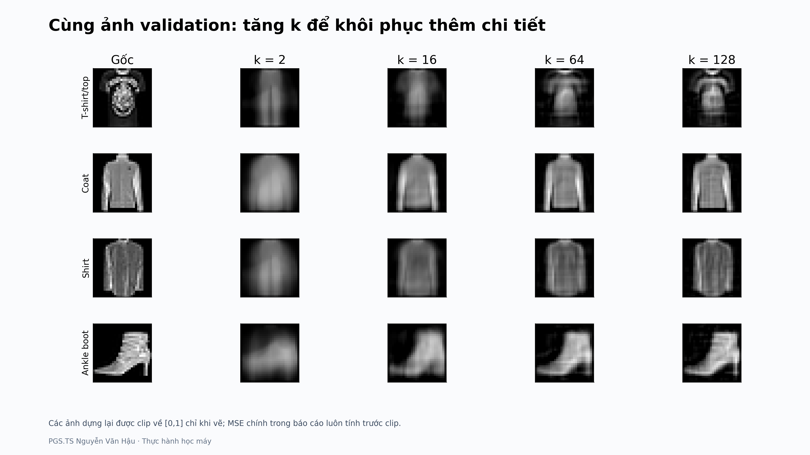
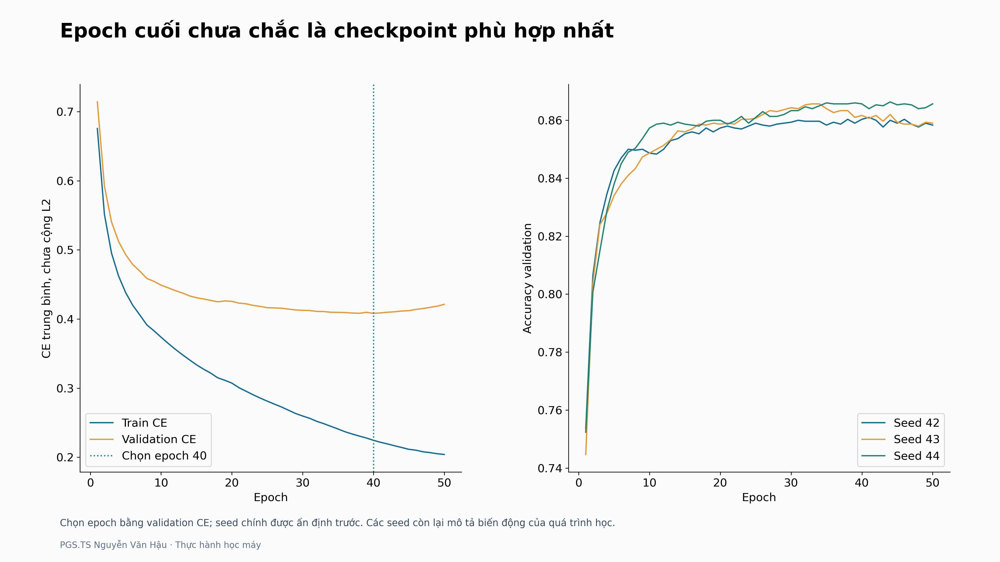

# Mười hình minh họa chọn lọc

Mỗi hình được sinh từ mã, kích thước gốc 3840×2160. Chạy từng bài để tạo toàn bộ hình và các tệp số; đây là hình xem trước để định hướng đọc.

## Bài 01

[Hướng dẫn và giải thích](../lessons/bai01/README.md)

## Bài 02

[Hướng dẫn và giải thích](../lessons/bai02/README.md)

## Bài 03

[Hướng dẫn và giải thích](../lessons/bai03/README.md)

## Bài 04

[Hướng dẫn và giải thích](../lessons/bai04/README.md)

## Bài 05

[Hướng dẫn và giải thích](../lessons/bai05/README.md)

## Bài 06

[Hướng dẫn và giải thích](../lessons/bai06/README.md)

## Bài 07

[Hướng dẫn và giải thích](../lessons/bai07/README.md)

## Bài 08

[Hướng dẫn và giải thích](../lessons/bai08/README.md)

## Bài 09

[Hướng dẫn và giải thích](../lessons/bai09/README.md)

## Bài 10

[Hướng dẫn và giải thích](../lessons/bai10/README.md)

