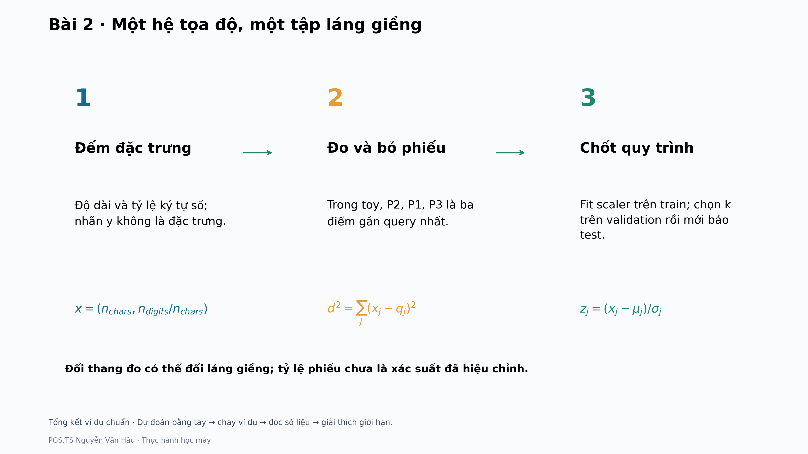

# Bài 2 · Lộ trình thực hành

[Hướng dẫn chi tiết](README.md) · [Đọc trước](../../readings/bai02/README.md) · [Kiểm tra học liệu](../../docs/MAINTAINING.md)

**Một hệ tọa độ, một tập láng giềng.** Lộ trình ví dụ nhỏ dự kiến 35–50 phút. Không cần dữ liệu thật để hoàn thành ví dụ nhỏ.

## 1. Dự đoán trước khi chạy

Vì sao không fit scaler riêng cho query hoặc validation?

Ghi câu trả lời bằng số và một câu giải thích. Chưa mở đáp án bên dưới; mục tiêu là kiểm cách hiểu, không chỉ chép đầu ra.

## 2. Chạy ví dụ nhỏ

Chạy từ thư mục gốc repository, sau khi cài thư viện theo README chung:

```bash
python -m examples.bai02.main --mode toy --output-dir outputs/toy/bai02
```

PNG mặc định 3840×2160. Công thức trong hình dùng Matplotlib mathtext; nguồn Markdown dùng LaTeX. `--dpi 80` dùng xem thử nhanh, không phải bản 4K.

## 3. Đọc theo ba chặng

### 1. Đếm đặc trưng

Độ dài và tỷ lệ ký tự số; nhãn y không là đặc trưng.

```math
x=(n_{chars},n_{digits}/n_{chars})
```

### 2. Đo và bỏ phiếu

Trong toy, P2, P1, P3 là ba điểm gần query nhất.

```math
d^2=\sum_j(x_j-q_j)^2
```

### 3. Chốt quy trình

Fit scaler trên train; chọn k trên validation rồi mới báo test.

```math
z_j=(x_j-\mu_j)/\sigma_j
```



## 4. Mở đúng đầu ra

Các tệp nằm trong thư mục `--output-dir` của lần chạy. Tên bắt đầu `toy_` thuộc ví dụ nhỏ; `real_` thuộc thí nghiệm thật. `results.json` lưu số liệu và cấu hình phiên bản.

- `toy_neighbors.csv`
- `real_query_neighbors.csv`
- `real_neighbors.png`

- `summary.png`: tổng kết ví dụ chuẩn và giới hạn diễn giải.

## 5. Đối chiếu và giải thích

<details>
<summary>Mở sau khi đã tự tính</summary>

Mỗi tập sẽ có một hệ tọa độ khác; scaler học từ train phải được dùng lại để đo khoảng cách nhất quán.

</details>

**Điều cần mang theo:** Đổi thang đo có thể đổi láng giềng; tỷ lệ phiếu chưa là xác suất đã hiệu chỉnh.

Bài nộp ngắn: ghi cấu hình đã chạy, một kết quả tính tay khớp mã, một hình kèm lời giải thích và một điều kết quả chưa chứng minh. Khi số khác, kiểm dữ liệu, seed, tham số, mẫu số và quy tắc làm tròn trước khi kết luận mã sai.

## 6. Nối với slide và tài liệu đọc trước

| Slide | Điểm bắt đầu | Điểm kết thúc |
|---|---|---|
| 11–29 | Hai đặc trưng nhìn và đếm được | Tổng kết · Từ khoảng cách đến một dự đoán |
| 31–43 | Hai trục SMS có thang số rất khác | Chuẩn hóa SMS bằng thống kê train thật |
| 44–60 | Ba láng giềng khi chưa chuẩn hóa | Tổng quan · kNN học từ láng giềng |

Bảng đối chiếu giúp giảng viên nối ví dụ với nội dung giảng dạy; repository không phân phối PowerPoint.

## 7. Mở rộng sang dữ liệu thật

Chuẩn bị đúng dữ liệu theo [README của bài](README.md), rồi chạy:

```bash
python -m examples.bai02.main --mode all --output-dir outputs/bai02
```

Đọc ví dụ trước, chạy cấu hình chuẩn sau; cuối cùng mới thay một yếu tố và lưu sang thư mục khác. Giữ nguyên tập chấm khi so mô hình; chọn cấu hình trên validation, không chọn lại bằng test. Với phân tích mô tả ở Bài 1 và 8, giới hạn kết luận ở snapshot và cách biểu diễn đã dùng.

Phần tính tay và giải thích hình là yêu cầu cơ bản. Vét cạn, chứng minh, nhiều seed, nested CV và các kiểm tra thư viện sâu là phần mở rộng phù hợp từng bài. Bài 10 mặc định chạy 3 seed × 50 epoch trên CPU; không coi cấu hình chạy nhanh là phép tái lập đầy đủ.
