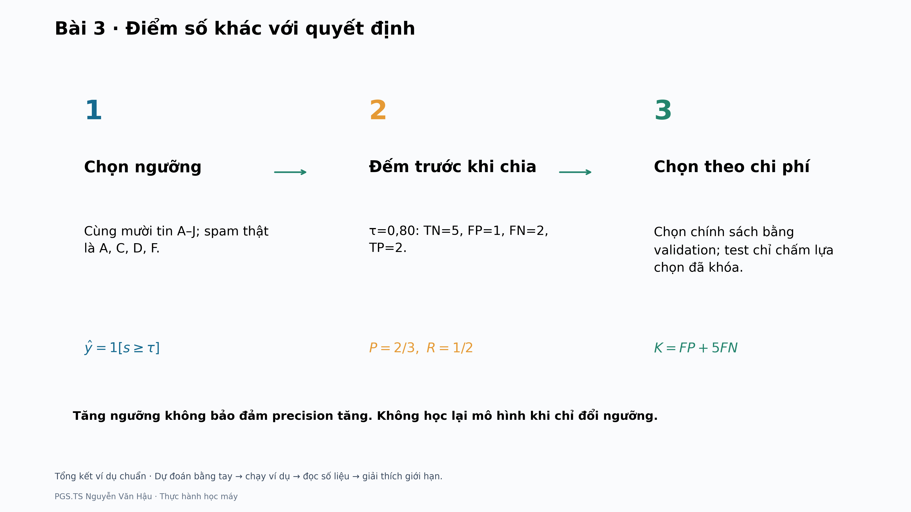

# Bài 3 · Lộ trình thực hành

[Hướng dẫn chi tiết](README.md) · [Đọc trước](../../readings/bai03/README.md) · [Kiểm tra học liệu](../../docs/MAINTAINING.md)

**Điểm số khác với quyết định.** Lộ trình ví dụ nhỏ dự kiến 35–50 phút. Không cần dữ liệu thật để hoàn thành ví dụ nhỏ.

## 1. Dự đoán trước khi chạy

Từ τ=0,50 lên 0,80: những tin nào đổi quyết định? Nếu FN đắt gấp 5, ngưỡng nào tốt hơn trong hai ngưỡng?

Ghi câu trả lời bằng số và một câu giải thích. Chưa mở đáp án bên dưới; mục tiêu là kiểm cách hiểu, không chỉ chép đầu ra.

## 2. Chạy ví dụ nhỏ

Chạy từ thư mục gốc repository, sau khi cài thư viện theo README chung:

```bash
python -m examples.bai03.main --mode toy --output-dir outputs/toy/bai03
```

PNG mặc định 3840×2160. Công thức trong hình dùng Matplotlib mathtext; nguồn Markdown dùng LaTeX. `--dpi 80` dùng xem thử nhanh, không phải bản 4K.

## 3. Đọc theo ba chặng

### 1. Chọn ngưỡng

Cùng mười tin A–J; spam thật là A, C, D, F.

```math
\hat y=1[s\geq\tau]
```

### 2. Đếm trước khi chia

τ=0,80: TN=5, FP=1, FN=2, TP=2.

```math
P=2/3,\ R=1/2
```

### 3. Chọn theo chi phí

Chọn chính sách bằng validation; test chỉ chấm lựa chọn đã khóa.

```math
K=FP+5FN
```



## 4. Mở đúng đầu ra

Các tệp nằm trong thư mục `--output-dir` của lần chạy. Tên bắt đầu `toy_` thuộc ví dụ nhỏ; `real_` thuộc thí nghiệm thật. `results.json` lưu số liệu và cấu hình phiên bản.

- `toy_rows.csv`
- `toy_thresholds.csv`
- `toy_confusion.png`

- `summary.png`: tổng kết ví dụ chuẩn và giới hạn diễn giải.

## 5. Đối chiếu và giải thích

<details>
<summary>Mở sau khi đã tự tính</summary>

D, E, F rời nhóm cảnh báo. K(0,50)=2; K(0,80)=11, nên 0,50 tốt hơn theo chi phí đó.

</details>

**Điều cần mang theo:** Tăng ngưỡng không bảo đảm precision tăng. Không học lại mô hình khi chỉ đổi ngưỡng.

Bài nộp ngắn: ghi cấu hình đã chạy, một kết quả tính tay khớp mã, một hình kèm lời giải thích và một điều kết quả chưa chứng minh. Khi số khác, kiểm dữ liệu, seed, tham số, mẫu số và quy tắc làm tròn trước khi kết luận mã sai.

## 6. Nối với slide và tài liệu đọc trước

| Slide | Điểm bắt đầu | Điểm kết thúc |
|---|---|---|
| 11–31 | Mười tin mô phỏng để tính tay | Tổng kết · Chọn đúng mẫu số |
| 33–40 | Một điểm số, nhiều cách ra quyết định | Tổng kết · Chọn ngưỡng ở đâu? |
| 41–56 | Với k = 11, ngưỡng là số phiếu tối thiểu | Tổng quan · Từ dự đoán đến quyết định |

Bảng đối chiếu giúp giảng viên nối ví dụ với nội dung giảng dạy; repository không phân phối PowerPoint.

## 7. Mở rộng sang dữ liệu thật

Chuẩn bị đúng dữ liệu theo [README của bài](README.md), rồi chạy:

```bash
python -m examples.bai03.main --mode all --output-dir outputs/bai03
```

Đọc ví dụ trước, chạy cấu hình chuẩn sau; cuối cùng mới thay một yếu tố và lưu sang thư mục khác. Giữ nguyên tập chấm khi so mô hình; chọn cấu hình trên validation, không chọn lại bằng test. Với phân tích mô tả ở Bài 1 và 8, giới hạn kết luận ở snapshot và cách biểu diễn đã dùng.

Phần tính tay và giải thích hình là yêu cầu cơ bản. Vét cạn, chứng minh, nhiều seed, nested CV và các kiểm tra thư viện sâu là phần mở rộng phù hợp từng bài. Bài 10 mặc định chạy 3 seed × 50 epoch trên CPU; không coi cấu hình chạy nhanh là phép tái lập đầy đủ.
