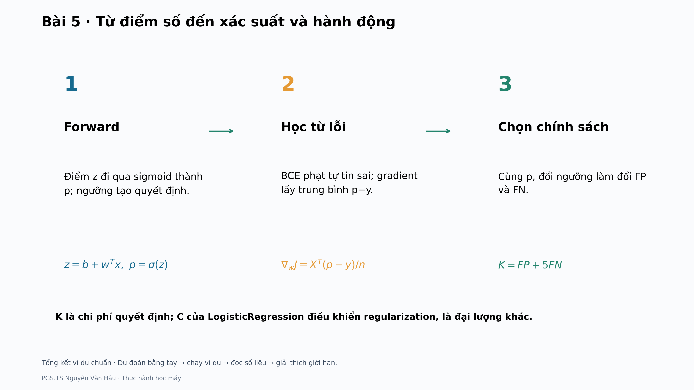

# Bài 5 · Lộ trình thực hành v3

[Hướng dẫn chi tiết](README.md) · [Đọc trước](../../readings/bai05/README.md) · [Toàn bộ cập nhật](../../docs/PYTHON_V3.md)

**Từ điểm số đến xác suất và hành động.** Tài liệu đọc trước v3; đối chiếu slide **v3**. Lộ trình cơ bản dự kiến 35–50 phút, tùy tốc độ người học. Không cần chạy dữ liệu thật để hoàn thành ví dụ nhỏ.

## 1. Dự đoán trước khi chạy

Đổi ngưỡng có làm thay đổi p hoặc BCE của mô hình đã fit không?

Ghi câu trả lời bằng số và một câu giải thích. Chưa mở đáp án bên dưới; mục tiêu là kiểm cách hiểu, không chỉ chép đầu ra.

## 2. Chạy ví dụ nhỏ

Chạy từ thư mục gốc repository, sau khi cài thư viện theo README chung:

```bash
python -m lessons.bai05.main --mode toy --output-dir outputs/v3_toy/bai05
```

PNG mặc định 3840×2160. Công thức trong hình dùng Matplotlib mathtext; nguồn Markdown dùng LaTeX. `--dpi 80` dùng xem thử nhanh, không phải bản 4K.

## 3. Đọc theo ba chặng

### 1. Forward

Điểm z đi qua sigmoid thành p; ngưỡng tạo quyết định.

```math
z=b+w^Tx,\ p=\sigma(z)
```

### 2. Học từ lỗi

BCE phạt tự tin sai; gradient lấy trung bình p−y.

```math
\nabla_w J=X^T(p-y)/n
```

### 3. Chọn chính sách

Cùng p, đổi ngưỡng làm đổi FP và FN.

```math
K=FP+5FN
```



## 4. Mở đúng đầu ra

Các tệp nằm trong thư mục `--output-dir` của lần chạy. Tên bắt đầu `toy_` thuộc ví dụ nhỏ; `real_` thuộc thí nghiệm thật. `results.json` lưu số liệu và cấu hình phiên bản.

- `toy_sigmoid_bce.png`
- `toy_learning.png`
- `real_one_order.png`

- `summary_v3.png`: tổng kết ví dụ chuẩn và giới hạn diễn giải.

## 5. Đối chiếu và giải thích

<details>
<summary>Mở sau khi đã tự tính</summary>

Không. Ngưỡng chỉ đổi nhãn dự đoán; p và BCE trên cùng dữ liệu vẫn giữ nguyên.

</details>

**Điều cần mang theo:** K là chi phí quyết định; C của LogisticRegression điều khiển regularization, là đại lượng khác.

Bài nộp ngắn: ghi cấu hình đã chạy, một kết quả tính tay khớp mã, một hình kèm lời giải thích và một điều kết quả chưa chứng minh. Khi số khác, kiểm dữ liệu, seed, tham số, mẫu số và quy tắc làm tròn trước khi kết luận mã sai.

## 6. Nối với slide và tài liệu đọc trước

| Slide | Điểm bắt đầu | Điểm kết thúc |
|---|---|---|
| 8–22 | Điểm tuyến tính có thể nằm ngoài 0 đến 1 | Hàm mục tiêu là BCE trung bình |
| 23–38 | BCE: từ một mẫu đến cả tập | Ngưỡng xác suất tạo biên quyết định |
| 40–65 | Từ một đầu vào đến sáu đặc trưng | Bài 5 · Từ đơn hàng đến quyết định |

Các số slide ở bảng trên thuộc phiên bản đã ghi ở đầu hướng dẫn. `teaching.json` lưu mã SHA256 của danh mục slide dùng đối chiếu; không lấy số slide v2 thay cho v3.

## 7. Mở rộng sang dữ liệu thật

Chuẩn bị đúng dữ liệu theo [README của bài](README.md), rồi chạy:

```bash
python -m lessons.bai05.main --mode all --output-dir outputs/v3/bai05
```

Đọc ví dụ trước, chạy cấu hình chuẩn sau; cuối cùng mới thay một yếu tố và lưu sang thư mục khác. Giữ nguyên tập chấm khi so mô hình; chọn cấu hình trên validation, không chọn lại bằng test. Với phân tích mô tả ở Bài 1 và 8, giới hạn kết luận ở snapshot và cách biểu diễn đã dùng.

Phần tính tay và giải thích hình là yêu cầu cơ bản. Vét cạn, chứng minh, nhiều seed, nested CV và các kiểm tra thư viện sâu là phần mở rộng phù hợp từng bài. Bài 10 mặc định chạy 3 seed × 50 epoch trên CPU; không coi cấu hình chạy nhanh là phép tái lập đầy đủ.
