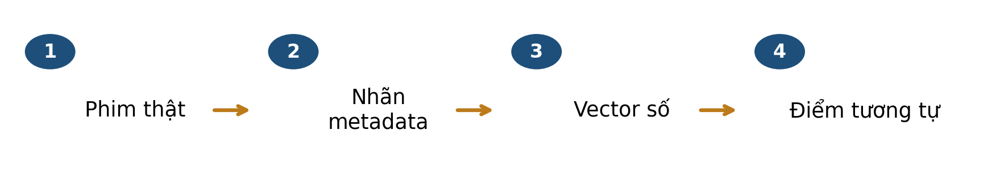
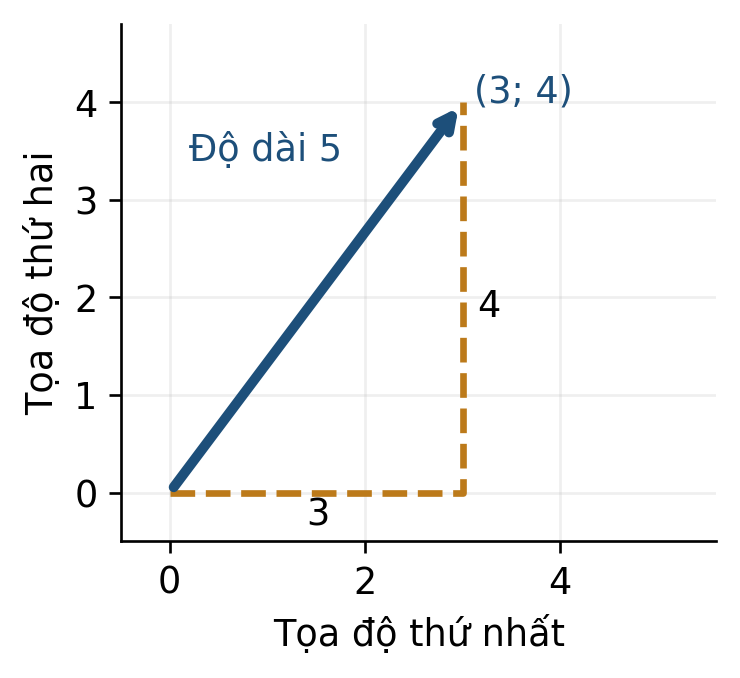
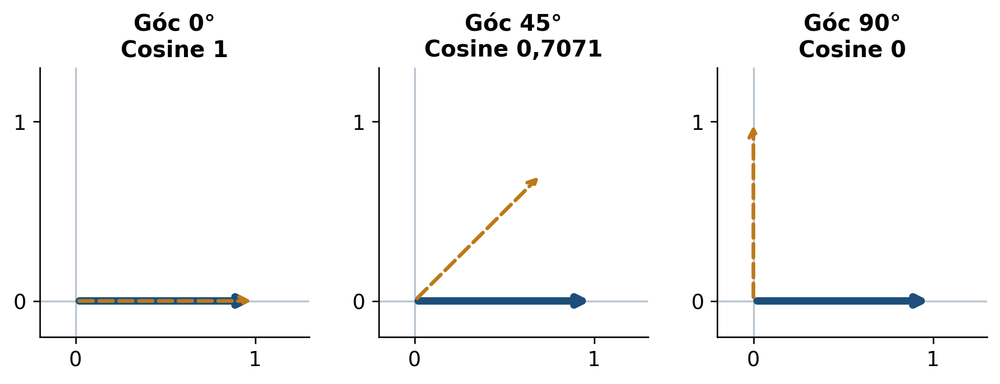
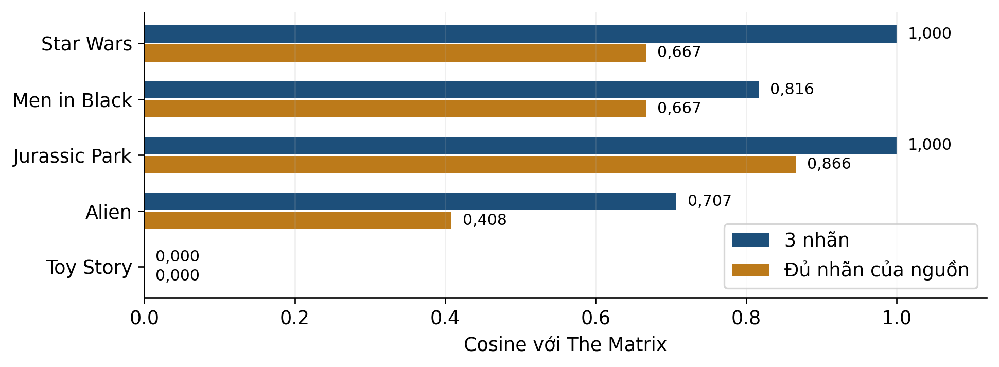

# Bài 01 · Vector và độ tương đồng cosine

**PGS.TS. Nguyễn Văn Hậu**

Khoa Công nghệ Thông tin, Trường Đại học Công nghệ Kỹ thuật Hưng Yên

[← Mục lục khóa học](../../README.md) · [📄 PDF 14 trang](Bai01_Kien_thuc_nen_tang_va_doc_truoc.pdf) · [📝 Word](Bai01_Kien_thuc_nen_tang_va_doc_truoc.docx) · [💻 Thực hành Python](../../lessons/bai01/README.md)

**Tài liệu đọc trước v3 · Đối chiếu slide v3.** Bộ Python hiện vẫn theo phiên bản trước; xem [các điểm cần đối chiếu](../../docs/DOI_CHIEU_HOC_LIEU.md).

Đọc mục 1–8, tự làm mục 9 trước khi xem phụ lục A, dùng mục 10 để ôn tập. Phụ lục B dành cho người muốn tìm hiểu sâu hơn.

## Mục lục

- [1 Bài học này giải quyết vấn đề gì](#muc-1)
- [Lộ trình đọc và đối chiếu với bài giảng](#muc-2)
- [2 Bạn cần biết gì trước khi bắt đầu](#muc-3)
- [3 Dữ liệu của bài học trông như thế nào](#muc-4)
- [4 Ý tưởng chính của phương pháp là gì](#muc-5)
- [5 Những khái niệm và công thức nào cần nắm](#muc-6)
- [6 Phương pháp được thực hiện như thế nào](#muc-7)
- [7 Cùng làm một ví dụ từ đầu đến cuối](#muc-8)
- [8 Đọc kết quả và tránh hiểu nhầm](#muc-9)
- [Kết nối trực quan từ vector đến đề xuất phim](#muc-10)
- [9 Tự kiểm tra trước khi đến lớp](#muc-11)
- [10 Những điều cần nhớ](#muc-12)
- [Phụ lục A Đáp án có giải thích](#muc-13)
- [Phụ lục B Kiến thức mở rộng tùy chọn](#muc-14)

<a id="muc-1"></a>

## 1 Bài học này giải quyết vấn đề gì

Bạn muốn tìm những phim có nhãn gần với **The Matrix**. Một người có thể chọn theo diễn viên, người khác chọn theo nội dung. Để máy tính thực hiện được, ta cần chốt một nghĩa cụ thể của “gần”: trong bài này là tương tự theo các nhãn metadata được cung cấp.



*Hình 1. Một quy trình từ đối tượng đến điểm số. Mũi tên thể hiện các bước xử lý, không thể hiện quan hệ nhân quả.*

Đầu vào là nhãn của phim tham chiếu và các phim ứng viên. Đầu ra là một điểm cosine cho mỗi cặp hợp lệ. **Chưa có dữ liệu về sở thích của một người cụ thể**, nên điểm số này chưa trả lời người đó sẽ thích phim nào.

### Sau khi đọc bạn có thể

- Mã hóa nhãn của phim thành vector theo cùng thứ tự.
- Tính tích vô hướng, chuẩn L2 và cosine trên một ví dụ nhỏ.
- Phân biệt điểm 0 với trường hợp công thức không xác định.
- Đọc thứ hạng và giải thích giới hạn của biểu diễn.

> ✏️ **Cách học:** đọc 10 mục chính, làm câu hỏi ở mục 9 rồi đối chiếu phụ lục A. Chuẩn bị giấy và máy tính căn bậc hai. Không cần biết Python; phụ lục B là tùy chọn. Dành khoảng 40–50 phút, điều chỉnh theo tốc độ của bạn.

<a id="muc-2"></a>

## Lộ trình đọc và đối chiếu với bài giảng

Bản tài liệu cập nhật v3 • Đối chiếu Bài 1, slide v3. Nội dung và các mốc tổng kết dưới đây theo bản slide v3.

### Đọc để chuẩn bị điều gì

- Biểu diễn phim thành vector
- Tích vô hướng và độ dài
- Cosine và cách xếp hạng
- Kiểm tra giới hạn của biểu diễn

Dành khoảng 40–50 phút cho phần chính, ví dụ và tự kiểm. Phụ lục A dùng để kiểm tra lập luận sau khi tự làm; phụ lục B là phần mở rộng, có thể đọc sau giờ học.

| Slide | Mốc ôn tập trong bài giảng |
| --- | --- |
| 12 | Tổng kết · Nhãn phim thành vector |
| 22 | Tổng kết · Dot chuẩn L2 và cosine |
| 35 | Tổng kết · Tính và đọc một điểm cosine |
| 43 | Tổng kết · Khi nào được diễn giải cosine |
| 56 | Tổng quan · Biểu diễn quyết định cách so sánh |

> 📌 Tài liệu đọc trước tạo nền và đặt câu hỏi; các slide trên giúp nối lại kiến thức trong giờ học. Không cần học thuộc mọi kết quả số trước khi đến lớp.

<a id="muc-3"></a>

## 2 Bạn cần biết gì trước khi bắt đầu

Một **vector** là một dãy số có thứ tự. Với vector phim, từng vị trí có một ý nghĩa cố định. Hai vector cùng có ba số vẫn chưa so sánh trực tiếp được nếu vị trí thứ hai của chúng chỉ hai nhãn khác nhau.

| Kiến thức | Cách đọc | Ví dụ |
| --- | --- | --- |
| Tọa độ | Giá trị tại từng vị trí | u = (1; 0; 1) có 3 tọa độ |
| Bình phương | Nhân số với chính nó | (−3)² = 9 |
| Căn bậc hai không âm | Số không âm có bình phương bằng số đã cho | √25 = 5 |
| Ký hiệu tổng | Cộng các số hạng theo chỉ số | Σ từ j = 1 đến 3 là cộng 3 hạng |



*Hình 2. Ví dụ hình học 2D được tạo để ôn Pythagoras; hai trục cùng tỷ lệ. Đây không phải phép chiếu các phim xuống hai chiều.*

```math
\|(3,4)\|_2=\sqrt{3^2+4^2}=5
```

Chuẩn L2 đo độ dài mũi tên từ gốc đến (3; 4). Số 25 là bình phương độ dài; cần lấy căn để được độ dài.

> ✏️ **Kiểm nhanh:** (K1) tính 2×1 + 0×3 + 1×2; (K2) tính √(1² + 1² + 0²). Nếu vướng, làm theo thứ tự bình phương → cộng → căn. Đáp án ở phụ lục A.

<a id="muc-4"></a>

## 3 Dữ liệu của bài học trông như thế nào

Nguồn **MovieLens latest-small** do GroupLens phát hành [1]. Bản lưu dùng trong slide có 9.742 phim. Ta dùng **movies.csv**, trong đó một hàng đại diện cho một phim, gồm movieId, title và genres. File ratings.csv lưu đánh giá của người dùng nhưng không tham gia phép so sánh ở bài này.

| Cột | Ý nghĩa và cách dùng |
| --- | --- |
| movieId | Khóa để tra lại phim; không dùng chênh lệch ID làm độ giống nội dung. |
| title | Tên và năm của phim theo nguồn; giúp đọc bảng. |
| genres | Các nhãn ngăn bằng dấu \|; dấu này là ký tự phân cách, không phải phép toán. |

Giữ thứ tự **Action → Comedy → Sci-Fi**. Mỗi vị trí bằng 1 nếu nhãn có trong dòng dữ liệu, bằng 0 nếu không có. Vì một phim có thể mang nhiều nhãn, đây là mã hóa **multi-hot**.

| ID | Tên rút gọn | Nhãn nguyên văn từ dữ liệu | Vector 3 trục |
| --- | --- | --- | --- |
| 2571 | The Matrix | Action\|Sci-Fi\|Thriller | (1; 0; 1) |
| 260 | Star Wars IV | Action\|Adventure\|Sci-Fi | (1; 0; 1) |
| 1580 | Men in Black | Action\|Comedy\|Sci-Fi | (1; 1; 1) |
| 480 | Jurassic Park | Action\|Adventure\|Sci-Fi\|Thriller | (1; 0; 1) |
| 1214 | Alien | Horror\|Sci-Fi | (0; 0; 1) |
| 1 | Toy Story | Adventure\|Animation\|Children\|Comedy\|Fantasy | (0; 1; 0) |

> 🔎 **Đọc một hàng:** The Matrix có Action, Sci-Fi và Thriller. Ba trục đang dùng giữ Action và Sci-Fi, nên vector là (1; 0; 1). Thriller chưa được mã hóa.

Các phim trên được chọn có chủ đích để minh họa, không phải mẫu ngẫu nhiên của kho. Số 0 ở Comedy chỉ nói nhãn này không xuất hiện trong bản ghi; nó không phải điểm đánh giá 0 sao hay nhận xét về mọi cảnh phim.

<a id="muc-5"></a>

## 4 Ý tưởng chính của phương pháp là gì

Hai mũi tên có thể dài khác nhau nhưng chỉ cùng một hướng. Cosine so sánh hướng của hai vector khác 0. Trong miền góc từ 0° đến 180°, góc càng nhỏ thì cosine càng lớn. Với vector nhãn không âm của bài, ta chỉ gặp các góc từ 0° đến 90°.



*Hình 3. Minh họa hình học 2D. Đường xanh là vector tham chiếu; đường vàng nét đứt là vector so sánh. Ở góc 0° hai vector chồng nhau.*

### Vì sao chỉ đếm nhãn chung chưa đủ

Star Wars và Men in Black đều có hai nhãn chung với The Matrix trên ba trục. Tuy nhiên Men in Black có thêm Comedy. Số nhãn chung bằng nhau, nhưng tỷ lệ giữa phần chung và độ dài hai vector khác nhau. Cosine đưa cả hai độ dài vào mẫu số để phản ánh sự khác biệt này.

```math
\widehat u=\frac{u}{\|u\|_2},\qquad u\ne0
```

Chia mọi tọa độ của một vector khác 0 cho chuẩn L2 của nó tạo vector đơn vị, có độ dài 1 và giữ nguyên hướng.

Ví dụ (3; 4) chia cho 5 thành (0,6; 0,8). Hai tọa độ không bằng 1, nhưng tổng bình phương của chúng bằng 1. Chuẩn hóa L2 là thao tác trên từng vector; chuẩn hóa theo trung bình và độ lệch chuẩn của một cột dữ liệu là thao tác khác, sẽ gặp ở bài 2.

> 📌 **Giữ đúng phạm vi hình:** các hình phẳng ở đây giải thích hướng và độ dài. Không bỏ một tọa độ của vector phim rồi xem góc 2D là góc chính xác của vector 3D.

<a id="muc-6"></a>

## 5 Những khái niệm và công thức nào cần nắm

Cho u và v là hai vector thực có d tọa độ, được mã hóa theo cùng thứ tự. Chỉ số j xác định một vị trí; uⱼ và vⱼ là hai giá trị tại vị trí đó.

```math
u^{\mathsf{T}}v=\sum_{j=1}^{d}u_jv_j
```

**Tích vô hướng:** nhân các tọa độ cùng vị trí rồi cộng. Với các bit 0/1, kết quả đếm số nhãn chung đang được mã hóa.

```math
\|u\|_2=\sqrt{\sum_{j=1}^{d}u_j^2}
```

**Chuẩn L2:** bình phương từng tọa độ, cộng lại rồi lấy căn. Chuẩn không âm; chuẩn bằng 0 khi và chỉ khi mọi tọa độ đều bằng 0.

```math
\operatorname{cos}(u,v)=\frac{u^{\mathsf{T}}v}{\|u\|_2\|v\|_2},\qquad u\ne0,\ v\ne0
```

**Cosine:** chia tích vô hướng cho tích hai chuẩn [2]. Tử và mẫu cần được tính từ cùng hai vector. Cùng số chiều chưa đủ; ý nghĩa các tọa độ cũng phải khớp.

| Đại lượng | Đầu vào | Câu hỏi trả lời |
| --- | --- | --- |
| Tích vô hướng | Một cặp vector | Các tích cùng vị trí cộng lại bằng bao nhiêu? |
| Chuẩn L2 | Một vector | Vector dài bao nhiêu? |
| Cosine | Một cặp khác 0 | Hai vector có hướng tương tự đến đâu? |

> 📌 **Miền giá trị:** cosine của vector thực khác 0 thuộc [−1; 1]; với mọi tọa độ không âm thì thuộc [0; 1]. Cosine không có đơn vị. Không chia dot cho số chiều để thay mẫu số.

<a id="muc-7"></a>

## 6 Phương pháp được thực hiện như thế nào

Ta có thể thực hiện phép so sánh bằng tay hoặc bằng chương trình. Trong case này, cosine là công thức được chọn trước; **không có bước huấn luyện tham số từ ratings**.


*Hình 4. Quy trình tính một cặp vector. Nếu có chuẩn bằng 0, dừng trước phép chia.*

### Quy trình xếp hạng ứng viên

- Chốt phim tham chiếu, danh sách nhãn và thứ tự tọa độ.
- Mã hóa phim tham chiếu và từng ứng viên bằng cùng quy tắc.
- Kiểm dữ liệu hợp lệ và chuẩn khác 0. Nếu vector 0, ghi không xác định trong biểu diễn hiện tại; không thay bằng một điểm số mà không nói rõ quy ước.
- Tính dot, hai chuẩn và cosine của từng cặp hợp lệ. Giữ số chính xác khi tính; chỉ làm tròn khi trình bày.
- Loại chính phim tham chiếu khỏi danh sách gợi ý. Xếp điểm giảm dần và giữ các nhóm đồng hạng.
- Đọc điểm cùng với nhãn. Nếu dùng ID để sắp các phim đồng hạng, coi đó là quy tắc hiển thị, không phải mức độ hay của phim.

Khi có nhiều phim, máy tính lặp lại cùng quy trình. Muốn kiểm cài đặt, ta tính tay vài dòng và đối chiếu từng dòng. Hai tổng bằng nhau chưa bảo đảm mọi dòng đúng vì các lỗi có thể triệt tiêu.

> ✏️ **Tự nói lại:** trước khi bấm phép chia, bạn cần kiểm hai điều gì? Hãy nêu điều kiện về tọa độ và điều kiện về chuẩn.

<a id="muc-8"></a>

## 7 Cùng làm một ví dụ từ đầu đến cuối

So sánh The Matrix với Men in Black, giữ ba trục Action, Comedy, Sci-Fi. Dữ liệu ở mục 3 cho u = (1; 0; 1) và v = (1; 1; 1).

| Tọa độ | u | v | Tích uⱼvⱼ |
| --- | --- | --- | --- |
| Action | 1 | 1 | 1 |
| Comedy | 0 | 1 | 0 |
| Sci-Fi | 1 | 1 | 1 |
| Cộng ba tích |  |  | 2 |

```math
\|u\|_2=\sqrt{2},\quad\|v\|_2=\sqrt{3},\quad\operatorname{cos}(u,v)=\frac{2}{\sqrt{6}}\approx0.8165
```

Dot bằng 2; tích hai chuẩn là √6, không phải 6. Cả hai chuẩn đều khác 0 nên phép chia hợp lệ.

Kết luận: hai phim có cosine khoảng 0,8165 **theo ba nhãn đã chọn**. Đây không phải xác suất 81,65% một người sẽ thích Men in Black.

| Ứng viên | Dot | Chuẩn ứng viên | Cosine với Matrix |
| --- | --- | --- | --- |
| Star Wars | 2 | √2 | 1 |
| Men in Black | 2 | √3 | 2/√6 ≈ 0,8165 |
| Jurassic Park | 2 | √2 | 1 |
| Alien | 1 | 1 | 1/√2 ≈ 0,7071 |
| Toy Story | 0 | 1 | 0 |

> 🔎 **Kiểm kết quả:** Star Wars và Jurassic Park đồng hạng; Toy Story có chuẩn 1 nên điểm 0 hoàn toàn xác định. Hãy che hàng Alien và tự tính lại trước khi đọc tiếp.

<a id="muc-9"></a>

## 8 Đọc kết quả và tránh hiểu nhầm

Mở rộng từ ba trục sang đủ 19 nhãn hợp lệ của bản dữ liệu làm thay đổi vector. Ký hiệu “no genres listed” được xem là thiếu nhãn và không trở thành một thể loại. Nhãn IMAX vẫn được giữ theo nguồn, nên ta dùng thuật ngữ metadata để bao quát cả nhãn định dạng.



*Hình 5. Tính lại từ cùng các bản ghi thật của mục 3. Điểm thay đổi do đổi biểu diễn; không phải do thay công thức cosine.*

Với đủ nhãn, The Matrix có 3 nhãn. Star Wars có 3 nhãn và chung 2, nên điểm bằng 2/3. Jurassic Park có 4 nhãn và chung 3, nên điểm bằng 3/√12 ≈ 0,8660. Hai phim từng đồng hạng nay được phân biệt.

| Dễ hiểu nhầm | Cách đọc đúng |
| --- | --- |
| Cosine 1 nghĩa là cùng bộ phim | Chỉ cùng hướng vector; với multi-hot khác 0 thì cùng vector nhãn. |
| Vector 0 nghĩa là không có metadata | Có thể các nhãn chỉ nằm ngoài tập trục đã chọn, như Casablanca. |
| Cosine lớn nghĩa là người xem thích | Cần thêm dữ liệu và đánh giá về sở thích để kết luận điều này. |

> 📌 **Điều kiện sử dụng:** Casablanca có Drama và Romance nên thành vector 0 trên ba trục hiện tại; cosine không xác định. Toy Story có Comedy nên khác vector 0, dù cosine với Matrix bằng 0.

<a id="muc-10"></a>

## Kết nối trực quan từ vector đến đề xuất phim

Một vector không tự biết nội dung phim. Ta chọn các trục đặc trưng, rồi mới dùng hình học để so sánh. Với ba trục Action, Comedy, Sci-Fi, mỗi số 1 nghĩa là phim có thể loại tương ứng.

```math
\cos(x,y)=\frac{x^{\mathsf{T}}y}{\|x\|\|y\|}
```

Chỉ tính khi cả hai vector khác 0. Điểm cao biểu thị gần hướng trong cách biểu diễn đã chọn, không phải xác suất người xem thích phim.

| Phim | Vector | Điều cần thấy |
| --- | --- | --- |
| The Matrix | (1, 0, 1) | Mốc so sánh |
| Star Wars | (1, 0, 1) | Giống hoàn toàn trong ba trục này |
| Men in Black | (1, 1, 1) | Thêm Comedy nên hướng thay đổi |
| Casablanca | (0, 0, 0) | Chưa được mô tả bằng ba trục này |

Mở rộng lên nhiều thể loại có thể đổi thứ hạng. Vì vậy, phải hỏi “giống theo đặc trưng nào?” trước khi đọc danh sách đề xuất.

> ✏️ Tự kiểm: nhân vector khác 0 với 3 có đổi cosine không? Không, vì tích vô hướng và độ dài cùng được nhân 3.

<a id="muc-11"></a>

## 9 Tự kiểm tra trước khi đến lớp

Làm trước khi xem phụ lục A. Với câu trắc nghiệm, chọn một đáp án và giải thích ngắn một lựa chọn sai.

**Câu 1.** Phim chỉ có Comedy và Sci-Fi được mã hóa thế nào theo Action, Comedy, Sci-Fi?

- **A.** (1; 1; 0)
- **B.** (0; 1; 1)
- **C.** (1; 0; 1)

**Câu 2.** Tính dot, hai chuẩn và cosine của u = (1; 0; 1), v = (1; 1; 0).

**Câu 3.** Với vector thực khác 0, nếu thay u bằng 3u thì cosine với v ra sao?

- **A.** Tăng ba lần
- **B.** Luôn bằng 1
- **C.** Giữ nguyên

**Câu 4.** So sánh v = (0; 0; 0) với u = (1; 0; 1). Kết luận nào đúng?

- **A.** Cosine không xác định theo công thức
- **B.** Cosine bằng 0
- **C.** Phim chắc chắn không có metadata

**Câu 5.** Đọc hình 5. Vì sao Jurassic Park tách khỏi Star Wars khi dùng đủ nhãn? Hãy nêu số nhãn chung và hai mẫu số.

**Câu 6.** Một chương trình tính khớp các ví dụ trên đã chứng minh điều gì?

- **A.** Mọi người sẽ thích phim được xếp đầu
- **B.** Nhãn nguồn luôn đầy đủ và chính xác
- **C.** Cài đặt cho kết quả đúng ở các ca đã đối chiếu

> ✏️ **Mang đến lớp:** một phép tính bạn tự kiểm được và một câu hỏi còn vướng. Có thể chọn bất kỳ hai phim trong bảng mục 3 để thực hiện quy trình mục 6.

<a id="muc-12"></a>

## 10 Những điều cần nhớ

Một điểm tương tự chỉ có ý nghĩa sau khi ta xác định rõ đối tượng, đặc trưng và phép đo. Bài này bắt đầu từ nhãn phim, mã hóa theo cùng thứ tự rồi dùng cosine để so hướng của hai vector khác 0.

- Mã hóa cùng schema trước khi tính toán.
- Dot: nhân cùng vị trí rồi cộng. Chuẩn L2: bình phương, cộng, lấy căn.
- Cosine: dot chia tích hai chuẩn; kiểm mẫu khác 0.
- Diễn giải điểm trong đúng biểu diễn; giữ đồng hạng và các giới hạn.

| Thuật ngữ | Nghĩa trong bài |
| --- | --- |
| Metadata | Thông tin mô tả đối tượng, ở đây là các nhãn phim. |
| Đặc trưng | Thuộc tính đã chọn để biểu diễn đối tượng. |
| Multi-hot | Mã 0/1 cho nhiều nhãn có thể đồng thời xuất hiện. |
| Tích vô hướng | Tổng các tích tọa độ tương ứng. |
| Chuẩn L2 | Độ dài Euclid của một vector. |
| Vector đơn vị | Vector có chuẩn L2 bằng 1. |
| Cosine similarity | Độ tương tự hướng; không phải xác suất thích. |

### Nguồn để đọc và kiểm lại

Đối chiếu Bài 1 v3; các mốc tổng kết được ghi ở bảng lộ trình đầu tài liệu. Dữ liệu latest có thể thay đổi; khi tái lập, dùng bản movies.csv đi kèm. [1] mô tả dữ liệu; [2] mô tả phép tính và quy ước thư viện.

[\[1\] GroupLens MovieLens latest và README của bản dữ liệu](https://grouplens.org/datasets/movielens/latest/)

[\[2\] scikit-learn 1.6 cosine_similarity](https://scikit-learn.org/1.6/modules/generated/sklearn.metrics.pairwise.cosine_similarity.html)

**Nối sang bài 2:** khi chuyển sang SMS, ta cần định nghĩa lại đặc trưng và cách đo gần nhau, sau đó dùng nhãn của các láng giềng để dự đoán. Không mang nguyên các trục thể loại phim sang dữ liệu tin nhắn.

<a id="muc-13"></a>

## Phụ lục A Đáp án có giải thích

**K1:** 2×1 + 0×3 + 1×2 = 4. Nhân từng cặp trước rồi cộng. **K2:** √(1 + 1 + 0) = √2; số 2 là chuẩn bình phương.

### Câu 1

Đáp án B, (0; 1; 1). Vị trí đầu là Action nên bằng 0. A và C đặt bit 1 vào Action, không khớp mô tả. Nếu sai, đọc lại thứ tự trục ở mục 3.

### Câu 2

```math
u^{\mathsf{T}}v=1,\quad\|u\|_2=\|v\|_2=\sqrt{2},\quad\operatorname{cos}(u,v)=\frac{1}{2}
```

Chỉ Action đóng góp vào dot. Mẫu số là √2 × √2 = 2. Hai vector đều khác 0; cosine bằng 0,5.

### Câu 3

Đáp án C. Khi nhân u với 3, dot và chuẩn u cùng tăng ba lần nên tỷ số không đổi. Đáp án A bỏ qua mẫu số; B nhầm bất biến độ dài với việc mọi cặp đều cùng hướng. Hệ số phải dương trong lập luận này.

### Câu 4

Đáp án A. Chuẩn v bằng 0 nên mẫu số bằng 0. Tử số 0 không làm phép chia 0/0 hợp lệ. C sai vì các nhãn có thể nằm ngoài ba trục, như Casablanca; phải kiểm bản ghi nguồn.

### Câu 5

The Matrix có 3 nhãn. Star Wars có 3, chung 2 nên cosine = 2/√9 = 2/3. Jurassic Park có 4, chung 3 nên cosine = 3/√12 = √3/2. Nhãn Thriller của Matrix nay được giữ lại và cũng có ở Jurassic Park. Kết luận chỉ về nhãn, chưa về chất lượng gợi ý.

### Câu 6

Đáp án C. Phép đối chiếu hỗ trợ tính đúng của cài đặt ở các ca đã thử. A cần đánh giá người dùng; B cần kiểm chất lượng nhãn và không suy từ việc chương trình tính đúng. Nếu nhầm, quay lại mục 8.

> ✏️ **Tự đánh giá:** nếu sai thao tác số, ôn mục 2 và 7; nếu sai ý nghĩa, ôn mục 3 và 8. Ghi bước chưa hiểu để hỏi trên lớp, thay vì chỉ chép đáp án.

<a id="muc-14"></a>

## Phụ lục B Kiến thức mở rộng tùy chọn

### Nhân độ dài với hệ số dương

```math
\operatorname{cos}(cu,v)=\frac{c\,u^{\mathsf{T}}v}{|c|\,\|u\|_2\|v\|_2}=\operatorname{cos}(u,v),\quad c>0
```

Chuẩn của cu bằng |c| nhân chuẩn u. Với c dương, tử và mẫu rút gọn cùng hệ số. Với c âm, cosine đổi dấu; với c bằng 0, công thức mất điều kiện.

### Liên hệ với khoảng cách sau chuẩn hóa

```math
\|\widehat u-\widehat v\|_2^2=2-2\operatorname{cos}(u,v)
```

Hai vector mũ ở đây là vector đơn vị của u và v. Khai triển bình phương chuẩn của hiệu: mỗi chuẩn bình phương bằng 1; tích vô hướng của hai vector đơn vị chính là cosine.

Trên các vector đã chuẩn hóa L2, xếp cosine giảm dần tương đương xếp khoảng cách Euclid tăng dần. Không bỏ điều kiện chuẩn hóa rồi áp dụng cho vector gốc có độ dài bất kỳ.

### Một điểm số và một hệ thống gợi ý

Muốn gợi ý cá nhân, ta cần thêm định nghĩa người dùng, lịch sử được phép sử dụng, thời điểm gợi ý và tiêu chí đánh giá. Có thể tạo hồ sơ từ các phim đã được thích, nhưng phải định nghĩa “thích” và chỉ dùng tương tác quá khứ. Người chưa có lịch sử cần một phương án xử lý riêng.

> ✏️ **Bài mở rộng:** chọn u = (1; 0), v = (1; 1). Chuẩn hóa cả hai rồi tính khoảng cách bình phương. Kiểm kết quả có bằng 2 − √2 không. Nêu vì sao khoảng cách trên vector gốc không thỏa cùng đẳng thức.

Trong lập trình, một thư viện có thể đặt quy ước đầu ra 0 cho vector 0 [2]. Khi dùng quy ước đó cần ghi rõ; nó không làm vector 0 có một hướng hình học. Các nội dung mở rộng này không bắt buộc để làm được phần chính.

## Chuyển sang thực hành

Mở [hướng dẫn Python Bài 01](../../lessons/bai01/README.md), chạy ví dụ nhỏ trước rồi mới chạy dữ liệu thật. Các bảng CSV và JSON trong thư mục đọc trước lưu kết quả tham chiếu của lần biên soạn; chương trình thực hành tự tính lại và lưu kết quả mới trong `outputs/`.

[Nguồn dữ liệu và điều kiện sử dụng](../../docs/DU_LIEU_VA_NGUON.md) · [Ghi chú đối chiếu tài liệu với mã](../../docs/DOI_CHIEU_HOC_LIEU.md)
