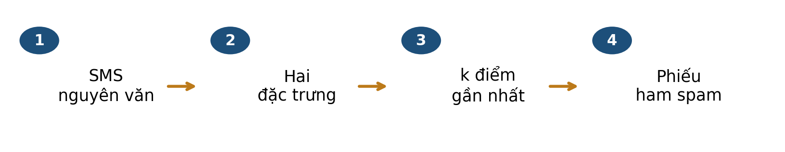
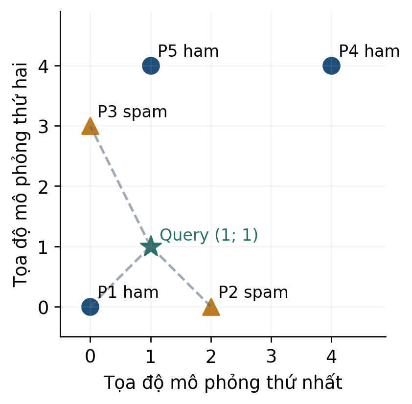
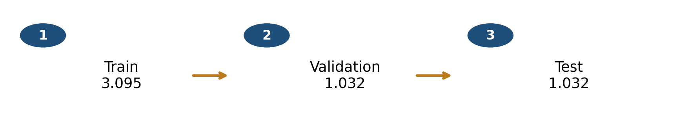
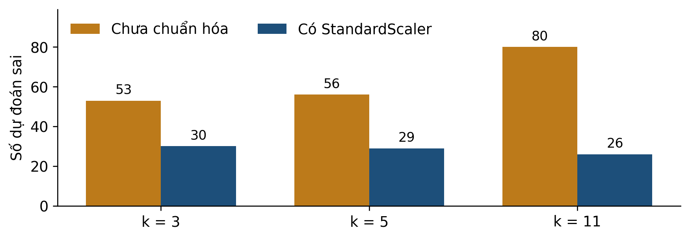

# Bài 02 · kNN và chuẩn hóa qua dữ liệu SMS

**PGS.TS. Nguyễn Văn Hậu**

Khoa Công nghệ Thông tin, Trường Đại học Công nghệ Kỹ thuật Hưng Yên

[← Mục lục khóa học](../../README.md) · [Thực hành Python](../../examples/bai02/README.md)

**Tài liệu hỗ trợ ví dụ thuật toán.** [Học liệu chính](../../README.md).

Đọc mục 1–8, tự làm mục 9 trước khi xem phụ lục A, dùng mục 10 để ôn tập. Phụ lục B dành cho người muốn tìm hiểu sâu hơn.

## Mục lục

- [1 Bài học này giải quyết vấn đề gì](#muc-1)
- [Lộ trình đọc và đối chiếu với bài giảng](#muc-2)
- [2 Bạn cần biết gì trước khi bắt đầu](#muc-3)
- [3 Dữ liệu của bài học trông như thế nào](#muc-4)
- [4 Ý tưởng chính của phương pháp là gì](#muc-5)
- [5 Những khái niệm và công thức nào cần nắm](#muc-6)
- [6 Phương pháp được thực hiện như thế nào](#muc-7)
- [7 Cùng làm một ví dụ từ đầu đến cuối](#muc-8)
- [8 Đọc kết quả và tránh hiểu nhầm](#muc-9)
- [Kết nối trực quan từ khoảng cách đến lựa chọn k](#muc-10)
- [9 Tự kiểm tra trước khi đến lớp](#muc-11)
- [10 Những điều cần nhớ](#muc-12)
- [Phụ lục A Đáp án có giải thích](#muc-13)
- [Phụ lục B Kiến thức mở rộng tùy chọn](#muc-14)

<a id="muc-1"></a>

## 1 Bài học này giải quyết vấn đề gì

Một bộ lọc nhận SMS mới và cần dự đoán nhãn **ham** hay **spam**. Ta bắt đầu từ các SMS đã được gán nhãn trong một corpus công khai. Ý tưởng của kNN là tìm những ví dụ gần tin mới trong không gian đặc trưng rồi dùng nhãn của chúng để bỏ phiếu.



*Hình 1. Từ văn bản đến dự đoán. Trong bài này, khoảng cách được tính trên hai số; nhãn của query không tham gia bỏ phiếu.*

Bài 1 giúp bạn biểu diễn đối tượng bằng vector. Bài này bổ sung **nhãn của ví dụ train** và quy tắc dự đoán. Ta sẽ hiểu vì sao cùng một SMS có thể nhận dự đoán khác khi thay cách đo khoảng cách.

### Sau khi đọc bạn có thể

- Tra một SMS thật và giải thích hai tọa độ của nó.
- Tính khoảng cách, chọn đúng k điểm và bỏ phiếu theo nhãn.
- Áp dụng chuẩn hóa theo cột bằng thống kê của train.
- Phân biệt ví dụ tính tay, ví dụ minh họa và kết quả đánh giá.

> ✏️ **Cách học:** dành khoảng 40–50 phút, chuẩn bị giấy và máy tính căn. Đọc mục 1–8, làm mục 9 rồi xem phụ lục A. Không cần lập trình; phụ lục B dành cho người muốn hiểu sâu hơn.

<a id="muc-2"></a>

## Lộ trình đọc và đối chiếu với bài giảng

Bản tài liệu cập nhật  • Đối chiếu Bài 2, slide . Nội dung và các mốc tổng kết dưới đây theo bản slide .

### Đọc để chuẩn bị điều gì

- Khoảng cách giữa hai tin nhắn
- Chuẩn hóa chỉ từ train
- Bỏ phiếu của k láng giềng
- Chọn k trên validation

Dành khoảng 40–50 phút cho phần chính, ví dụ và tự kiểm. Phụ lục A dùng để kiểm tra lập luận sau khi tự làm; phụ lục B là phần mở rộng, có thể đọc sau giờ học.

| Slide | Mốc ôn tập trong bài giảng |
| --- | --- |
| 14 | Tổng kết · Văn bản thành hai tọa độ |
| 29 | Tổng kết · Từ khoảng cách đến một dự đoán |
| 40 | Tổng kết · Một hệ tọa độ cho mọi tập |
| 54 | Tổng kết · Kiểm từng bước của thực nghiệm |
| 60 | Tổng quan · kNN học từ láng giềng |

> 📌 Tài liệu đọc trước tạo nền và đặt câu hỏi; các slide trên giúp nối lại kiến thức trong giờ học. Không cần học thuộc mọi kết quả số trước khi đến lớp.

<a id="muc-3"></a>

## 2 Bạn cần biết gì trước khi bắt đầu

Bạn cần đọc được vector hai chiều và thực hiện cộng, trừ, bình phương, căn, chia. Tọa độ phải có cùng ý nghĩa ở mọi hàng. Trong bài SMS, ta luôn giữ thứ tự **số ký tự, tỷ lệ chữ số**.

| Thao tác | Ví dụ | Ý nghĩa |
| --- | --- | --- |
| Chênh lệch | 1 − 3 = −2 | Hướng chênh lệch có thể âm. |
| Bình phương | (−2)² = 4 | Đóng góp vào khoảng cách không âm. |
| Cộng rồi lấy căn | √(1² + 2²) = √5 | Pythagoras trong hai chiều. |
| Tỷ lệ | 12/100 = 0,12 = 12% | Tử đếm một phần, mẫu đếm toàn bộ. |

### Đọc một phép tính khoảng cách

```math
d((1,1),(0,3))=\sqrt{(1-0)^2+(1-3)^2}=\sqrt{5}
```

Lấy chênh lệch ở từng tọa độ, bình phương riêng rồi cộng. Không cộng hai chênh lệch trước khi bình phương.

Khoảng cách bằng 0 nghĩa là hai vector trùng tọa độ. Hai văn bản khác nhau vẫn có thể trùng vector khi ta chỉ giữ hai đặc trưng. Nhãn 0 và 1 là mã lớp, không phải tọa độ thứ ba để đưa vào khoảng cách.

> ✏️ **Kiểm nhanh K1:** một chuỗi có 50 ký tự, trong đó 5 chữ số. Tỷ lệ chữ số bằng bao nhiêu? **K2:** khi μ = 100, σ = 20 và x = 80, hãy tính (x − μ)/σ. Đây là số mô phỏng. Đáp án ở phụ lục A.

<a id="muc-4"></a>

## 3 Dữ liệu của bài học trông như thế nào

Dữ liệu **SMS Spam Collection** do Almeida và Hidalgo công bố, được UCI phân phối [1]. Bản lưu của slide đọc được 5.574 bản ghi. Một bản ghi chứa nhãn và toàn văn SMS, cách nhau bằng tab. Sau bỏ trùng theo quy tắc đã định, còn 5.159 tin: 4.517 ham và 642 spam.

| Mã trong tệp | Nhãn nguồn | Văn bản nguyên gốc |
| --- | --- | --- |
| 2 | ham | Ok lar... Joking wif u oni... |
| 3 | spam | Free entry in 2 a wkly comp to win FA Cup final tkts 21st May 2005. Text FA to 87121 to receive entry question(std txt rate)T&C's apply 08452810075over18's |

Diễn nghĩa để đọc: tin 2 nói người gửi chỉ đang đùa; tin 3 mời tham gia cuộc thi nhận vé và yêu cầu nhắn tin tới một số điện thoại. **Bản dịch chỉ giúp hiểu tình huống. Phép đếm dùng tiếng Anh nguyên gốc ở bảng.**

| Mã | Số ký tự | Số chữ số | Tỷ lệ chữ số |
| --- | --- | --- | --- |
| 2 | 29 | 0 | 0/29 = 0 |
| 3 | 155 | 25 | 25/155 ≈ 0,1613 |

Ở tin 3, các nhóm chữ số là 2, 21, 2005, 87121, 08452810075 và 18. Chúng đóng góp 1 + 2 + 4 + 5 + 11 + 2 = 25 chữ số. Độ dài 155 gồm cả chữ, số, dấu câu và khoảng trắng. Vector của tin này là (155; 25/155).

> 🔎 **Tra lại:** mã là thứ tự bản ghi trước bỏ trùng, do chương trình bổ sung. Nó không cho biết người gửi hay thời gian. Hai dấu “...” ở tin 2 là ký tự thật, không phải dấu rút gọn do tài liệu thêm.

Tệp và phép đếm đi kèm được giữ theo slide. Corpus tiếng Anh lịch sử này phục vụ học cơ chế; nhãn spam không phải kết luận đã xác minh về lừa đảo.

<a id="muc-5"></a>

## 4 Ý tưởng chính của phương pháp là gì

Với một query, kNN chọn k vector train gần nhất rồi đọc nhãn của các điểm đã chọn. Mỗi điểm có một phiếu trong cấu hình **phiếu đều**. Hình dưới là năm điểm mô phỏng để tính tay, không phải tọa độ SMS thật.



*Hình 2. Hai trục cùng tỷ lệ. Nét đứt nối query với ba láng giềng được chọn khi k = 3.*

| Điểm | P1 | P2 | P3 | P4 | P5 |
| --- | --- | --- | --- | --- | --- |
| d² tới (1; 1) | 2 | 2 | 5 | 18 | 9 |
| Nhãn | ham | spam | spam | ham | ham |

Thứ tự theo d² là nhóm P1 và P2 đồng hạng, rồi P3, P5, P4. Với k = 3, hai phiếu spam thắng một phiếu ham: dự đoán spam. Với k = 5, ba phiếu ham thắng hai phiếu spam: dự đoán ham.

> 📌 **Giới hạn kết luận:** query mô phỏng chưa có nhãn thật để chấm. Làm đúng quy tắc bỏ phiếu chưa chứng minh dự đoán đúng. Hai điểm đồng hạng ở đây đều được chọn; không cần tạo thứ tự giả giữa P1 và P2.

<a id="muc-6"></a>

## 5 Những khái niệm và công thức nào cần nắm

```math
d(x,p)=\sqrt{\sum_{j=1}^{D}(x_j-p_j)^2}
```

**Khoảng cách Euclid:** x là query, p là một vector train, D là số chiều, j chỉ tọa độ. Các tọa độ phải thống nhất ý nghĩa và cách biến đổi. Xếp tăng d² cho cùng thứ tự như xếp tăng d vì căn tăng trên số không âm.

```math
s(x)=\frac{1}{k}\sum_{i\in N_k(x)}\mathbf{1}(y_i=1)
```

**Tỷ lệ phiếu spam:** Nₖ(x) là tập chỉ số k láng giềng, yᵢ = 1 mã hóa spam; ký hiệu 1(điều kiện) bằng 1 khi đúng và 0 khi sai. Với hai lớp, phiếu đều và k lẻ, dự đoán spam nếu s > 1/2. Cần 1 ≤ k ≤ số mẫu train.

```math
z_j=\frac{x_j-\mu_j}{\sigma_j},\qquad \sigma_j>0
```

**Chuẩn hóa theo cột:** μⱼ và σⱼ là trung bình và độ lệch chuẩn của đặc trưng j trên train [3]. Trừ để đặt gốc, chia để đo theo đơn vị độ lệch chuẩn. z có thể âm hoặc lớn hơn 1.

| Thao tác | Thống kê dùng | Điều thu được |
| --- | --- | --- |
| Chuẩn hóa L2 bài 1 | Chuẩn của từng vector | Mỗi vector hợp lệ dài 1. |
| StandardScaler bài 2 | μ và σ của từng cột train | Cột train không hằng có trung bình 0, độ lệch chuẩn 1. |

> 📌 **Không đồng nhất:** tỷ lệ phiếu là mức đồng thuận của các láng giềng. Nó chưa phải xác suất được hiệu chỉnh hoặc lời bảo đảm về nhãn thật.

<a id="muc-7"></a>

## 6 Phương pháp được thực hiện như thế nào

Trước khi fit mô hình, nhận diện bản trùng theo văn bản đã gộp khoảng trắng, bỏ khoảng trắng đầu cuối và chuyển về dạng chữ thường thống nhất. Giữ lần xuất hiện đầu. Văn bản gốc của hàng giữ lại vẫn dùng để tính đặc trưng.



*Hình 3. Ba giai đoạn dùng ba phần dữ liệu không chồng nhau sau bỏ trùng. Mũi tên là thứ tự công việc, không phải tạo tập sau từ tập trước.*

| Tập | Vai trò |
| --- | --- |
| Train | Tính μ, σ; biến đổi train; lưu vector và nhãn vào kNN. |
| Validation | Dùng cùng scaler để thử và chọn cấu hình; có nhãn để chấm. |
| Test | Chấm cấu hình đã khóa; không dùng kết quả để chọn lại k. |

### Thống kê của 3.095 tin train

| Đặc trưng | μ | σ |
| --- | --- | --- |
| Số ký tự | 79,31018 | 59,10396 |
| Tỷ lệ chữ số | 0,018052 | 0,047065 |

Các giá trị hiển thị đã làm tròn; phép tính dùng giá trị đầy đủ trong tệp. StandardScaler ở đây tính phương sai với mẫu số n. **Fit** là tính thống kê; **transform** là dùng lại thống kê đó. Cả train, validation, test và query mới đều dùng cùng μ, σ đã fit.

> ✏️ **Tự kiểm quy trình:** nếu fit scaler riêng trên từng tập, các vector sẽ không còn cùng hệ tọa độ. Nếu fit trên cả test, thông tin của phép chấm cuối đã đi vào bước học. Trong pilot này không refit gộp train và validation.

<a id="muc-8"></a>

## 7 Cùng làm một ví dụ từ đầu đến cuối

Xét SMS thật có mã **4500**, thuộc validation. Ta giấu nhãn khi dự đoán. Văn bản nguyên gốc:

Latest Nokia Mobile or iPOD MP3 Player +£400 proze GUARANTEED! Reply with: WIN to 83355 now! Norcorp Ltd.£1,50/Mtmsgrcvd18+

Tin mời nhận điện thoại hoặc máy nghe nhạc cùng tiền thưởng. Đếm trên văn bản gốc được 123 ký tự và 14 chữ số; vector x = (123; 14/123). Giữ cả lỗi chính tả “proze” của nguồn.

```math
z_1\approx\frac{123-79.31018}{59.10396}\approx0.7392,\quad z_2\approx\frac{14/123-0.018052}{0.047065}\approx2.0348
```

Biến đổi query và mọi vector train bằng cùng thống kê mục 6. Các giá trị gần đúng ở đây chỉ để theo dõi; không làm tròn trước khi xếp láng giềng.

| Thước đo | Mã train | Ký tự | Tỷ lệ số | d² | Nhãn |
| --- | --- | --- | --- | --- | --- |
| Thô | 2780 | 123 | 23/123 | 0,005354 | spam |
| Thô | 626 | 123 | 0 | 0,012955 | ham |
| Thô | 646 | 123 | 0 | 0,012955 | ham |
| Sau scaler | 4798 | 135 | 15/135 | 0,044538 | spam |
| Sau scaler | 3969 | 134 | 14/134 | 0,074050 | spam |
| Sau scaler | 2353 | 119 | 12/119 | 0,080649 | spam |

Cột ký tự và tỷ lệ số luôn hiển thị **giá trị gốc** để tra SMS. Ba d² cuối được tính sau transform, không phải từ các số gốc thay thẳng vào Euclid. Ví dụ mã 4798: d² = (12/59,10396)² + ((15/135 − 14/123)/0,047065)² ≈ 0,044538.

Với k = 3, trước chuẩn hóa có hai ham nên dự đoán ham; sau chuẩn hóa cả ba phiếu spam nên dự đoán spam. Mở nhãn nguồn: query là spam. Trường hợp này sau chuẩn hóa đúng nhãn.

> 📌 **Phạm vi:** query được chọn có chủ đích để minh họa cơ chế thay đổi. Một tin đúng hơn không chứng minh mọi tin đều đúng hơn.

<a id="muc-9"></a>

## 8 Đọc kết quả và tránh hiểu nhầm

Để đi xa hơn một query, ta giữ cùng train và so kết quả trên toàn bộ **1.032 tin validation**. Hình dưới tính từ thí nghiệm đã lưu trong slide, dùng hai đặc trưng và phiếu đều.



*Hình 4. Số lỗi validation theo k và cách chuẩn hóa. Trục bắt đầu từ 0; thấp hơn nghĩa là ít lỗi tổng hơn trong lần chia này.*

Với k = 3, số lỗi giảm từ 53 xuống 30 khi thêm scaler. Cấu hình chấm cuối là **StandardScaler và k = 11**, được chọn theo F1 lớp spam trên validation trong các cấu hình đã thử. F1 sẽ được giải thích ở bài 3; điểm của ba k sau scaler lần lượt là 0,8837; 0,8863; 0,8960.

| Dễ hiểu nhầm | Cách đọc đúng |
| --- | --- |
| k = 3 là k tối ưu | k3 chỉ để minh họa; k11 được chọn trong tập cấu hình thử. |
| Chuẩn hóa luôn cải thiện | Kết quả hỗ trợ lựa chọn trong thí nghiệm này. |
| Hai đặc trưng hiểu toàn bộ SMS | Chúng bỏ qua nghĩa từ và ngữ cảnh. |
| 3/3 phiếu là chắc chắn đúng | Query xa train vẫn có thể nhận đồng thuận cao. |

Trên test giữ riêng, cấu hình đã khóa có 29 lỗi: 12 ham bị dự đoán spam và 17 spam bị dự đoán ham. **Không dùng những lỗi này để quay lại chọn k.** Bài 3 nhận chính bảng dự đoán này để phân biệt hai loại sai.

> 🔎 **Cần thêm bằng chứng khi đổi mục tiêu:** kết quả trên corpus tiếng Anh lịch sử chưa cho biết hiệu quả với SMS tiếng Việt hiện tại. Bỏ trùng chính xác cũng chưa loại mọi tin cùng mẫu chiến dịch.

<a id="muc-10"></a>

## Kết nối trực quan từ khoảng cách đến lựa chọn k

Với mỗi tin nhắn mới, KNN đo khoảng cách tới các điểm train, lấy k điểm gần nhất rồi bỏ phiếu. Validation dùng để chọn k; test dùng để báo cáo sau khi đã khóa lựa chọn.

```math
z_j=\frac{x_j-\mu_j}{s_j}
```

Trung bình μ và độ lệch chuẩn s được ước lượng trên train. Dùng nguyên các giá trị này để biến đổi validation, test và tin nhắn mới.

| Bước | Câu hỏi cần trả lời |
| --- | --- |
| Biểu diễn | Độ dài tin nhắn và tỷ lệ chữ số có đơn vị/thang đo gì? |
| Chuẩn hóa | Đã dùng thống kê của train chưa? |
| Tìm láng giềng | Khoảng cách được tính trong cùng không gian đã chuẩn hóa chưa? |
| Bỏ phiếu | Đang dùng k nào? Có quy tắc xử lý hòa phiếu không? |
| Chọn mô hình | Chọn k bằng F1 validation, không bằng kết quả test. |

> 📌 Case-study dùng k = 11 vì F1 validation tốt nhất trong các giá trị đã thử. Đây không phải khẳng định k = 11 tốt cho mọi dữ liệu.

> ✏️ Tự kiểm: vì sao không fit scaler trên toàn bộ dữ liệu? Vì thống kê của tập giữ lại sẽ đi vào quá trình xây dựng mô hình.

<a id="muc-11"></a>

## 9 Tự kiểm tra trước khi đến lớp

Làm trước khi xem phụ lục A. Chọn một đáp án nếu có lựa chọn; với câu tính, ghi bước trung gian.

**Câu 1.** Một SMS có 80 ký tự và 8 chữ số. Đặc trưng tỷ lệ chữ số là gì?

- **A.** 8
- **B.** 0,1
- **C.** Xác suất spam 10%

**Câu 2.** Giữ năm điểm hình 2, đổi query thành (2; 1). Tính d² đến P1–P5 rồi chọn ba láng giềng.

**Câu 3.** Dùng ba láng giềng vừa chọn ở câu 2. Dự đoán phiếu đều là gì?

- **A.** ham vì train có tổng nhiều ham hơn
- **B.** Không thể bỏ phiếu khi chưa biết nhãn query
- **C.** spam vì có hai phiếu spam trong ba láng giềng

**Câu 4.** μ và σ để biến đổi query phải lấy từ đâu?

- **A.** Train đã dùng để fit scaler
- **B.** Riêng query mới
- **C.** Fit riêng validation rồi lấy thống kê đó

**Câu 5.** Được dùng nhãn test để thử k = 3, 5, 11 rồi báo k tốt nhất trên chính test không? Giải thích vai trò nào của test bị thay đổi.

**Câu 6.** Một query đổi từ sai sang đúng sau scaler chứng minh điều gì?

- **A.** Scaler tốt hơn trên mọi bộ dữ liệu
- **B.** Mọi query sẽ đổi nhãn
- **C.** Cơ chế thay đổi đã được minh họa ở query đó

> ✏️ **Mang đến lớp:** một bảng d² bạn tự làm và một câu hỏi về dữ liệu hoặc scaler. Nếu chưa chắc mẫu số tỷ lệ chữ số, quay lại mục 3.

<a id="muc-12"></a>

## 10 Những điều cần nhớ

kNN dự đoán bằng các ví dụ có nhãn ở gần query trong biểu diễn đã chọn. Chất lượng của phép đo phụ thuộc đặc trưng, đơn vị, cách chuẩn hóa và k; làm đúng số học là một phần của quy trình.

- Giữ văn bản gốc để trích đặc trưng; nhãn query chỉ để chấm sau dự đoán.
- Fit scaler trên train; transform mọi tập bằng cùng thống kê.
- Tính khoảng cách → chọn láng giềng → đọc nhãn → bỏ phiếu.
- Chọn cấu hình bằng validation, khóa rồi mới chấm test.

| Thuật ngữ | Nghĩa trong bài |
| --- | --- |
| Đặc trưng | Số quan sát được từ SMS trước khi biết nhãn. |
| Query | Tin hoặc vector đang cần dự đoán. |
| Láng giềng | Một ví dụ train được chọn theo khoảng cách. |
| k | Số ví dụ tham gia bỏ phiếu. |
| Fit scaler | Tính thống kê trên train. |
| Transform | Áp dụng thống kê đã fit. |
| Phiếu đều | Mỗi láng giềng có cùng trọng số. |

### Nguồn để đọc và kiểm lại

Đối chiếu Bài 2 ; các mốc tổng kết được ghi ở bảng lộ trình đầu tài liệu. Số liệu và mã bản ghi khớp các CSV kèm tài liệu; bản SMS gốc giữ ở Bai02/data. Dữ liệu UCI công bố theo CC BY 4.0; đã ghi tác giả và nguồn.

[\[1\] UCI SMS Spam Collection Almeida và Hidalgo 2011](https://archive.ics.uci.edu/dataset/228/sms+spam+collection)

[\[2\] scikit-learn 1.6 Nearest Neighbors](https://scikit-learn.org/1.6/modules/neighbors.html)

[\[3\] scikit-learn 1.6 StandardScaler](https://scikit-learn.org/1.6/modules/generated/sklearn.preprocessing.StandardScaler.html)

> 🔎 **Nối sang bài 3:** “sai 29 tin” còn quá gộp. Ta sẽ đọc riêng chặn nhầm ham, bỏ lọt spam và chọn chỉ số phù hợp với câu hỏi.

<a id="muc-13"></a>

## Phụ lục A Đáp án có giải thích

**K1:** 5/50 = 0,1 = 10%. Đây là tỷ lệ ký tự số. **K2:** (80 − 100)/20 = −1; thấp hơn trung bình một độ lệch chuẩn. Không có độ dài SMS âm.

### Câu 1

Đáp án B. 8/80 = 0,1. A mới là số đếm; C biến đặc trưng thành xác suất nhãn mà không có căn cứ. Ôn mẫu số ở mục 3 nếu nhầm.

### Câu 2

| Điểm | P1 | P2 | P3 | P4 | P5 |
| --- | --- | --- | --- | --- | --- |
| d² | 5 | 1 | 8 | 13 | 10 |

Ví dụ P3: (2 − 0)² + (1 − 3)² = 4 + 4 = 8. Thứ tự tăng là P2, P1, P3, P5, P4. Chọn P2, P1, P3. Nếu kết quả âm, kiểm bước bình phương; không cần lấy căn để xếp hạng.

### Câu 3

Đáp án C. Nhãn theo thứ tự đã chọn là spam, ham, spam. kNN đọc nhãn của ba láng giềng, không bỏ phiếu bằng cả train như A. B nhầm nhãn cần dự đoán với nhãn train đã biết.

### Câu 4

Đáp án A. Query và train phải cùng hệ tọa độ đã fit. B không ước lượng biến thiên của train và thường đưa query về 0 ở mỗi cột; C tạo một hệ thống kê khác. Ôn phân biệt fit và transform ở mục 6.

### Câu 5

Không dùng chính test như vậy để vừa chọn k vừa báo đánh giá cuối độc lập. Khi thử k theo nhãn test, test đã đóng vai trò validation. Chọn trên validation đã dành riêng, khóa cấu hình rồi đánh giá test; muốn tiếp tục thiết kế sau khi xem test cần một kế hoạch đánh giá mới.

### Câu 6

Đáp án C. Query minh họa giúp giải thích thay đổi láng giềng. A suy rộng quá dữ liệu; B sai vì nhiều query có thể giữ nguyên nhãn. Bảng toàn validation cho bằng chứng rộng hơn nhưng vẫn gắn corpus, lần chia và cấu hình.

> ✏️ **Tự sửa:** lỗi phép tính → mục 2 và 4; lỗi quy trình → mục 6; lỗi kết luận → mục 7 và 8. Ghi rõ bước nào chưa hiểu để hỏi trên lớp.

<a id="muc-14"></a>

## Phụ lục B Kiến thức mở rộng tùy chọn

### Đơn vị có thể đổi láng giềng

Phản ví dụ mô phỏng: q = (100; 0,10), A = (101; 0,10), B = (100; 0,12). Khi dùng tỷ lệ, d²(q,A) = 1 còn d²(q,B) = 0,0004 nên B gần hơn. Đổi nhất quán trục hai sang phần trăm: q = (100; 10), A = (101; 10), B = (100; 12). Lúc này d²(q,B) = 4 nên A gần hơn. Nội dung không đổi, tỷ trọng của các trục trong Euclid thô đã đổi.

```math
d^2(z_x,z_p)=\sum_{j=1}^{D}\frac{(x_j-p_j)^2}{\sigma_j^2}
```

Sau chuẩn hóa dùng chung μ, σ, hai trung bình triệt tiêu khi lấy chênh lệch. Chia σ thay đổi tỷ trọng; chỉ trừ trung bình không đổi khoảng cách đôi một.

Nếu đổi một cột theo cùng hệ số dương c và fit lại scaler trên cùng train, μ và σ cùng nhân c nên z giữ nguyên. Phải đổi cả train và query nhất quán. Cột hằng cần quy ước riêng; StandardScaler dùng scale bằng 1, không chia cho 0 [3].

### Hòa và điểm xa

k lẻ chỉ tránh hòa phiếu khi có hai lớp và phiếu đều. Ba lớp có thể nhận 2–2–1 phiếu dù k = 5. Đồng khoảng cách giữa điểm thứ k và k+1 có nhãn khác nhau còn cần quy tắc chọn rõ; thứ tự train có thể ảnh hưởng cài đặt [2].

Giữ hình 2 và lấy query (12; 12). d² tới năm điểm là 288, 244, 225, 128, 185. Ba láng giềng P4, P5, P3 bỏ hai phiếu ham và một spam. kNN vẫn dự đoán ham dù điểm gần nhất cũng xa √128 ≈ 11,31. Đồng thuận không chứng minh query nằm trong vùng dữ liệu quen thuộc.

> ✏️ **Bài mở rộng:** tính lại phản ví dụ đơn vị bằng hai cách. Nếu đổi riêng query sang phần trăm còn train giữ tỷ lệ, hãy giải thích vì sao đó là lỗi dữ liệu đầu vào. Không cần học TF-IDF hoặc trọng số khoảng cách để hoàn thành phần chính.

## Chuyển sang thực hành

Mở [hướng dẫn Python Bài 02](../../examples/bai02/README.md), chạy ví dụ nhỏ trước rồi mới chạy dữ liệu thật. Các bảng CSV và JSON trong thư mục đọc trước lưu kết quả tham chiếu của lần biên soạn; chương trình thực hành tự tính lại và lưu kết quả mới trong `outputs/`.

[Nguồn dữ liệu và điều kiện sử dụng](../../docs/DU_LIEU_VA_NGUON.md) · [Kiểm tra học liệu](../../docs/MAINTAINING.md)
