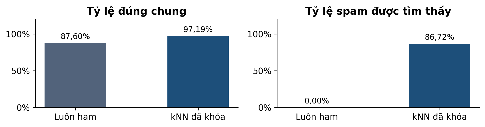
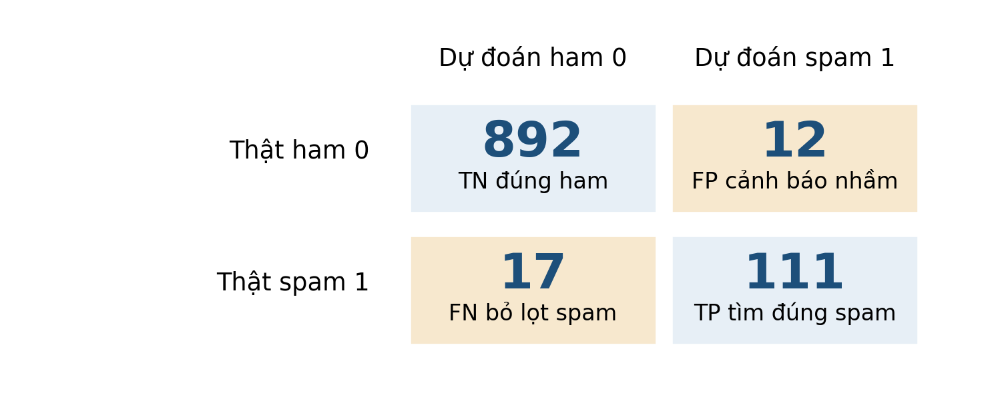
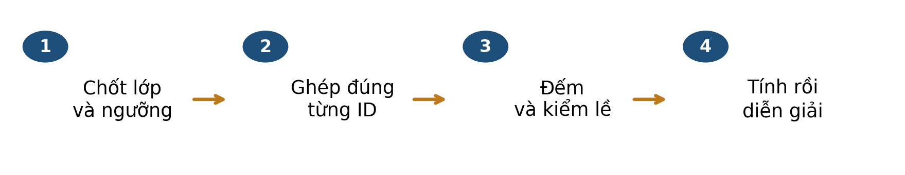
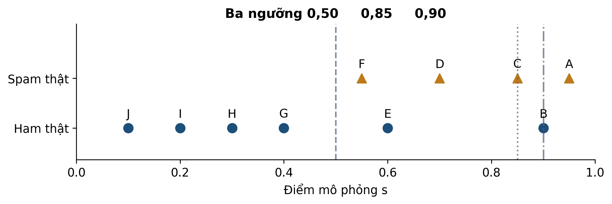

# Bài 03 · Đánh giá phân loại và lựa chọn ngưỡng

**PGS.TS. Nguyễn Văn Hậu**

Khoa Công nghệ Thông tin, Trường Đại học Công nghệ Kỹ thuật Hưng Yên

[← Mục lục khóa học](../../README.md) · [Thực hành Python](../../examples/bai03/README.md)

**Tài liệu hỗ trợ ví dụ thuật toán.** [Học liệu chính](../../README.md).

Đọc mục 1–8, tự làm mục 9 trước khi xem phụ lục A, dùng mục 10 để ôn tập. Phụ lục B dành cho người muốn tìm hiểu sâu hơn.

## Mục lục

- [1 Bài học này giải quyết vấn đề gì](#muc-1)
- [Lộ trình đọc và đối chiếu với bài giảng](#muc-2)
- [2 Bạn cần biết gì trước khi bắt đầu](#muc-3)
- [3 Dữ liệu của bài học trông như thế nào](#muc-4)
- [4 Ý tưởng chính của phương pháp là gì](#muc-5)
- [5 Những khái niệm và công thức nào cần nắm](#muc-6)
- [6 Phương pháp được thực hiện như thế nào](#muc-7)
- [7 Cùng làm một ví dụ từ đầu đến cuối](#muc-8)
- [8 Đọc kết quả và tránh hiểu nhầm](#muc-9)
- [Kết nối từ chỉ số đến ngưỡng ra quyết định](#muc-10)
- [9 Tự kiểm tra trước khi đến lớp](#muc-11)
- [10 Những điều cần nhớ](#muc-12)
- [Phụ lục A Đáp án có giải thích](#muc-13)
- [Phụ lục B Kiến thức mở rộng tùy chọn](#muc-14)

<a id="muc-1"></a>

## 1 Bài học này giải quyết vấn đề gì

Bài 2 tạo ra dự đoán SMS. Bài 3 hỏi: **bộ lọc đúng ở đâu, sai kiểu gì và có phù hợp mục tiêu không?** Trên 1.032 tin test của bài trước, một quy tắc luôn trả lời ham vẫn đúng ở 904 tin, đạt 87,60%, dù không tìm thấy spam nào.



*Hình 1. Cùng test gồm 904 ham và 128 spam. Hai biểu đồ trả lời hai câu hỏi khác nhau; số liệu tính từ CSV của bài 2.*

kNN đã khóa đúng 1.003/1.032 tin và tìm được 111/128 spam. Nó tốt hơn mốc luôn ham trong dữ liệu này, nhưng vẫn có hai loại lỗi cần đọc riêng: cảnh báo nhầm ham và bỏ lọt spam.

### Sau khi đọc bạn có thể

- Xếp từng cặp nhãn thật và dự đoán vào đúng ô ma trận.
- Tính accuracy, precision, recall và F1 cùng điều kiện mẫu số.
- Theo dõi điều gì đổi khi thay ngưỡng trên cùng điểm.
- Viết kết luận gắn chỉ số với dữ liệu và hậu quả lỗi.

> ✏️ **Cách học:** khoảng 40–50 phút, không cần lập trình. Đọc phần chính, tự làm sáu câu ở mục 9 rồi xem phụ lục A. Phần chi phí và chỉ số mở rộng ở phụ lục B là tùy chọn.

<a id="muc-2"></a>

## Lộ trình đọc và đối chiếu với bài giảng

Bản tài liệu cập nhật  • Đối chiếu Bài 3, slide . Nội dung và các mốc tổng kết dưới đây theo bản slide .

### Đọc để chuẩn bị điều gì

- Đếm TP, FP, FN, TN
- Đọc precision và recall
- Chọn ngưỡng theo chi phí
- Khóa lựa chọn trước khi mở test

Dành khoảng 40–50 phút cho phần chính, ví dụ và tự kiểm. Phụ lục A dùng để kiểm tra lập luận sau khi tự làm; phụ lục B là phần mở rộng, có thể đọc sau giờ học.

| Slide | Mốc ôn tập trong bài giảng |
| --- | --- |
| 14 | Tổng kết · Mỗi tin đi vào đúng một ô |
| 31 | Tổng kết · Chọn đúng mẫu số |
| 40 | Tổng kết · Chọn ngưỡng ở đâu? |
| 49 | Tổng kết · Báo cáo để người khác kiểm lại |
| 56 | Tổng quan · Từ dự đoán đến quyết định |

> 📌 Tài liệu đọc trước tạo nền và đặt câu hỏi; các slide trên giúp nối lại kiến thức trong giờ học. Không cần học thuộc mọi kết quả số trước khi đến lớp.

<a id="muc-3"></a>

## 2 Bạn cần biết gì trước khi bắt đầu

Bạn cần phân biệt ba đối tượng: nhãn thật để đối chiếu, điểm do mô hình sinh ra và nhãn dự đoán sau áp dụng quy tắc. Chọn **spam = 1 là lớp dương** trong toàn bài; ham = 0 là lớp âm. “Dương” là tên quy ước, không có nghĩa là tốt.

| Đại lượng | Ví dụ | Dùng khi nào |
| --- | --- | --- |
| Nhãn thật y | 1 nghĩa là spam theo corpus | Chấm sau khi đã dự đoán. |
| Điểm s | 6/11 phiếu spam | Mô tả đầu ra trước quyết định. |
| Ngưỡng t | 0,5 | Chuyển điểm thành nhãn. |
| Dự đoán ŷ | 1 nếu s ≥ t, ngược lại 0 | So với y để đếm đúng sai. |

### Tỷ lệ cần một nhóm làm mẫu số

Câu “bao nhiêu tin đúng trong số đã cảnh báo” và câu “bao nhiêu spam được tìm thấy trong số spam thật” có thể dùng cùng số ở tử nhưng khác nhóm ở mẫu. Hãy nói câu hỏi bằng lời trước khi ghi phân số.

```math
\frac{15}{20}=0.75,\qquad\frac{15}{30}=0.50
```

Ví dụ mô phỏng: 15 cảnh báo đúng trong 20 cảnh báo; đồng thời tìm thấy 15 trong 30 spam thật. Hai tỷ lệ không mâu thuẫn vì hai mẫu số khác nhau.

> ✏️ **Kiểm nhanh K1:** tính hai tỷ lệ trên theo phần trăm. **K2:** quy tắc s ≥ 0,5 xếp một tin có s = 0,5 vào lớp nào? Giải thích dấu bằng. Đáp án ở phụ lục A.

Một điểm 0,75 không tự bảo đảm 75% khả năng một tin riêng lẻ là spam. Đối với kNN bài 2, điểm là tỷ lệ phiếu trong 11 láng giềng; việc kiểm xác suất cần bước đánh giá riêng.

<a id="muc-4"></a>

## 3 Dữ liệu của bài học trông như thế nào

Ta đọc lại **1.032 SMS test** từ cùng corpus UCI [1] và cùng kNN hai đặc trưng, StandardScaler fit train, k = 11. Tệp có mã để ghép đúng văn bản, nhãn và dự đoán. Không huấn luyện mô hình mới ở phần đánh giá này.

| Cột | Cần hiểu |
| --- | --- |
| message_id | Khóa ghép cùng SMS giữa các tệp; không phải điểm số. |
| source_record và text | Vị trí nguồn và văn bản để đọc lại ví dụ. |
| y và prediction | Nhãn thật và nhãn dự đoán, mã 0/1. |
| votes và score | Số phiếu spam trong 11 láng giềng và votes/11. |

### Hai sai sót có thể tra ngược

| Mã thật | y | Phiếu spam | Dự đoán | Loại lỗi |
| --- | --- | --- | --- | --- |
| 1056 | 0 ham | 6/11 | 1 spam | FP |
| 1501 | 1 spam | 4/11 | 0 ham | FN |

SMS 1056 nguyên văn: HIYA COMIN 2 BRISTOL 1 ST WEEK IN APRIL. LES GOT OFF + RUDI ON NEW YRS EVE BUT I WAS SNORING.THEY WERE DRUNK! U BAK AT COLLEGE YET? MY WORK SENDS INK 2 BATH.

Tin này là trao đổi cá nhân theo nhãn nguồn. Mô hình cảnh báo spam nên đó là **FP**, dù đã làm đúng quy tắc đa số. SMS 1501 có nhãn spam nhưng chưa đủ sáu phiếu nên thành **FN**; toàn văn nằm trong CSV đi kèm.

> 🔎 **Đọc có căn cứ:** đặt tên lỗi từ cặp y và dự đoán. Không suy chữ in hoa gây ra FP vì mô hình này chỉ dùng số ký tự và tỷ lệ chữ số. Hai ví dụ được chọn để giải thích lỗi, không phải mẫu ngẫu nhiên.

<a id="muc-5"></a>

## 4 Ý tưởng chính của phương pháp là gì

Mỗi dòng đi vào đúng một ô của **ma trận nhầm lẫn**. Ta đặt hàng là nhãn thật, cột là dự đoán. Trước khi dùng chữ viết tắt, đọc đủ cặp thật–dự đoán; như vậy bạn vẫn đọc đúng nếu một tài liệu đổi vị trí các hàng.



*Hình 2. Ma trận thật của test bài 2. Màu hỗ trợ phân biệt; tên trục và chữ trong ô mới quyết định ý nghĩa.*

| Tên | Thật | Dự đoán | Câu diễn giải |
| --- | --- | --- | --- |
| TN | ham | ham | Để qua đúng một tin ham. |
| FP | ham | spam | Cảnh báo nhầm một tin ham. |
| FN | spam | ham | Bỏ lọt một tin spam. |
| TP | spam | spam | Tìm đúng một tin spam. |

### Kiểm tổng trước khi tính chỉ số

Cộng bốn ô: 892 + 12 + 17 + 111 = 1.032. Hàng ham có 904 tin; hàng spam có 128 tin. Cột cảnh báo spam có 12 + 111 = 123 tin. Hai ô đường chéo cộng thành 1.003 dự đoán đúng.

> ✏️ **Dừng để tự nói lại:** mã 1056 đóng góp vào ô nào và cột nào? Nếu chỉ đổi ngưỡng, tổng số spam thật trong hàng có đổi không? Nhãn thật và tập SMS vẫn giữ nguyên.

<a id="muc-6"></a>

## 5 Những khái niệm và công thức nào cần nắm

```math
\mathrm{Accuracy}=\frac{TP+TN}{N}
```

**Trong tất cả N tin, bao nhiêu dự đoán đúng?** N = TP + TN + FP + FN và cần N > 0. Accuracy mô tả tỷ lệ đúng chung, chưa chỉ riêng chất lượng phát hiện spam.

```math
P=\mathrm{Precision}=\frac{TP}{TP+FP}
```

**Trong các cảnh báo spam, bao nhiêu tin là spam thật?** Mẫu số là cột dự đoán spam. Cần có ít nhất một cảnh báo: TP + FP > 0.

```math
R=\mathrm{Recall}=\frac{TP}{TP+FN}
```

**Trong các spam thật, tìm thấy được bao nhiêu?** Mẫu số là hàng spam thật. Cần tập đánh giá có spam: TP + FN > 0.

```math
F_1=\frac{2PR}{P+R}=\frac{2TP}{2TP+FP+FN}
```

**F1 kết hợp precision và recall bằng trung bình điều hòa.** Dạng theo P,R cần P và R xác định, P + R > 0. Dạng số đếm dùng khi mẫu số của nó dương; kiểm trường hợp biên riêng [2].

F1 không chứa TN và không tự biểu diễn tiền, lợi ích hay hậu quả của sai sót. Giữ cả bốn ô và số cảnh báo khi báo F1. Chỉ làm tròn sau khi tính từ số đếm đầy đủ.

> 📌 **Mẫu số 0:** nếu không có cảnh báo, precision theo phép chia không xác định. Thư viện có thể trả 0 theo quy ước; phải nói rõ “không có cảnh báo”, không xem 0/0 là số 0.

<a id="muc-7"></a>

## 6 Phương pháp được thực hiện như thế nào



*Hình 3. Quy trình đọc kết quả. Từng bước có thể kiểm lại trước khi tổng hợp thành một điểm số.*

- Chốt lớp dương, quy tắc ngưỡng, tập đánh giá và mục đích sử dụng.
- Ghép đúng ID giữa nhãn thật và dự đoán; kiểm không thiếu hoặc lặp dòng.
- Đếm TN, FP, FN, TP; kiểm tổng N, số spam thật và số cảnh báo.
- Tính chỉ số theo câu hỏi, ghi quy ước nếu không có mẫu ở mẫu số.
- Đọc một vài lỗi thật để hiểu giới hạn; không suy nguyên nhân chỉ từ tương quan quan sát.

### Nếu cần chọn ngưỡng

Giữ nguyên mô hình và điểm, thay quy tắc chuyển điểm thành nhãn. Với kNN có 11 phiếu, mặc định cần ít nhất **6 phiếu spam**. Ta có thể thử chính sách cần ít nhất m phiếu, nhưng phải xác định tiêu chí chọn trước khi đọc kết quả test.

| Giai đoạn | Thao tác |
| --- | --- |
| Validation | Thử tập ngưỡng đã định và chọn theo tiêu chí như chi phí lỗi giả định. |
| Khóa quyết định | Lưu ngưỡng, tiêu chí, quy tắc phá hòa và mô hình tạo điểm. |
| Báo kết quả | Áp dụng quy tắc đã khóa; trình bày cả cải thiện và đánh đổi. |

Trong bộ bài này, test đã được xem ở bài 2. Bài 3 dùng lại nó để học cách đọc và minh họa chính sách; **đây không phải phép đánh giá độc lập mới trên dữ liệu chưa từng xem**. Thử nhiều lần còn có thể thích nghi với validation.

> ✏️ **Tự kiểm:** đổi ngưỡng có đổi điểm s hoặc nhãn thật y không? Không, nếu mô hình và tập dữ liệu giữ nguyên; chỉ nhãn dự đoán có thể đổi.

<a id="muc-8"></a>

## 7 Cùng làm một ví dụ từ đầu đến cuối

Dùng **10 bản ghi mô phỏng A–J**, không phải mẫu SMS thật. Điểm s đã được cho sẵn để tập trung học cách chấm. Quy tắc: dự đoán 1 khi s ≥ 0,5; nếu thấp hơn thì dự đoán 0.

| ID | Điểm s | Nhãn thật y | Dự đoán | Ô |
| --- | --- | --- | --- | --- |
| A | 0,95 | 1 | 1 | TP |
| B | 0,9 | 0 | 1 | FP |
| C | 0,85 | 1 | 1 | TP |
| D | 0,7 | 1 | 1 | TP |
| E | 0,6 | 0 | 1 | FP |
| F | 0,55 | 1 | 1 | TP |
| G | 0,4 | 0 | 0 | TN |
| H | 0,3 | 0 | 0 | TN |
| I | 0,2 | 0 | 0 | TN |
| J | 0,1 | 0 | 0 | TN |

TP gồm A,C,D,F: 4 tin. FP gồm B,E: 2 tin. FN không có. TN gồm G,H,I,J: 4 tin. Tổng 10; spam thật có 4; cảnh báo có 6. Đếm theo ID giúp kiểm từng ô, thay vì đoán một ma trận có vẻ hợp lý.

```math
\mathrm{Accuracy}=\frac{8}{10}=0.8,\quad P=\frac{4}{6}=\frac{2}{3},\quad R=\frac{4}{4}=1
```

Đúng 80% tổng số tin; hai phần ba cảnh báo đúng; tìm đủ bốn spam thật. Recall bằng 1 vẫn đi cùng hai cảnh báo nhầm.

```math
F_1=\frac{2\cdot(2/3)\cdot1}{(2/3)+1}=\frac{8}{8+2+0}=0.8
```

Hai cách tính khớp. 0,8 ở F1 và accuracy trùng nhau trong ví dụ này; đó không phải đẳng thức tổng quát.

> ✏️ **Tự làm tiếp:** che cột “Ô”, tính lại nhóm của E. Hãy nói rõ E được cảnh báo nhưng có nhãn thật nào.

<a id="muc-9"></a>

## 8 Đọc kết quả và tránh hiểu nhầm

Giữ nguyên 10 điểm và nhãn ở mục 7. Với ngưỡng 0,8, chỉ A,B,C được cảnh báo. Hai TP là A,C; B là FP. D,F chuyển từ TP thành FN. Các nhãn thật không đổi.



*Hình 4. Điểm và nhãn của 10 bản ghi mô phỏng. Các đường lần lượt tại 0,50; 0,80; 0,90. Điểm nằm đúng ngưỡng vẫn được cảnh báo.*

| Ngưỡng | TP | FP | FN | TN | Precision | Recall |
| --- | --- | --- | --- | --- | --- | --- |
| 0,50 | 4 | 2 | 0 | 4 | 2/3 | 1 |
| 0,80 | 2 | 1 | 2 | 5 | 2/3 | 1/2 |
| 0,90 | 1 | 1 | 3 | 5 | 1/2 | 1/4 |

Tăng ngưỡng từ 0,8 lên 0,90 loại C, một TP, nên precision **giảm từ 2/3 xuống 1/2**. Với điểm cố định, tập cảnh báo ở ngưỡng cao là tập con của ngưỡng thấp: số cảnh báo, TP và FP không tăng; recall không tăng khi có spam thật. Precision là tỷ số nên không có bảo đảm tăng.

### Quay lại dữ liệu thật

| Chỉ số spam trên test | Phép tính | Kết quả |
| --- | --- | --- |
| Accuracy | 1.003/1.032 | 97,19% |
| Precision | 111/123 | 90,24% |
| Recall | 111/128 | 86,72% |
| F1 | 222/(222+12+17) | 88,45% |

> 📌 **Kết luận có phạm vi:** kNN tốt hơn mốc luôn ham trên test lịch sử này. Vẫn cần đọc 12 FP và 17 FN; không gọi một chỉ số là bằng chứng bộ lọc phù hợp mọi tình huống.

<a id="muc-10"></a>

## Kết nối từ chỉ số đến ngưỡng ra quyết định

Một ngưỡng phù hợp phụ thuộc hậu quả của hai loại lỗi. Trong bài này, lớp dương là spam. FP là chặn nhầm tin ham; FN là bỏ lọt spam.

```math
K=c_{FP}FP+c_{FN}FN
```

K là tổng chi phí trên tập đang đánh giá; c là chi phí cho một lỗi tương ứng. Hệ số chi phí do bối cảnh quyết định, không tự suy ra từ accuracy.

| Ưu tiên | Chi phí minh họa | Ngưỡng được chọn trên validation |
| --- | --- | --- |
| Tránh chặn nhầm ham | 5FP + FN | m = 8 láng giềng spam trong 11 |
| Tránh bỏ lọt spam | FP + 5FN | m = 4 láng giềng spam trong 11 |

Trong ví dụ A–J, ngưỡng τ = 0,8 chọn A, B, C: TP = 2 và FP = 1. Nâng lên 0,9 chỉ chọn A, B: TP = 1 và FP = 1. Precision giảm từ 2/3 xuống 1/2. Vì vậy, precision không nhất thiết tăng ở mọi bước tăng ngưỡng.

> ✏️ Tự kiểm: có được xem test rồi chọn lại m không? Không. Khi đó test đã tham gia chọn mô hình và không còn là phép đánh giá độc lập cho lựa chọn đó.

<a id="muc-11"></a>

## 9 Tự kiểm tra trước khi đến lớp

Tự trả lời trước khi xem phụ lục A. Với câu trắc nghiệm, chọn một đáp án; với câu tính, ghi nhóm làm mẫu số.

**Câu 1.** Nhãn thật ham nhưng dự đoán spam là gì?

- **A.** FP
- **B.** FN
- **C.** TP

**Câu 2.** Có 20 cảnh báo, 15 cảnh báo đúng và tổng 30 spam thật. Precision và recall bằng bao nhiêu?

**Câu 3.** Ví dụ mô phỏng có 20 tin, 5 spam thật, 5 cảnh báo, trong đó 3 cảnh báo đúng. Lập bốn ô và tính accuracy, precision, recall, F1.

**Câu 4.** Trên cùng bảng điểm A–J, tăng ngưỡng từ 0,8 lên 0,90 làm precision ra sao?

- **A.** Tăng vì ngưỡng luôn loại lỗi
- **B.** Giảm vì loại C là một TP
- **C.** Không đổi vì điểm không đổi

**Câu 5.** Dùng dữ liệu nào để lựa chọn ngưỡng trước phép báo kết quả?

- **A.** Test đã dùng để báo hiệu năng
- **B.** Chọn tùy ý ngưỡng có chỉ số đẹp nhất sau khi xem test
- **C.** Validation theo tiêu chí đã định

**Câu 6.** Nếu thêm 100 ham được dự đoán đúng vào một ma trận đã có, F1 spam thay đổi không? Giải thích bằng công thức và nêu chỉ số nào có thể đổi.

> ✏️ **Mang đến lớp:** một câu diễn giải precision và một câu diễn giải recall dùng hai nhóm mẫu số rõ ràng. Nếu chưa chắc, vẽ cột cảnh báo và hàng spam thật.

<a id="muc-12"></a>

## 10 Những điều cần nhớ

Đánh giá bắt đầu từ câu hỏi và các bản ghi được ghép đúng. Từ đó đếm bốn loại kết quả, kiểm tổng và chọn chỉ số phù hợp. Một tỷ lệ chỉ dễ hiểu khi người đọc biết tập làm mẫu số.

| Cần báo | Nội dung ngắn gọn |
| --- | --- |
| Dữ liệu | Nguồn, tập đánh giá, N, số spam thật và giới hạn đại diện. |
| Mô hình và quyết định | Đặc trưng, mô hình tạo điểm, ngưỡng, nơi đã chọn ngưỡng. |
| Số đếm | TN, FP, FN, TP và tổng cảnh báo. |
| Chỉ số | Accuracy và P,R,F1 lớp spam cùng quy ước mẫu số 0. |
| Kết luận | Đánh đổi nào đã quan sát, giả định nào đang dùng, điều gì chưa kiểm. |

### Từ vựng cần nhớ

**False positive:** cảnh báo nhầm. **False negative:** bỏ lọt. **Precision:** tỷ lệ đúng trong cảnh báo. **Recall:** tỷ lệ tìm thấy trong spam thật. **Threshold:** ngưỡng chuyển điểm thành quyết định. **Baseline:** mốc đơn giản để so sánh.

### Nguồn để đọc và kiểm lại

Đối chiếu Bài 3 ; các mốc tổng kết được ghi ở bảng lộ trình đầu tài liệu. Dữ liệu UCI có ghi công Almeida và Hidalgo, CC BY 4.0. Các chỉ số được tái tính trực tiếp và đối chiếu thư viện.

[\[1\] UCI SMS Spam Collection Almeida và Hidalgo 2011](https://archive.ics.uci.edu/dataset/228/sms+spam+collection)

[\[2\] scikit-learn 1.6 Metrics and scoring](https://scikit-learn.org/1.6/modules/model_evaluation.html)

[\[3\] scikit-learn 1.6 average_precision_score](https://scikit-learn.org/1.6/modules/generated/sklearn.metrics.average_precision_score.html)

> 🔎 **Liên hệ tiếp:** bài 4 chuyển sang dự đoán số ngày giao hàng bằng hồi quy; bài 5 dự đoán nhãn trễ bằng logistic. Khi đầu ra là nhãn, ma trận, precision, recall và ngưỡng của bài này sẽ tiếp tục được sử dụng.

<a id="muc-13"></a>

## Phụ lục A Đáp án có giải thích

**K1:** 15/20 = 75%, còn 15/30 = 50%. **K2:** dự đoán lớp 1 vì quy tắc có dấu ≥. Không được tự thay bằng > khi chấm.

### Câu 1

Đáp án A, FP. Dự đoán positive nhưng sai. FN cần thật spam và dự đoán ham; TP cần cả thật và dự đoán đều spam. Ôn mục 4 nếu nhầm.

### Câu 2

Precision = 15/20 = 0,75 vì bắt đầu từ 20 cảnh báo. Recall = 15/30 = 0,50 vì bắt đầu từ 30 spam thật. FP = 5, FN = 15. Chưa biết tổng N nên chưa xác định TN hoặc accuracy.

### Câu 3

| Thật và dự đoán | Ham 0 | Spam 1 | Tổng thật |
| --- | --- | --- | --- |
| Ham thật 0 | 13 TN | 2 FP | 15 |
| Spam thật 1 | 2 FN | 3 TP | 5 |

```math
\mathrm{Accuracy}=\frac{16}{20}=0.8,\quad P=R=\frac{3}{5}=0.6,\quad F_1=\frac{6}{6+2+2}=0.6
```

Hai mẫu số precision và recall tình cờ cùng bằng 5. Chúng vẫn là hai tập khác nhau. TP = 3, FP = 5 − 3 = 2, FN = 5 − 3 = 2, TN = 20 − 3 − 2 − 2 = 13.

### Câu 4

Đáp án B. Ngưỡng 0,8 cảnh báo A,B,C; ngưỡng 0,90 cảnh báo A,B. C là spam thật nên mất một TP: precision từ 2/3 xuống 1/2. A là khẳng định quá mạnh; C nhầm giữ điểm với giữ quyết định.

### Câu 5

Đáp án C. Tiêu chí và tập ngưỡng cần xác định trước, lựa chọn trên validation. A và B dùng chính test để chọn làm mất vai trò phép báo kết quả sau lựa chọn. Test của bài này đã được xem trước, nên không gọi là kiểm độc lập mới.

### Câu 6

F1 spam không đổi vì TP, FP, FN giữ nguyên, còn TN không có trong công thức. Accuracy trở thành (TP + TN + 100)/(N + 100) và tăng nếu trước đó có lỗi. Đổi thành phần dữ liệu cũng đổi ngữ cảnh đánh giá; không nên thêm hàng chỉ để làm đẹp chỉ số.

> ✏️ **Tự sửa:** nhầm ô → mục 4; nhầm tỷ lệ → mục 5 và 7; nhầm ngưỡng hoặc phạm vi → mục 6 và 8.

<a id="muc-14"></a>

## Phụ lục B Kiến thức mở rộng tùy chọn

### Chi phí phải được định nghĩa trước

Giả định A coi một FP nặng bằng năm FN, dùng Cₐ = 5FP + FN. Giả định B ưu tiên giảm bỏ lọt, dùng Cᵦ = FP + 5FN. Đây là đơn vị chi phí quy ước để tập ra quyết định, không phải tiền hay lợi nhuận đo được.

| m phiếu tối thiểu | FP validation | FN validation | Cₐ | Cᵦ |
| --- | --- | --- | --- | --- |
| 4 | 17 | 12 | 97 | 77 |
| 6 mặc định | 9 | 17 | 62 | 94 |
| 8 | 4 | 19 | 39 | 99 |

Quét m từ 1 đến 12 trên validation cho A chọn m = 8, B chọn m = 4. m = 12 là mốc không cảnh báo vì chỉ có 11 phiếu. Bảng trên trích ba hàng để đọc, không giới hạn việc quét ở ba ngưỡng. Không so trực tiếp Cₐ và Cᵦ như cùng một thang giá trị.

Áp dụng hai chính sách đã chọn lên test lịch sử: m = 8 có FP = 7, FN = 21; m = 4 có FP = 23, FN = 14. So mặc định FP = 12, FN = 17, mỗi lựa chọn có một đánh đổi. Nguồn chọn là validation; test không phải dữ liệu mới chưa từng xem.

### Những câu hỏi ngoài một ngưỡng

- Không có cảnh báo: precision không xác định theo phép chia; thư viện có thể quy ước 0. Recall bằng 0 nếu vẫn có spam thật.
- ROC dùng recall và tỷ lệ báo nhầm trên ham thật. FPR có mẫu số FP+TN, khác 1−precision. AUC tổng hợp khả năng xếp hạng, không tự chọn ngưỡng.
- AP tổng hợp precision theo các bước tăng recall [3]; không đồng nhất với diện tích hình thang của đường PR.
- Hiệu chỉnh xác suất hỏi các nhóm điểm có phản ánh tần suất dương thật không. Tỷ lệ phiếu kNN chưa tự đáp ứng yêu cầu này.

> ✏️ **Bài mở rộng:** tính lại hai chi phí ở hàng m = 8. Giải thích vì sao việc ưu tiên giảm FP có thể khiến ta chấp nhận nhiều FN hơn. Không cần học hết ROC/AP để hoàn thành 10 mục chính.

## Chuyển sang thực hành

Mở [hướng dẫn Python Bài 03](../../examples/bai03/README.md), chạy ví dụ nhỏ trước rồi mới chạy dữ liệu thật. Các bảng CSV và JSON trong thư mục đọc trước lưu kết quả tham chiếu của lần biên soạn; chương trình thực hành tự tính lại và lưu kết quả mới trong `outputs/`.

[Nguồn dữ liệu và điều kiện sử dụng](../../docs/DU_LIEU_VA_NGUON.md) · [Kiểm tra học liệu](../../docs/MAINTAINING.md)
