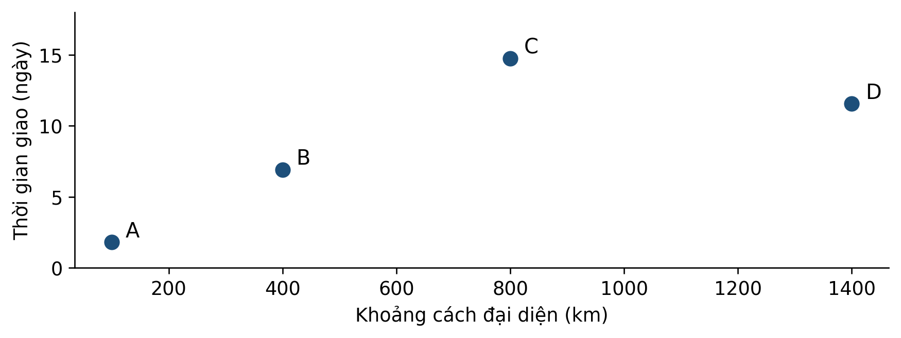
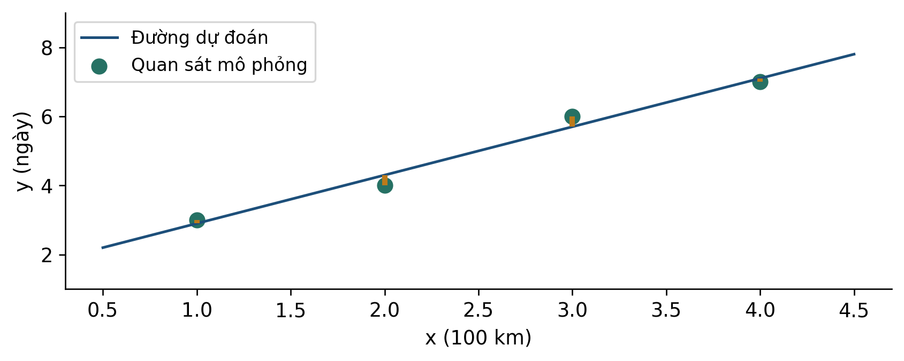
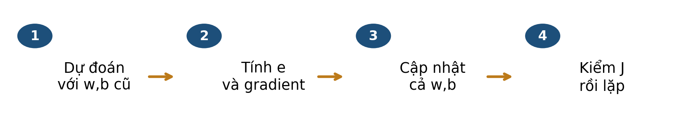
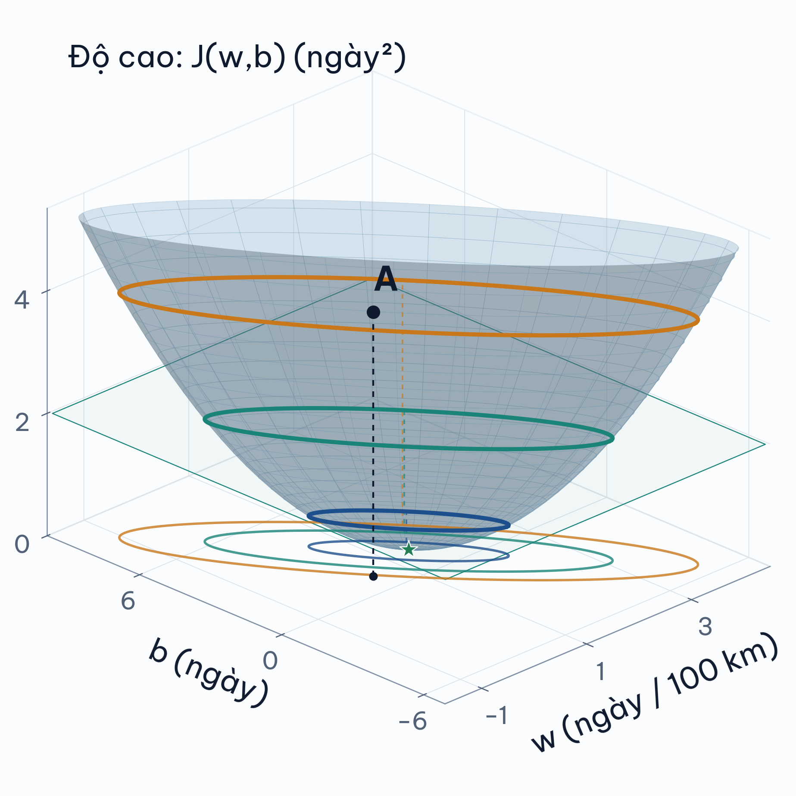
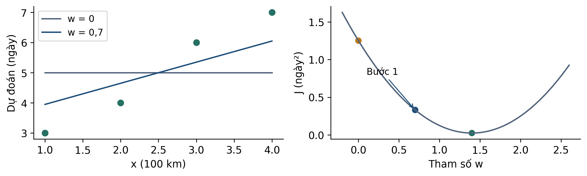
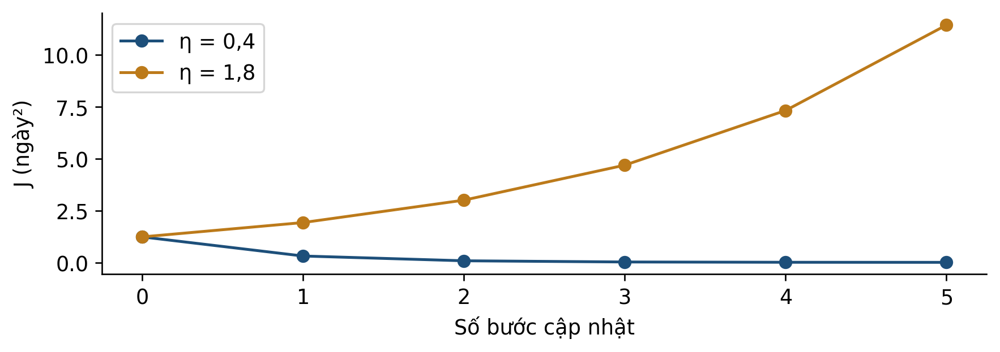

# Bài 4 — Hồi quy tuyến tính và Gradient Descent
Kiến thức nền tảng và tài liệu đọc trước — bản cập nhật v3

## 1 Bài học này giải quyết vấn đề gì

Một người mua muốn biết **đơn hàng mất khoảng bao nhiêu ngày từ lúc được xác nhận đến lúc nhận hàng**. Bài này dùng hồi quy tuyến tính để trả lời bằng một con số, rồi học cách điều chỉnh đường dự đoán bằng Gradient Descent (GD).

### Ba điều cần phân biệt ngay

| Đối tượng | Câu hỏi |
| --- | --- |
| Mô hình | Dùng công thức nào để biến đầu vào thành dự đoán? |
| Hàm mất mát | Một bộ tham số hiện tại sai nhiều đến đâu trên train? |
| Thuật toán học | Điều chỉnh tham số theo quy tắc nào? |

### Sau khi đọc bạn có thể

- Nhận ra thông tin đã biết và chưa biết ở thời điểm xác nhận đơn.
- Đọc độ dốc, hệ số chặn và đoạn sai số trên hình.
- Tính một bước GD bằng bảng bốn điểm và kiểm loss sau cập nhật.
- Diễn giải MAE/RMSE trên dữ liệu thật mà không biến trung bình thành lời bảo đảm.

**Cách học:** dự kiến 40–50 phút; không cần lập trình. Chuẩn bị giấy nháp và máy tính. Hoàn thành 10 mục chính và sáu câu tự kiểm; phần learning rate nâng cao nằm ở phụ lục B.

## Lộ trình đọc và đối chiếu với bài giảng

Bản tài liệu cập nhật v3 • Đối chiếu Bài 4, slide v3. Nội dung và các mốc tổng kết dưới đây theo bản slide v3.

### Đọc để chuẩn bị điều gì

- Từ dữ liệu đến đường hồi quy
- Sai số và hàm J
- Cập nhật đồng thời w, b
- Đọc mặt 3D và đường đồng mức

Dành khoảng 40–50 phút cho phần chính, ví dụ và tự kiểm. Phụ lục A dùng để kiểm tra lập luận sau khi tự làm; phụ lục B là phần mở rộng, có thể đọc sau giờ học.

| Slide | Mốc ôn tập trong bài giảng |
| --- | --- |
| 20 | Tổng kết · Dự đoán, đo sai, rồi học |
| 32 | Tổng kết · Một bước, hai cách nhìn |
| 42 | Tổng kết · Vòng lặp Gradient Descent |
| 48 | Chuẩn hóa · Vì sao đáp án D đúng? |
| 60 | Tổng kết · Đọc kết quả cùng giới hạn |
| 65 | Tổng quan · Một đường học từ sai số |

Tài liệu đọc trước tạo nền và đặt câu hỏi; các slide trên giúp nối lại kiến thức trong giờ học. Không cần học thuộc mọi kết quả số trước khi đến lớp.

## 2 Bạn cần biết gì trước khi bắt đầu

Bạn cần thay số vào đường thẳng, tính trung bình, bình phương và hiểu dấu âm/dương. Đạo hàm được giới thiệu qua hướng thay đổi; phần chính chưa yêu cầu tự chứng minh công thức.

| Kiến thức | Ví dụ mô phỏng | Ý nghĩa |
| --- | --- | --- |
| Đường thẳng | ŷ = 0,5x + 2 | x là đầu vào; ŷ là số dự đoán. |
| Độ dốc w | 0,5 ngày / đơn vị x | x tăng 1 thì dự đoán tăng 0,5. |
| Hệ số chặn b | 2 ngày | Giá trị công thức tại x = 0. |
| Trung bình | (3+4+6+7)/4 = 5 | Mức trung tâm của bốn số. |
| Sai số có dấu | ŷ = 5, y = 7 ⇒ e = −2 | Dự đoán thấp hơn thực tế 2 ngày. |

### Dấu mũ và đơn vị có tác dụng gì?

y là giá trị quan sát; ŷ là giá trị dự đoán. Nếu x đo bằng **100 km**, x = 4 biểu thị 400 km. Cùng một quan hệ nhưng đổi sang km thì hệ số w phải đổi. Hệ số chặn tại x = 0 là giá trị của công thức; chưa chắc có tình huống thực tế tương ứng.

### Đạo hàm như một chỉ báo hướng

Đạo hàm của J theo w mô tả tốc độ thay đổi cục bộ của loss khi w thay đổi nhỏ. Đạo hàm âm gợi ý tăng w để đi xuống tại vùng đang xét; đạo hàm dương gợi ý giảm w. Độ dài bước vẫn cần kiểm soát.

**K1:** với ŷ = 0,5x + 2, x = 4 và y = 5, tính ŷ và e = ŷ−y. **K2:** tính trung bình của 3,4,6,7. Đáp án ở phụ lục A.

## 3 Dữ liệu của bài học trông như thế nào

Nguồn là bộ thương mại điện tử Olist trên Kaggle [1]. **Một hàng học là một đơn hàng** sau tổng hợp các dòng mặt hàng. Bốn đơn dưới đây có thật, được chọn gần bốn mốc khoảng cách để minh họa; chữ A–D là ký hiệu đọc hình, mã đầy đủ nằm trong CSV kèm theo.

| Đơn | Mã bắt đầu bằng | Khoảng cách km | Số ngày giao |
| --- | --- | --- | --- |
| A | fc9bc4ba… | 100,03 | 1,81 |
| B | 67f2f913… | 399,99 | 6,91 |
| C | 7d09a3b1… | 800,02 | 14,72 |
| D | 34445bc5… | 1400,11 | 11,55 |

**Nhãn delivery_days:** lấy timestamp giao thực tế trừ timestamp xác nhận, đổi tổng giây thành ngày bằng cách chia 86.400. Kết quả 1,5 ngày hợp lệ. Ngày giao thực tế chỉ dùng tạo nhãn sau khi đã giao, không được đưa vào đầu vào lúc xác nhận.

distance_km là khoảng cách đường chim bay giữa các tâm vùng bưu chính, trung bình theo dòng mặt hàng; không phải tuyến xe chạy. Train: 29.031 đơn; validation: 10.389; test: 40.266. Nhãn train có trước 01/11/2017, nhãn validation có trước 01/01/2018; test thuộc nửa đầu 2018 theo ngày xác nhận.

**Phạm vi:** bảng đã lọc đơn hoàn tất và đủ điều kiện. Đây không đại diện tự động cho mọi đơn vừa đặt. Ảnh chụp dữ liệu tĩnh chưa xác nhận lịch sử sẵn có của mọi trường.

## 4 Ý tưởng chính của phương pháp là gì

Từ đây tới mục 7, dùng **bốn điểm mô phỏng** (1,3), (2,4), (3,6), (4,7), với x theo 100 km, y theo ngày. Các số tròn giúp ta tự tính; chúng không phải bốn đơn A–D vừa quan sát.

Một đường tạo ra bốn dự đoán, do đó tạo ra bốn sai số. Ta bình phương từng sai số rồi lấy trung bình để tránh các sai số trái dấu triệt tiêu nhau. Đường học được là đường làm tiêu chí đã chọn nhỏ, không nhất thiết đi qua từng điểm.

| Thứ ta giữ | Thứ ta thay | Thứ ta quan sát |
| --- | --- | --- |
| Các điểm dữ liệu | w làm đổi độ dốc; b làm đổi mức chặn | Các dự đoán và đoạn sai số thay đổi. |
| Quy ước hàm mất mát | Bộ tham số w,b | Mỗi bộ tham số cho một giá trị J. |

**Hai không gian:** hình trên đặt x,y là dữ liệu. Đồ thị loss ở mục 7 đặt w,J là tham số và mất mát. Một điểm trên đồ thị loss đại diện cho cả một đường dự đoán, không phải một đơn hàng.

## 5 Những khái niệm và công thức nào cần nắm

$$
\widehat y_i=wx_i+b,\qquad e_i=\widehat y_i-y_i
$$

i chỉ một mẫu; xᵢ đầu vào, yᵢ nhãn; w độ dốc, b hệ số chặn. Quy ước sai số trong toàn bài là dự đoán trừ thực tế.

$$
J(w,b)=\frac{1}{2n}\sum_{i=1}^{n}e_i^2=\frac{\mathrm{MSE}}{2}
$$

n > 0 là số mẫu train. Hệ số 1/2 làm đạo hàm gọn; J và MSE khác giá trị nhưng có cùng tập nghiệm tối thiểu. J và MSE đều có đơn vị ngày².

$$
g_w=\frac{1}{n}\sum_{i=1}^{n}x_i e_i,\qquad g_b=\frac{1}{n}\sum_{i=1}^{n}e_i
$$

Đây là hai thành phần gradient của J đang định nghĩa. Tính tất cả eᵢ từ cùng bộ w,b hiện tại, rồi lấy trung bình tương ứng. Nếu đổi J thành MSE, gradient có thêm hệ số 2.

$$
w_{t+1}=w_t-\eta g_w,\qquad b_{t+1}=b_t-\eta g_b
$$

t là số bước; η > 0 là learning rate điều khiển độ dài bước. Cả hai gradient ở vế phải được tính tại bộ tham số bước t. Không tính lại g_b sau khi đã dùng w mới.

**Đúng hướng chưa đủ:** gradient cho hướng giảm cục bộ, nhưng một bước quá dài vẫn làm loss tăng. Learning rate phù hợp phụ thuộc thang đo và hàm mục tiêu; 0,4 của ví dụ nhỏ không phải quy tắc cho mọi dữ liệu.

## 6 Phương pháp được thực hiện như thế nào

- Chia dữ liệu theo thời gian và thời điểm nhãn sẵn có. Fit bộ điền thiếu và scaler trên train; dùng lại khi biến đổi tập khác.
- Khởi tạo w,b và chọn learning rate; tính toàn bộ ŷ rồi e trên train.
- Tính g_w, g_b và lưu cả hai trước khi cập nhật.
- Tạo w,b mới, tính lại J; theo dõi tiến triển và điều kiện dừng đã chọn.
- Khóa cách làm trước khi báo test. Giữ cùng quy trình tiền xử lý khi dự đoán dữ liệu mới.

### Một bước hai tham số, có thể kiểm tay

Với bốn điểm mô phỏng, bắt đầu w = 0,5; b = 1. Sai số lần lượt −1,5; −2; −3,5; −4. Trung bình sai số là g_b = −2,75; trung bình x nhân sai số là g_w = −8.

$$
\eta=0.05:\quad w_{1}=0.5-0.05(-8)=0.9,\quad b_{1}=1-0.05(-2.75)=1.1375
$$

Loss giảm từ 4,3125 xuống 1,481328125 ngày² sau bước này. Hai phép gán có thể viết ở hai dòng nếu các gradient đã được lưu từ bộ cũ.

Trong thực hành Olist, giá trị khoảng cách thiếu được điền trung vị train; chuẩn hóa cũng dùng train. GD 100 bước với η = 0,1 trên một cột đã chuẩn hóa cho tham số gần nghiệm OLS trong phép kiểm của bài. 100 bước không phải điều kiện dừng chung.

**Tự nói lại:** nếu tính g_b bằng w vừa cập nhật, ta còn đang làm đúng bước GD đồng thời ở mục 5 không? Giải thích bằng thời điểm lấy sai số.

## Từ mặt chi phí 3D đến đường đồng mức

$$
J(w,b)=\frac{1}{8}\sum_{i=1}^{4}(wx_i+b-y_i)^2
$$

Bốn điểm là (1,3), (2,4), (3,6), (4,7). Mỗi cặp tham số (w,b) xác định một đường dự đoán và một độ cao J.

Nhìn từ trên xuống, nối các cặp (w,b) có cùng J ta được đường đồng mức. Trục w và b là tham số của mô hình, không phải hai đặc trưng đầu vào.

Một bước gradient descent dùng cùng bộ tham số cũ để tính cả hai đạo hàm, rồi cập nhật đồng thời w và b. Bước quá lớn có thể vượt qua vùng chi phí thấp.

## 7 Cùng làm một ví dụ từ đầu đến cuối

Để tập trung vào một tham số, đặt **z = x − 2,5** và dùng ŷ = 5 + wz. Với bình phương tối thiểu không trọng số, có chặn tự do không phạt, trung bình z = 0 cho hệ số chặn tối ưu trong hệ z bằng trung bình y = 5. Ta chủ động cố định giá trị đó.

| x | z | y | ŷ khi w=0 | e | z × e |
| --- | --- | --- | --- | --- | --- |
| 1 | −1,5 | 3 | 5 | 2 | −3 |
| 2 | −0,5 | 4 | 5 | 1 | −0,5 |
| 3 | 0,5 | 6 | 5 | −1 | −0,5 |
| 4 | 1,5 | 7 | 5 | −2 | −3 |

$$
g_w=\frac{-3-0.5-0.5-3}{4}=-1.75,\qquad w_1=0-0.4(-1.75)=0.7
$$

J ban đầu = (4+1+1+4)/8 = 1,25. Sau bước đầu, dự đoán là 3,95; 4,65; 5,35; 6,05 và J = 0,33125. Tính loss bằng dự đoán mới để kiểm tác dụng thật của bước.

Bước tiếp theo g_w = −0,875 nên w₂ = 1,05. Nghiệm tối ưu w* = 1,4 vẫn có J* = 0,025 vì một đường thẳng không khớp cả bốn điểm. Trong hệ x gốc, b = 5 − 2,5w; khi w = 0,7 thì b = 3,25, không phải 5.

z âm nghĩa là thấp hơn khoảng cách trung bình, không phải khoảng cách vật lý âm. Căn giữa không tự động loại bỏ hệ số chặn trong mọi mô hình.

## 8 Đọc kết quả và tránh hiểu nhầm

Trở lại đơn Olist thật. Hồi quy bình phương tối thiểu (OLS) học trên 29.031 đơn train, chỉ dùng distance_km sau điền thiếu bằng trung vị train. Cùng 40.266 đơn test được dùng để so với dự đoán hằng bằng trung bình hoặc trung vị train.

$$
\widehat y=7.908191785+0.005639149\,x
$$

Ở đây x theo km, ŷ theo ngày. Đơn có khoảng cách 400 km cho dự đoán khoảng 10,16 ngày. Các hệ số học từ train, không phải đường mô phỏng của mục 7.

$$
\mathrm{MAE}=\frac{1}{n}\sum_{i=1}^{n}|e_i|,\qquad\mathrm{RMSE}=\sqrt{\frac{1}{n}\sum_{i=1}^{n}e_i^2}
$$

Trong công thức đánh giá này, n là số đơn ở tập đang chấm. MAE và RMSE đều theo ngày; RMSE nhạy hơn với những sai số có độ lớn lớn vì bình phương trước khi lấy trung bình.

| Mô hình/mốc train | MAE test ngày | RMSE test ngày |
| --- | --- | --- |
| Trung bình train | 6,8513 | 10,1675 |
| Trung vị train | 6,8011 | 10,5190 |
| OLS khoảng cách | 5,9396 | 9,3515 |

Trên tập này, đường khoảng cách có MAE và RMSE thấp hơn hai mốc hằng. MAE ≈ 5,94 nghĩa là **trung bình độ lớn sai số** khoảng 5,94 ngày; không nói từng đơn đều sai ít hơn mức đó. Mốc trung bình phù hợp tiêu chí bình phương, còn trung vị tối ưu tổng sai số tuyệt đối trên train.

- Chỉ dùng khoảng cách nên vẫn bỏ qua nhiều thông tin; quan hệ quan sát không chứng minh nhân quả.
- Chỉ số gắn với mẫu hoàn tất và giai đoạn đã chọn. Ngoại suy sang khoảng cách hoặc bối cảnh khác cần bằng chứng mới.
- Đây là tái kiểm kết quả test lịch sử của bộ slide, không phải phép thử độc lập mới trên dữ liệu chưa xem.

**Tự kiểm:** RMSE lớn hơn MAE có tự chứng minh dữ liệu bị lỗi không? Không; hai chỉ số tổng hợp sai số theo cách khác nhau.

## 9 Tự kiểm tra trước khi đến lớp

Tự trả lời trước khi mở phụ lục A. Với câu tính, ghi phép thay số và đơn vị; với câu chọn đáp án, giải thích vì sao phương án còn lại không đúng.

**Câu 1.** Đang dự đoán số ngày giao ngay khi xác nhận đơn. Trường nào chỉ được dùng tạo nhãn sau này?
A. Khoảng cách đại diện giữa các vùng.
B. Timestamp giao thực tế cho khách.
C. Thông tin đã biết tại lúc xác nhận.

**Câu 2.** Với J đang dùng, g_w = −2 và η = 0,1. w hiện tại bằng 0,5. Tính w mới và giải thích hướng thay đổi.

**Câu 3.** Ví dụ mô phỏng ở mục 7 đang có w = 0,7. Tính dự đoán khi x = 4 (100 km), rồi tính e nếu y = 7. Lưu ý dùng z = x − 2,5.

**Câu 4.** Ở nghiệm tối ưu của bốn điểm mô phỏng, gradient bằng 0 nhưng J = 0,025. Kết luận đúng?
A. Chương trình sai vì gradient 0 buộc J bằng 0.
B. Cần tăng learning rate để ép đường qua mọi điểm.
C. Đường tối ưu vẫn còn sai số vì mô hình không khớp cả bốn điểm.

**Câu 5.** MAE test ≈ 5,94 ngày hỗ trợ câu nào?
A. Trung bình độ lớn sai số trên test đã chọn khoảng 5,94 ngày.
B. Mọi đơn đều sai không quá 5,94 ngày.
C. Ngày giao của một đơn mới được bảo đảm trong khoảng đó.

**Câu 6.** Một nhóm fit scaler trên cả train và test rồi huấn luyện chỉ trên train. Hãy chỉ ra vấn đề và cách sửa. Vì sao chỉ sửa mô hình mà giữ scaler cũ chưa đủ?

**Tự đánh giá:** câu 1,6 kiểm quy trình dữ liệu; câu 2,3 kiểm phép tính; câu 4 kiểm mô hình và tối ưu; câu 5 kiểm diễn giải. Ghi rõ phần chưa chắc để hỏi trên lớp.

## 10 Những điều cần nhớ

### Tuyến lập luận cần tự kể lại

- Chọn thời điểm dự đoán và định nghĩa nhãn bằng đơn vị cụ thể.
- Một bộ w,b tạo đường dự đoán; mỗi đơn tạo một sai số.
- Gom sai số theo J=MSE/2 để học, rồi dùng gradient tại bộ cũ để cập nhật.
- Tính lại loss sau cập nhật; kiểm thang đo và learning rate nếu tiến triển xấu.
- Báo MAE/RMSE cùng baseline, tập chấm và giới hạn.

| Thuật ngữ | Nói bằng lời |
| --- | --- |
| Regression | Hồi quy: dự đoán giá trị số. |
| Residual trong bài | Sai số có dấu e = dự đoán − thực tế. |
| Loss | Hàm gom sai số dùng trong học tham số. |
| Gradient | Các đạo hàm theo tham số, tính tại cùng một điểm. |
| Learning rate | Hệ số điều khiển độ dài bước cập nhật. |
| OLS | Bình phương tối thiểu thông thường; tiêu chí tìm đường phù hợp. |

### Nguồn và dữ liệu để kiểm lại

Đối chiếu Bài 4 v3; các mốc tổng kết được ghi ở bảng lộ trình đầu tài liệu. CSV bốn đơn thật có mã đầy đủ, bảng mô hình và bảng toy được kèm theo. Các phép tính tay, nhãn từ timestamps và MAE/RMSE đã được tái tính bằng nguồn dữ liệu này.

[[1] Olist Brazilian E-Commerce Public Dataset Kaggle](https://www.kaggle.com/datasets/olistbr/brazilian-ecommerce)

[[2] scikit-learn 1.6 Linear models](https://scikit-learn.org/1.6/modules/linear_model.html)

[[3] Stanford CS229 Linear regression and LMS](https://cs229.stanford.edu/notes2022fall/main_notes.pdf)

**Nối sang bài 5:** “giao trong bao nhiêu ngày?” khác “có giao trễ ngày hẹn không?”. Bài 5 đổi nhãn sang 0/1, dùng logistic để tạo điểm xác suất rồi chọn ngưỡng ra quyết định.

## Phụ lục A Đáp án có giải thích

**K1:** ŷ = 0,5×4 + 2 = 4 ngày, e = 4 − 5 = −1 ngày. **K2:** (3+4+6+7)/4 = 5. Dấu âm của e chỉ hướng thấp hơn; độ lớn sai số là 1 ngày.

### Câu 1

Đáp án B. Timestamp giao thực tế có sau thời điểm cần dự đoán. Dùng nó làm đầu vào là rò rỉ thông tin tương lai. A và C chỉ hợp lệ nếu thực sự sẵn có tại lúc xác nhận; có trong tệp không đủ để kết luận sẵn có.

### Câu 2

$$
w_{\mathrm{new}}=0.5-0.1(-2)=0.7
$$

w tăng 0,2 vì trừ một số âm. Đây là hướng giảm cục bộ của J; chưa bảo đảm mọi độ dài bước đều giảm loss. Ôn mục 5 nếu nhầm dấu.

### Câu 3

z = 4 − 2,5 = 1,5; ŷ = 5 + 0,7×1,5 = 6,05 ngày; e = 6,05 − 7 = −0,95 ngày. Nếu dùng 5 + 0,7×4 là đã nhầm hệ tọa độ. Tương đương trong hệ x: b = 3,25 và ŷ = 0,7×4 + 3,25.

### Câu 4

Đáp án C. Tại w*=1,4, đường có dự đoán 2,9; 4,3; 5,7; 7,1 nên vẫn có sai số −0,1; 0,3; −0,3; 0,1. Bình phương cộng được 0,2; chia 8 cho J=0,025. Gradient 0 nói về thay đổi loss theo tham số, không nói mọi sai số bằng 0. A nhầm hai đại lượng; B không khắc phục giới hạn của đường thẳng.

### Câu 5

Đáp án A. B biến trung bình thành chặn trên cho từng mẫu. C còn mở rộng sang đơn mới và lời bảo đảm mà phép đo chưa cung cấp. Muốn biết sai số phân bố ra sao cần xem thêm từng nhóm, phân vị hoặc biểu đồ sai số.

### Câu 6

Scaler đã học trung bình và độ lệch chuẩn từ test nên test ảnh hưởng quy trình học. Fit lại scaler chỉ trên train, huấn luyện lại mô hình với biểu diễn đó, rồi transform test bằng scaler đã khóa. Giữ scaler cũ vẫn giữ thông tin từ test. Không dùng test để chọn lại cấu hình cho đẹp kết quả.

**Cách ôn:** câu 1,6 → mục 3,6; câu 2,3 → mục 5,7; câu 4 → mục 4,7; câu 5 → mục 8.

## Phụ lục B Kiến thức mở rộng tùy chọn

### Một learning rate quá lớn trong đúng ví dụ này

$$
J(w)=0.625w^2-1.75w+1.25,\qquad J^{\prime}(w)=1.25w-1.75
$$

Đây là hàm sau khi đặt z=x−2,5 và giữ chặn trung tâm a=5 cho bốn điểm mô phỏng. Không dùng nguyên các hệ số này cho dữ liệu Olist thật.

Với η = 1,8, bước đầu cho w₁ = 3,15 và J₁ = 1,9390625 > 1,25. Với hàm bậc hai này, sai lệch khỏi w*=1,4 được nhân với (1−1,25η) sau mỗi bước. Hội tụ từ mọi khởi tạo khi |1−1,25η| < 1, tương đương 0 < η < 1,6. Nếu khởi tạo đúng nghiệm thì gradient đã bằng 0.

### Căn giữa, chuẩn hóa và nghiệm

Căn giữa dùng z=x−trung bình train. Chuẩn hóa z-score còn chia độ lệch chuẩn train. Với OLS có hệ số chặn và phép đổi tọa độ khả nghịch, có thể đổi tham số để giữ dự đoán tối ưu; đường đi GD với cùng η có thể đổi. Chuẩn hóa từng cột không bảo đảm đường đồng mức tròn khi có nhiều đặc trưng tương quan.

### Cùng MAE vẫn khác RMSE

Bốn sai số [2,2,2,2] có MAE=2, RMSE=2 ngày. Bốn sai số [0,0,0,8] có MAE=2 nhưng RMSE=4 ngày. Đây là ví dụ mô phỏng để thấy ảnh hưởng của bình phương; RMSE lớn không tự chỉ ra nguyên nhân sai số.

**Nếu muốn đi sâu:** tự khai triển J từ bảng mục 7. Phần này giúp hiểu điều kiện, không phải yêu cầu thuộc giới hạn η cho mọi mô hình.
