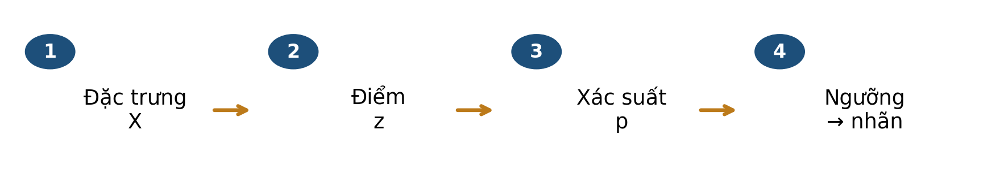
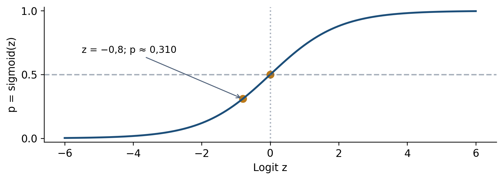
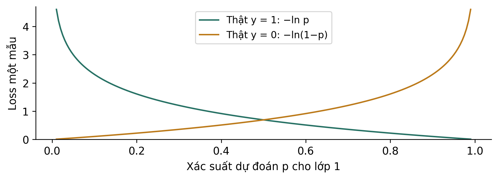
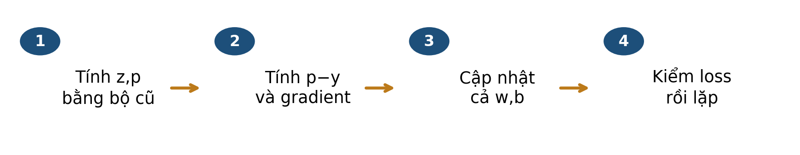
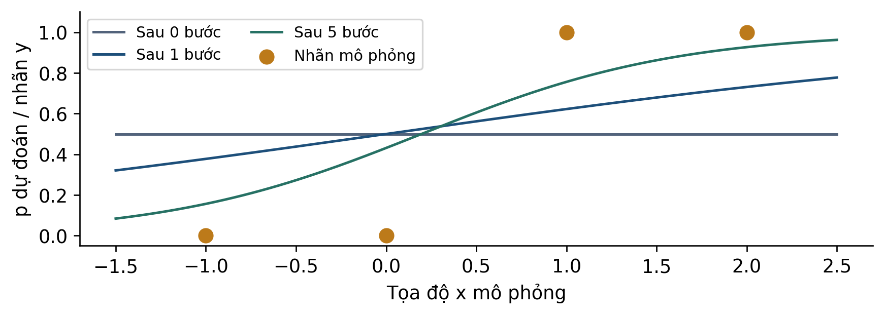
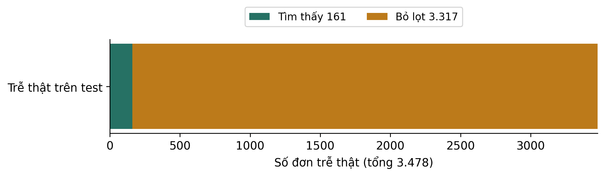

# Bài 05 · Hồi quy Logistic và quyết định cảnh báo

**PGS.TS. Nguyễn Văn Hậu**

Khoa Công nghệ Thông tin, Trường Đại học Công nghệ Kỹ thuật Hưng Yên

[← Mục lục khóa học](../../README.md) · [Thực hành Python](../../examples/bai05/README.md)

**Tài liệu hỗ trợ ví dụ thuật toán.** [Học liệu chính](../../README.md).

Đọc mục 1–8, tự làm mục 9 trước khi xem phụ lục A, dùng mục 10 để ôn tập. Phụ lục B dành cho người muốn tìm hiểu sâu hơn.

## Mục lục

- [1 Bài học này giải quyết vấn đề gì](#muc-1)
- [Lộ trình đọc và đối chiếu với bài giảng](#muc-2)
- [2 Bạn cần biết gì trước khi bắt đầu](#muc-3)
- [3 Dữ liệu của bài học trông như thế nào](#muc-4)
- [4 Ý tưởng chính của phương pháp là gì](#muc-5)
- [5 Những khái niệm và công thức nào cần nắm](#muc-6)
- [6 Phương pháp được thực hiện như thế nào](#muc-7)
- [7 Cùng làm một ví dụ từ đầu đến cuối](#muc-8)
- [8 Đọc kết quả và tránh hiểu nhầm](#muc-9)
- [Đọc AP và AUC trước khi chọn mô hình](#muc-10)
- [9 Tự kiểm tra trước khi đến lớp](#muc-11)
- [10 Những điều cần nhớ](#muc-12)
- [Phụ lục A Đáp án có giải thích](#muc-13)
- [Phụ lục B Kiến thức mở rộng tùy chọn](#muc-14)

<a id="muc-1"></a>

## 1 Bài học này giải quyết vấn đề gì

Bài 4 dự đoán đơn Olist mất bao nhiêu ngày để giao. Bài 5 hỏi **đơn có giao sau ngày hẹn không?** Hai đơn cùng mất mười ngày vẫn có thể khác nhãn vì ngày hẹn khác nhau. Ta dùng logistic để tạo xác suất theo mô hình, sau đó chọn ngưỡng để cảnh báo.



*Hình 1. Bốn bước cần theo dõi riêng. Chỉ bước cuối dùng ngưỡng; điểm và xác suất đã được tính trước đó.*

| Bài 4 | Bài 5 |
| --- | --- |
| Nhãn là số ngày từ duyệt đến giao. | Nhãn 1 nếu giao trễ ngày hẹn, 0 nếu không. |
| Đường tuyến tính dự đoán số ngày. | Điểm tuyến tính đi qua sigmoid để tạo p. |
| Đọc MAE/RMSE theo đơn vị ngày. | Đọc loss khi học và FP/FN khi ra quyết định. |

### Sau khi đọc bạn có thể

- Định nghĩa nhãn trễ đúng với mốc thời gian và dữ liệu.
- Tính logit, sigmoid, odds và nhãn dự đoán; phân biệt chúng.
- Tính một bước gradient từ bốn hàng mô phỏng.
- Giải thích vì sao đổi ngưỡng có đánh đổi và vì sao accuracy cao chưa đủ.

> ✏️ **Cách học:** dự kiến 40–50 phút, không cần lập trình. Ôn scaler ở bài 2, ma trận nhầm lẫn ở bài 3 và cập nhật gradient ở bài 4. Làm mục 9 trước khi xem phụ lục A.

<a id="muc-2"></a>

## Lộ trình đọc và đối chiếu với bài giảng

Bản tài liệu cập nhật  • Đối chiếu Bài 5, slide . Nội dung và các mốc tổng kết dưới đây theo bản slide .

### Đọc để chuẩn bị điều gì

- Từ điểm tuyến tính đến xác suất
- BCE và một bước gradient
- Chọn ngưỡng theo K = FP + 5FN
- AP, AUC và vai trò của L2

Dành khoảng 40–50 phút cho phần chính, ví dụ và tự kiểm. Phụ lục A dùng để kiểm tra lập luận sau khi tự làm; phụ lục B là phần mở rộng, có thể đọc sau giờ học.

| Slide | Mốc ôn tập trong bài giảng |
| --- | --- |
| 17 | Một dự đoán Logistic |
| 23 | BCE: từ một mẫu đến cả tập |
| 36 | Học Logistic: khởi tạo rồi lặp |
| 59 | Đánh giá theo đúng thứ tự |
| 65 | Bài 5 · Từ đơn hàng đến quyết định |

> 📌 Tài liệu đọc trước tạo nền và đặt câu hỏi; các slide trên giúp nối lại kiến thức trong giờ học. Không cần học thuộc mọi kết quả số trước khi đến lớp.

<a id="muc-3"></a>

## 2 Bạn cần biết gì trước khi bắt đầu

Một đơn được biểu diễn bằng vector đặc trưng. Mô hình nhân từng tọa độ với trọng số tương ứng, cộng các tích rồi thêm hệ số chặn. Có thể hiểu phép tính này bằng một bảng cộng, chưa cần thuộc ký hiệu ma trận.

| Đại lượng | Nói bằng lời | Ví dụ mô phỏng |
| --- | --- | --- |
| x hoặc X | Một hoặc nhiều đặc trưng đầu vào. | Khoảng cách, thời gian hẹn… |
| z | Điểm tuyến tính, còn gọi là logit. | z = 0,4x − 2 |
| exp(z) hay eᶻ | Hàm mũ cơ số e ≈ 2,718. | exp(0) = 1 |
| ln | Log tự nhiên, ngược với exp. | ln(1)=0; ln(e)=1 |
| p | Xác suất lớp 1 theo mô hình. | p=0,2 nghĩa là 20% theo mô hình. |
| y và ŷ | Nhãn thật và nhãn dự đoán. | Cùng thuộc {0,1}. |

### Điểm khác với nhãn

z có thể âm hoặc lớn hơn 1; p của sigmoid với z hữu hạn nằm giữa 0 và 1; ŷ chỉ là 0 hoặc 1 sau so ngưỡng. Không so z trực tiếp với một ngưỡng dành cho p nếu chưa đổi ngưỡng sang đúng thang.

### Quy ước luôn giữ trong bài

Lớp dương là **trễ = 1**. Cảnh báo khi p ≥ τ; không cảnh báo khi p < τ. τ đọc là “tau”, chỉ ngưỡng quyết định. Một đầu ra p chưa nói mô hình được hiệu chuẩn tốt; điều đó cần kiểm bằng dữ liệu phù hợp.

> ✏️ **K1:** p=0,2 bằng bao nhiêu phần trăm? **K2:** khi z=0, tính p=1/(1+exp(−z)), rồi áp dụng ngưỡng τ=0,5. Chú ý dấu bằng. Đáp án ở phụ lục A.

<a id="muc-4"></a>

## 3 Dữ liệu của bài học trông như thế nào

Dùng cùng bảng Olist [1] và cách chia với bài 4. **Nhãn y=1 khi ngày lịch giao thực tế lớn hơn ngày lịch hẹn.** Giao buổi chiều đúng ngày hẹn vẫn là y=0 theo quy ước của case; không so timestamp thô với mốc hẹn 00:00.

| Mã đơn bắt đầu | Ngày hẹn | Giao thực tế | y |
| --- | --- | --- | --- |
| 6cc4eb51… | 2017-05-19 | 2017-05-19 15:55:47 | 0 |
| 203096f0… | 2017-09-28 | 2017-10-09 22:23:46 | 1 |

Hai hàng thật trên được chọn trong train để minh họa ranh giới ngày, không phải mẫu đại diện. Mã đầy đủ ở two_calendar_examples.csv. Quy ước nhãn phục vụ bài học; chưa xác minh cam kết dịch vụ riêng của từng đơn.

| Sáu đặc trưng | Ý nghĩa và đơn vị |
| --- | --- |
| distance_km; promised_days | Khoảng cách đại diện km; thời gian từ duyệt tới mốc hẹn, theo ngày. |
| price; freight_value | Tổng giá mặt hàng và phí vận chuyển theo đơn, BRL. |
| n_items; weight_g | Số dòng mặt hàng; tổng khối lượng theo gram. |

| Tập | Số đơn | Số trễ | Tỷ lệ trễ |
| --- | --- | --- | --- |
| train | 29031 | 941 | 3,24% |
| validation | 10389 | 634 | 6,10% |
| test | 40266 | 3478 | 8,64% |

Train: duyệt 01–10/2017 và giao trước 01/11/2017. Validation: duyệt 11–12/2017 và giao trước 01/01/2018. Test: duyệt 01–06/2018. Điền thiếu và chuẩn hóa chỉ học từ train. Ngày giao thực tế và delivery_days không nằm trong sáu đầu vào.

> 📌 **Giới hạn dữ liệu:** chỉ đơn đã giao và đủ điều kiện. 16 đơn thiếu toàn bộ khối lượng bị tổng hợp thành 0 trong bảng đóng băng; đó không phải đo được 0 gram. Giữ bảng để khớp slide, sửa xử lý thiếu cần thí nghiệm mới.

<a id="muc-5"></a>

## 4 Ý tưởng chính của phương pháp là gì

```math
z=b+\sum_{j=1}^{d}w_jx_j,\qquad p=\sigma(z)=\frac{1}{1+\exp(-z)}
```

d là số đặc trưng; wⱼ là trọng số của tọa độ xⱼ; b là chặn. Sigmoid biến điểm tuyến tính thành xác suất lớp 1 theo mô hình.



*Hình 2. Sigmoid tăng theo z; z=0 cho p=0,5. Với z hữu hạn, đường không đạt đúng 0 hoặc 1.*

### Một ví dụ mô phỏng qua các bước

Dùng một tọa độ x với w=0,4; b=−2 và x=3. Khi đó z=−0,8 và p≈0,310. Đây là tham số thiết kế để luyện tính, không phải hệ số đã fit trên Olist.

| Bước cuối | Kết quả | Điều giữ nguyên |
| --- | --- | --- |
| τ=0,50 | 0,310 < 0,50 ⇒ ŷ=0 | z=−0,8 và p≈0,310 |
| τ=0,30 | 0,310 ≥ 0,30 ⇒ ŷ=1 | z=−0,8 và p≈0,310 |

Đổi ngưỡng chỉ đổi quyết định trong ví dụ này. Chưa có nhãn thật nên chưa gọi quyết định nào là TP hay FP. Một xác suất 0,310 cũng không hứa rằng một nhóm bất kỳ có đúng 31% đơn trễ.

> 🔎 **Vì sao không dùng thẳng z?** Điểm tuyến tính không bị chặn trong [0,1]. Có thể dùng nhiều cách tạo mô hình phân loại; logistic chọn giả định log-odds tuyến tính và hàm sigmoid, không phải lựa chọn duy nhất có đầu ra xác suất.

<a id="muc-6"></a>

## 5 Những khái niệm và công thức nào cần nắm

```math
\mathrm{odds}=\frac{p}{1-p},\qquad\ln\frac{p}{1-p}=z
```

Với 0<p<1, odds so xác suất trễ với xác suất không trễ. p=0,2 cho odds=0,25; p=0,8 cho odds=4. Logistic giả định log-odds là tổ hợp tuyến tính của đặc trưng.

Nếu tăng xⱼ một đơn vị và giữ các tọa độ khác, odds theo mô hình nhân với exp(wⱼ). **Xác suất không nhân theo cùng hệ số.** Hệ số phụ thuộc đơn vị; với z-score, một đơn vị là một độ lệch chuẩn train. Đây là liên hệ trong mô hình, không phải kết luận nhân quả.

```math
\ell(y,p)=-y\ln p-(1-y)\ln(1-p)
```

Binary cross-entropy (BCE) của một mẫu: nếu y=1 chỉ còn −ln p; nếu y=0 chỉ còn −ln(1−p). Dùng log tự nhiên; loss không có đơn vị ngày và không phải tỷ lệ phần trăm sai.



*Hình 3. Đọc theo nhãn thật: dự đoán tự tin về phía nhãn sai bị phạt mạnh. Hai đường là hai nhãn, không phải hai thuật toán.*

```math
J=\frac{1}{n}\sum_{i=1}^{n}\ell(y_i,p_i)
```

Loss train trong tính tay là BCE trung bình, không có phạt, với n>0. Khi y=1, p=0,8 cho loss≈0,2231; p=0,2 cho loss≈1,6094. Chỉ cộng loss sau khi đã chọn đúng nhánh theo nhãn thật.

> ✏️ **Dừng để kiểm:** cùng p=0,8 nhưng y đổi từ 1 sang 0 thì loss tăng hay giảm? Dùng đường đúng trên hình trước khi bấm máy.

<a id="muc-7"></a>

## 6 Phương pháp được thực hiện như thế nào



*Hình 4. Vòng học tính tay với BCE không phạt. Quyết định ngưỡng không tham gia phép tính gradient này.*

```math
\frac{\partial\ell_i}{\partial z_i}=p_i-y_i,\qquad g_b=\frac{1}{n}\sum_i(p_i-y_i)
```

pᵢ−yᵢ là đạo hàm theo logit của một mẫu. Gradient theo chặn b là trung bình các giá trị này. Đây không phải loss; gradient có thể âm trong khi BCE không âm.

```math
g_{w_j}=\frac{1}{n}\sum_i x_{ij}(p_i-y_i)
```

Mỗi thành phần gradient theo wⱼ còn nhân tọa độ xᵢⱼ. Không đồng nhất một số p−y với toàn bộ vector gradient. Với một đặc trưng, bỏ chỉ số j để bảng tính dễ đọc.

```math
b_{t+1}=b_t-\eta g_b,\qquad w_{j,t+1}=w_{j,t}-\eta g_{w_j}
```

Tính các gradient tại cùng bộ tham số cũ rồi cập nhật đồng thời, như bài 4. Learning rate η>0 điều chỉnh độ dài bước; sau cập nhật tính lại p và J.

### Phân biệt phép tính tay với cấu hình thật

| Phần học bằng tay | Case Olist trong slide |
| --- | --- |
| BCE trung bình, không phạt. | Logistic với phạt L2; C=1. |
| GD để nhìn từng phép tính. | Solver Newton-CG, tối đa 100 vòng. |
| Bốn hàng mô phỏng, một tọa độ. | Sáu đặc trưng, median và scaler fit train. |
| η là learning rate. | C điều khiển mức phạt nghịch đảo, không phải η. |

> 📌 **Đúng quy trình:** fit tiền xử lý và mô hình trên train; chọn ngưỡng trên validation theo mục tiêu định trước; khóa trước khi đọc test. Trong bộ bài, test lịch sử đã được xem ở pilot nên lần trình bày lại không là kiểm độc lập mới.

<a id="muc-8"></a>

## 7 Cùng làm một ví dụ từ đầu đến cuối

Bốn hàng sau là **dữ liệu mô phỏng A–D**, x là tọa độ đã thiết kế, không phải khoảng cách km. Nhãn y cho sẵn. Bắt đầu b₀=w₀=0 nên mọi z=0 và p=0,5.

| ID | x | y | p−y | x(p−y) |
| --- | --- | --- | --- | --- |
| A | −1 | 0 | 0,5 | −0,5 |
| B | 0 | 0 | 0,5 | 0 |
| C | 1 | 1 | −0,5 | −0,5 |
| D | 2 | 1 | −0,5 | −1 |

```math
g_b=\frac{0.5+0.5-0.5-0.5}{4}=0,\qquad g_w=\frac{-0.5+0-0.5-1}{4}=-0.5
```

Chọn η=1 cho đúng ví dụ này: b₁=0−1×0=0; w₁=0−1×(−0,5)=0,5. Ở hàng A, x âm nên x(p−y) âm dù p−y dương.

| Sau cập nhật | A | B | C | D |
| --- | --- | --- | --- | --- |
| z mới | −0,5 | 0 | 0,5 | 1 |
| p mới | 0,3775 | 0,5000 | 0,6225 | 0,7311 |
| Nhãn tại τ=0,5 | 0 | 1 | 1 | 1 |

BCE trung bình giảm từ ln 2 ≈ 0,6931 xuống 0,4886. Hàng B vẫn bị cảnh báo nhầm ở bước này vì p đúng bằng ngưỡng. Muốn kiểm học có tiến triển phải tính lại loss; một bước chưa cần phân loại đúng mọi hàng.



*Hình 5. Cùng bốn hàng mô phỏng, xác suất thay đổi sau các bước học. Điểm vàng là nhãn thật 0/1; đường là p dự đoán.*

> 📌 Ví dụ này chỉ để nhìn quá trình cập nhật. Bốn điểm phân tách hoàn toàn nên logistic không phạt không có nghiệm tối ưu hữu hạn; không dùng loss giảm để khẳng định mọi bài đều có nghiệm hữu hạn duy nhất.

<a id="muc-9"></a>

## 8 Đọc kết quả và tránh hiểu nhầm

Mô hình thật dùng sáu đặc trưng như mục 3. Đơn fc9bc4ba… của bài 4 cho logit -2,8189 và p≈0,0563 sau tiền xử lý. Đây là đơn train để minh họa phép dự đoán, không dùng làm bằng chứng tổng quát hóa.

### Chọn ngưỡng trên validation, theo tiêu chí đã định

Giả định lớp học: chi phí K=FP+5FN, tức bỏ lọt nặng bằng năm cảnh báo nhầm. Quét sáu ngưỡng dưới đây; nếu hòa chọn ít cảnh báo hơn, rồi ngưỡng lớn hơn. K trong chi phí này khác tham số C=1 của mức phạt trong phần mềm.

| Ngưỡng τ | 0,05 | 0,10 | 0,15 | 0,20 | 0,30 | 0,50 |
| --- | --- | --- | --- | --- | --- | --- |
| FP+5FN validation | 3377 | 3108 | 3168 | 3173 | 3173 | 3172 |

Ngưỡng 0,10 có chi phí validation nhỏ nhất trong lưới đã thử. Khóa mô hình và ngưỡng rồi áp dụng lại lên test lịch sử, gồm 36.788 đơn không trễ và 3.478 đơn trễ.

| Test | TN | FP | FN | TP | FP+5FN |
| --- | --- | --- | --- | --- | --- |
| τ=0,50 | 36788 | 0 | 3478 | 0 | 17390 |
| τ=0,10 | 36429 | 359 | 3317 | 161 | 16944 |

Tại τ=0,50, accuracy=91,36% nhưng recall=0 vì không cảnh báo đơn nào; precision theo phép chia không xác định. Tại τ=0,10 có 520 cảnh báo: precision=161/520≈30,96%, recall=161/3478≈4,63%. Chi phí giả định giảm 446 đơn vị, song phần lớn đơn trễ vẫn bỏ lọt.



*Hình 6. Với ngưỡng 0,10, nhìn từ các đơn trễ thật: 161 được tìm thấy, 3.317 bị bỏ lọt. Đây là recall; 359 cảnh báo nhầm thuộc nhóm không trễ nên không nằm trên thanh.*

> 📌 **Kết luận có giới hạn:** có đánh đổi trên tập đã chọn, chưa đủ bằng chứng để triển khai. Không gọi 446 là tiền tiết kiệm, không suy cảnh báo đã làm giảm trễ, và không coi đổi ngưỡng là cải thiện xác suất p.

<a id="muc-10"></a>

## Đọc AP và AUC trước khi chọn mô hình

Ngưỡng biến xác suất thành nhãn; AP và ROC-AUC đánh giá khả năng xếp hạng qua nhiều ngưỡng. Validation là tập dùng để so sánh các lựa chọn, không phải một loại AUC mới.

```math
AP=\sum_j(R_j-R_{j-1})P_j
```

P và R là precision và recall tại các mức điểm giảm dần; AP cộng precision có trọng số theo phần recall tăng thêm. Không đồng nhất AP với mọi cách tính diện tích đường PR.

| Xếp hạng từ cao xuống | Nhãn thật | Precision nếu dừng ở đây |
| --- | --- | --- |
| 1 | 1 | 1 |
| 2 | 0 | 1/2 |
| 3 | 1 | 2/3 |
| 4 | 0 | 1/2 |

Hai mẫu dương xuất hiện ở hạng 1 và 3, nên AP = (1 + 2/3)/2 = 5/6. Trong bốn cặp dương–âm, điểm dương cao hơn ba lần, nên ROC-AUC = 3/4. Nếu bằng điểm, một cặp được tính nửa điểm.

### Hai chữ cần phân biệt

K = FP + 5FN là chi phí cảnh báo. C của LogisticRegression điều khiển mức regularization: C nhỏ hơn tương ứng phạt mạnh hơn trong cùng cách thiết lập. C không phải learning rate η.

> ✏️ Tự kiểm: AP cao có bảo đảm ít FN tại ngưỡng 0,5 không? Không; xếp hạng và quyết định ở một ngưỡng là hai câu hỏi khác nhau.

<a id="muc-11"></a>

## 9 Tự kiểm tra trước khi đến lớp

Làm trước khi đọc phụ lục A. Ghi cả phép tính và câu giải thích. Câu chọn đáp án cần nêu vì sao các phương án khác không phù hợp.

**Câu 1.** Ngày hẹn ghi 2018-03-10 00:00:00; giao thực tế 2018-03-10 17:30:00. Theo quy ước nhãn của case, y bằng bao nhiêu?

- **A.** 1 vì giao sau nửa đêm.
- **B.** 0 vì vẫn giao trong ngày hẹn.
- **C.** Không thể gán nhãn dù đã có cả hai mốc.

**Câu 2.** Mô hình cho p=0,31. So sánh quyết định ở τ=0,50 và τ=0,30. Đại lượng nào thay đổi: logit z, xác suất p hay nhãn ŷ?

**Câu 3.** Ban đầu p=0,20. Khi tăng một tọa độ theo mô hình, odds tăng gấp đôi. Xác suất mới bằng bao nhiêu?

- **A.** 0,40 vì p tăng gấp đôi.
- **B.** 0,50 vì odds tăng gấp đôi.
- **C.** 1/3 vì odds từ 0,25 tăng thành 0,50.

**Câu 4.** Một mẫu có x=−1, y=0, p=0,5. Tính đóng góp x(p−y) vào tổng gradient theo w. Nếu có n=4 thì đóng góp vào gradient trung bình là bao nhiêu?

**Câu 5.** Nhãn thật y=1. Trong hai dự đoán p=0,8 và p=0,2, dự đoán nào có BCE nhỏ hơn? Tính hai loss bằng log tự nhiên và giải thích dấu.

**Câu 6.** Tại ngưỡng 0,10, mô hình Olist tìm được 161/3.478 đơn trễ và có 359 cảnh báo nhầm. Kết luận nào được hỗ trợ?

- **A.** Có đánh đổi được đo trên tập này; recall còn thấp nên chưa đủ kết luận triển khai.
- **B.** Mô hình đã giúp giảm số đơn trễ thật xuống còn 3.317.
- **C.** Mô hình đáng tin cho từng đơn vì logistic luôn hiệu chuẩn tốt.

> ✏️ **Tự đánh giá:** nhãn ngày lịch → câu 1; mô hình/quyết định → câu 2; odds → câu 3; học tham số → câu 4,5; đọc bằng chứng → câu 6.

<a id="muc-12"></a>

## 10 Những điều cần nhớ

### Tự kể lại toàn bộ một lần dự đoán và học

- Tạo đặc trưng đúng thời điểm; dùng lại tiền xử lý đã fit train.
- Tính z từ các trọng số, đưa qua sigmoid để có p.
- Khi học, so p với nhãn thật bằng BCE; gradient theo logit là p−y.
- Tính gradient từng tham số tại cùng bộ cũ, cập nhật rồi kiểm lại loss.
- Khi ra quyết định, so p với ngưỡng đã chọn theo mục tiêu trên validation.
- Báo cả FP/FN, precision/recall, giới hạn dữ liệu và điều chưa kiểm.

| Thuật ngữ | Nói bằng lời |
| --- | --- |
| Logit | Log của odds; là điểm tuyến tính trong logistic. |
| Sigmoid | Hàm biến logit thành p thuộc (0,1). |
| BCE | Mất mát của xác suất với nhãn nhị phân. |
| Regularization | Thành phần phạt để kiểm soát tham số trong mục tiêu học. |
| Calibration | Kiểm mức điểm có phù hợp tần suất quan sát ở dữ liệu phù hợp không. |

### Nguồn và dữ liệu để kiểm lại

Đối chiếu Bài 5 ; các mốc tổng kết được ghi ở bảng lộ trình đầu tài liệu. Kèm bảng mô hình, dự đoán, toy bốn hàng, hai ví dụ ngày lịch và cấu hình đã khóa. Mọi điểm dự đoán được tái tính và đối chiếu bản slide; các bảng số đếm được tính lại từ CSV.

[\[1\] Olist Brazilian E-Commerce Public Dataset Kaggle](https://www.kaggle.com/datasets/olistbr/brazilian-ecommerce)

[\[2\] scikit-learn 1.6 Logistic regression](https://scikit-learn.org/1.6/modules/linear_model.html#logistic-regression)

[\[3\] scikit-learn 1.6 log_loss](https://scikit-learn.org/1.6/modules/generated/sklearn.metrics.log_loss.html)

[\[4\] Stanford CS229 Logistic regression](https://cs229.stanford.edu/notes2022fall/main_notes.pdf)

> 🔎 **Nối sang bài 6:** giữ case Olist và mục tiêu để so cách mô hình hóa. Cây quyết định dùng các câu hỏi chia nhánh; nhiều nhánh hơn không tự bảo đảm chất lượng tốt hơn trên dữ liệu mới.

<a id="muc-13"></a>

## Phụ lục A Đáp án có giải thích

**K1:** 0,2 = 20%. **K2:** exp(0)=1 nên p=1/(1+1)=0,5; theo p≥0,5 thì ŷ=1. Đây là dự đoán, chưa biết nhãn thật thì chưa kết luận đúng hay sai.

### Câu 1

Đáp án B. Chuẩn hóa về ngày lịch cho hai mốc cùng là 2018-03-10, nên ngày giao không lớn hơn ngày hẹn. A dùng nhầm so timestamp thô; C bỏ qua quy ước đã có. Quy ước của case không tự mô tả mọi hợp đồng giao hàng.

### Câu 2

τ=0,50: 0,31<0,50 nên ŷ=0. τ=0,30: 0,31≥0,30 nên ŷ=1. Chỉ nhãn quyết định thay đổi; cùng mô hình và đầu vào nên z,p giữ nguyên. Chưa biết y nên không kết luận quyết định nào đúng.

### Câu 3

```math
\mathrm{odds}_{old}=\frac{0.2}{0.8}=0.25,\quad\mathrm{odds}_{new}=0.50,\quad p_{new}=\frac{0.50}{1+0.50}=\frac{1}{3}
```

Đáp án C. A nhân nhầm xác suất; B nhầm odds 0,50 với xác suất 0,50. Chuyển ngược từ odds o sang p bằng p=o/(1+o).

### Câu 4

p−y=0,5; x(p−y)=−1×0,5=−0,5. Đây là đóng góp vào tổng. Với n=4, đóng góp vào gradient trung bình là −0,5/4=−0,125. Gradient đầy đủ còn phải cộng đóng góp của ba mẫu kia.

### Câu 5

Vì y=1, loss=−ln p. Với p=0,8: loss≈0,2231; p=0,2: loss≈1,6094. Log của số trong (0,1) âm nên thêm dấu trừ cho loss dương. Gán nhiều xác suất hơn cho lớp đã quan sát cho loss nhỏ hơn trong hai trường hợp này.

### Câu 6

Đáp án A. Tỷ lệ tìm thấy chỉ khoảng 4,63%; cần báo cả 359 FP. B nhầm bỏ lọt trong dự đoán với số đơn trễ sau một can thiệp thực. C coi sigmoid là bằng chứng hiệu chuẩn, trong khi chưa kiểm điều đó trên phân phối đích.

> ✏️ **Ôn theo lỗi:** câu 1 → mục 3; câu 2 → mục 4; câu 3,5 → mục 5; câu 4 → mục 6–7; câu 6 → mục 8.

<a id="muc-14"></a>

## Phụ lục B Kiến thức mở rộng tùy chọn

### 19 quan sát thiết kế để kiểm một quan hệ đẹp

Đây là ví dụ mô phỏng đọc thêm tùy chọn, không phải Olist. Ở mỗi nhóm x có đúng một nhãn 1; số còn lại là nhãn 0. Tổng 19 quan sát và 4 nhãn 1.

| x | Số quan sát | Số nhãn 1 | Tần suất | Odds từ tần suất |
| --- | --- | --- | --- | --- |
| 1 | 9 | 1 | 1/9 | 1/8 |
| 2 | 5 | 1 | 1/5 | 1/4 |
| 3 | 3 | 1 | 1/3 | 1/2 |
| 4 | 2 | 1 | 1/2 | 1 |

```math
z=-\ln16+(\ln2)x,\qquad p=\sigma(z)
```

Odds tăng gấp đôi giữa các nhóm, nên logit nằm trên đường có độ dốc ln 2. Công thức cho đúng p=1/9,1/5,1/3,1/2. Đây là cấu trúc được thiết kế, không chứng minh log-odds tuyến tính cho dữ liệu bất kỳ.

### Loss lồi chưa đủ để kết luận có nghiệm hữu hạn

Bốn điểm ở mục 7 phân tách được bởi một biên giữa x=0 và x=1. Tăng độ lớn tham số theo hướng phân tách làm p tiến về nhãn và BCE tiến 0, nhưng không đạt 0 với tham số hữu hạn. Phải xét riêng tính lồi, tồn tại và duy nhất nghiệm; loss giảm trong 20 bước không chứng minh cả ba.

### Phạt, đơn vị và chất lượng xác suất

- L2 thêm phạt theo bình phương trọng số; C trong sklearn là mức mạnh nghịch đảo của phạt. C lớn hơn làm phạt yếu hơn, với các thiết lập khác giữ nguyên. Đổi đơn vị có thể đổi ảnh hưởng phạt.
- Squared loss không vô nghĩa cho phân loại: Brier chấm xác suất bằng trung bình (p−y)². BCE và Brier đánh giá p, không thay đổi chỉ vì đổi ngưỡng.
- Điểm xác suất tốt hơn mốc hằng theo một chỉ số tổng hợp chưa chứng minh đã hiệu chuẩn ở mọi nhóm. Cần xem tần suất theo nhóm điểm trên dữ liệu phù hợp.
- Chỉ số lịch sử trên mẫu đã giao chưa xác nhận tác động của cảnh báo hoặc khả năng dùng cho đơn chưa hoàn tất và dữ liệu Việt Nam.

> ✏️ **Bài mở rộng:** đổi odds 1/4 về p để kiểm hàng x=2. Công thức BCE không chứa ngưỡng; vì sao đổi ngưỡng vẫn có thể đổi FP và FN?

## Chuyển sang thực hành

Mở [hướng dẫn Python Bài 05](../../examples/bai05/README.md), chạy ví dụ nhỏ trước rồi mới chạy dữ liệu thật. Các bảng CSV và JSON trong thư mục đọc trước lưu kết quả tham chiếu của lần biên soạn; chương trình thực hành tự tính lại và lưu kết quả mới trong `outputs/`.

[Nguồn dữ liệu và điều kiện sử dụng](../../docs/DU_LIEU_VA_NGUON.md) · [Kiểm tra học liệu](../../docs/MAINTAINING.md)
