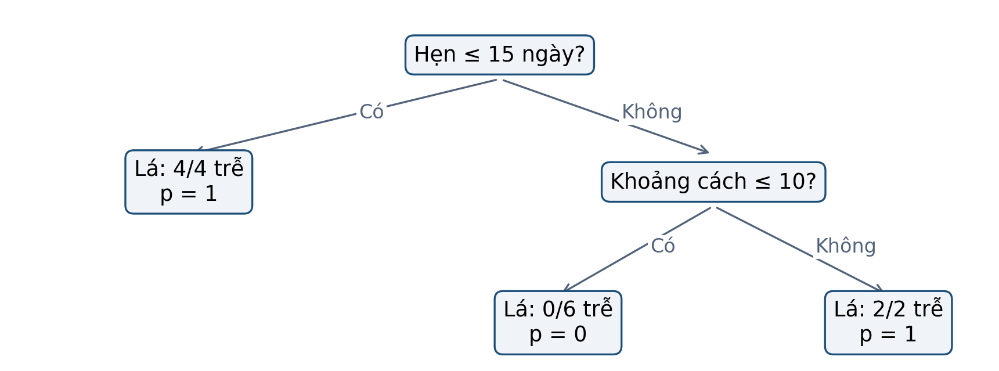
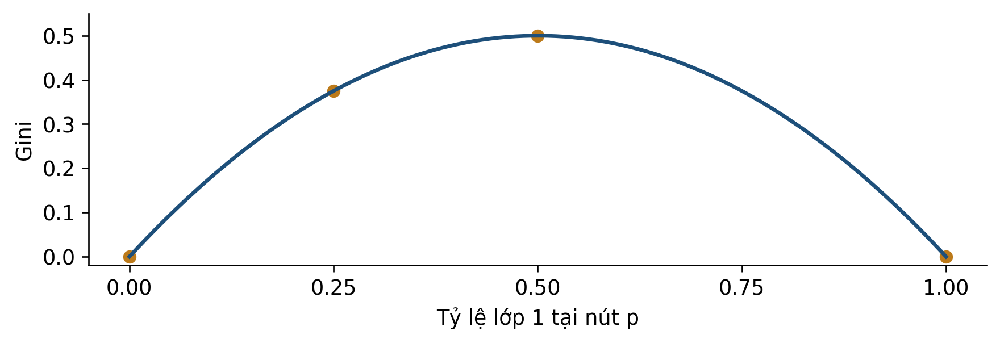
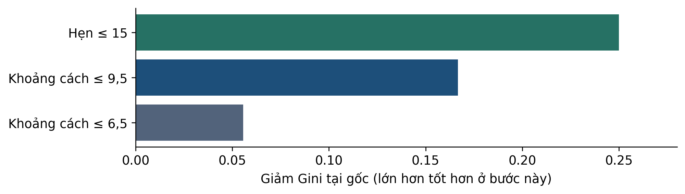
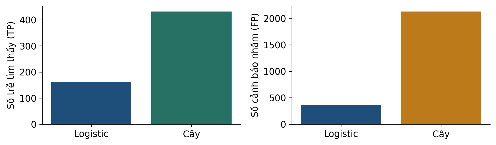
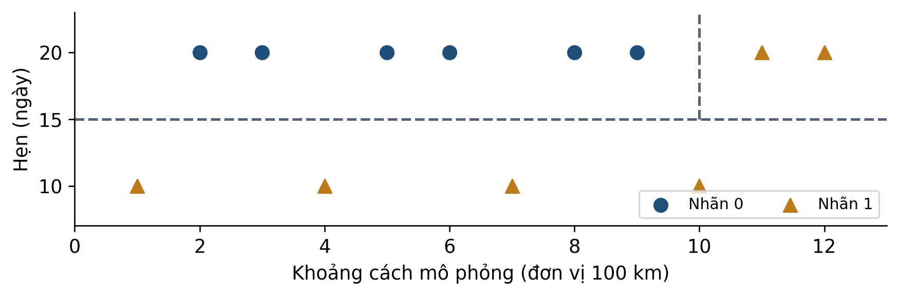

# Bài 06 · Cây quyết định và cách học các điều kiện

**PGS.TS. Nguyễn Văn Hậu**

Khoa Công nghệ Thông tin, Trường Đại học Công nghệ Kỹ thuật Hưng Yên

[← Mục lục khóa học](../../README.md) · [📄 PDF 12 trang](Bai06_Kien_thuc_nen_tang_va_doc_truoc.pdf) · [📝 Word](Bai06_Kien_thuc_nen_tang_va_doc_truoc.docx) · [💻 Thực hành Python](../../lessons/bai06/README.md)

Đọc mục 1–8, tự làm mục 9 trước khi xem phụ lục A, dùng mục 10 để ôn tập. Phụ lục B dành cho người muốn tìm hiểu sâu hơn.

## Mục lục

- [1 Bài học này giải quyết vấn đề gì](#muc-1)
- [2 Bạn cần biết gì trước khi bắt đầu](#muc-2)
- [3 Dữ liệu của bài học trông như thế nào](#muc-3)
- [4 Ý tưởng chính của phương pháp là gì](#muc-4)
- [5 Những khái niệm và công thức nào cần nắm](#muc-5)
- [6 Phương pháp được thực hiện như thế nào](#muc-6)
- [7 Cùng làm một ví dụ từ đầu đến cuối](#muc-7)
- [8 Đọc kết quả và tránh hiểu nhầm](#muc-8)
- [9 Tự kiểm tra trước khi đến lớp](#muc-9)
- [10 Những điều cần nhớ](#muc-10)
- [Phụ lục A Đáp án có giải thích](#muc-11)
- [Phụ lục B Kiến thức mở rộng tùy chọn](#muc-12)

<a id="muc-1"></a>

## 1 Bài học này giải quyết vấn đề gì

Bài 5 tạo xác suất trễ bằng logistic. Bài 6 giữ mục tiêu Olist đó và thử **cây quyết định**: một chuỗi câu hỏi có/không đưa từng đơn đến một nhóm gọi là lá. Ta học cách dựng câu hỏi từ dữ liệu, rồi kiểm xem quyết định có hữu ích trên dữ liệu khác không.


*Hình 1. Một lần dự đoán chỉ đi theo một đường từ gốc đến lá.*

### Sau khi đọc bạn có thể

- Đọc điều kiện, đi đúng nhánh và tính xác suất tại lá.
- Tính Gini và giảm Gini có trọng số để so hai phép chia.
- Dựng cây ba lá từ 12 hàng mô phỏng có thể kiểm bằng tay.
- Phân biệt học cấu trúc cây, chọn ngưỡng và đánh giá kết quả.

> ✏️ **Cách học:** dự kiến 30–40 phút; không cần lập trình. Đọc mục 1–8, tự làm mục 9 rồi xem đáp án. Phụ lục B dành cho người muốn hiểu thêm về cắt tỉa.

<a id="muc-2"></a>

## 2 Bạn cần biết gì trước khi bắt đầu

Ở một nút, ta chỉ nhìn những hàng dữ liệu đã đi đến nút đó. Các số đếm của nút con không phải số đếm của toàn bộ bảng. Đây là chìa khóa để tránh nhầm mẫu số trong công thức.

| Cần biết | Ví dụ và cách đọc |
| --- | --- |
| Tỷ lệ | Có 2 nhãn trễ trong 8 đơn: p=2/8=0,25. |
| Bình phương | 0,25²=0,0625; không phải 0,50. |
| Trung bình có trọng số | Nhóm 4 và 8 hàng trong tổng 12 có trọng số 4/12 và 8/12. |
| Bất đẳng thức | x≤10 đi trái, x>10 đi phải; x=10 thuộc nhánh trái. |
| Ma trận nhầm lẫn | FP: cảnh báo khi không trễ. FN: bỏ lọt đơn trễ. |

### Ba cấp độ cần phân biệt

- Mẫu: một đơn cùng vector đặc trưng và nhãn thật.
- Nút: nhóm mẫu đang được xem xét chia tiếp.
- Cây: toàn bộ các điều kiện và lá tạo ra sau khi học.

> 📌 **Quy ước:** lớp 1 là trễ; dự đoán cảnh báo khi p≥τ. Xác suất tại lá ở ví dụ không dùng trọng số mẫu bằng tỷ lệ nhãn 1 trong các mẫu train của lá.

> ✏️ **K1:** lá có 3 đơn trễ trong 12 đơn thì p bao nhiêu? **K2:** nút có 8 hàng trong tổng 12, trọng số của nó trong toàn cây là bao nhiêu? Đáp án ở phụ lục A.

<a id="muc-3"></a>

## 3 Dữ liệu của bài học trông như thế nào

Bảng thật Olist [1] tiếp nối bài 4–5. Bốn hàng dưới được chọn từ train để xem dữ liệu; đây không phải mẫu ngẫu nhiên đại diện. Mã đầy đủ và các cột còn lại ở four_real_orders.csv.

| Mã đơn bắt đầu | Km | Hẹn (ngày) | Trễ |
| --- | --- | --- | --- |
| fc9bc4ba… | 100.0 | 7.20 | 0 |
| 67f2f913… | 400.0 | 21.16 | 0 |
| 7d09a3b1… | 800.0 | 25.37 | 0 |
| 34445bc5… | 1400.1 | 49.98 | 0 |

Sáu đầu vào: distance_km, promised_days, price và freight_value (BRL), n_items, weight_g. Nhãn trễ=1 nếu **ngày lịch giao thực tế sau ngày lịch hẹn**. Ngày giao thực tế và thời gian đã giao không được dùng làm đầu vào.

| Tập | Số đơn | Số trễ |
| --- | --- | --- |
| train | 29031 | 941 |
| validation | 10389 | 634 |
| test | 40266 | 3478 |

Train: duyệt 01–10/2017, giao trước 01/11/2017. Validation: duyệt 11–12/2017, giao trước 01/01/2018. Test: duyệt 01–06/2018. Điền thiếu và scaler chỉ fit train; giữ tiền xử lý bài 5 để đối chiếu. Cây không sử dụng khoảng cách Euclid để chia nhánh.

> 📌 Bảng chỉ gồm đơn đã giao đủ điều kiện; đầu vào tại lúc duyệt là giả định cần kiểm khi triển khai. 16 đơn thiếu toàn bộ khối lượng được tổng hợp thành 0 trong bảng đóng băng, không phải đo được 0 gram. Bảng 12 đơn ở mục 7 là **mô phỏng**, tách biệt với Olist.

<a id="muc-4"></a>

## 4 Ý tưởng chính của phương pháp là gì

Cây dưới được học từ 12 đơn mô phỏng ở mục 7. Câu hỏi đầu xét thời gian hẹn; chỉ những đơn trả lời “Không” mới cần xét khoảng cách. Đơn vị khoảng cách ở ví dụ này là 100 km.



*Hình 2. Cây có hai nút chia, ba lá, độ sâu 2; gốc có độ sâu 0.*

### Theo một đơn đến cùng

M11 có khoảng cách 11 và hẹn 20 ngày. Vì 20>15, đi phải. Vì 11>10, tiếp tục đi phải. Lá có 2/2 đơn train trễ nên p=1. Với τ=0,5, cây dự đoán nhãn 1.

Cây trả cùng một p cho mọi đầu vào rơi vào cùng lá. p=1 ở hai mẫu train không chứng minh mọi đơn tương lai trong vùng đó đều trễ. Các nhánh mô tả quan hệ dự đoán, không chứng minh thời gian hẹn gây ra kết quả giao.

> ✏️ **Dừng để kiểm:** một đơn mới có hẹn 20 và khoảng cách đúng 10 đi đến lá nào? Dùng dấu ≤ ở hình trước khi xem câu 3 mục 9.

<a id="muc-5"></a>

## 5 Những khái niệm và công thức nào cần nắm

```math
p_k=\frac{n_k}{n},\qquad G=1-\sum_{k=1}^{K}p_k^2
```

n>0 là số mẫu tại nút; nₖ là số mẫu lớp k. Công thức ở đây cho các mẫu không có trọng số. Với hai lớp, dùng p cho tỷ lệ lớp 1.

```math
G=1-p^2-(1-p)^2=2p(1-p)
```

Nút thuần một lớp có G=0; nút hai lớp cân bằng có G=0,5, là giá trị lớn nhất trong trường hợp nhị phân.



*Hình 3. Gini đo sự trộn lớp ở nút, không phải xác suất dự đoán sai của một đơn.*

```math
G_{sau}=\frac{n_L}{n}G_L+\frac{n_R}{n}G_R,\qquad\Delta G=G_{truoc}-G_{sau}
```

L,R là hai nút con, nL+nR=n. So các phép chia hợp lệ tại cùng nút bằng giảm Gini. Nút con nhỏ cần trọng số nhỏ tương ứng [2].

> 📌 Ví dụ p=2/8=0,25: G=2×0,25×0,75=0,375. Không thay p bằng ngưỡng cảnh báo τ trong công thức Gini.

<a id="muc-6"></a>

## 6 Phương pháp được thực hiện như thế nào

### Học cây từ dữ liệu train

- Tại nút, xét từng đặc trưng và các ngưỡng ứng viên giữa hai giá trị khác nhau liên tiếp.
- Chia nhóm ≤ ngưỡng và > ngưỡng; bỏ phép chia vi phạm điều kiện như số mẫu tối thiểu ở lá.
- Tính Gini sau chia có trọng số; chọn mức giảm tốt nhất ở nút đang xét.
- Lặp trên nút con cho đến khi đạt điều kiện dừng. Mỗi lá giữ tỷ lệ các lớp.



*Hình 4. Ba ứng viên tại gốc của bảng 12 đơn; còn các ứng viên khác trong CSV đi kèm.*

Gốc có 11 ngưỡng khoảng cách và một ngưỡng hẹn, tổng 12 ứng viên. Hẹn≤15 giảm Gini 0,25; khoảng cách≤6,5 chỉ giảm 1/18≈0,0556. Chia hai bên bằng số hàng không đồng nghĩa chia lớp tốt nhất.

> 📌 CART chọn tốt nhất từng bước theo tiêu chí và ràng buộc hiện tại; không tìm hết mọi cây để bảo đảm tối ưu toàn cục. Giới hạn độ sâu, số mẫu tối thiểu ở lá và cắt tỉa giúp kiểm soát độ phức tạp [2].

> ✏️ Chọn cấu trúc bằng validation; ngưỡng cảnh báo được chọn sau khi có điểm p. Không nhìn test rồi sửa độ sâu để báo lại như đánh giá độc lập.

<a id="muc-7"></a>

## 7 Cùng làm một ví dụ từ đầu đến cuối

**Bảng mô phỏng đầy đủ:** x là khoảng cách theo đơn vị 100 km. Nhãn được thiết kế để người học kiểm từng phép chia, không ước lượng tần suất trễ của Olist.

| Đơn | x | Hẹn | y |
| --- | --- | --- | --- |
| M01 | 1 | 10.0 | 1 |
| M02 | 2 | 20.0 | 0 |
| M03 | 3 | 20.0 | 0 |
| M04 | 4 | 10.0 | 1 |
| M05 | 5 | 20.0 | 0 |
| M06 | 6 | 20.0 | 0 |
| M07 | 7 | 10.0 | 1 |
| M08 | 8 | 20.0 | 0 |
| M09 | 9 | 20.0 | 0 |
| M10 | 10 | 10.0 | 1 |
| M11 | 11 | 20.0 | 1 |
| M12 | 12 | 20.0 | 1 |

```math
G_{goc}=0.5,\quad G_{sau}=\frac{4}{12}0+\frac{8}{12}0.375=0.25
```

Chia hẹn≤15: bên trái M01,M04,M07,M10 đều trễ; bên phải 8 đơn có 2 trễ. Giảm Gini ở gốc là 0,5−0,25=0,25.

```math
\Delta G_{toan\ cay}=0.25+\frac{8}{12}\times0.375=0.50
```

Ở nhánh hẹn>15, chia x≤10 cho 6 nhãn 0 và 2 nhãn 1. Giảm Gini tại nhánh là 0,375; đóng góp toàn cây phải nhân 8/12. Ba lá đều thuần trên bảng này.

> 📌 Cây phân loại đúng 12/12 mẫu train mô phỏng. Chưa có mẫu kiểm tra mới trong phép tính này, nên không suy ra accuracy 100% ngoài mẫu.

<a id="muc-8"></a>

## 8 Đọc kết quả và tránh hiểu nhầm

Với Olist, so độ sâu tối đa 3 và 6, mỗi lá ít nhất 200 mẫu train. AP validation lần lượt khoảng 0,0817 và 0,1005; chọn độ sâu 6 (23 lá). AP đánh giá xếp hạng điểm, không phải chỉ số tại một ngưỡng.

Trên validation, chọn τ từ {0,05; 0,10; 0,15; 0,20; 0,30; 0,50} theo chi phí giả định FP+5FN. Chọn τ=0,10; không refit. Test dưới đây đã được xem trong pilot lịch sử, không phải thí nghiệm độc lập mới.



*Hình 5. Cùng test 40.266 đơn: cây tìm nhiều đơn trễ hơn, đồng thời báo nhầm nhiều hơn.*

| Mô hình/chính sách | TP | FP | FN | FP+5FN |
| --- | --- | --- | --- | --- |
| Không cảnh báo | 0 | 0 | 3.478 | 17.390 |
| Logistic bài 5 | 161 | 359 | 3.317 | 16.944 |
| Cây bài 6 | 432 | 2.129 | 3.046 | 17.359 |

Recall cây=432/3.478≈12,42%; precision=432/2.561≈16,87%. Cây có recall cao hơn logistic trong phép thử này nhưng chi phí giả định lớn hơn. Cả hai chưa đủ bằng chứng cho triển khai.

> 🔎 Đơn thật fc9bc4ba… đi đến lá có 33/297 mẫu train trễ: p≈0,1111. Với τ=0,10 cây cảnh báo, trong khi đơn này không trễ. Đường đi giải thích phép dự đoán, không bảo đảm dự đoán đúng.

<a id="muc-9"></a>

## 9 Tự kiểm tra trước khi đến lớp

Ghi phép tính và lý do trước khi mở phụ lục A. Có thể quay lại bảng 12 hàng nhưng hãy tự chọn nhánh.

**Câu 1.** Lá có 2 nhãn 1 và 6 nhãn 0. Tính p và Gini.

- **A.** p=0,25; G=0,375.
- **B.** p=0,25; G=0,25.
- **C.** p=0,75; G=0,5.

**Câu 2.** Gốc có G=0,5. Hai con có (nL=4, GL=0) và (nR=8, GR=0,375). Tính G sau chia và giảm Gini. Vì sao không lấy trung bình hai Gini bằng trọng số 1/2?

**Câu 3.** Theo cây hình 2, đơn hẹn 20 ngày và x=10 có p bao nhiêu? Nếu x=11 thì sao?

**Câu 4.** Cây chỉ có phép chia gốc của ví dụ: lá phải có p=2/8. So quyết định ở τ=0,5 và τ=0,2; cấu trúc cây có thay đổi không?

**Câu 5.** Cây đúng 100% trên train. Kết luận nào phù hợp?

- **A.** Chắc chắn tốt nhất trên dữ liệu mới.
- **B.** Chắc chắn overfit dù chưa có kết quả ngoài mẫu.
- **C.** Cần kiểm dữ liệu ngoài train và so mức phức tạp phù hợp.

**Câu 6.** Trong bảng Olist mục 8, tính phần tăng FP và phần giảm FN của cây so logistic. Theo FP+5FN, mô hình nào có chi phí nhỏ hơn?

> ✏️ **Tự đánh giá:** hiểu nút → câu 1; hiểu học → câu 2; hiểu dự đoán → câu 3,4; hiểu bằng chứng → câu 5,6.

<a id="muc-10"></a>

## 10 Những điều cần nhớ

### Sáu điều cần kể lại được

- Một lần dự đoán đi từ gốc đến đúng một lá.
- Tỷ lệ lớp tại lá và ngưỡng ra quyết định là hai đại lượng riêng.
- Gini sau chia phải tính trọng số theo số mẫu tại nút.
- CART tham lam tại từng nút; cây sâu hơn chưa chắc tốt hơn ngoài mẫu.
- Chọn cấu trúc và ngưỡng theo validation, rồi đọc test trong đúng phạm vi bằng chứng.
- Một đường đi dễ đọc không biến quan hệ dự đoán thành quan hệ nhân quả.

| Thuật ngữ | Ý nghĩa |
| --- | --- |
| Node / leaf | Nút đang chia / nút kết thúc. |
| Depth | Số cạnh từ gốc đến nút; độ sâu cây là lớn nhất. |
| Impurity / gain | Mức trộn lớp / mức giảm trộn lớp của phép chia. |
| Pruning | Cắt bớt nhánh theo tiêu chí kiểm soát độ phức tạp. |
| min_samples_leaf | Số mẫu tối thiểu được phép ở mỗi lá khi dựng cây. |

### Nguồn và cách kiểm

Bám Bài 06 v2 và notes 68 slide, ưu tiên phần lõi 1–60; cắt tỉa thuộc mở rộng. Mã nguồn tính lại các phép chia toy, học lại hai cây và đối chiếu toàn bộ điểm dự đoán đã lưu. CSV ví dụ, cấu hình và báo cáo phép tính đi kèm.

[\[1\] Olist – dữ liệu thương mại điện tử Brazil](https://www.kaggle.com/datasets/olistbr/brazilian-ecommerce)

[\[2\] scikit-learn 1.6 – Decision Trees](https://scikit-learn.org/1.6/modules/tree.html)

[\[3\] scikit-learn 1.6 – Cost complexity pruning](https://scikit-learn.org/1.6/auto_examples/tree/plot_cost_complexity_pruning.html)

> ✏️ Trước giờ học, thử giải thích vì sao “thuần lớp hơn trên train” và “chi phí cảnh báo thấp hơn” là hai câu hỏi khác nhau.

<a id="muc-11"></a>

## Phụ lục A Đáp án có giải thích

**K1:** p=3/12=0,25. **K2:** trọng số 8/12=2/3. Mẫu số luôn gắn với tổng đang xét.

### Câu 1

Đáp án A. p=2/8=0,25; G=1−0,25²−0,75²=0,375. B nhầm Gini với p; C vừa nhầm lớp dương vừa dùng Gini cực đại không phù hợp tỷ lệ hiện tại.

### Câu 2

G sau=(4/12)×0+(8/12)×0,375=0,25; giảm G=0,5−0,25=0,25. Hai nhóm có số mẫu khác nhau, nên lấy 1/2 cho mỗi nhóm sẽ đánh giá sai mức trộn lớp trung bình trên 12 mẫu.

### Câu 3

Hẹn 20>15 nên đi phải. x=10 thỏa ≤10 nên vào lá sáu nhãn 0: p=0. x=11 đi nhánh >10, vào lá hai nhãn 1: p=1. Điều kiện bằng ngưỡng cần được áp dụng đúng.

### Câu 4

p=0,25<0,5 nên không cảnh báo; p=0,25≥0,2 nên cảnh báo. Điểm p và cấu trúc cây giữ nguyên; chỉ nhãn quyết định thay đổi. Đây là cây một phép chia, chưa phải cây ba lá hình 2.

### Câu 5

Đáp án C. A suy rộng từ train sang dữ liệu mới. B kết luận overfit chỉ từ điểm train; cần thêm bằng chứng về tổng quát hóa, chẳng hạn so hiệu năng ngoài train của các mức phức tạp trong cùng quy trình.

### Câu 6

```math
\Delta C=(2129-359)+5(3046-3317)=1770-1355=415
```

Cây tăng 1.770 FP, giảm 271 FN; chi phí lớn hơn logistic 415 đơn vị giả định. Logistic có chi phí nhỏ hơn trên test này. Hệ số 5 là lựa chọn mô phỏng chi phí, không phải giá tiền đã đo.

> ✏️ Ôn lại: câu 1–2 → mục 5–7; câu 3–4 → mục 4; câu 5–6 → mục 8.

<a id="muc-12"></a>

## Phụ lục B Kiến thức mở rộng tùy chọn

### Cắt tỉa: thêm giá phải trả cho mỗi lá

```math
R(T)=\sum_{l\in leaves(T)}\frac{n_l}{N}G_l,\qquad R_\alpha(T)=R(T)+\alpha|leaves(T)|
```

R là Gini các lá có trọng số theo toàn bộ N mẫu train. α≥0 phạt số lá. Đây không phải tỷ lệ phân loại sai và không phải chi phí FP+5FN [3].

| Cây con của ví dụ | Số lá | R | Rα, α=0,1 | Rα, α=0,3 |
| --- | --- | --- | --- | --- |
| Giữ đủ cây | 3 | 0 | 0,30 | 0,90 |
| Chỉ chia hẹn | 2 | 0,25 | 0,45 | 0,85 |
| Chỉ giữ gốc | 1 | 0,50 | 0,60 | 0,80 |

Trong ba cây này, α=0,1 chọn cây ba lá; α=0,3 chọn gốc. Tại α=0,25 cả ba bằng 0,75. Đường cắt tỉa sklearn của ví dụ nhảy từ ba lá về một lá; không bắt buộc đi qua mọi số lá.

### Ngưỡng chia và biến đổi đặc trưng

Cây xét thứ tự giá trị, nhưng không nên khẳng định mọi biến đổi đơn điệu đều cho dự đoán giống hệt ở điểm mới. Ví dụ train x=0,2 với nhãn 0,1 có ngưỡng giữa là 1. Bình phương x trên miền không âm cho giá trị 0,4 và ngưỡng giữa 2.

Điểm mới x=1,2 ở cây đầu nằm bên phải 1, dự đoán 1. Sau bình phương: 1,44≤2 nên cây sau dự đoán 0. Thứ tự hai điểm train giữ nguyên nhưng ranh giới nội suy khác nhau.



*Hình 6. Hai phép cắt của toy chỉ áp dụng trên vùng tương ứng. Đường x=10 chỉ cần ở vùng hẹn>15.*

## Chuyển sang thực hành

Mở [hướng dẫn Python Bài 06](../../lessons/bai06/README.md), chạy ví dụ nhỏ trước rồi mới chạy dữ liệu thật. Các bảng CSV và JSON trong thư mục đọc trước lưu kết quả tham chiếu của lần biên soạn; chương trình thực hành tự tính lại và lưu kết quả mới trong `outputs/`.

[Nguồn dữ liệu và điều kiện sử dụng](../../docs/DU_LIEU_VA_NGUON.md) · [Ghi chú đối chiếu tài liệu với mã](../../docs/DOI_CHIEU_HOC_LIEU.md)
