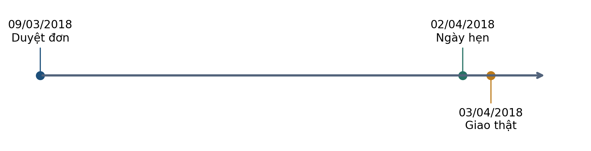
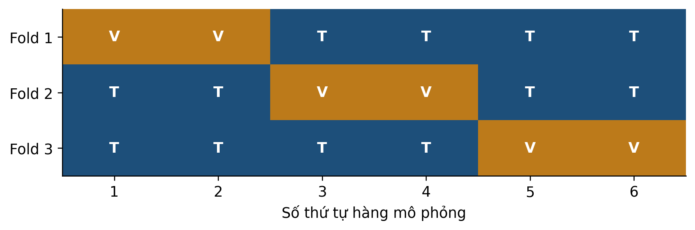
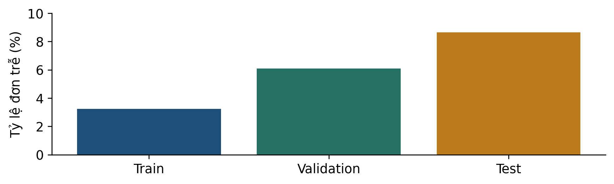
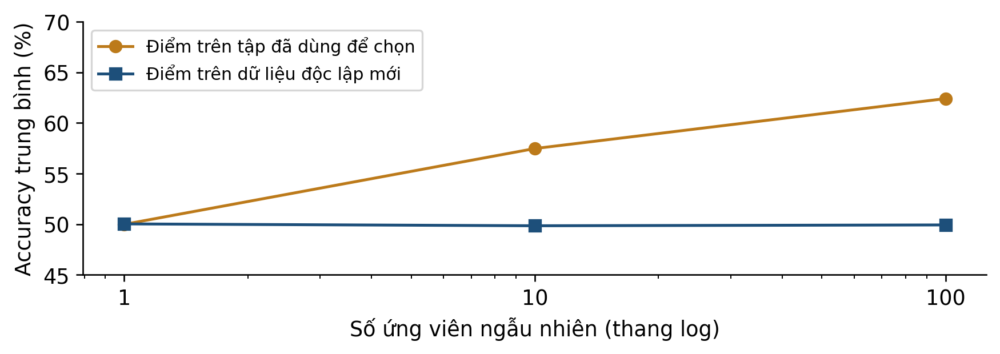

# Bài 7 — Đánh giá đáng tin cậy và phòng tránh rò rỉ
Kiến thức nền tảng và tài liệu đọc trước — bản cập nhật v3

## 1 Bài học này giải quyết vấn đề gì

Một cách dự đoán trễ Olist đạt accuracy 100%. Trước khi tin kết quả, hãy kiểm nó đã biết gì ở lúc phát dự đoán. Bài 7 nối bài 4–6 để **kiểm quy trình tạo bằng chứng**, không học thêm một mô hình dự đoán mới.

### Sau khi đọc bạn có thể

- Xác định thời điểm dự đoán và thông tin được phép dùng.
- Phân biệt rò rỉ, quá khớp và thay đổi phân phối dữ liệu.
- Đặt tiền xử lý đúng trong mỗi lần chia train/validation.
- Chọn cách chia theo thời gian hoặc nhóm cho đúng mục tiêu đánh giá.

Dự kiến 40–50 phút; ôn scaler bài 2 và chỉ số bài 3. Không cần chạy Python. Hãy làm mục 9 trước khi xem đáp án; phần mở rộng là tùy chọn.

## Lộ trình đọc và đối chiếu với bài giảng

Bản tài liệu cập nhật v3 • Đối chiếu Bài 7, slide v2. Bài 7 chưa có slide v3 trong bộ nguồn; tài liệu này ghi đúng nguồn v2 và cập nhật kết nối với các bài còn lại.

### Đọc để chuẩn bị điều gì

- Thông tin nào có tại lúc dự đoán
- Chia theo thời gian hoặc nhóm
- Fit mọi phép biến đổi trên train
- Tách chọn mô hình khỏi báo cáo test

Dành khoảng 40–50 phút cho phần chính, ví dụ và tự kiểm. Phụ lục A dùng để kiểm tra lập luận sau khi tự làm; phụ lục B là phần mở rộng, có thể đọc sau giờ học.

| Slide | Mốc ôn tập trong bài giảng |
| --- | --- |
| 28 | Tóm tắt trước giờ nghỉ |
| 47 | Phiếu kiểm năm câu |

Tài liệu đọc trước tạo nền và đặt câu hỏi; các slide trên giúp nối lại kiến thức trong giờ học. Không cần học thuộc mọi kết quả số trước khi đến lớp.

## 2 Bạn cần biết gì trước khi bắt đầu

| Khái niệm | Cách hiểu trong case |
| --- | --- |
| Đầu vào X | Thông tin được dùng khi đơn vừa được duyệt. |
| Nhãn y | Kết quả trễ, xác định từ ngày giao và ngày hẹn. |
| Fit | Học một đại lượng từ dữ liệu: trung bình, tham số mô hình… |
| Transform | Áp dụng phép biến đổi đã học, giữ nguyên các tham số. |
| Train | Dữ liệu để học trong lần chia đang xét. |
| Validation | Dữ liệu để chọn cách làm, cấu hình hoặc ngưỡng. |
| Test giữ lại | Dữ liệu để đánh giá quy trình đã khóa; không dùng chọn. |

Trong cross-validation, mỗi fold có train riêng. Sau khi lựa chọn có thể định trước việc fit lại trên toàn bộ dữ liệu phát triển; test vẫn phải được giữ lại. Các bài Olist 5–6 chọn không refit để giữ phép so đã khóa.

$$
\mathrm{Accuracy}=\frac{TP+TN}{TP+TN+FP+FN}
$$

Một chỉ số có thể tính đúng trên một quy trình không hợp lệ. Phép cộng đúng chưa bảo đảm thông tin đầu vào được dùng đúng lúc.

**K1:** 10 đơn có 8 đúng hạn, 2 trễ; luôn dự đoán không trễ thì accuracy và recall lớp trễ là bao nhiêu? **K2:** scaler dùng lại trung bình train cho điểm mới là fit hay transform?

## 3 Dữ liệu của bài học trông như thế nào

Đơn thật 66e4624a… của Olist [1] có khoảng cách khoảng 1.727 km, thời gian hẹn 23,35 ngày từ lúc duyệt. Mã đầy đủ và các cột nằm trong real_examples.csv. Nhãn là 1 vì giao ngày 03/04 sau ngày hẹn 02/04.

| Trường thông tin | Tại lúc duyệt | Việc cần kiểm |
| --- | --- | --- |
| Ngày hẹn | Giả định đã có | Có bị sửa sau duyệt không? |
| Giá, phí, khối lượng | Giả định đã có | Giá trị và cách tổng hợp đúng lúc? |
| Ngày giao thực tế | Chưa biết | Chỉ dùng tạo nhãn sau sự kiện. |
| Số ngày giao thực tế | Chưa biết | Không đưa vào X lúc duyệt. |

Tên cột và tương quan với nhãn không đủ xác nhận tính hợp lệ. Cần nguồn gốc, lúc tạo, lúc cập nhật và lịch sử phiên bản. Dữ liệu công khai chưa cung cấp toàn bộ ảnh chụp bất biến của từng trường lúc duyệt.

Một dòng là một đơn sau tổng hợp mặt hàng. Bảng hiện tại chỉ gồm đơn đã giao đủ điều kiện; khác quần thể tất cả đơn đang mở tại một thời điểm.

## 4 Ý tưởng chính của phương pháp là gì

**Rò rỉ dữ liệu** xảy ra khi thông tin vượt ranh giới được phép của phép học/đánh giá, chẳng hạn dùng kết quả tương lai làm X hoặc chọn mô hình bằng test. Cần kiểm luồng thông tin, không chỉ nhìn điểm số [2].

| Hiện tượng | Cơ chế | Dấu hiệu chưa đủ để kết luận |
| --- | --- | --- |
| Rò rỉ | Thông tin không được phép lọt vào quy trình. | Điểm cao đơn lẻ chưa chứng minh rò rỉ. |
| Quá khớp | Học chi tiết riêng của train, tổng quát hóa kém. | Train 100% cần thêm kiểm ngoài mẫu. |
| Dịch chuyển | Phân phối dữ liệu thay đổi giữa bối cảnh. | Điểm theo thời gian giảm chưa cô lập một nguyên nhân. |

Pipeline ghép các bước, giúp fit đúng tập trong mỗi fold. Nó không tự nhận ra cột ngày giao tương lai, khách hàng lặp, nhãn sai hoặc quần thể đã bị chọn theo kết quả.

Nếu đưa “ngày giao thực tế” vào một Pipeline hoàn chỉnh rồi dự đoán ở lúc duyệt, lỗi còn ở đâu? Câu trả lời: thông tin tương lai vẫn nằm trong đầu vào.

## 5 Những khái niệm và công thức nào cần nắm

$$
y=\mathbf{1}\{date(t_{giao})>date(t_{hen})\}
$$

Hàm chỉ báo bằng 1 nếu điều kiện đúng, bằng 0 nếu sai. date lấy phần ngày. Giao chiều đúng ngày hẹn vẫn là nhãn 0 theo quy ước case.

$$
\mu_{tr}=\frac{1}{n}\sum_{i\in train}x_i,\quad s_{tr}=\sqrt{\frac{1}{n}\sum_{i\in train}(x_i-\mu_{tr})^2}
$$

StandardScaler ở bài tính dùng phương sai với mẫu số n. Chỉ các giá trị train tham gia học μ và s. Giả sử s>0; đặc trưng hằng cần xử lý riêng.

$$
z_{moi}=\frac{x_{moi}-\mu_{tr}}{s_{tr}}
$$

Điểm mới được transform theo cùng μtrain,strain. Không tính lại trung bình từ một tập test riêng hoặc gộp test vào train để vừa thang.

### Một phép dựng lại nhãn không phải dự báo sớm

Đặt q bằng số ngày lịch từ ngày hẹn đến ngày giao thực tế, rồi dự đoán trễ khi q>0. Trên 40.266 đơn test, quy tắc dựng lại đúng 36.788 nhãn 0 và 3.478 nhãn 1, accuracy=100%.

Con số đúng vì q chứa thông tin tạo nhãn. q chưa có lúc duyệt nên không hợp lệ cho mục tiêu dự báo lúc duyệt. Tuy vậy, 100% trên một bài toán khác có quy luật xác định và đầu vào hợp lệ không tự là lỗi.

Cần chỉ rõ cột nào vượt ranh giới thông tin và tại sao; không dùng một ngưỡng accuracy để kết luận rò rỉ.

## 6 Phương pháp được thực hiện như thế nào

### Quy trình có thể mang sang đồ án

- Ghi đích dự đoán, thời điểm phát, đơn vị quan sát và quần thể cần đánh giá.
- Chọn chia thời gian/nhóm hoặc ngẫu nhiên phù hợp; giữ test trước khi lựa chọn.
- Trong mỗi fold, fit tiền xử lý và mô hình trên train của fold đó.
- Đánh giá validation; chọn cấu hình theo tiêu chí đã định.
- Khóa cách làm, refit nếu quy trình đã định như vậy, rồi dùng test để báo kết quả.

Fold 1 fit scaler bằng hàng 3,4,5,6; áp dụng cho hàng 1,2. Fold 2 phải fit scaler mới bằng hàng 1,2,5,6. Không chuẩn hóa tất cả sáu hàng rồi mới chia fold.

Hình chỉ giải thích cơ chế K-fold thông thường [3]. Với dữ liệu tương lai hoặc nhóm phụ thuộc, cách xếp fold phải được đổi cho đúng câu hỏi. Việc mỗi hàng xuất hiện một lần ở validation chưa đủ để bảo đảm phép đo phù hợp.

**Dừng để kiểm:** ở fold 3, scaler học từ các hàng nào? Đáp án: 1,2,3,4; hàng 5,6 chỉ được transform.

## 7 Cùng làm một ví dụ từ đầu đến cuối

**Ví dụ mô phỏng tính tay:** train chỉ có x=0 và x=2. Giữ lại một điểm x=10 để đánh giá. Ta kiểm phép chuẩn hóa, không gán các số này thành khoảng cách Olist.

| Bước | Fit chỉ train [0,2] | Fit gộp [0,2,10] |
| --- | --- | --- |
| Trung bình μ | (0+2)/2 = 1 | (0+2+10)/3 = 4 |
| Phương sai s² | (1+1)/2 = 1 | (16+4+36)/3 = 56/3 |
| Độ lệch chuẩn s | 1 | √(56/3) ≈ 4,3205 |
| Điểm mới z(10) | (10−1)/1 = 9 | (10−4)/4,3205 ≈ 1,3887 |

### Luồng thông tin sai nằm ở đâu?

Giá trị giữ lại 10 tham gia tính μ,s ở cột phải. Phép học đã nhìn vào phân phối của tập đánh giá. Sửa bằng cách fit μ,s chỉ trên [0,2], lưu lại rồi transform tất cả đầu vào cần dùng theo cùng bộ đó.

### Phản ví dụ: sửa sai chưa chắc làm điểm đổi

Ở một chiều, dùng cùng phép biến đổi tuyến tính có hệ số dương cho mọi điểm sẽ nhân tất cả khoảng cách với cùng hệ số. Với truy vấn 10, hàng train 2 vẫn gần hơn hàng 0 trong cả hai cách chuẩn hóa. 1-NN vì vậy có thể cho cùng nhãn.

$$
d_{z}(a,b)=\frac{|a-b|}{s},\qquad s>0
$$

Khoảng cách đổi tỷ lệ nhưng thứ tự không đổi trong ví dụ một chiều này. Tính không hợp lệ của fit gộp không biến mất chỉ vì dự đoán chưa thay đổi.

Không tổng quát phản ví dụ một chiều thành mọi bài toán nhiều chiều; từng tọa độ có thể bị đổi tỷ lệ khác nhau.

## 8 Đọc kết quả và tránh hiểu nhầm

Theo quy trình Olist đã khóa, train chỉ chứa đơn duyệt 01–10/2017 và giao trước 01/11/2017; validation duyệt 11–12/2017 và giao trước 01/01/2018. Đây là quy tắc nhãn bảo thủ sau giao. Chỉ kiểm ngày duyệt chưa đủ.

Raw có 1.490 dòng duyệt trước 01/11/2017 trong cửa sổ trên nhưng giao sau mốc. Ví dụ 83018ec1… duyệt 26/10, giao 08/11. Đây là đếm theo điều kiện raw, không phải số loại duy nhất sau toàn bộ bước chuẩn bị.

| Mô phỏng ghi nhớ mã nhóm | Nhóm chung train/validation | Accuracy |
| --- | --- | --- |
| Chia theo dòng | 118 | 97,5% |
| Giữ toàn bộ nhóm mới | 0 | 42,5% |

Mô phỏng có 200 nhóm ×4 dòng, nhãn cố định ngẫu nhiên trong nhóm; bộ nhớ trả nhãn đã gặp, nhóm lạ dùng nhãn đa số train. Hai phép chia trả lời câu hỏi khác nhau. Đây không phải benchmark Olist.

Olist có 363 khách xuất hiện cả train và test. Điều này có thể phù hợp mục tiêu dự đoán đơn tương lai của khách cũ; cần giữ nhóm riêng nếu đánh giá khách hoàn toàn mới. Không cộng chênh lệch điểm từ các quần thể khác nhau thành “thiệt hại rò rỉ”.

## Nối quy trình kiểm chứng với các bài đã cập nhật

Bài 7 hiện đối chiếu với slide v2, là bản mới nhất có trong bộ nguồn. Các nguyên tắc dưới đây liên kết trực tiếp với case-study trong Bài 2–6 và các phép biến đổi trong Bài 8–10.

| Tình huống | Cách làm đúng |
| --- | --- |
| Scaler trong KNN hoặc RFM | Fit trên dữ liệu được phép dùng để xây dựng mô hình; giữ lại tập kiểm chứng theo mục tiêu đánh giá. |
| Ngưỡng cảnh báo Olist | Chọn bằng validation và chi phí đã định nghĩa; khóa trước khi báo cáo test. |
| PCA trước phân loại | Fit trung bình và các hướng PCA trên train; transform validation và test. |
| Mạng nơ-ron | Dùng validation để chọn checkpoint; test không chọn epoch. |

Nếu dự đoán ở thời điểm duyệt đơn, ngày giao hàng thực tế chưa tồn tại. Không dùng nó làm đặc trưng. Nhãn train cũng phải đã quan sát được tại thời điểm cắt dữ liệu.

Tự kiểm: chia ngẫu nhiên có luôn sai không? Không. Cách chia phải mô phỏng đúng loại dữ liệu mới sẽ gặp: tương lai, khách hàng mới hoặc mẫu độc lập cùng phân phối.

## 9 Tự kiểm tra trước khi đến lớp

**Câu 1.** Dự đoán khi đơn vừa được duyệt: cột nào chắc chắn chưa có theo mô tả sự kiện?
A. Ngày hẹn đã được lập.
B. Ngày giao thực tế về sau.
C. Mã đơn đã phát sinh.

**Câu 2.** Đưa cột tương lai vào Pipeline rồi CV. Kết luận nào đúng?
A. Pipeline tự loại cột tương lai.
B. CV nhiều fold xóa được rò rỉ này.
C. Cần kiểm và sửa cột đầu vào; Pipeline không tự sửa ngữ nghĩa.

**Câu 3.** Train [0,2], điểm giữ lại 10. Tính μ,s và z(10) theo StandardScaler chỉ fit train.

**Câu 4.** Đơn duyệt 26/10/2017, giao 08/11/2017. Tại mốc huấn luyện 01/11, theo quy tắc nhãn sau giao của case, đơn có được vào train không? Vì sao?

**Câu 5.** Sau khi xem test, bạn đổi độ sâu cây rồi chọn bản có test tốt nhất. Tập đó còn là test giữ lại độc lập cho lựa chọn vừa làm không? Nên báo và xử lý thế nào?

**Câu 6.** Mô phỏng chia dòng đạt 97,5%, chia nhóm mới 42,5%. Kết luận nào được hỗ trợ?
A. Mọi mô hình khách hàng mới chỉ đạt 42,5%.
B. Bộ nhớ mã nhóm hưởng lợi từ nhóm đã gặp trong phép chia dòng này.
C. Chênh lệch 55 điểm phần trăm là thiệt hại do rò rỉ của Olist.

Mục tiêu tự kiểm: thời điểm → 1,4; công cụ/quy trình → 2,3,5; giới hạn bằng chứng → 6.

## 10 Những điều cần nhớ

### Phiếu kiểm năm câu trước khi tin kết quả

| Câu hỏi | Bằng chứng cần có |
| --- | --- |
| Dự báo điều gì, lúc nào? | Nhãn, thời điểm phát và đối tượng rõ ràng. |
| Mỗi cột đã biết lúc đó chưa? | Nguồn gốc và lịch sử cập nhật. |
| Đã chia đúng đích đánh giá chưa? | Thời gian, nhóm, bản sao và quần thể. |
| Mỗi bước fit nhìn thấy tập nào? | Tiền xử lý trong từng fold; test không chọn mô hình. |
| Điểm số cho phép nói đến đâu? | Baseline, chỉ số, phạm vi và giới hạn; chưa suy tác động hành động. |

Baseline đa số không đồng nghĩa đoán ngẫu nhiên. Chi phí FP+5FN trong bài 5–6 là giả định, không phải BRL đã đo. Test lịch sử đã xem trong pilot phải được mô tả đúng như vậy.

### Thuật ngữ cần dùng đúng

Leakage: rò rỉ thông tin. Fold: một lần chia của CV. Group: đơn vị phụ thuộc như khách hàng. Refit: học lại theo quy trình đã chọn. Holdout: tập giữ lại với vai trò đã xác định.

### Nguồn và khả năng kiểm lại

Bám Bài 07 v2, 54 slide chính và 6 mở rộng. Mã đi kèm tính lại nhãn, cửa sổ, số khách chung, scaler và hai mô phỏng. CSV ví dụ thật và mô phỏng được ghi rõ nguồn gốc.

[[1] Olist – dữ liệu gốc Kaggle](https://www.kaggle.com/datasets/olistbr/brazilian-ecommerce)

[[2] scikit-learn 1.6 – Common pitfalls](https://scikit-learn.org/1.6/common_pitfalls.html)

[[3] scikit-learn 1.6 – Cross-validation](https://scikit-learn.org/1.6/modules/cross_validation.html)

Nối sang bài 8: phân cụm không có nhãn đích để học nhưng vẫn cần mục tiêu, mốc chốt dữ liệu và giới hạn diễn giải rõ ràng.

## Phụ lục A Đáp án có giải thích

**K1:** accuracy=8/10=80%; recall trễ=0/2=0. Đây là ví dụ chỉ số, chưa chứng minh rò rỉ. **K2:** transform, vì dùng nguyên tham số đã học.

### Câu 1

B. Ngày giao thực tế xuất hiện sau lúc duyệt. A,C có thể đã có theo mô tả; để dùng dữ liệu thật vẫn cần kiểm phiên bản của từng cột, không chỉ tên.

### Câu 2

C. Pipeline điều phối fit/transform, không hiểu cột chứa tương lai. A gán cho công cụ khả năng chưa có; B nhầm lặp cách chia với sửa đầu vào sai.

### Câu 3

$$
\mu=1,\quad s=\sqrt{\frac{(0-1)^2+(2-1)^2}{2}}=1,\quad z(10)=9
$$

Không dùng x=10 để học μ,s. Trừ trung bình train và chia độ lệch chuẩn train khi transform điểm mới.

### Câu 4

Không. Nhãn sau giao chưa sẵn có vào 01/11 theo quy tắc case vì giao 08/11. Việc duyệt trong cửa sổ train chưa đáp ứng điều kiện về nhãn. Một quy trình định nghĩa nhãn sớm khác cần được mô tả và kiểm riêng.

### Câu 5

Không còn giữ vai trò test độc lập cho lựa chọn đó. Cần công bố đã dùng nó để chọn, giữ kết quả như thăm dò và đánh giá quy trình khóa trên dữ liệu độc lập phù hợp nếu muốn có bằng chứng mới. Đổi tên file không khôi phục tính độc lập.

### Câu 6

B. Bộ nhớ hưởng lợi từ nhóm đã thấy, đúng cơ chế và số đo trong mô phỏng. A suy rộng sang mọi mô hình và quần thể. C chuyển nhầm kết quả mô phỏng sang Olist, đồng thời quy mọi khác biệt cho một nguyên nhân.

Ôn câu 1,4 ở mục 3,8; câu 2,3,5 ở mục 4–7; câu 6 ở mục 8.

## Phụ lục B Kiến thức mở rộng tùy chọn

### Chọn nhiều lần có thể chọn trúng may mắn

Mô phỏng 500 lần, mỗi điểm accuracy từ 100 phép đo đúng/sai với xác suất đúng 0,5. Trong mỗi lần, chọn ứng viên có điểm cao nhất trong 1,10 hoặc 100 ứng viên; sau đó đọc điểm trên một tập độc lập mới.

| Số ứng viên | Điểm chọn TB | Điểm mới TB |
| --- | --- | --- |
| 1 | 49.982% | 50.028% |
| 10 | 57.466% | 49.844% |
| 100 | 62.396% | 49.926% |

Ví dụ minh họa thiên lệch khi báo tốt nhất trên chính tập đã dùng lựa chọn. Mức lệch phụ thuộc thiết kế, không lấy các tỷ lệ này áp cho mọi dự án.

### Nested CV và sự không chắc chắn

Vòng trong chọn cấu hình, vòng ngoài đánh giá toàn bộ quy trình lựa chọn. Mọi bước học từ dữ liệu phải được đặt trong ranh giới phù hợp. Với thời gian/nhóm, cả cách tạo fold cần phản ánh đích đánh giá [3].

Độ lệch chuẩn giữa fold mô tả độ phân tán các điểm fold; không tự là khoảng tin cậy. Các fold có train chồng lấn nên không mặc nhiên độc lập. Không dùng SD/√K như bảo đảm phổ quát cho sai số chuẩn.
