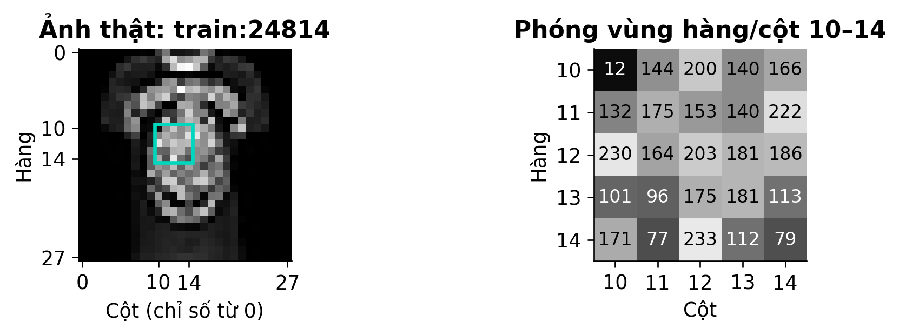
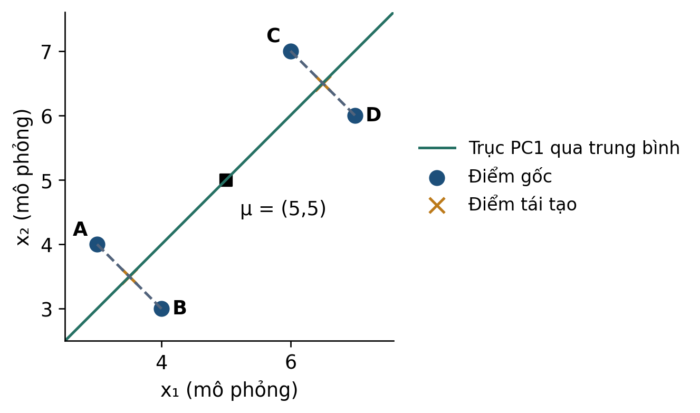
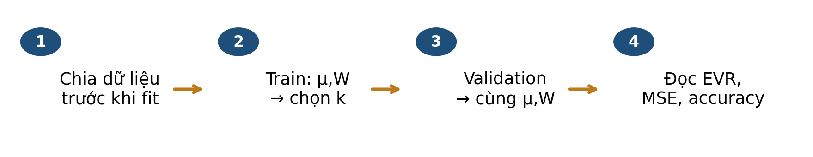
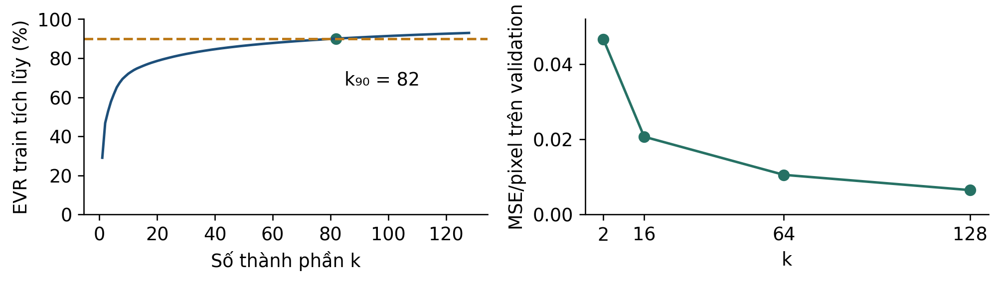

# Bài 09 · PCA: từ pixel ảnh đến biểu diễn ít chiều

**PGS.TS. Nguyễn Văn Hậu**

Khoa Công nghệ Thông tin, Trường Đại học Công nghệ Kỹ thuật Hưng Yên

[← Mục lục khóa học](../../README.md) · [📄 PDF 14 trang](Bai09_Kien_thuc_nen_tang_va_doc_truoc.pdf) · [📝 Word](Bai09_Kien_thuc_nen_tang_va_doc_truoc.docx) · [💻 Thực hành Python](../../lessons/bai09/README.md)

**Tài liệu đọc trước v3 · Đối chiếu slide v3.** Bộ Python hiện vẫn theo phiên bản trước; xem [các điểm cần đối chiếu](../../docs/DOI_CHIEU_HOC_LIEU.md).

Đọc mục 1–8, tự làm mục 9 trước khi xem phụ lục A, dùng mục 10 để ôn tập. Phụ lục B dành cho người muốn tìm hiểu sâu hơn.

## Mục lục

- [1 Bài học này giải quyết vấn đề gì](#muc-1)
- [Lộ trình đọc và đối chiếu với bài giảng](#muc-2)
- [2 Bạn cần biết gì trước khi bắt đầu](#muc-3)
- [3 Dữ liệu của bài học trông như thế nào](#muc-4)
- [4 Ý tưởng chính của phương pháp là gì](#muc-5)
- [Vì sao PCA cần hiệp phương sai và trị riêng](#muc-6)
- [5 Những khái niệm và công thức nào cần nắm](#muc-7)
- [6 Phương pháp được thực hiện như thế nào](#muc-8)
- [7 Cùng làm một ví dụ từ đầu đến cuối](#muc-9)
- [8 Đọc kết quả và tránh hiểu nhầm](#muc-10)
- [9 Tự kiểm tra trước khi đến lớp](#muc-11)
- [10 Những điều cần nhớ](#muc-12)
- [Phụ lục A Đáp án có giải thích](#muc-13)
- [Phụ lục B Kiến thức mở rộng tùy chọn](#muc-14)

<a id="muc-1"></a>

## 1 Bài học này giải quyết vấn đề gì

Một ảnh áo có 784 giá trị pixel. Có thể biểu diễn bằng ít tọa độ hơn mà vẫn giữ được phần hình dạng đáng kể? Bài 9 dùng **PCA — phân tích thành phần chính** để nhìn rõ thông tin được giữ và bị mất.

![Hình 1. Cùng ảnh validation thật train:24814; tái tạo từ k tọa độ PCA. Chỉ ảnh hiển thị được clip \[0,1\].](assets/reconstruction.png)

*Hình 1. Cùng ảnh validation thật train:24814; tái tạo từ k tọa độ PCA. Chỉ ảnh hiển thị được clip [0,1].*

### Sau khi đọc bạn có thể

- Đọc một ảnh như một vector và truy ngược giá trị về pixel.
- Tính định tâm, phép chiếu và tái tạo trên bốn điểm nhỏ.
- Phân biệt phương sai giữ lại, lỗi tái tạo và accuracy.
- Giải thích vì sao PCA chỉ fit trên train trong quy trình dự đoán.

> ✏️ Dự kiến 40–50 phút, không cần lập trình. Ôn vector/tích vô hướng ở bài 1 và chia dữ liệu ở bài 7. Phụ lục B là phần tùy chọn.

<a id="muc-2"></a>

## Lộ trình đọc và đối chiếu với bài giảng

Bản tài liệu cập nhật v3 • Đối chiếu Bài 9, slide v3. Nội dung và các mốc tổng kết dưới đây theo bản slide v3.

### Đọc để chuẩn bị điều gì

- Chiếu dữ liệu lên hướng mới
- Center và hiệp phương sai
- Trị riêng, EVR và chọn k
- Tái tạo ảnh và đánh giá nhiệm vụ

Dành khoảng 40–50 phút cho phần chính, ví dụ và tự kiểm. Phụ lục A dùng để kiểm tra lập luận sau khi tự làm; phụ lục B là phần mở rộng, có thể đọc sau giờ học.

| Slide | Mốc ôn tập trong bài giảng |
| --- | --- |
| 11 | Từ ảnh đến đầu vào PCA |
| 22 | Chiếu rồi tái tạo: ba thao tác cốt lõi |
| 31 | PCA giữ hướng biến thiên mạnh |
| 38 | PCA: học một lần, áp dụng nhất quán |
| 63 | PCA · Bản đồ toàn bài |

> 📌 Tài liệu đọc trước tạo nền và đặt câu hỏi; các slide trên giúp nối lại kiến thức trong giờ học. Không cần học thuộc mọi kết quả số trước khi đến lớp.

<a id="muc-3"></a>

## 2 Bạn cần biết gì trước khi bắt đầu

| Khái niệm | Hiểu và làm được |
| --- | --- |
| Quan sát và đặc trưng | Một ảnh là một quan sát. Mỗi vị trí pixel là một đặc trưng. |
| Vector | Một danh sách tọa độ có thứ tự. Hai ảnh phải dùng cùng thứ tự pixel. |
| Trung bình vector | Lấy trung bình riêng ở mỗi tọa độ trên train. |
| Tích vô hướng | Nhân các tọa độ tương ứng rồi cộng. Dùng để tính tọa độ chiếu. |
| Vector đơn vị | Vector có độ dài bằng 1; chỉ giữ hướng mà không phóng đại tùy ý. |
| Phương sai | Trung bình bình phương độ lệch khỏi trung bình; đo mức phân tán theo trục đã chọn. |

```math
(a,b)\cdot(c,d)=ac+bd,\qquad\|(a,b)\|=\sqrt{a^2+b^2}
```

Ví dụ (−2,−1)·(1,1)/√2 = −3/√2. Dấu âm nghĩa là nằm phía âm của trục, không có nghĩa ảnh lỗi.

Khi dùng PCA, ta đổi cơ sở tọa độ và chỉ giữ một số trục mới. Trải phẳng ảnh 28×28 thành vector 784 phần tử chỉ đổi cách sắp xếp, chưa loại bớt giá trị.

> ✏️ **K1:** 100 ảnh, mỗi ảnh 28×28 pixel, trải phẳng thành ma trận kích thước nào? **K2:** vector (1,1) có là vector đơn vị không?

<a id="muc-4"></a>

## 3 Dữ liệu của bài học trông như thế nào

Fashion-MNIST [1,2] là ảnh sản phẩm thời trang 28×28 mức xám. Mười nhãn gồm áo thun/top, quần, áo len, váy, áo khoác, sandal, sơ mi, sneaker, túi và bốt cổ ngắn. Mã nhãn 0–9 là tên lớp, không là thang “mức độ thời trang”.



*Hình 2. Pixel thật uint8: 0 đen, 255 trắng. Khung màu và bảng số là cùng vùng 5×5 của ảnh áo thun/top.*

| Tập dùng trong case | Số ảnh | Vai trò |
| --- | --- | --- |
| Train thí nghiệm | 12.000 | 1.200/lớp; fit μ và các trục. |
| Validation | 3.000 | 300/lớp; so lỗi và mô hình. |
| Test chính thức | 10.000 | Để đánh giá ở bài 10. |

Train và validation ở đây được lấy từ 60.000 ảnh train chính thức; còn 45.000 ảnh không dùng. train:24814 chỉ dòng 24814 (đếm từ 0) của tệp nguồn train chính thức; trong thí nghiệm, ảnh này thuộc validation.

> 📌 Giá trị đầu vào mô hình = pixel/255. Đây là phép đổi thang cố định. Nhãn chỉ dùng chia mẫu theo lớp và đánh giá phân loại, không dùng để fit trục PCA.

<a id="muc-5"></a>

## 4 Ý tưởng chính của phương pháp là gì

Hãy đặt một đường thẳng qua trung bình của đám điểm. Chiếu vuông góc từng điểm lên đường. PCA chọn hướng đơn vị mà các tọa độ chiếu phân tán nhiều nhất; với một trục, đó cũng là hướng cho tổng lỗi tái tạo bình phương nhỏ nhất.



*Hình 3. Bốn điểm mô phỏng. Nét đứt là phần bị bỏ; dấu × là vị trí tái tạo trên đường PC1. Hai điểm A,B cùng chân chiếu, tương tự C,D.*

| Phần giữ lại | Phần bị bỏ |
| --- | --- |
| Tọa độ dọc theo PC1 sau khi trừ trung bình. | Độ lệch vuông góc với PC1. |
| Một số thay cho hai tọa độ ban đầu. | Không thể phân biệt A với B chỉ từ số này. |

Đường nằm trong không gian hai chiều nhưng biểu diễn dọc đường chỉ cần một tọa độ. Khi tái tạo, ta cần cả tọa độ ấy, hướng đã học và trung bình đã học.

> ✏️ Nếu A và B có nhãn khác nhau, việc chúng chiếu vào cùng vị trí có gây khó cho phân loại không? Phương sai lớn không tự động là thông tin tốt nhất cho mọi nhiệm vụ.

<a id="muc-6"></a>

## Vì sao PCA cần hiệp phương sai và trị riêng

Sau khi trừ trung bình, ta cần tìm hướng mà dữ liệu trải rộng nhất. Hiệp phương sai mô tả từng trục biến thiên bao nhiêu và hai trục có cùng tăng giảm không.

```math
C=\frac{1}{n}X_c^{\mathsf{T}}X_c
```

Trong ví dụ bốn điểm, mỗi hàng Xc là một điểm đã center. Quy ước 1/n ở đây cho C có đường chéo 2,5 và ngoài đường chéo 2.

```math
Cw_j=\lambda_j w_j,\qquad \|w_j\|=1
```

w là hướng riêng đơn vị; λ là phương sai theo hướng đó với cùng quy ước chuẩn hóa. Sắp λ từ lớn xuống nhỏ để chọn hướng đầu.

| Hướng | Phương sai | Ý nghĩa |
| --- | --- | --- |
| w₁ = (1,1)/√2 | λ₁ = 4,5 | Hai tọa độ cùng tăng giảm |
| w₂ = (1,−1)/√2 | λ₂ = 0,5 | Phần biến thiên vuông góc nhỏ hơn |
| Giữ một hướng | 4,5 / (4,5 + 0,5) = 90% | Giữ 90% phương sai, không phải 90% nhãn đúng |

Dùng 1/(n−1) thay cho 1/n sẽ đổi trị riêng cùng một hệ số, nhưng không đổi hướng riêng hoặc tỷ lệ EVR. Một score là tọa độ trên hướng mới; điểm tái tạo quay về không gian ban đầu.

> ✏️ Tự kiểm: cần nhãn lớp để tìm hướng PCA không? Không. Vì thế hướng giữ nhiều phương sai chưa chắc phân tách lớp tốt nhất.

<a id="muc-7"></a>

## 5 Những khái niệm và công thức nào cần nắm

Quy ước: x, μ, w là vector cột d chiều; Wₖ chứa k vector đơn vị trực giao làm các cột. Một ảnh x có d=784. μ và Wₖ đều lấy từ train.

```math
\mu=\frac{1}{n}\sum_{i=1}^{n}x_i,\qquad x_c=x-\mu
```

Định tâm: trừ cùng một vector trung bình train khỏi mỗi ảnh train, validation hay ảnh mới.

```math
z=W_k^{\mathsf{T}}(x-\mu),\qquad\hat{x}=\mu+W_kz
```

z có k tọa độ; x̂ có d tọa độ. Tái tạo cộng lại trung bình. Trong mã lưu mẫu theo hàng, phép nhân viết tương đương Z=(X−μ)Wₖ.

```math
w_1=\arg\max_{\|w\|=1}\operatorname{Var}(w^{\mathsf{T}}x_c)
```

Ràng buộc ‖w‖=1 là cần thiết: nếu nhân hướng với 100 thì phương sai score nhân 10.000 dù hướng không tốt hơn. Các trục sau trực giao với các trục trước.

```math
EVR(k)=\frac{\lambda_1+\cdots+\lambda_k}{\lambda_1+\cdots+\lambda_d}
```

λ₁≥λ₂≥…≥0 là phương sai trên các trục PCA theo cùng quy ước. Mẫu số phải dương. EVR là tỷ lệ phương sai, không là xác suất ảnh được phân loại đúng.

> 📌 Trong case không z-score từng pixel. Các pixel có cùng đơn vị cường độ; đổi cách chuẩn hóa sẽ đổi bài toán PCA. Không suy ra rằng chuẩn hóa luôn sai hay luôn cần.

<a id="muc-8"></a>

## 6 Phương pháp được thực hiện như thế nào



*Hình 4. PCA học biểu diễn ở train và áp dụng nguyên biểu diễn đó cho validation.*

| Bước | Thao tác cụ thể |
| --- | --- |
| 1. Chia trước | Giữ nguyên 12.000 train và 3.000 validation theo seed 42; không chọn lại mẫu vì kết quả xấu. |
| 2. Đổi thang cố định | Chia pixel của mọi tập cho 255. |
| 3. Fit trên train | Tính μ; tìm các trục và phương sai tương ứng. Case dùng SVD đầy đủ. |
| 4. Chọn cách báo cáo k | So k=2,16,64,128 đã định; k90 là số nhỏ nhất đạt EVR train≥90%. |
| 5. Transform, tái tạo | Validation trừ μ train; nhân Wₖ; tái tạo với cùng μ và Wₖ. |
| 6. Đọc đúng mục tiêu | MSE cho tái tạo; accuracy cho bộ phân loại được fit riêng. Test dành cho bước đánh giá sau. |

Nếu tính lại μ hoặc trục trên validation, tọa độ đã thay đổi và thông tin tập đánh giá đã đi vào quy trình học. Bộ phân loại học trên tọa độ train cũng không còn nhận cùng hệ tọa độ.

> ✏️ Dừng kiểm tra: ảnh mới rất sáng có được dùng để cập nhật μ ngay trước khi dự đoán không? Trong quy trình đánh giá đã chốt ở đây: không.

<a id="muc-9"></a>

## 7 Cùng làm một ví dụ từ đầu đến cuối

Bốn điểm toy A=(3,4), B=(4,3), C=(6,7), D=(7,6). Trung bình μ=(5,5). Chọn PC1=(1,1)/√2, PC2=(1,−1)/√2; đây là hai hướng đơn vị trực giao.

| Điểm | x−μ | z₁ | z₂ | Tái tạo k=1 |
| --- | --- | --- | --- | --- |
| A | (−2,−1) | −3/√2 | −1/√2 | (3,5; 3,5) |
| B | (−1,−2) | −3/√2 | +1/√2 | (3,5; 3,5) |
| C | (1,2) | +3/√2 | −1/√2 | (6,5; 6,5) |
| D | (2,1) | +3/√2 | +1/√2 | (6,5; 6,5) |

```math
\hat{x}_A=(5,5)+\frac{-3}{\sqrt{2}}\frac{(1,1)}{\sqrt{2}}=(3.5,3.5)
```

Tái tạo A từ chỉ z₁. Không được dùng z₂ vì thành phần đó đã bị bỏ.

### Đọc phương sai và lỗi

Với phương sai chia n=4: Var(z₁)=4,5 và Var(z₂)=0,5. Tổng là 5, nên một trục giữ 4,5/5=90% phương sai. Độ lệch chuẩn PC1 chỉ gấp √(4,5/0,5)=3 lần PC2, không phải 9 lần.

```math
\|x_A-\hat{x}_A\|^2=(-0.5)^2+(0.5)^2=0.5
```

Mỗi điểm có cùng tổng bình phương lỗi 0,5. Trung bình trên bốn điểm vẫn 0,5; chia thêm hai tọa độ được MSE mỗi tọa độ 0,25.

> 📌 Nếu chỉ giữ trục x₁ thì trung bình lỗi mỗi điểm là 2,5; giữ PC1 được 0,5. Kết quả kiểm tra được từ bốn điểm thiết kế, không phải thống kê Fashion-MNIST.

<a id="muc-10"></a>

## 8 Đọc kết quả và tránh hiểu nhầm



*Hình 5. Hai đồ thị tính lại trên case: phương sai lấy từ train, lỗi tái tạo lấy từ 3.000 ảnh validation. MSE dùng ảnh trước clip.*

| k | EVR train | MSE validation/pixel |
| --- | --- | --- |
| 2 | 46.83% | 0.046618 |
| 16 | 76.59% | 0.020703 |
| 64 | 88.24% | 0.010562 |
| 128 | 92.93% | 0.006499 |

k90=82: EVR(81)=89,9272% chưa đạt, EVR(82)=90,0122% vừa đạt. Giữ 82 score không có nghĩa tệp ảnh chắc chắn nhỏ 784/82 lần: còn độ chính xác số, mean, basis và cách lưu.

Logistic cùng C=1, fit trên 12.000 ảnh: pixel gốc đúng 2.500/3.000=83,33%; PCA64 đúng 2.511/3.000=83,70% trên validation. Chênh 11 ảnh trong một lần chia chưa chứng minh PCA luôn tăng accuracy.

> 📌 Tăng k trong cùng cơ sở PCA lồng nhau không tăng lỗi tái tạo bình phương. Accuracy của một mô hình học trên biểu diễn đó có thể tăng hoặc giảm. Đừng dùng đường MSE để suy ra đường accuracy.

<a id="muc-11"></a>

## 9 Tự kiểm tra trước khi đến lớp

Tự trả lời trước khi mở phụ lục A. Câu tính tay cần viết phép tính; câu giải thích cần nêu điều kiện.

**Câu 1.** 100 ảnh 784 pixel qua PCA k=16 tạo ma trận score nào?

- **A.** 16×784
- **B.** 100×16
- **C.** 16×100 nếu mỗi hàng vẫn là một ảnh

**Câu 2.** Ảnh validation được định tâm bằng gì?

- **A.** Trung bình riêng của validation.
- **B.** Trung bình của train∪validation.
- **C.** Trung bình train đã lưu.

**Câu 3.** Với x=(4,3), μ=(5,5), w=(1,1)/√2, hãy tính score và điểm tái tạo chỉ từ score này.

**Câu 4.** EVR=90% cho phép khẳng định điều nào?

- **A.** Bộ phân loại đúng 90% ảnh.
- **B.** Các trục giữ lại chứa 90% tổng phương sai train theo quy ước đã nêu.
- **C.** 90% ảnh được giữ nguyên pixel.

**Câu 5.** Gán nhãn A,C là 0; B,D là 1 ở toy mục 7. Chỉ giữ PC1 có còn đủ thông tin phân biệt hoàn hảo bốn điểm không? Vì sao?

**Câu 6.** Tái tạo một pixel thật x=0,2 thành −0,1. Tính lỗi bình phương trước clip và sau clip [0,1]. Nên dùng con số nào khi đối chiếu bảng mục 8?

> ✏️ Nếu câu 3 khó: làm lần lượt trừ μ → tích vô hướng → nhân lại w → cộng μ. Không cần nhớ toàn bộ phép biến đổi trong một bước.

<a id="muc-12"></a>

## 10 Những điều cần nhớ

### Năm câu hỏi trước khi đọc một kết quả PCA

- Một quan sát và mỗi tọa độ là gì? Có đổi thang hay chuẩn hóa không?
- Tập nào dùng để học μ và trục? Ảnh mới có dùng cùng phép biến đổi không?
- k được chọn theo phương sai, tái tạo hay nhiệm vụ tiếp theo?
- EVR, MSE và accuracy dùng tập nào, mẫu số nào?
- Thông tin nhãn có nằm trong hướng bị bỏ không? Giới hạn kết luận là gì?

| Thuật ngữ | Ý nghĩa ngắn |
| --- | --- |
| Component / trục | Một hướng đơn vị trong không gian đặc trưng đã định tâm. |
| Score / tọa độ PCA | Tích vô hướng với một trục; có thể âm. |
| Explained variance | Phương sai score trên train. |
| Reconstruction | Trở về d tọa độ từ k score và μ,W đã lưu. |

### Nguồn và dữ liệu đi kèm

Đối chiếu Bài 9 v3; các mốc tổng kết được ghi ở bảng lộ trình đầu tài liệu. Kèm pixel ảnh train:24814, bảng toy, bảng kết quả và mã kiểm tính. Ảnh lấy từ Fashion-MNIST; hình phép chiếu và đường cong tự dựng từ các phép tính của case.

[\[1\] Zalando Research — Fashion-MNIST, dữ liệu và nhãn chính thức](https://github.com/zalandoresearch/fashion-mnist)

[\[2\] Fashion-MNIST trên Kaggle](https://www.kaggle.com/datasets/zalando-research/fashionmnist)

[\[3\] scikit-learn 1.6 — PCA, centering và explained_variance_](https://scikit-learn.org/1.6/modules/generated/sklearn.decomposition.PCA.html)

> 🔎 Nối bài 10: từ biểu diễn tuyến tính sang mạng neural, vẫn giữ nguyên kỷ luật chia dữ liệu, baseline và đọc lỗi theo lớp.

<a id="muc-13"></a>

## Phụ lục A Đáp án có giải thích

**K1:** 100×784 nếu mỗi hàng là một ảnh. **K2:** không; (1,1) dài √2, cần chia √2 để thành vector đơn vị.

### Câu 1

B. Số ảnh vẫn 100, số tọa độ mới là 16. A nhầm số thành phần với số ảnh; C đảo hàng/cột trái với quy ước mỗi hàng là một ảnh.

### Câu 2

C. Fit train, dùng lại trên validation. A đổi hệ tọa độ; B đưa dữ liệu đánh giá vào bước học. Chia 255 thì khác: đó là hằng số biết trước, không ước lượng từ validation.

### Câu 3

```math
z=\frac{-1-2}{\sqrt{2}}=\frac{-3}{\sqrt{2}},\quad\hat{x}=(5,5)+(-1.5,-1.5)=(3.5,3.5)
```

B có cùng score với A. Không thể suy ngược duy nhất A hay B từ score này.

### Câu 4

B. A nhầm tỷ lệ phương sai với accuracy; C nhầm năng lượng phân tán với số ảnh nguyên vẹn. Tất cả ảnh đều có thể thay đổi ít nhiều sau tái tạo.

### Câu 5

Không. A và B khác nhãn nhưng cùng z₁; C và D cũng vậy. Bộ phân loại chỉ nhận z₁ không thể gán hai nhãn khác nhau cho cùng đầu vào một cách tất định. PC2 ít phương sai hơn nhưng dấu của nó phân tách đúng nhãn toy.

### Câu 6

```math
(0.2-(-0.1))^2=0.09,\qquad (0.2-0)^2=0.04
```

Bảng mục 8 dùng 0,09: lỗi trước clip. Clip thay đổi quy tắc tái tạo; cần báo rõ nếu muốn đánh giá riêng 0,04.

> ✏️ Ôn câu 1–2 ở mục 2,3,6; câu 3 ở mục 5,7; câu 4–6 ở mục 4,8.

<a id="muc-14"></a>

## Phụ lục B Kiến thức mở rộng tùy chọn

![Hình 6. Mean image dùng thang cường độ \[0,1\]; trục PCA dùng trọng số có dấu, thang đối xứng quanh 0. Không coi trục là ảnh sản phẩm gốc.](assets/basis.png)

*Hình 6. Mean image dùng thang cường độ [0,1]; trục PCA dùng trọng số có dấu, thang đối xứng quanh 0. Không coi trục là ảnh sản phẩm gốc.*

### Quy ước phương sai

Toy chia n=4 cho eigenvalue 4,5 và 0,5. scikit-learn [3] chia n−1=3, cho 6 và 2/3. Tỷ số EVR vẫn 90% và 10% vì tử và mẫu cùng nhân 4/3. Cần cùng quy ước khi so số tuyệt đối.

```math
MSE_{train,pixel}=\frac{n-1}{nd}\sum_{j=k+1}^{d}\lambda_j
```

Công thức trên dùng λ của covariance chia n−1, dữ liệu train đã định tâm, phép chiếu trực giao không clip, d tọa độ. Không áp dụng trực tiếp cho MSE validation.

### SVD và dấu của trục

SVD của ma trận train đã định tâm tìm các hướng trực giao và độ lớn tương ứng. Bình phương singular value chia n−1 cho explained_variance_. Không cần lập covariance 784×784 để hiểu trực giác này.

Đổi w thành −w thì score z cũng đổi dấu, nhưng wz không đổi nên ảnh tái tạo giữ nguyên. Hai kết quả chỉ khác dấu trục chưa phải hai mô hình khác về phép chiếu.

> 📌 Score các trục khác nhau không tương quan trên train theo PCA; không suy ra chúng độc lập xác suất, cũng không bảo đảm covariance bằng 0 trên một tập mới.

## Chuyển sang thực hành

Mở [hướng dẫn Python Bài 09](../../lessons/bai09/README.md), chạy ví dụ nhỏ trước rồi mới chạy dữ liệu thật. Các bảng CSV và JSON trong thư mục đọc trước lưu kết quả tham chiếu của lần biên soạn; chương trình thực hành tự tính lại và lưu kết quả mới trong `outputs/`.

[Nguồn dữ liệu và điều kiện sử dụng](../../docs/DU_LIEU_VA_NGUON.md) · [Ghi chú đối chiếu tài liệu với mã](../../docs/DOI_CHIEU_HOC_LIEU.md)
