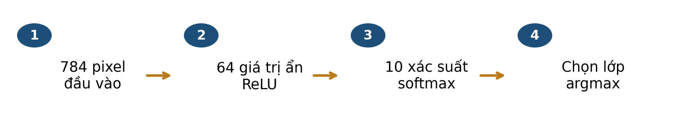
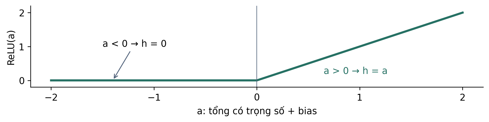
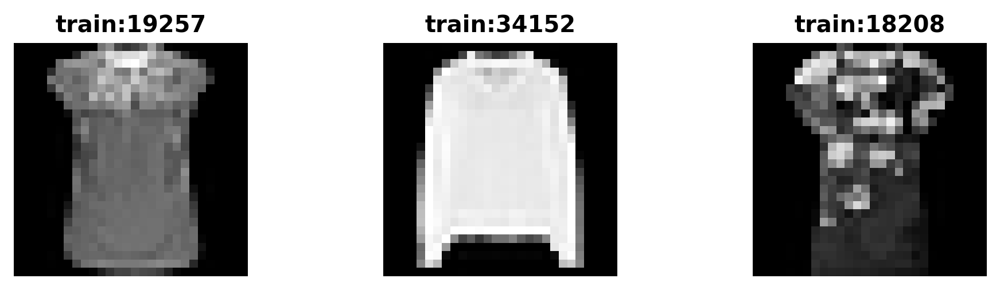
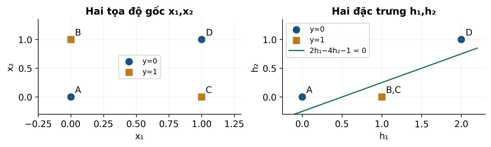
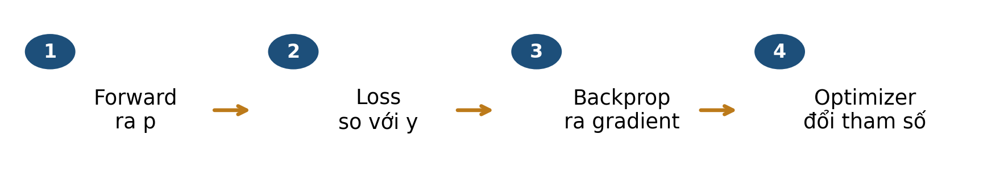
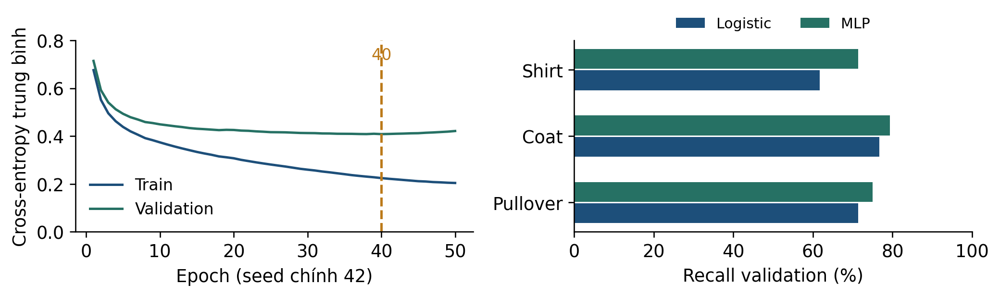

# Bài 10 · Mạng neural: học biểu diễn từ dữ liệu có nhãn

**PGS.TS. Nguyễn Văn Hậu**

Khoa Công nghệ Thông tin, Trường Đại học Công nghệ Kỹ thuật Hưng Yên

[← Mục lục khóa học](../../README.md) · [Thực hành Python](../../examples/bai10/README.md)

**Tài liệu hỗ trợ ví dụ thuật toán.** [Học liệu chính](../../README.md).

Đọc mục 1–8, tự làm mục 9 trước khi xem phụ lục A, dùng mục 10 để ôn tập. Phụ lục B dành cho người muốn tìm hiểu sâu hơn.

## Mục lục

- [1 Bài học này giải quyết vấn đề gì](#muc-1)
- [Lộ trình đọc và đối chiếu với bài giảng](#muc-2)
- [2 Bạn cần biết gì trước khi bắt đầu](#muc-3)
- [3 Dữ liệu của bài học trông như thế nào](#muc-4)
- [4 Ý tưởng chính của phương pháp là gì](#muc-5)
- [5 Những khái niệm và công thức nào cần nắm](#muc-6)
- [6 Phương pháp được thực hiện như thế nào](#muc-7)
- [Theo dõi một đường backprop trước khi học công thức tổng quát](#muc-8)
- [7 Cùng làm một ví dụ từ đầu đến cuối](#muc-9)
- [8 Đọc kết quả và tránh hiểu nhầm](#muc-10)
- [9 Tự kiểm tra trước khi đến lớp](#muc-11)
- [10 Những điều cần nhớ](#muc-12)
- [Phụ lục A Đáp án có giải thích](#muc-13)
- [Phụ lục B Kiến thức mở rộng tùy chọn](#muc-14)

<a id="muc-1"></a>

## 1 Bài học này giải quyết vấn đề gì

Hai ảnh áo có thể khá giống nhau về pixel nhưng thuộc hai lớp khác. Sau PCA ở bài 9, ta đặt câu hỏi: **có thể học đặc trưng theo chính nhãn cần dự đoán không?** Bài 10 dùng mạng neural một tầng ẩn — MLP — trên cùng Fashion-MNIST.



*Hình 1. Kiến trúc case thật: 784 đầu vào → 64 đơn vị ẩn ReLU → 10 xác suất lớp. Mỗi ảnh nhận một nhãn dự đoán.*

Tính cả bias: 784×64 + 64 + 64×10 + 10 = 50.890 tham số được học. Số đơn vị ẩn 64 không phải số lớp; lớp đầu ra vẫn là 10.

### Sau khi đọc bạn có thể

- Giải thích neuron, tầng ẩn, phi tuyến và số tham số.
- Tính một lượt forward, loss, gradient và cập nhật trên ví dụ nhỏ.
- Phân biệt backprop với optimizer, batch với epoch.
- Dùng validation để chọn checkpoint, đọc cả accuracy và lỗi theo lớp.

> ✏️ Dự kiến 40–50 phút; không cần lập trình. Ôn tích vô hướng (bài 1), gradient descent (bài 4), logistic (bài 5), chia dữ liệu (bài 7). Đạo hàm đầy đủ ở phụ lục B là tùy chọn.

<a id="muc-2"></a>

## Lộ trình đọc và đối chiếu với bài giảng

Bản tài liệu cập nhật  • Đối chiếu Bài 10, slide . Nội dung và các mốc tổng kết dưới đây theo bản slide .

### Đọc để chuẩn bị điều gì

- Vì sao XOR cần tầng ẩn
- Forward và hàm mất mát
- Backprop qua một trọng số
- Validation, checkpoint và test

Dành khoảng 40–50 phút cho phần chính, ví dụ và tự kiểm. Phụ lục A dùng để kiểm tra lập luận sau khi tự làm; phụ lục B là phần mở rộng, có thể đọc sau giờ học.

| Slide | Mốc ôn tập trong bài giảng |
| --- | --- |
| 18 | Tổng kết · Học một biểu diễn mới |
| 30 | Tổng kết · Forward rồi cập nhật |
| 39 | Tổng kết · Một đường backprop |
| 45 | Tổng kết · Thuật toán huấn luyện MLP |
| 57 | Tổng kết · Đánh giá có quy trình |
| 63 | Bài 10 · Từ biểu diễn đến bằng chứng |

> 📌 Tài liệu đọc trước tạo nền và đặt câu hỏi; các slide trên giúp nối lại kiến thức trong giờ học. Không cần học thuộc mọi kết quả số trước khi đến lớp.

<a id="muc-3"></a>

## 2 Bạn cần biết gì trước khi bắt đầu

| Nền tảng | Nhắc lại để sử dụng |
| --- | --- |
| Affine | Tổng có trọng số cộng bias: a=w·x+b. Bias dịch ngưỡng. |
| Activation | Hàm áp dụng lên a. ReLU giữ phần dương và đưa phần âm về 0. |
| Sigmoid | Đưa một score nhị phân thành p∈(0,1); sigmoid(0)=0,5. |
| Loss và gradient | Loss đo mức phạt; gradient đo độ thay đổi bậc nhất theo các tham số. |
| Nhãn thật y | Dùng trong tính loss khi huấn luyện/đánh giá; không là đầu vào lúc dự đoán ảnh mới. |



*Hình 2. ReLU(a)=max(0,a). Tại a=0, hàm có điểm gãy; khi cần đạo hàm phải nêu quy ước.*

Một neuron không phải lúc nào cũng là logistic regression. Trong tầng ẩn case này, neuron dùng ReLU; tầng ra nhiều lớp dùng softmax. Mạng là mô hình toán học, sơ đồ không mô tả chi tiết hoạt động não.

> ✏️ **K1:** ReLU(−0,4) và ReLU(0,7) bằng bao nhiêu? **K2:** với y=0 và xác suất nhãn 1 là p=0,2, xác suất mô hình gán cho nhãn đúng là bao nhiêu?

<a id="muc-4"></a>

## 3 Dữ liệu của bài học trông như thế nào

Giữ đúng dữ liệu bài 9: 12.000 train, 3.000 validation lấy từ 60.000 train chính thức và 10.000 test chính thức; pixel 28×28 được chia 255 [1,2]. Có 10 nhãn. Một hàng là một ảnh; mã nguồn không dùng như đặc trưng.



*Hình 3. Ba ảnh validation thật; mã train: chỉ tệp nguồn chính thức. Cả ba ảnh mang nhãn Shirt trong dữ liệu.*

| Mã ảnh | Nhãn thật | Logistic | MLP |
| --- | --- | --- | --- |
| train:19257 | Shirt | T-shirt/top | Shirt |
| train:34152 | Shirt | Pullover | Pullover |
| train:18208 | Shirt | Shirt | T-shirt/top |

Đây là ảnh đầu tiên theo thứ tự validation của ba nhóm: logistic sai/MLP đúng; cả hai sai; logistic đúng/MLP sai. Chọn như vậy để quan sát các tình huống, không dùng ba ảnh này để ước lượng tỷ lệ lỗi.

### Điểm nối với PCA

Flatten giữ 784 giá trị và có thể reshape nếu biết thứ tự. PCA học mean/trục không dùng nhãn; tầng ẩn của MLP được học qua loss có nhãn. MLP ở đây không dùng PCA trước mạng, mà nhận trực tiếp pixel/255.

> 📌 Ảnh 28×28 mức xám của benchmark không đại diện mọi ảnh chụp hàng hóa ngoài đời. Đọc sai lớp trong bảng là sai so với nhãn được cung cấp.

<a id="muc-5"></a>

## 4 Ý tưởng chính của phương pháp là gì

XOR là ví dụ mô phỏng: nhãn 1 khi hai bit khác nhau. Bốn điểm ở bốn góc không được phân tách hoàn hảo bởi một đường ngưỡng affine trong tọa độ gốc. Ta thử hai đặc trưng phi tuyến được cho sẵn.

Một cách kiểm: trung điểm của A,D và B,C đều là (0,5;0,5). Giá trị affine tại trung điểm bằng trung bình hai đầu. Nếu A,D có score âm còn B,C không âm, cùng trung điểm phải vừa âm vừa không âm — mâu thuẫn.



*Hình 4. Ở không gian h, B và C trùng vị trí và cùng nhãn 1; một đường thẳng phân tách được các lớp.*

```math
h_1=ReLU(x_1+x_2),\qquad h_2=ReLU(x_1+x_2-1)
```

Hai hàm ẩn này do người thiết kế đặt sẵn cho ví dụ; chưa phải kết quả thuật toán tự học.

| Điểm | (x₁,x₂) | y | (h₁,h₂) |
| --- | --- | --- | --- |
| A | (0,0) | 0 | (0,0) |
| B | (0,1) | 1 | (1,0) |
| C | (1,0) | 1 | (1,0) |
| D | (1,1) | 0 | (2,1) |

Score s=2h₁−4h₂−1 lần lượt −1,+1,+1,−1. Quy tắc s≥0 → nhãn 1 cho đúng 4/4. Bộ trọng số này chứng minh khả năng biểu diễn; chưa chứng minh mọi khởi tạo hay mọi cách học đều tìm được nó.

> ✏️ Bỏ ReLU và chỉ chồng các lớp affine thì có thoát được giới hạn của một affine không? Không: hợp các phép affine vẫn là affine.

<a id="muc-6"></a>

## 5 Những khái niệm và công thức nào cần nắm

### Mạng nhị phân nhỏ để tính tay

```math
a_j=\sum_r w_{jr}x_r+b_{1,j},\quad h_j=ReLU(a_j),\quad s=\sum_jv_jh_j+b
```

W₁,b₁ là ma trận trọng số/vector bias tầng ẩn; v,b của tầng ra. Chỉ số j chỉ đơn vị ẩn, r chỉ đầu vào; x ở ví dụ này là vector cột.

```math
p=\frac{1}{1+e^{-s}},\qquad L=-\frac{1}{n}\sum_i[y_i\ln p_i+(1-y_i)\ln(1-p_i)]
```

p là xác suất gán cho nhãn 1. L là BCE trung bình, dùng log tự nhiên. Ví dụ tay không có L2; n=4. Với nhãn 0, loss đọc xác suất 1−p.

### Từ hai lớp tới mười lớp

```math
p_c=\frac{e^{s_c}}{\sum_{j=1}^{10}e^{s_j}},\qquad L_{CE}=-\frac{1}{n}\sum_i\ln p_{i,y_i}
```

Mỗi ảnh có 10 logits s và 10 xác suất tổng bằng 1. yᵢ là chỉ số lớp thật, pᵢ,yᵢ là xác suất của lớp ấy. Chọn lớp có xác suất lớn nhất [3].

Nếu dự đoán đều 10 lớp, xác suất nhãn thật là 1/10 nên CE=ln10≈2,3026, bất kể tần suất nhãn. Với nhị phân p=1/2, BCE=ln2≈0,6931. Accuracy không xác định chỉ từ hai con số loss này.

> 📌 Các công thức trên là loss dữ liệu. Huấn luyện MLP thật còn dùng L2 theo alpha=0,0001 của thư viện. Đường CE ở mục 8 được tính lại từ logits, không cộng phạt L2.

<a id="muc-7"></a>

## 6 Phương pháp được thực hiện như thế nào



*Hình 5. Bốn công việc khác nhau trong một lượt học; sau cập nhật, lặp trên batch kế tiếp.*

| Công việc | Điều cần làm đúng |
| --- | --- |
| Forward | Từ x và tham số hiện tại, tính a,h,s,p; lưu giá trị cần cho đạo hàm. |
| Loss | So p với nhãn thật y; dùng đúng tổng hay trung bình theo quy ước. |
| Backprop | Áp dụng quy tắc dây chuyền để tính mọi gradient tại cùng tham số cũ. |
| Optimizer | Dùng gradient để tạo tham số mới. GD: θ mới=θ cũ−η∇L; Adam còn dùng trạng thái tích lũy gradient [3]. |

Nếu tầng ẩn được phép học, sai số phải truyền qua tầng ra và đạo hàm activation về W₁,b₁. Nếu giữ tầng ẩn cố định như XOR mục 7, chỉ cập nhật v,b. Dự đoán ảnh mới chỉ chạy forward, không cần nhãn và không cập nhật trọng số.

### Từ một batch tới thí nghiệm hoàn chỉnh

Mini-batch là một nhóm ảnh dùng cho một lượt cập nhật. Một epoch là một lượt qua tập train. Với 12.000 ảnh và batch 256, giữ batch cuối: 46 batch đủ và 1 batch 224 ảnh, tổng 47 cập nhật/epoch.

Case dùng Adam, tốc độ học ban đầu 0,001, 50 epoch và lưu checkpoint có CE validation nhỏ nhất [4]. Seed chính 42 được chỉ định trước. Chạy hết 50 epoch là hết ngân sách, không chứng minh hội tụ.

> ✏️ Có được cập nhật v rồi dùng v mới để tính gradient W₁ trong cùng lượt backprop không? Không trong phép cập nhật đồng thời đang mô tả.

<a id="muc-8"></a>

## Theo dõi một đường backprop trước khi học công thức tổng quát

Xét một mẫu x = (0,6; 0,2), y = 1. Forward cho h₁ = 0,32; h₂ = 0,44; điểm s = 0,204; p = 0,550824. Trọng số từ h₁ đến đầu ra là v₁ = 0,7; trọng số đang theo dõi w₁₁ = 0,5.

```math
\delta=p-y=-0.449176
```

Với sigmoid và binary cross-entropy của một mẫu, δ là đạo hàm của loss theo điểm s.

```math
\frac{\partial\ell}{\partial w_{11}}=\delta\,v_1\,\mathbf{1}_{a_1>0}\,x_1
```

Đi ngược đầu ra → h₁ → a₁ → w₁₁. ReLU có đạo hàm 1 tại a₁ = 0,32 > 0; x₁ = 0,6 là đầu vào của trọng số này.

```math
\frac{\partial\ell}{\partial w_{11}}=(-0.449176)(0.7)(1)(0.6)=-0.188654
```

Mọi thừa số được lấy từ cùng lượt forward, trước khi cập nhật bất kỳ tham số nào.

```math
w_{11}^{new}=0.5-0.1(-0.188654)=0.518865
```

Learning rate η = 0,1. Đây là minh họa một thành phần của bước cập nhật; huấn luyện toàn mạng tính gradient cho tất cả tham số.

> 📌 b là bias đầu ra; b₁ là vector bias tầng ẩn; W₁ là ma trận trọng số tầng ẩn và w₁₁ là một phần tử. Ký hiệu ⊙ nếu gặp nghĩa là nhân theo từng phần tử.

> ✏️ Tự kiểm: nếu a₁ < 0 thì đường gradient qua ReLU này bằng bao nhiêu? Bằng 0; tại đúng a₁ = 0 cần quy ước đạo hàm.

<a id="muc-9"></a>

## 7 Cùng làm một ví dụ từ đầu đến cuối

Giữ h₁,h₂ ở mục 4; chỉ học v₁,v₂,b, khởi tạo cả ba bằng 0. Vì s=0 ở bốn điểm nên p=0,5 và L=ln2. Tính đóng góp gradient tại cùng bộ tham số ban đầu.

| Điểm | y | (h₁,h₂) | p−y | (p−y)h₁ | (p−y)h₂ |
| --- | --- | --- | --- | --- | --- |
| A | 0 | (0,0) | 0,5 | 0 | 0 |
| B | 1 | (1,0) | −0,5 | −0,5 | 0 |
| C | 1 | (1,0) | −0,5 | −0,5 | 0 |
| D | 0 | (2,1) | 0,5 | 1 | 0,5 |

```math
\frac{\partial L}{\partial v_j}=\frac{1}{4}\sum_i(p_i-y_i)h_{ij},\qquad\frac{\partial L}{\partial b}=\frac{1}{4}\sum_i(p_i-y_i)
```

Cộng từng cột rồi chia 4: gradient theo (v₁,v₂,b)=(0;0,125;0). Chưa chia 4 thì đang lấy gradient tổng loss.

```math
(v_1,v_2,b)_{moi}=(0,0,0)-8(0,0.125,0)=(0,-1,0)
```

Chọn η=8 chỉ cho phép tính minh họa này. Tính lại s=(0,0,0,−1), p≈(0,5;0,5;0,5;0,26894).

Loss mới=(3ln2+ln(1+e⁻¹))/4≈0,59818, giảm từ 0,69315. Theo p≥0,5 → nhãn 1, dự đoán mới là (1,1,1,0), đúng 3/4; chưa giải hoàn toàn XOR.

Bộ trọng số dựng (2,−4,−1) ở mục 4 cho đúng 4/4 nhưng loss≈0,31326 còn dương. Phân loại đúng không bắt buộc xác suất nhãn đúng bằng 1.

> 📌 Gradient v₁ bằng 0 tại khởi tạo do các đóng góp triệt tiêu. Điều này không chứng minh h₁ vô ích: nghiệm dựng vẫn dùng hệ số v₁=2.

<a id="muc-10"></a>

## 8 Đọc kết quả và tránh hiểu nhầm



*Hình 6. Trái: CE theo epoch của seed 42; chọn checkpoint 40. Phải: recall ba lớp được chỉ rõ trên validation, không phải toàn bộ 10 lớp.*

| Mô hình cố định | Validation đúng/3.000 | Test đúng/10.000 |
| --- | --- | --- |
| Logistic pixel bài 9 | 2.500 (83,33%) | 8.277 (82,77%) |
| MLP, seed 42, epoch 40 | 2.581 (86,03%) | 8.544 (85,44%) |

Trên validation, MLP nhận đúng 214/300 ảnh Shirt=71,33%. Recall theo hàng: trong các ảnh thật thuộc lớp đó, bao nhiêu được nhận đúng? Một accuracy chung chưa cho biết lớp nào khó.

Ba seed 42,43,44 có accuracy validation lần lượt 86,03%;86,33%;86,57%; checkpoint 40,27,40. Đây là mô tả ba lần chạy, không là khoảng tin cậy. Giữ seed chính 42 đã chốt, không đổi sang seed 44 sau khi thấy bảng.

> 📌 Test cho MLP hơn 267 ảnh đúng, tức 2,67 điểm phần trăm trong cấu hình này. Hai mô hình chưa được tối ưu toàn diện; chưa suy ra MLP luôn tốt hơn hay dùng ngay được với ảnh cửa hàng. Test công khai đã được xem ở pilot trước; đây không phải một kiểm nghiệm hoàn toàn mới.

<a id="muc-11"></a>

## 9 Tự kiểm tra trước khi đến lớp

Tự làm trước khi đọc phụ lục A. Viết rõ quy ước ngưỡng và mẫu số trong câu tính.

**Câu 1.** Một neuron ReLU có a=−0,4. Đầu ra h là gì?

- **A.** −0,4
- **B.** 0
- **C.** 0,4

**Câu 2.** Mạng đầy đủ 2→2→1 có bias ở tầng ẩn và tầng ra có bao nhiêu tham số? Giải thích phép đếm.

**Câu 3.** Trong mục 7, tổng đóng góp gradient v₂ là 0,5. L là trung bình 4 điểm, η=8, v₂ cũ=0. Giá trị mới là gì?

- **A.** −4
- **B.** −1
- **C.** +1

**Câu 4.** Nhãn thật y=1. Hai dự đoán p=0,6 và p=0,9 đều được phân lớp đúng với ngưỡng 0,5. Dự đoán nào có BCE nhỏ hơn? Vì sao?

**Câu 5.** Quy trình đã chốt chọn checkpoint theo CE validation nhỏ nhất. Epoch A có CE val=0,40, accuracy test=85%; epoch B có CE val=0,42, accuracy test=86%. Chọn checkpoint nào theo đúng quy trình?

- **A.** A; không dùng test để chọn.
- **B.** B vì test cao hơn.
- **C.** Trung bình trọng số A,B vì chắc chắn tốt hơn.

**Câu 6.** Một MLP tăng accuracy chung. Có đủ để kết luận mọi lớp đều được cải thiện và có thể dùng với ảnh cửa hàng không? Nêu hai kiểm tra còn cần.

> ✏️ Câu 1–3 kiểm cấu trúc và phép tính; câu 4 kiểm loss; câu 5–6 kiểm cách ra quyết định từ kết quả.

<a id="muc-12"></a>

## 10 Những điều cần nhớ

### Checklist tối thiểu khi đọc một mô hình neural

- Nêu rõ đầu vào, nhãn, kiến trúc, activation, loss và số tham số gồm bias.
- Chỉ ra tham số nào được học; phân biệt forward, backprop và cập nhật.
- Ghi batch, epoch, optimizer, seed, tiêu chí chọn checkpoint.
- So baseline trên cùng dữ liệu; xem lỗi theo lớp và ảnh cụ thể.
- Nêu vai trò validation/test và giới hạn dữ liệu trước khi đề xuất ứng dụng.

| Mạch kiến thức toàn khóa | Vai trò trong bài 10 |
| --- | --- |
| Bài 1–3 | Biểu diễn và độ gần; dự đoán và đánh giá đúng đơn vị. |
| Bài 4–6 | Mô hình hồi quy, phân loại, hàm mục tiêu và cách học. |
| Bài 7 | Kiểm soát dữ liệu, chọn mô hình và đánh giá. |
| Bài 8–9 | Khám phá nhóm; học biểu diễn theo phương sai. |
| Bài 10 | Học biểu diễn theo nhãn, vẫn cần toàn bộ kỷ luật trên. |

### Nguồn và hiện vật

Đối chiếu Bài 10 ; các mốc tổng kết được ghi ở bảng lộ trình đầu tài liệu. Kèm ảnh minh họa, bảng XOR, lịch sử seed chính được chạy lại, báo cáo kiểm gradient và dự đoán. Mã tính kiểm tra thuộc bộ tài liệu đọc trước; số baseline giữ đúng snapshot bài 9.

[\[1\] Zalando Research — Fashion-MNIST, ảnh và nhãn](https://github.com/zalandoresearch/fashion-mnist)

[\[2\] Fashion-MNIST trên Kaggle](https://www.kaggle.com/datasets/zalando-research/fashionmnist)

[\[3\] scikit-learn 1.6 — MLP và thuật toán học](https://scikit-learn.org/1.6/modules/neural_networks_supervised.html)

[\[4\] scikit-learn 1.6 — MLPClassifier và partial_fit](https://scikit-learn.org/1.6/modules/generated/sklearn.neural_network.MLPClassifier.html)

<a id="muc-13"></a>

## Phụ lục A Đáp án có giải thích

**K1:** lần lượt 0 và 0,7. **K2:** 1−0,2=0,8; đừng lấy p của nhãn 1 khi nhãn thật là 0.

### Câu 1

B. ReLU lấy max(0,a). A quên activation; C dùng trị tuyệt đối, là hàm khác ReLU.

### Câu 2

```math
2\times2+2+2\times1+1=9
```

Bốn trọng số tầng ẩn, hai bias ẩn, hai trọng số tầng ra và một bias ra. Sigmoid không thêm tham số. Nếu giữ tầng ẩn cố định thì số tham số đang học có thể chỉ là ba.

### Câu 3

```math
v_{2,moi}=0-8\left(\frac{0.5}{4}\right)=-1
```

B. A quên chia số điểm khi loss là trung bình; C đảo dấu cập nhật gradient descent.

### Câu 4

p=0,9 có BCE nhỏ hơn: −ln0,9≈0,10536, còn −ln0,6≈0,51083. Accuracy chỉ nhìn phía nào của ngưỡng; loss còn nhìn xác suất nhãn đúng. Cùng dự đoán đúng vẫn có mức loss khác.

### Câu 5

A. Tiêu chí đã chốt chọn CE validation nên 0,40 tốt hơn 0,42. B biến test thành tập chọn mô hình; C chưa có bảo đảm trung bình trọng số làm mô hình tốt hơn. Test dùng đánh giá sau quyết định, không dùng đảo quyết định.

### Câu 6

Chưa đủ. Cần xem confusion/recall từng lớp và tính đại diện của dữ liệu cho môi trường triển khai. Có thể một lớp giảm dù tổng tăng. Cần đánh giá trên ảnh mới phù hợp, đồng thời xem sai số có chấp nhận được theo cách sử dụng hay không.

> ✏️ Ôn câu 1 ở mục 2; câu 2 ở sơ đồ và phụ lục B; câu 3 ở mục 7; câu 4 ở mục 5; câu 5–6 ở mục 6,8.

<a id="muc-14"></a>

## Phụ lục B Kiến thức mở rộng tùy chọn

### Một lượt backprop qua cả hai tầng

Ví dụ khác XOR, một điểm x=(0,6;0,2), y=1. Tầng ẩn: ma trận W₁ có hàng 1 là (0,5;−0,4), hàng 2 là (0,3;0,8), vector b₁=(0,1;0,1); tầng ra v=(0,7;−0,5), b=0,2. Cả chín tham số đều được phép học; không có L2 ở phép tính này.

| Forward | Tính được |
| --- | --- |
| a₁ = 0,5×0,6 − 0,4×0,2 + 0,1 | 0,32 → h₁=0,32 |
| a₂ = 0,3×0,6 + 0,8×0,2 + 0,1 | 0,44 → h₂=0,44 |
| s = 0,7×0,32 − 0,5×0,44 + 0,2 | 0,204 → p≈0,550824 |
| L = −ln p, vì y=1 | ≈0,596340 |

```math
\delta=p-y,\quad\frac{\partial L}{\partial v_j}=\delta h_j,\quad\frac{\partial L}{\partial b}=\delta
```

δ≈−0,449176. Đây là một điểm, không phải trung bình nhiều điểm. Tất cả số dùng tham số cũ.

```math
\delta_j=\delta v_j\,\mathbf{1}_{a_j>0},\quad\frac{\partial L}{\partial w_{jr}}=\delta_jx_r,\quad\frac{\partial L}{\partial b_{1,j}}=\delta_j
```

Hệ số chỉ báo bằng 1 khi aⱼ>0 và bằng 0 khi aⱼ<0; tại 0, đạo hàm ReLU cần quy ước. δ₁≈−0,314423; δ₂≈0,224588. Ví dụ ∂L/∂w₁₁=δ₁×0,6≈−0,188654. GD với η=0,1 cho w₁₁ mới≈0,518865; các tham số khác cũng được cập nhật đồng thời.

### Kiểm bằng cách khác

Thay riêng mỗi tham số θⱼ bởi θⱼ±10⁻⁶ và lấy [L(θ+εeⱼ)−L(θ−εeⱼ)]/(2ε). Chín gradient sai phân khớp giải tích với sai lệch lớn nhất khoảng 7,55×10⁻¹¹. Hai a dương và cách điểm gãy 0 ít nhất 0,32 nên phép kiểm không đi qua chỗ gãy ReLU.

> 📌 Kiểm sai phân kiểm công thức/cài đặt quanh điểm đang xét. Nó không chứng minh mạng đạt tối ưu toàn cục hay sẽ tổng quát hóa tốt. Các số đầy đủ nằm trong recomputed_case.json.

## Chuyển sang thực hành

Mở [hướng dẫn Python Bài 10](../../examples/bai10/README.md), chạy ví dụ nhỏ trước rồi mới chạy dữ liệu thật. Các bảng CSV và JSON trong thư mục đọc trước lưu kết quả tham chiếu của lần biên soạn; chương trình thực hành tự tính lại và lưu kết quả mới trong `outputs/`.

[Nguồn dữ liệu và điều kiện sử dụng](../../docs/DU_LIEU_VA_NGUON.md) · [Kiểm tra học liệu](../../docs/MAINTAINING.md)
