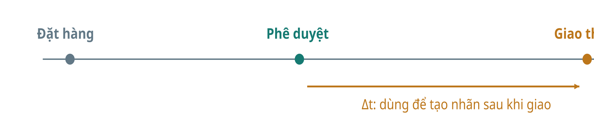
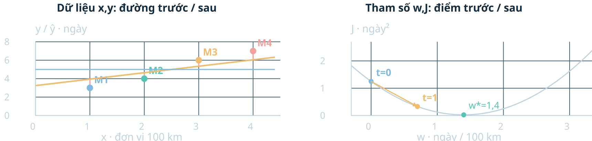
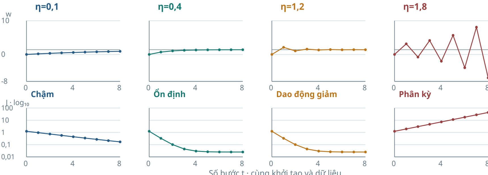
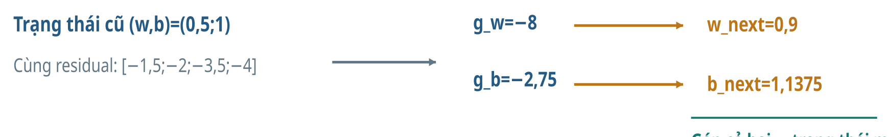

> Bản đọc trực tiếp trên GitHub, chuyển từ đầy đủ tài liệu HTML v4. [Tải bản HTML có bố cục và công thức LaTeX](Tai_lieu_doc_truoc/Bai04_Kien_thuc_nen_tang_va_doc_truoc_v4.html); mở bản HTML sau khi tải và giải nén toàn bộ repository. [Hướng dẫn bài thực hành và slide](README.md).

# Bài 4 v4 · Kiến thức nền tảng và đọc trước

**PGS.TS. Nguyễn Văn Hậu** · Khoa Công nghệ Thông tin · Trường Đại học Công nghệ Kỹ thuật Hưng Yên.

Đọc trước 30–40 phút. Mục tiêu là nhận ra dữ kiện, ký hiệu và thứ tự một vòng học; chưa cần thuộc chứng minh. Dùng bài mô phỏng để tính tay, rồi dùng Olist để đọc thực nghiệm thật.

## 1. Mục tiêu và sản phẩm cần tạo

| Bạn cần làm được | Tự kiểm bằng |
| --- | --- |
| Tính một vòng GD | Bảng ŷ, e, g, tham số và J mới |
| Đọc learning rate | Giải thích hướng, độ dài và hội tụ |
| Cập nhật hai tham số | Hai gradient từ cùng trạng thái cũ |
| Đọc Olist | Baseline, test, đơn vị và giới hạn |

## 2. Bối cảnh và dữ liệu thật

Câu hỏi: tại lúc đơn hàng được phê duyệt, dự đoán bao nhiêu ngày tới lúc giao? Olist gồm các bảng đơn, mặt hàng, người bán, người mua và tọa độ vùng mã bưu chính. Một dòng học là một đơn đã tổng hợp. Khoảng cách là Haversine giữa tọa độ trung vị vùng, trung bình theo mặt hàng; chưa phải chiều dài đường vận chuyển.



```math
y=(t_{\mathrm{delivery}}-t_{\mathrm{approval}})/86400\quad\text{(ngày, khi chênh lệch tính bằng giây)}
```

| ID đầy đủ | Khoảng cách km | Nhãn ngày |
| --- | --- | --- |
| fc9bc4bac939adaa600ad59dee9a106f | 100.0280 | 1.8143 |
| 67f2f913bb16abed933504fb19d4ade4 | 399.9923 | 6.9119 |
| 7d09a3b11e55c5e586d952edc9e12e6b | 800.0179 | 14.7196 |
| 34445bc5a6255519c1d230b2231eeb63 | 1400.1055 | 11.5486 |

Chọn các đơn train gần 100, 400, 800, 1.400 km mà không đọc nhãn khi chọn. Thời điểm giao dùng tạo nhãn tương lai, không dùng làm đầu vào. Việc snapshot địa lý đã biết tại approval là giả định cần ghi nhận.

## 3. Kiến thức nền cần ôn

| Nền toán | Ví dụ trực tiếp |
| --- | --- |
| Trung bình | (3+4+6+7)/4=5 |
| Bình phương và dấu | (−2)²=4; tổng có dấu có thể triệt tiêu |
| Độ dốc / đạo hàm | J tăng theo w ở một vị trí → đạo hàm dương |
| Cập nhật bằng phép gán | Tính next trước, gán sau |
| Đơn vị | w ngày/100 km trong toy; w ngày/km trong Olist |

Không cần học đại số ma trận trước tuyến chính. Mở phần mở rộng sau khi đã tính được hai vòng.

## 4. Ký hiệu và quy ước

| Ký hiệu | Nghĩa |
| --- | --- |
| x,y,ŷ | Đầu vào, nhãn thật, dự đoán |
| b,w | Intercept và độ dốc; thứ tự cặp là (w,b) |
| e=ŷ−y | Residual dương: dự đoán dài hơn |
| n,m | Số mẫu train, số mẫu đánh giá |
| J=MSE/2 | Loss train, đơn vị ngày² |
| g,η,t | Gradient, learning rate, số vòng |
| z=x−2,5 | Toy chỉ căn giữa; giữ a=5 |
| u=(x−μtrain)/strain | Đầu vào chuẩn hóa; ddof=0 |

## 5. Từ mô hình và sai số tới mục tiêu học

```math
\hat y_i=b+wx_i,\quad e_i=\hat y_i-y_i,\quad J(w,b)=\frac1{2n}\sum_i e_i^2
```

Mô hình quy định dạng dự đoán. Loss cho biết cần làm nhỏ đại lượng nào. Gradient Descent học tham số bằng các vòng cập nhật. Batch GD dùng mọi mẫu train trong một vòng. Bình phương tránh triệt tiêu residual trái dấu; 1/2 giúp đạo hàm gọn và giữ nguyên nghiệm tối ưu.

```math
g_w=\frac1n\sum_i x_ie_i,\quad g_b=\frac1n\sum_i e_i,\quad w_{t+1}=w_t-\eta g_w,\quad b_{t+1}=b_t-\eta g_b
```

## 6. Ví dụ tính tay xuyên suốt

Bốn điểm MÔ PHỎNG: x=[1,2,3,4] theo 100 km; y=[3,4,6,7] ngày. Căn giữa z=x−2,5 và giữ a=5, học riêng w trong ŷ=5+wz. Với hồi quy bình phương không phạt và có intercept, mean(z)=0 cho intercept tối ưu a=mean(y)=5 ở mỗi w; đây là lý do có thể tách ví dụ một tham số.

| t | w | Gradient tại trạng thái | J ngày² |
| --- | --- | --- | --- |
| 0 | 0.000000 | -1.750000 | 1.25000000 |
| 1 | 0.700000 | -0.875000 | 0.33125000 |
| 2 | 1.050000 | -0.437500 | 0.10156250 |

```math
J(w)=0{,}625w^2-1{,}75w+1{,}25,\quad g(w)=1{,}25w-1{,}75
```

```math
w_1=0-0{,}4(-1{,}75)=0{,}7,\quad w_2=0{,}7-0{,}4(-0{,}875)=1{,}05
```



Ghi trạng thái cũ → tính ŷ, e → tính g → tính w mới → tính lại J. Khi w đổi, phải tính lại gradient. Khi quay về x gốc, b=5−2,5w nên không giữ b=5 trong hệ x.

## 7. Bước học, hội tụ và hai tham số

Gradient cho hướng biến thiên cục bộ; cập nhật dùng hướng ngược gradient. Độ dài bước là |ηg|, khác riêng η. η=1,2 đi 0→2,1→1,05 quanh đáy 1,4 nhưng độ lệch co lại. Vượt qua đáy chưa đủ kết luận phân kỳ. Chỉ trong toy này, 0<η<1,6 cho hội tụ; không dùng làm hằng số cho mọi dữ liệu.



Mở lại cả b,w trên x gốc: khởi tạo (0,5;1), gradient (−8;−2,75), η=0,05 cho (0,9;1,1375). Hai gradient phải dùng cùng residual cũ. Chuẩn hóa một đặc trưng có intercept không phạt đổi tọa độ mà không đổi lớp đường dự đoán; fit imputer và scaler bằng train, dùng lại cho các tập khác.



## 8. Case Olist và cách đọc báo cáo

| Tập | Thời gian approval | Số đơn | Nhãn biết trước |
| --- | --- | --- | --- |
| Train | 01–10/2017 | 29.031 | 01/11/2017 |
| Validation | 11–12/2017 | 10.389 | 01/01/2018 |
| Test | 01–06/2018 | 40.266 | Nhóm cuối cùng đã hoàn tất trong lịch sử |

Train fit median khoảng cách, mean và std. GD dùng η=0,1; 100 bước; tham số chuẩn hóa khởi tạo bằng 0. Baseline là mean(ytrain)≈11,4176 ngày. Cấu hình và test đã xuất hiện ở bản trước; đây là tái lập, không là phép thử mù mới.

| Test cùng 40.266 đơn | MAE ngày | RMSE ngày |
| --- | --- | --- |
| Baseline mean train | 6,8513 | 10,1675 |
| GD khoảng cách | 5,9396 | 9,3516 |

```math
\mathrm{MAE}=\frac1m\sum_i|e_i|,\qquad\mathrm{RMSE}=\sqrt{\frac1m\sum_i e_i^2}
```

GD gần nghiệm OLS xác nhận việc tối ưu cùng hàm, chưa chứng minh dự đoán tốt. MAE là trung bình, không là mức sai số tối đa từng đơn. Lọc đơn đã giao và nhãn trước cutoff có thể làm mẫu khác quần thể triển khai. Khoảng cách liên quan tới số ngày chưa chứng minh quan hệ nhân quả.

## 9. Tự kiểm trước giờ học

| Câu hỏi | Tự làm trước khi mở đáp án |
| --- | --- |
| e=[2,1,−1,−2], n=4: tính J | Ghi quy ước và đơn vị |
| w=0, g=−1,75, η=0,4: bước đầu? | Giải thích dấu của bước |
| Sau bước đầu, dùng lại gradient cũ được không? | Chỉ ra dữ kiện cần tính lại |
| Fit scaler riêng cho test có hợp lý? | Nói hệ tọa độ mô hình sẽ nhận |

**Đối chiếu**

J=1,25 ngày²; w mới=0,7 và bước dương. Phải tính lại residual/gradient tại w=0,7; g=−0,875. Dùng scaler train giữ cùng hệ tọa độ khi dự đoán test.

## 10. Thực hành, thuật ngữ và tài liệu

[Mở toàn bộ học liệu](Bat_dau_Bai04_v4.html) · [Notebook](Bai04_Thuc_hanh_v4.ipynb) · [Python](source/gd_lab.py) · [Quiz](Tai_lieu/Bai04_Quiz_v4.html).

| Thuật ngữ | Cách đọc |
| --- | --- |
| Residual | Độ lệch có dấu ŷ−y |
| Gradient | Các đạo hàm theo tham số tại trạng thái hiện tại |
| Learning rate | Hệ số η nhân gradient |
| Convergence | Quá trình tiến tới một giới hạn |
| Baseline | Mốc đơn giản so trên cùng tập |
| Leakage | Thông tin đánh giá/tương lai tham gia không đúng quy trình |
| OLS | Nghiệm bình phương tối thiểu; solver đối chiếu GD |

Nguồn: [Olist / Kaggle](https://www.kaggle.com/datasets/olistbr/brazilian-ecommerce); [Stanford CS229, hồi quy và GD](https://cs229.stanford.edu/notes_archive/cs229-notes-all/cs229-notes1.pdf); [Cornell CS6241, bước học](https://www.cs.cornell.edu/courses/cs6241/2021sp/lec/2021-02-18.pdf).
