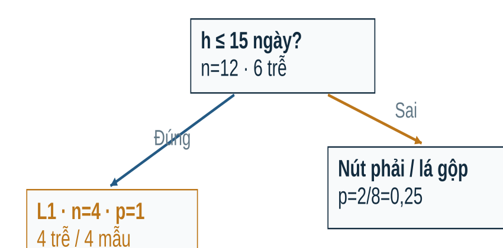
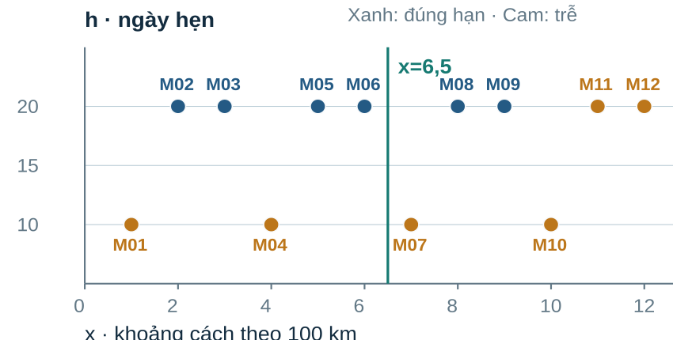
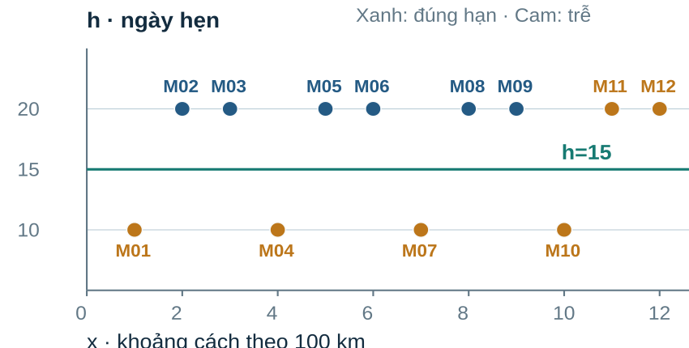
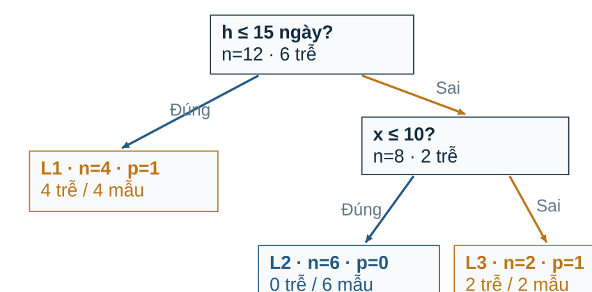

> Bản đọc trực tiếp trên GitHub, chuyển từ đầy đủ tài liệu HTML v4. [Tải bản HTML có bố cục và công thức LaTeX](Tai_lieu_doc_truoc/Bai06_Doc_truoc_v4.html); mở bản HTML sau khi tải và giải nén toàn bộ repository. [Hướng dẫn bài thực hành và slide](README.md).

# Bài 6 v4 · Kiến thức nền tảng và đọc trước

**PGS.TS. Nguyễn Văn Hậu** · Khoa Công nghệ Thông tin · Trường Đại học Công nghệ Kỹ thuật Hưng Yên.

🧭 **Mạch học:** dữ liệu tại nút → phép chia → cây → lá → điểm → ngưỡng → kiểm chứng. Đọc khoảng 35–45 phút trước buổi học; chưa cần biết đệ quy hoặc chứng minh tối ưu.

## 1. 🎯 Bài toán và điều cần làm được

Dự báo giao trễ tại lúc duyệt đơn. Sau bài học, tự tính được một phép chia, dựng cây nhỏ, truy một mẫu đến lá, giải thích độ phức tạp và đọc so sánh mô hình.

| Năng lực | Sản phẩm |
| --- | --- |
| Dựng cây | Số đếm, Gini, danh sách ngưỡng, cấu trúc |
| Dự đoán | Điều kiện đúng/sai và điểm tại lá |
| Kiểm chứng | Vai trò train/validation/test và lỗi hai chiều |

## 2. 🧩 Kiến thức cần nhớ từ bài trước

Tỉ lệ là số lượng một nhóm chia tổng số; trung bình có trọng số dùng trọng số cộng bằng 1. Phân biệt dữ liệu train, validation và test; biết đọc TP, FP, FN, TN. Hiểu điểm dự đoán và ngưỡng cảnh báo từ bài Logistic.

```math
\widehat y=\mathbf{1}\{\widehat p\geq\tau\}
```

## 3. 📖 Từ vựng và ký hiệu

| Khái niệm | Cách hiểu |
| --- | --- |
| Gốc | Nút nhận tất cả train |
| Nút trong | Kiểm điều kiện xⱼ≤c |
| Lá | Nút cuối, lưu phân bố nhãn train |
| nₜ / N | Số mẫu tại nút / toàn train |
| pₜ / G(t) | Tỉ lệ lớp trễ / mức pha trộn nhãn |
| Δₜ | Gini giảm tại nút sau chia |
| α / τ | Mức phạt lá / ngưỡng hành động |



## 4. 🗂️ Hai bộ dữ liệu, hai vai trò

Ví dụ 12 dòng là mô phỏng được thiết kế để tính tay. Olist/Kaggle là dữ liệu đơn hàng thật dùng đánh giá. Nhãn y=1 nếu ngày giao thực tế sau ngày hẹn theo ngày lịch; cùng ngày vẫn y=0.

| ID | x · 100 km | h · ngày | y |
| --- | --- | --- | --- |
| M01 | 1 | 10 | 1 |
| M02 | 2 | 20 | 0 |
| M03 | 3 | 20 | 0 |
| M04 | 4 | 10 | 1 |
| M05 | 5 | 20 | 0 |
| M06 | 6 | 20 | 0 |
| M07 | 7 | 10 | 1 |
| M08 | 8 | 20 | 0 |
| M09 | 9 | 20 | 0 |
| M10 | 10 | 10 | 1 |
| M11 | 11 | 20 | 1 |
| M12 | 12 | 20 | 1 |

Quy tắc tạo toy: y=1 nếu h=10 hoặc x≥11. Không dùng quy tắc thiết kế này như kết luận nhân quả về giao hàng.

| Tập Olist | Đơn | Trễ |
| --- | --- | --- |
| train | 29031 | 941 |
| validation | 10389 | 634 |
| test | 40266 | 3478 |

Sáu đặc trưng: km địa lý, số ngày hẹn thập phân, tổng giá BRL, tổng cước BRL, số dòng hàng, tổng gram. Khối lượng chưa biết giữ NaN; median 850 g học từ train điền 16 giá trị thiếu. Metadata tĩnh có giả định sẵn có ở mốc dự đoán; cohort chỉ gồm đơn hoàn tất đủ điều kiện.

## 5. 👀 Trực giác về phép chia

Thuần nghĩa là một nút gần như toàn một lớp. Chia đều số mẫu chưa chắc tách nhãn tốt. Quan sát hai đường cắt cùng dữ liệu rồi đếm số đúng hạn/trễ ở mỗi bên trước khi tính.





## 6. 🧮 Công thức và một phép tính đầy đủ

```math
G(t)=1-\sum_k p_{t,k}^2=2p_t(1-p_t)\quad\text{(hai lop)}
```

Gini hai lớp nằm trong [0;0,5]. Nút toàn một lớp có G=0; nút chia đều hai lớp có G=0,5. Gini không phải trực tiếp tỉ lệ dự đoán sai.

```math
G_{sau}=\frac{n_L}{n_t}G(L)+\frac{n_R}{n_t}G(R),\qquad\Delta_t=G(t)-G_{sau}
```

| Phép chia h≤15 | Số mẫu | Trễ | Gini | Trọng số |
| --- | --- | --- | --- | --- |
| Gốc | 12 | 6 | 1/2 | 1 |
| Trái | 4 | 4 | 0 | 4/12 |
| Phải | 8 | 2 | 3/8 | 8/12 |

```math
G_{sau}=\frac4{12}0+\frac8{12}\frac38=\frac14,\qquad\Delta=\frac12-\frac14=\frac14
```

Ở nút phải, chia x≤10 tạo hai lá thuần: gain tại nút=3/8, nhưng đóng góp trên toàn train=(8/12)×(3/8)=1/4. Mẫu số phải đi cùng phạm vi đo.

## 7. ⚙️ CART dựng cây và dự đoán

Tại một nút: kiểm dừng; sắp giá trị phân biệt của từng đặc trưng; thử trung điểm giữa hai giá trị kề nhau; loại phép chia không hợp lệ; tính gain; chọn lớn nhất; chia dữ liệu rồi lặp trên từng tập con. Chọn tham lam tại nút chưa bảo đảm cây tối ưu toàn cục.

```math
c_i=(v_i+v_{i+1})/2,\quad v_i<v_{i+1}
```



Tại gốc có 12 ứng viên, chọn h≤15. Nút phải chỉ còn tám mẫu có h=20, nên chỉ x còn chia được. Chọn x≤10 và tạo cây 3 lá. Dự đoán M11: h>15, x>10, tới lá p=1 và cảnh báo ở τ=0,5.

```math
\widehat p_\ell=n_{\ell,tre}/n_\ell
```

Cây không trọng số dùng tần suất train ở lá. Điểm lá rời rạc và chưa bảo đảm hiệu chỉnh xác suất tương lai. Với p=0,5, predict của sklearn và quy tắc p≥τ có thể khác khi hòa.

## 8. 🌿 Độ phức tạp và kiểm chứng

Độ sâu đếm số cạnh từ gốc. max_depth, min_samples_split và min_samples_leaf có vai trò khác nhau. Cây sâu có thể học cả nhiễu; so train và validation trên cùng split để chọn độ phức tạp.

```math
R(T)=\sum_\ell\frac{n_\ell}{N}G(\ell),\qquad R_\alpha(T)=R(T)+\alpha L
```

| Toy | 3 lá | 2 lá | 1 lá |
| --- | --- | --- | --- |
| R | 0 | 1/4 | 1/2 |
| Rα, α=0,1 | 0,30 | 0,45 | 0,60 |
| Rα, α=0,25 | 0,75 | 0,75 | 0,75 |
| Rα, α=0,3 | 0,90 | 0,85 | 0,80 |

Đường cắt tỉa thực có alpha=[0;0,25] và R=[0;0,5], có thể đi thẳng 3→1 lá. Case thật chọn trong depth 3/6 theo AP validation; min_leaf=200, alpha=0. Ngưỡng cảnh báo chọn trên validation bằng K=FP+5FN với cùng lưới và phương án không cảnh báo như bài 5.

| Test lịch sử | Logistic | Cây |
| --- | --- | --- |
| Recall | 0,046 | 0,124 |
| AP | 0,159 | 0,134 |
| K | 16944 | 17368 |

Cây sửa 369 lỗi nhưng tạo 1.877 lỗi mới so Logistic trên toàn cohort. Đọc cả hai chiều; các điểm chi phí là giả định, không là tiền. Test đã xem ở các phiên bản trước; kết quả này thuộc tái lập lịch sử. Importance và luật dự đoán chưa chứng minh nhân quả.

## 9. ❓ Tự kiểm bằng quiz

**Lá có 8 mẫu, 2 mẫu trễ; chính sách cảnh báo khi p≥0,2. Kết quả nào đúng?**

| Lựa chọn |
| --- |
| A. p=0,25; cảnh báo |
| B. p=0,25; không cảnh báo |
| C. p=2,5; cảnh báo |
| D. Mọi đơn mới ở lá chắc chắn giao trễ |

**Đáp án A**

A tính đúng 2/8 và so đúng ngưỡng.<br>B nhầm so sánh với ngưỡng 0,2.<br>C dùng sai phép tính tỉ lệ.<br>D biến tần suất train thành sự chắc chắn về tương lai.

**Nút gồm 3 mẫu đúng hạn và 3 mẫu trễ. Gini nhị phân là bao nhiêu?**

| Lựa chọn |
| --- |
| A. 0 |
| B. 0,5 |
| C. 1 |
| D. 3 |

**Đáp án B**

A là nút thuần, không đúng ở đây.<br>B: 1−(3/6)²−(3/6)²=0,5.<br>C vượt mức cực đại Gini hai lớp.<br>D nhầm số mẫu một lớp với tạp chất.

**Sau h≤15, trái có 4 mẫu trễ thuần; phải có 8 mẫu gồm 2 trễ và 6 đúng hạn. Gini sau chia có trọng số là?**

| Lựa chọn |
| --- |
| A. 0 |
| B. 3/8 |
| C. 1/4 |
| D. 1/2 |

**Đáp án C**

A chỉ nhìn nút trái.<br>B là Gini nút phải, chưa nhân trọng số.<br>C: (4/12)×0+(8/12)×(3/8)=1/4.<br>D là Gini gốc, chưa tính sau chia.

**Nút đang xét có 8/12 mẫu train; gain tại nút là 0,375. Cặp (gain tại nút; đóng góp toàn cây) nào đúng?**

| Lựa chọn |
| --- |
| A. (0,25;0,375) |
| B. (0,375;0,25) |
| C. (0,375;0,375) |
| D. (0;0,25) |

**Đáp án B**

A đảo hai phạm vi chuẩn hóa.<br>B: (8/12)×0,375=0,25.<br>C quên trọng số nₜ/N.<br>D nhầm Gini hai lá mới bằng 0 với gain bằng 0.

**Các cây 3/2/1 lá có R lần lượt 0;0,25;0,5. Với α=0,3, phương án nào có mục tiêu cắt tỉa nhỏ nhất?**

| Lựa chọn |
| --- |
| A. Cây 3 lá, mục tiêu=0,90 |
| B. Cây 2 lá, mục tiêu=0,85 |
| C. Cây 1 lá, mục tiêu=0,80 |
| D. Cả ba bằng nhau |

**Đáp án C**

A đúng giá trị nhưng chưa nhỏ nhất.<br>B đúng giá trị nhưng chưa nhỏ nhất.<br>C có giá trị 0,5+0,3×1=0,8 nhỏ nhất.<br>D chỉ hòa trong ví dụ này khi α=0,25.

**Quy trình nào đúng với kế hoạch thí nghiệm của bài?**

| Lựa chọn |
| --- |
| A. Chọn depth và τ theo test rồi báo cáo test |
| B. Học trên train; chọn cấu trúc/τ trên validation; khóa trước báo cáo test |
| C. Điền median theo toàn bộ dữ liệu trước chia |
| D. Dùng ngày giao thực tế làm đầu vào lúc duyệt đơn |

**Đáp án B**

A dùng tập báo cáo để chọn cấu hình.<br>B đúng vai trò các tập; test hiện có phải ghi là lịch sử đã xem.<br>C dùng thông tin ngoài train để fit imputer.<br>D dùng thông tin chưa có tại mốc dự đoán.

**Trong một tình huống giả định, cây có recall cao hơn, AP thấp hơn và K=FP+5FN lớn hơn Logistic. Kết luận nào có cơ sở?**

| Lựa chọn |
| --- |
| A. Cây tốt hơn mọi mặt vì recall cao |
| B. Cây chứng minh khoảng cách gây giao trễ |
| C. Không cần đọc FP vì cây dễ giải thích |
| D. Có đánh đổi; phải kết luận theo mục tiêu và chỉ số đã khai báo |

**Đáp án D**

A bỏ qua xếp hạng và chi phí.<br>B nhầm luật dự đoán với quan hệ nhân quả.<br>C tính dễ đọc không loại bỏ cảnh báo sai.<br>D xem đủ các mặt và nêu phạm vi kết luận.

## 10. ✅ Sản phẩm chuẩn bị và thực hành

Trước buổi học: tự tính Gini gốc, phép chia h≤15 và đường đi M11. Trong buổi: trả lời quiz và hoạt động ở slide 62. Sau buổi: chạy 10 ô notebook, đổi depth/min_leaf trên train–validation, đọc lỗi hai chiều; không dùng test để chọn lại cấu hình.

| Tự kiểm | Đã làm được? |
| --- | --- |
| Đếm đúng các dòng tới nút | □ |
| Viết đúng mẫu số tại nút và toàn train | □ |
| Sinh được trung điểm và chọn gain | □ |
| Cây, luật, vùng và đường đi khớp nhau | □ |
| Phân biệt α với τ; train với validation/test | □ |

[Notebook](Bai06_Thuc_hanh_v4.ipynb) · [Python đầy đủ](source/tree_lab.py) · [Trang Bắt đầu](Bat_dau_Bai06_v4.html)
