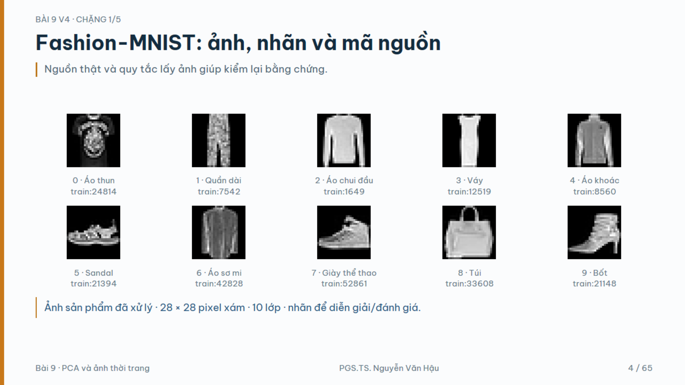
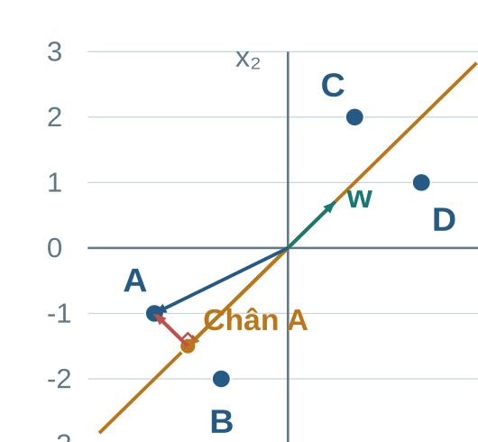
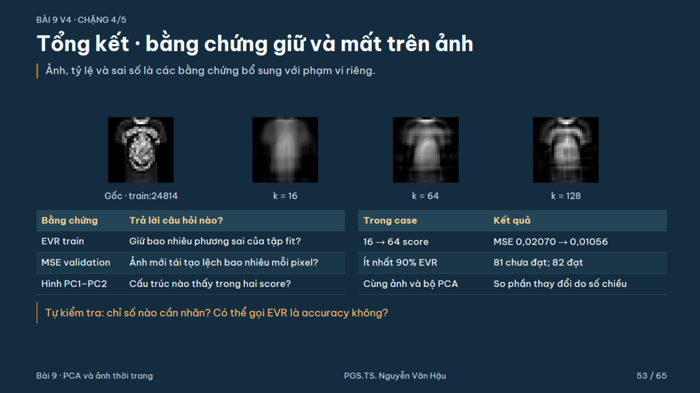

> Bản đọc trực tiếp trên GitHub, chuyển từ đầy đủ tài liệu HTML v4. [Tải bản HTML có bố cục và công thức LaTeX](Tai_lieu_doc_truoc/Bai09_Doc_truoc_v4.html); mở bản HTML sau khi tải và giải nén toàn bộ repository. [Hướng dẫn bài thực hành và slide](README.md).

# Bài 9 v4 · Kiến thức nền và đọc trước

**PGS.TS. Nguyễn Văn Hậu** · Khoa Công nghệ Thông tin · Trường Đại học Công nghệ Kỹ thuật Hưng Yên.

🧭 **Mạch học:** ảnh thật → vector → căn giữa → phép chiếu → chọn hướng PCA → giữ và mất → chọn số chiều theo mục đích. Đọc 35–45 phút; chuẩn bị trung bình, tích vô hướng và bình phương độ dài.

## 1. 🎯 Bài toán và mục tiêu

Một ảnh 28×28 cần 784 giá trị độ sáng. Có thể biểu diễn ảnh bằng ít tọa độ hơn, nhưng phải biết phần nào giữ lại, phần nào mất và ảnh hưởng tới nhiệm vụ sử dụng. Sau bài học, em tính được một score, tái tạo một điểm, giải thích hướng PCA và chọn bằng chứng phù hợp với mục đích.

| Năng lực | Sản phẩm |
| --- | --- |
| Dữ liệu | ID nguồn, vai trò train/validation, vị trí pixel |
| Phép chiếu | Score, chân chiếu, phần dư và tái tạo |
| PCA | Tiêu chí phương sai với hướng đơn vị |
| Quyết định | Một mục đích, hai bằng chứng và một giới hạn |

## 2. 🧩 Kiến thức nền cần nhớ

Vector là một bộ tọa độ. Tích vô hướng nhân các tọa độ tương ứng rồi cộng. Độ dài bình phương cộng bình phương từng tọa độ. Hai vector vuông góc khi tích vô hướng bằng 0. Trung bình của vector lấy trung bình theo từng cột.

```math
\mathbf a^\top\mathbf b=a_1b_1+a_2b_2,\qquad\|\mathbf a\|^2=a_1^2+a_2^2
```

Ví dụ a=(−2;−1), b=(1;1)/√2: aᵀb=−3/√2. Độ dài b bằng 1. Score âm cho biết vị trí theo chiều ngược b, không phải một độ dài âm.

## 3. 📖 Thuật ngữ và ký hiệu

| Ký hiệu | Ý nghĩa và kích thước |
| --- | --- |
| x / μ / x_c | Vector quan sát / tâm train / x−μ, đều d tọa độ |
| w | Một hướng đơn vị, d tọa độ |
| W_k | d×k; các hướng nằm ở cột, trực chuẩn |
| z | k score; vị trí trong hệ tọa độ mới |
| x̂ / r | Điểm tái tạo / phần dư x−x̂, vẫn d tọa độ |
| X / Z | n×d dữ liệu theo hàng / n×k score |
| λ / EVR | Phương sai theo hướng / tỷ lệ phương sai cộng dồn |
| fit / transform | Học tham số / dùng tham số đã học |

Trong sklearn, components_ có các hướng ở hàng nên bằng W_kᵀ. Chữ k ở PCA là số tọa độ giữ, khác K số cụm ở K-means.

## 4. 🗂️ Dữ liệu thật và quy trình

Fashion-MNIST do Zalando công bố: 60.000 ảnh train, 10.000 ảnh test, 10 lớp trang phục, ảnh xám 28×28. Case lấy phân tầng seed = 42: 12.000 train, 3.000 validation và để riêng 45.000 ảnh train chưa dùng. Test chính thức không dùng chọn k hay báo cáo metric ở Bài 9; Bài 10 v3 đã từng đánh giá test, nên giữ đúng lịch sử toàn khóa.



**

Ảnh train:24814 thuộc validation trong case. ID gọi tên nguồn, không gọi tên vai trò trong thí nghiệm. Pixel hàng 12/cột 12 bằng 203, theo chỉ số bắt đầu từ 0. Trải phẳng dùng j=28r+c, rồi chia 255; chưa giảm chiều.

```math
x_{ij}=\operatorname{pixel}_{ij}/255,\qquad\boldsymbol\mu=\frac1n\sum_i\mathbf x_i
```

PCA học tâm và hướng từ train. Validation dùng lại tâm và hướng ấy. Không z-score từng pixel và không whiten trong case chính.

## 5. 👀 Trực giác về phép chiếu

Bốn điểm mô phỏng có tâm (5;5). Căn giữa dời tâm về gốc, giữ quan hệ giữa các điểm. Chọn một đường qua gốc với hướng đơn vị w. Mỗi điểm có một chân chiếu trên đường; score là một số có dấu xác định vị trí chân chiếu.

| Điểm | x | x_c |
| --- | --- | --- |
| A | (3;4) | (−2;−1) |
| B | (4;3) | (−1;−2) |
| C | (6;7) | (1;2) |
| D | (7;6) | (2;1) |



Phần dư nối chân chiếu tới điểm và vuông góc với hướng. Score là một số; vector chiếu và điểm tái tạo vẫn có hai tọa độ. A và B cùng score nhưng khác phần dư, nên giảm chiều có thể làm mất khả năng phân biệt hai điểm.

## 6. 🧮 Một phép tính đầy đủ

```math
\mathbf w=(1,1)^\top/\sqrt2,\quad z_A=\mathbf w^\top(\mathbf x_A-\boldsymbol\mu)=-3/\sqrt2
```

```math
\mathbf x_{c,A}^{\parallel}=z_A\mathbf w=(-1.5,-1.5)^\top
```

```math
\widehat{\mathbf x}_A=\boldsymbol\mu+z_A\mathbf w=(3.5,3.5)^\top
```

```math
\mathbf r_A=(-0.5,0.5)^\top,\quad\mathbf w^\top\mathbf r_A=0,\quad\|\mathbf r_A\|^2=0.5
```

Muốn tìm chân chiếu gần nhất, tối thiểu hóa ||x_c−tw||². Khai triển với ||w||²=1 cho một bình phương (t−wᵀx_c)² cộng hạng không phụ thuộc t. Vì vậy t=wᵀx_c. Nếu w không đơn vị, cần chia thêm wᵀw.

## 7. ⚙️ PCA chọn hướng và học tham số

So nhiều hướng có độ dài 1 và chọn hướng có phương sai score lớn nhất. Nếu không cố định độ dài, kéo w dài gấp 10 sẽ làm phương sai tăng 100 lần mà đường không đổi. Với toy, covariance theo 1/n là C bên dưới.

```math
C=\begin{bmatrix}2.5&2\\2&2.5\end{bmatrix},\quad C\mathbf w_1=4.5\mathbf w_1,\quad C\mathbf w_2=0.5\mathbf w_2
```

Hai hướng (1;1)/√2 và (1;−1)/√2 vuông góc. Mọi hướng đơn vị αw₁+βw₂ có α²+β²=1, phương sai 4,5α²+0,5β²≤4,5. Hướng đầu giữ biến thiên lớn nhất. Giữ cả hai hướng chỉ đổi hệ tọa độ; bỏ một hướng mới giảm chiều.

```math
\operatorname{EVR}(k)=\frac{\sum_{j=1}^{k}\lambda_j}{\sum_{j=1}^{d}\lambda_j}
```

Toy giữ PC1 đạt 90% EVR. sklearn dùng 1/(n−1), nên trị riêng toy là 6 và 2/3 nhưng EVR vẫn 90%/10%. Sai số bình quân mỗi điểm là 0,5; MSE mỗi tọa độ là 0,25. Không trộn hai mẫu số.


```math
\mathbf z=W_k^\top(\mathbf x-\boldsymbol\mu),\quad\widehat{\mathbf x}=\boldsymbol\mu+W_k\mathbf z
```

## 8. 📊 Bằng chứng trên ảnh và giới hạn

| k | EVR train | MSE validation/pixel |
| --- | --- | --- |
| 2 | 46.83% | 0.04662 |
| 16 | 76.59% | 0.0207 |
| 64 | 88.24% | 0.01056 |
| 128 | 92.93% | 0.0065 |

81 hướng giữ 89,9272%; 82 giữ 90,0122%, nên k nhỏ nhất đạt 90% là 82 trong case này. MSE tính trước clip; ảnh hiển thị clip [0,1]. 64/784≈8,16% số tọa độ, chưa phải tỷ lệ byte nén. Hình PC1–PC2 chỉ giữ hai score, không tự tạo cụm và không chứng minh mọi lớp không thể phân loại.



**

Logistic Regression cùng C=1, newton-cg, max_iter=200: pixel đúng 2500/3000; PCA 64 đúng 2511/3000. Chênh lệch 11 ảnh gồm 145 lỗi được sửa và 134 lỗi mới. Một lần chia chưa chứng minh PCA luôn giúp phân loại. Phản ví dụ nhãn theo PC2 của toy cho thấy chiều ít phương sai vẫn có thể quyết định nhãn. Thang đo, ngoại lệ và cấu trúc cong cần được xét theo dữ liệu.

## 9. ❓ Quiz tự kiểm

**Đã fit PCA bằng train. Với ảnh validation, thao tác nào đúng?**

| Phương án | Nội dung |
| --- | --- |
| A | Dùng lại tâm và hướng học từ train. |
| B | Fit PCA riêng trên validation. |
| C | Dùng nhãn validation để học hướng PCA. |
| D | Gộp train và validation để fit lại. |

**Đáp án và giải thích**

**A**<br>A đúng: biến đổi validation bằng đúng tham số của pipeline train.<br>B sai: thay hệ tọa độ và học thống kê từ tập đánh giá.<br>C sai: PCA trong bài không học hướng từ nhãn.<br>D sai: validation đã tham gia học tham số, không còn đúng quy trình đã chốt.

**Giảm từ 2 chiều xuống 1 chiều. Đối tượng nào chỉ còn một số?**

| Phương án | Nội dung |
| --- | --- |
| A | Vector hướng w. |
| B | Điểm tái tạo trong hệ gốc. |
| C | Score z của một điểm. |
| D | Tâm μ của dữ liệu. |

**Đáp án và giải thích**

**C**<br>A sai: hướng vẫn có hai thành phần để xác định đường trong mặt phẳng.<br>B sai: điểm tái tạo vẫn có hai tọa độ trong hệ gốc.<br>C đúng: biểu diễn rút gọn lưu một vị trí có dấu trên trục mới.<br>D sai: tâm vẫn có hai thành phần trong ví dụ.

**Vì sao cần hướng có độ dài 1 khi so phương sai score?**

| Phương án | Nội dung |
| --- | --- |
| A | Để score của mọi điểm đều dương. |
| B | Để phương sai của score bằng 1. |
| C | Để mọi điểm gốc nằm trên đường chiếu. |
| D | Để kéo dài vector hướng không làm tăng phương sai giả tạo. |

**Đáp án và giải thích**

**D**<br>A sai: dấu score phụ thuộc phía của chân chiếu so với chiều dương.<br>B sai: phương sai còn phụ thuộc dữ liệu và hướng đã chọn.<br>C sai: phần dư của điểm có thể khác 0.<br>D đúng: vector dài gấp 10 làm score gấp 10 và phương sai gấp 100 trên cùng một đường.

**EVR đạt 90% trên train cho phép kết luận điều gì?**

| Phương án | Nội dung |
| --- | --- |
| A | Giữ 90% tổng phương sai của dữ liệu đã fit. |
| B | Phân loại đúng 90% ảnh validation. |
| C | Mỗi ảnh tái tạo giống ảnh gốc 90%. |
| D | Giữ đúng 90% thông tin về nhãn. |

**Đáp án và giải thích**

**A**<br>A đúng: mẫu số là tổng phương sai trên tập fit trong biểu diễn đã chọn.<br>B sai: cần bộ phân loại, nhãn thật và dữ liệu đánh giá để đo accuracy.<br>C sai: EVR là tổng hợp theo phương sai, không đo mức giống của từng ảnh.<br>D sai: nhãn không tham gia tiêu chí phương sai của PCA.

**Hai ảnh gần nhau trên PC1–PC2. Kết luận nào được hỗ trợ?**

| Phương án | Nội dung |
| --- | --- |
| A | Chúng chắc chắn gần nhau trong đủ 784 tọa độ. |
| B | Chúng gần trong hai score đã giữ; cần thêm bằng chứng cho kết luận khác. |
| C | Chúng chắc chắn thuộc cùng lớp trang phục. |
| D | PCA đã gán chúng vào cùng cụm. |

**Đáp án và giải thích**

**B**<br>A sai: hai ảnh có thể khác nhiều theo những hướng bị bỏ.<br>B đúng: hình chỉ thể hiện hai tọa độ đã chọn và cần nêu phạm vi.<br>C sai: nhãn có thể khác dù hai score gần nhau.<br>D sai: PCA tạo tọa độ, không tự gán cụm.

**Kết luận nào phù hợp với thí nghiệm vừa học?**

| Phương án | Nội dung |
| --- | --- |
| A | PCA luôn làm bộ phân loại chính xác hơn. |
| B | Đạt EVR 90% là đủ cho mọi mục đích. |
| C | Chọn và đánh giá số chiều theo nhiệm vụ cụ thể. |
| D | Hai lớp chồng lấp ở 2D thì không thể phân loại ở chiều cao. |

**Đáp án và giải thích**

**C**<br>A sai: kết quả phụ thuộc dữ liệu, tiền xử lý, số chiều và bộ phân loại.<br>B sai: phương sai, tái tạo và dự đoán có tiêu chí khác nhau.<br>C đúng: mục đích quyết định bằng chứng cần thu và chỉ số cần đọc.<br>D sai: những chiều chưa vẽ vẫn có thể chứa thông tin phân biệt.

## 10. ✅ Chuẩn bị và thực hành

Trước buổi: tính B theo hướng đã cho, phân biệt score và vector chiếu. Trong buổi: theo cùng ID và tọa độ, giải thích từng quiz. Sau buổi: chạy notebook từ đầu, đối chiếu số liệu, thử thay từng số chiều với cùng quy trình.

| Tự kiểm | Đã làm được? |
| --- | --- |
| Giữ tâm và hướng train cho validation | □ |
| Tính score, phần dư và tái tạo | □ |
| Giải thích điều kiện hướng đơn vị | □ |
| Phân biệt EVR, MSE và accuracy | □ |
| Nêu mục đích, hai bằng chứng và một giới hạn | □ |

[Notebook](Bai09_Thuc_hanh_v4.ipynb) · [Python đầy đủ](source/pca_lab.py) · [Trang bắt đầu](Bat_dau_Bai09_v4.html)
